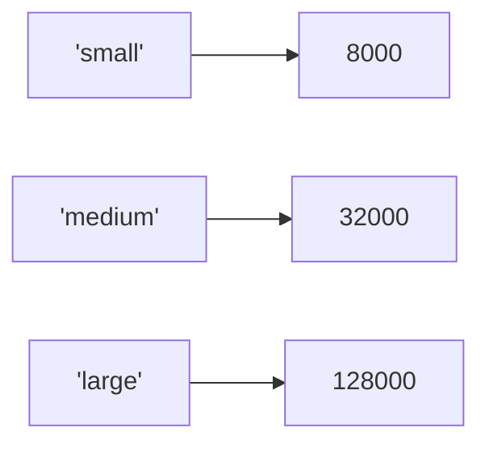
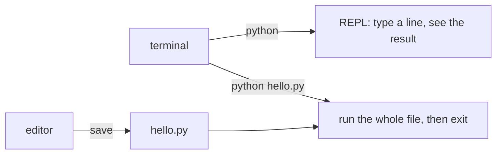
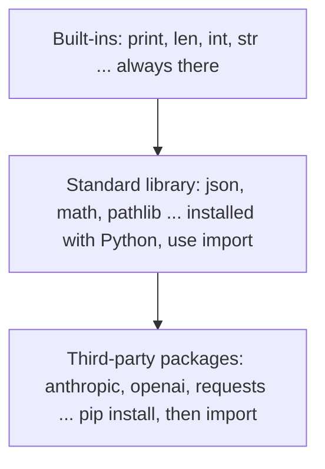
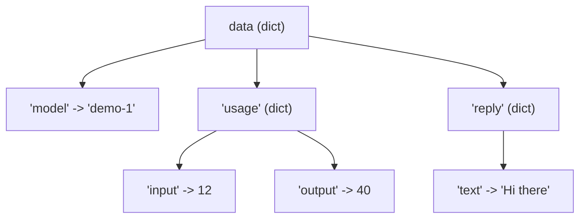
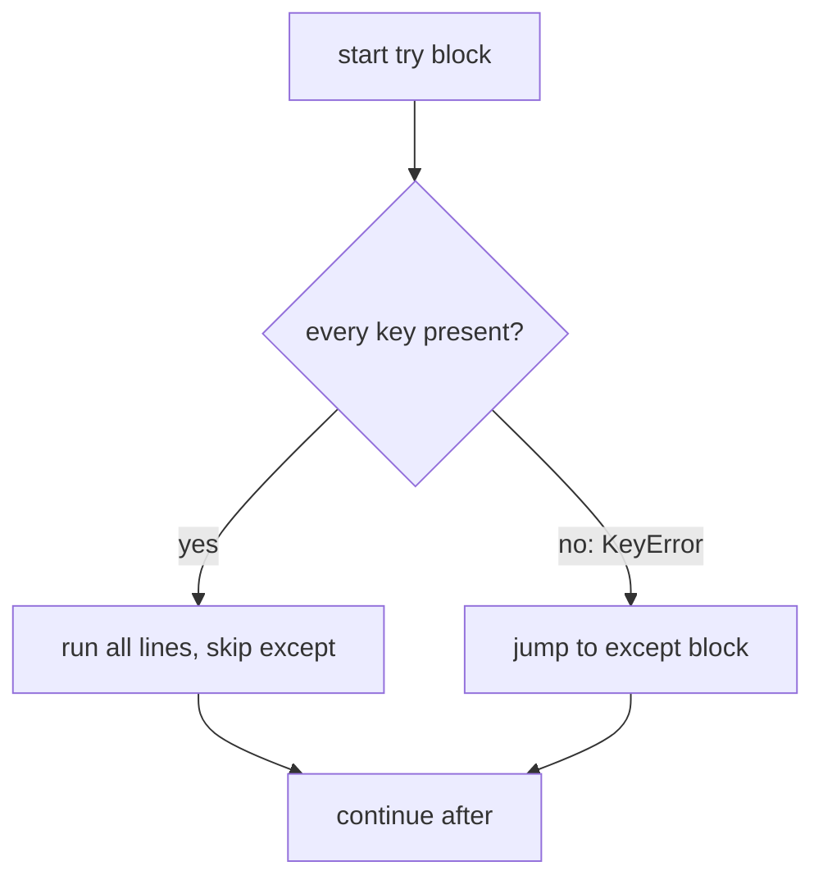

# Introduction

This chapter shows what a Python program looks like, how to install Python, and
how to run code in two ways: typed line by line, or saved in a file. It ends with
a realistic script that reads JSON, the data format almost every AI API speaks.
You do not need to understand every line yet. You need to see the shape of the thing.

## Mysteries

A knitting pattern and a cooking recipe both look like nonsense to an outsider.
Yet both are *little languages*: short vocabularies, strict rules, steps in order.
A program is the same kind of thing, written for a computer. The table maps the parts
of a recipe to the parts of a Python program.

| **Feature** | **In a recipe** | **In Python** |
|---|---|---|
| Vocabulary | “fold”, “sift”, abbreviations | keywords and names: `for`, `print` |
| Syntax | what may be written, and where | the grammar rules of the language |
| Sequence | steps run top to bottom | statements run top to bottom |
| Loop | “repeat for each ball” | `for` and `while` |
| Call another recipe | “see the dough recipe” | a **function** call |
| Assumed context | you know what an oven is | the standard library, the OS |
| Data | flour, potatoes | values: numbers, text, lists |
| Tools | bowl, pan | the interpreter, an editor, a terminal |
| Result | dinner | output, a file, a changed value |

> [!info] Key idea: programming is learnable
> Programming is mostly learning a small vocabulary and a few rules. Python keeps both
> small, which is one reason it dominates data science and AI work.

## Little Python Programs

Python is a general-purpose language created by Guido van Rossum in 1991. It is
designed to be easy to read, it runs tiny scripts and huge systems, and it is the main
language of modern machine learning. Three small programs show most of its flavor.

### A loop

```python
# file: loop1.py
for step in 3, 2, 1, "go":
    print(step)
```

```text
3
2
1
go
```

`for` takes each value in turn, puts it in the name `step`, and runs the
indented line. Notice that the values are mixed: numbers and text. Python does not mind.

### A list: values by position

A **list** keeps values in order inside square brackets. You reach one by its
**offset**: the distance from the start. The first item is at offset 0.

```python
models = ["haiku", "sonnet", "opus"]
print(models[1])
```

```text
  offset:     0         1          2
           +---------+----------+--------+
  models = | "haiku" | "sonnet" | "opus" |
           +---------+----------+--------+
  offset:    -3        -2         -1
```

The output of the program above is `sonnet`: offset 1 is the *second* item.
Think in offsets, not positions.

### A dictionary: values by name

A **dictionary** stores *key*: *value* pairs in curly braces. You look a
value up by its key instead of by a number.

```python
context_limit = {"small": 8_000, "medium": 32_000, "large": 128_000}
size = "medium"
print(size, "allows", context_limit[size], "tokens")
```

(The numbers are invented for the demo.) Output: `medium allows 32000 tokens`.



> [!example] Type check: square brackets do three different jobs
>
> | **You write** | **What it is** | **You get** |
> |---|---|---|
> | `["a", "b"]` | list literal | a `list` |
> | `models[1]` | subscript with an int offset | one item from the list |
> | `context_limit["small"]` | subscript with a key | one value from the dict |
>
>  
> Using the wrong thing fails loudly:
> ```python
> >>> models = ["haiku", "sonnet", "opus"]
> >>> models[3]
> Traceback (most recent call last):
>   ...
> IndexError: list index out of range
> >>> {"small": 8_000}["tiny"]
> Traceback (most recent call last):
>   ...
> KeyError: 'tiny'
> ```
>

## Setup

To write Python you need two tools: a **terminal** (a window where you type
commands) and a **text editor** (plain text, not a word processor). Windows,
macOS and Linux all have both. IDEs such as VS Code bundle them; they come in a
later chapter.

> [!warning] Trap
> Never write code in Word or similar. They swap straight quotes for curly ones
> and add formatting. Python then fails with a confusing `SyntaxError`. Use a code editor.

### Install Python

Download the latest release from `python.org` (Downloads, then your platform)
and follow the installer. On Windows, tick the option that adds Python to `PATH`.
The computer may already have an old Python; install a current one anyway.

### Upgrade Python

Versions are numbered **x.y.z**: a major number, a minor number, a bug-fix number.
Python 3 has been the major version for years and no Python 4 is planned. A new
minor version (3.12, 3.13, …) arrives about once a year. Check yours:

```text
$ python -V
Python 3.12.10
```

On Windows the launcher may be `py -V`. This series uses Python 3.12. Newer minor
versions add features; code written for 3.12 normally runs on later ones.

### Run Python programs



**Interactive interpreter.** Type `python` alone. You get a prompt
`>>>`. Type one line of Python, press Enter, see the result at once. This is the
fastest way to test an idea.

**A file.** Save code in a file ending in `.py`, then run
`python hello.py`. Use files for anything longer than a few lines.

One difference surprises beginners. The interpreter *echoes* the value of an
expression. A file does not. In a file you must call `print()`.

```python
>>> 6 * 7
42
>>> print(6 * 7)
42
>>> "hi"
'hi'
>>> print("hi")
hi
```

Note the quotes: the echo shows the value with quotes (a *representation*),
while `print()` shows the text for humans.

> [!example] Type check: `print()` returns nothing
> `print()` displays text and returns `None`. If you write
> `x = print("hi")`, then `x` is `None`, not the text. Use `print`
> to show, not to produce a value.

## Built-In Python Features

Where does code come from? Three layers, each wider than the last.



| **Layer** | **How you get it** | **Example** |
|---|---|---|
| Built-ins | nothing to do | `len("abc")` |
| Standard library | `import name` | `import math` |
| Third-party packages | `pip install name`, then import | `import anthropic` |

```python
>>> import math
>>> math.sqrt(16)
4.0
>>> from json import dumps
>>> dumps({"ok": True})
'{"ok": true}'
```

Installing third-party packages is done in a terminal, ideally inside a virtual
environment (a private folder of packages per project):

```text
$ pip install anthropic
```

(`anthropic` is a third-party package; it is not needed to read this chapter.)

> [!tip] Rule
> One virtual environment per project. Never install project packages into the
> system Python. It keeps versions from clashing.

## A Bigger Example

Here is a short script that does real work: it takes the JSON text an AI API might
send back, turns it into Python data, and pulls out two facts. It uses an import, a
multi-line string, a function call, nested lookups, an f-string and error handling.
(The JSON is canned, so the script runs offline.)

```python
# file: reply.py
import json

raw = """{
  "model": "demo-1",
  "usage": {"input": 12, "output": 40},
  "reply": {"text": "Hi there"}
}"""

data = json.loads(raw)
try:
    text = data["reply"]["text"]
    total = data["usage"]["input"] + data["usage"]["output"]
    print(f"{data['model']} said {text!r} using {total} tokens")
except KeyError as err:
    print("missing key:", err)
```

```text
demo-1 said 'Hi there' using 52 tokens
```

What each part does:

1. `import json`: make the standard-library JSON module available.
1. The triple-quoted string `raw` holds JSON *text*. It is a `str`.
1. `json.loads(raw)` parses text into Python data. Here you get a `dict`.
1. `try:` run the indented block. If a key is missing, jump to `except`.
1. `data["reply"]["text"]` follows two layers of dictionaries.
1. The f-string `f"..."` inserts values inside curly braces.
1. `except KeyError as err` runs only if a key was absent; `err` holds the key.



If the key is missing, the script reports it instead of crashing:

```python
>>> import json
>>> data = json.loads('{"model": "demo-1"}')
>>> try:
...     data["reply"]["text"]
... except KeyError as err:
...     print("missing key:", err)
...
missing key: 'reply'
```



> [!info] Key idea: indentation is syntax
> Many languages mark blocks with braces. Python uses **indentation**. The lines
> indented under `try:` belong to it; the unindented line ends it. Use four spaces.
> Mixing tabs and spaces causes errors.

> [!warning] Trap
> A bare `except:` (with no error type) hides every bug, even a typo.
> Name the error you expect: `except KeyError`.

> [!example] Type check: what `json.loads` gives you
>
> | **JSON** | **Python** |
> |---|---|
> | object `{...}` | `dict` |
> | array `[...]` | `list` |
> | string | `str` |
> | number | `int` or `float` |
> | `true` / `false` | `True` / `False` |
> | `null` | `None` |
>
>  
> A dict uses *subscripts*: `data["model"]`, not `data.model`.
> Dot access (`obj.name`) is for objects such as SDK responses.
> ```python
> >>> d = {"model": "demo-1"}
> >>> d["model"]
> 'demo-1'
> >>> d.model
> Traceback (most recent call last):
>   ...
> AttributeError: 'dict' object has no attribute 'model'
> ```
>

> [!danger] Boss fight: reading nested data
> Chains of subscripts are read left to right; each one peels off one layer. Always
> know the type of the layer you are in: a list needs an *int*, a dict needs a *key*.
> ```python
> >>> resp = {"choices": [{"message": {"text": "ok"}}]}
> >>> resp["choices"]
> [{'message': {'text': 'ok'}}]
> >>> resp["choices"][0]
> {'message': {'text': 'ok'}}
> >>> resp["choices"][0]["message"]
> {'text': 'ok'}
> >>> resp["choices"][0]["message"]["text"]
> 'ok'
> ```
>
> When one step fails, evaluate the chain one subscript at a time. The error shows
> which layer was not what you thought.

## Review

You now know the shape of a Python program: names, values, lists, dictionaries,
loops, imports, and indentation for blocks. You know two ways to run code and three
places code comes from. Next chapter: what a variable really is.

> [!question-] Practice
>
> 1. Why does `models[1]` on a three-item list give the *second* item?
> 1. What is the difference between what the interpreter echoes and what a file prints?
> 1. Name the three sources of Python code and give one example of each.
> 1. Which error do you get from a list offset that is too large? From a dict key that does not exist?
> 1. In `r["a"][0]["b"]`, what type must `r`, `r["a"]` and `r["a"][0]` have?
> 1. What marks the end of a `try` block in Python?
>

> [!success] Achievement unlocked: First Run
>
> - Read a short Python program: loop, list, dictionary, `try`/`except`.
> - Check your Python version and start the interpreter.
> - Run code interactively and from a `.py` file, and explain the echo difference.
> - Tell built-ins, the standard library and third-party packages apart.
> - Navigate nested list/dict data with chained subscripts.
>

---
Related: [[02 - Types and Variables]] · [[04 - Strings]] · [[09 - Dictionaries and Sets]] · [[12 - Modules and Packages]]
