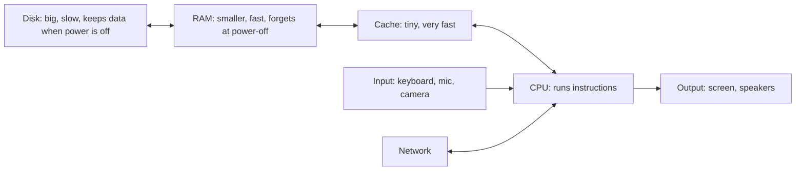
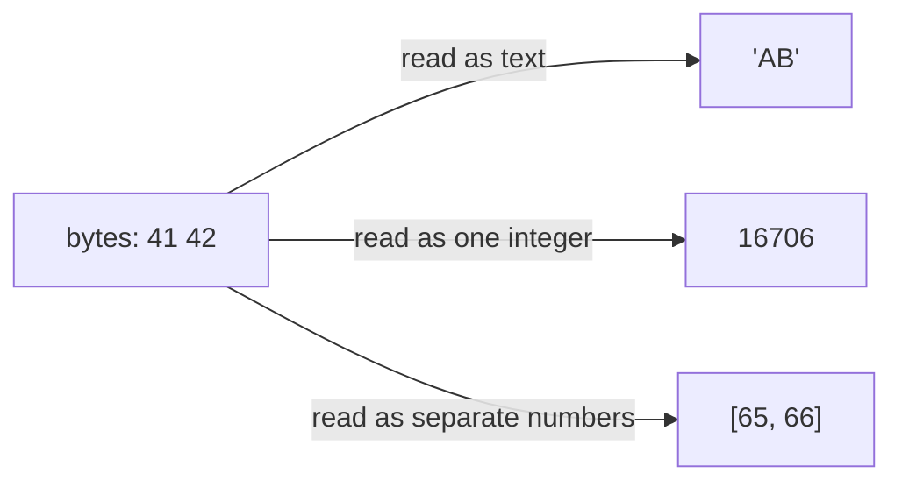
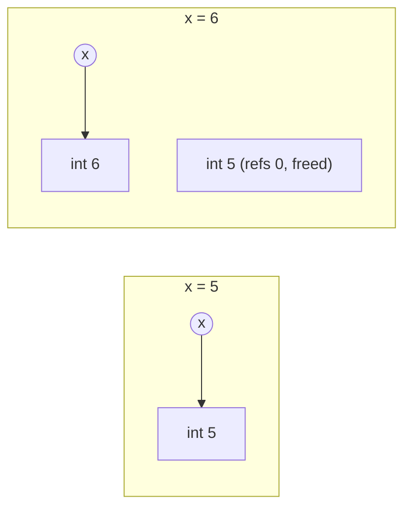

# Types and Variables

This chapter explains how a computer stores data, and then how Python handles it in
a way that differs from many other languages. The big idea: in Python a variable is
just a *name* that points at an *object*, and the object knows its own type.
Understanding this now saves you from a whole class of confusing bugs later.

## A Computer

A program is code plus data. The hardware that holds and processes both has a few parts.



Programs and data live on the disk. The CPU can only work on what has been copied into
RAM, so data moves `disk` $\to$ `RAM` $\to$ `cache` $\to$ `CPU` and back.
A machine learning model works the same way: its weights sit on disk until the program
loads them into memory.

| **Part** | **Job** | **Survives power-off?** |
|---|---|---|
| CPU | runs instructions (many cores in modern chips) | no |
| Cache | small, faster copy of what the CPU needs next | no |
| RAM | working storage for programs and data | no |
| Disk | long-term storage, much larger, much slower | ✔ |
| Input / output | keyboard, mouse, camera, display, printer | n/a |
| Network | talks to other computers | n/a |

## Bits and Bytes

Everything in a computer is made of **bits**. A bit holds one of two states,
which you can read as off/on, 0/1 or false/true. Eight bits make a **byte**, which
has $2^8 = 256$ possible patterns. A single bit or byte means nothing by itself. Meaning
comes from how a program chooses to read the pattern.

### A byte as a number

Read a byte in base 2 (binary). Each bit stands for a power of two, like the
ones, tens and hundreds places in decimal.

```text
  weight:   128   64   32   16    8    4    2    1
           +----+----+----+----+----+----+----+----+
  bits:    | 0  | 0  | 1  | 0  | 0  | 1  | 0  | 1  |
           +----+----+----+----+----+----+----+----+
  value:             32          +    4   +    1   = 37
```

All eight bits set gives $128+64+32+16+8+4+2+1 = 255$. All clear gives 0.
That is the range of an *unsigned* byte: 0 to 255.

```python
>>> 2 ** 8
256
>>> 0b11111111
255
>>> bin(37)
'0b100101'
>>> f"{37:08b}"
'00100101'
>>> int("00100101", 2)
37
```

A *signed* byte spends one bit on the sign, so it covers $-128$ to $127$ instead.
The same eight bits can therefore mean two different numbers:

```python
>>> (255).to_bytes(1, "big")
b'\xff'
>>> int.from_bytes(b"\xff", "big")
255
>>> int.from_bytes(b"\xff", "big", signed=True)
-1
```

### A byte as a character

A byte can also stand for a character. ASCII was the old agreement: 128 codes for English letters,
digits, punctuation and a few control codes. One byte cannot hold every writing
system, so Unicode defines millions of symbols ([[17 - Text Data|Chapter 17]]). Python text uses Unicode.

```python
>>> ord("A")
65
>>> chr(97)
'a'
```

## Multibyte Types

Bytes sit side by side in memory and can be grouped. Two bytes give
$2^{16} = 65{,}536$ patterns; four give $2^{32} \approx 4.3$ billion. Memory locations
are anonymous, so the program has to remember how many bytes belong together
and *what type* they represent.

```python
>>> 2 ** 16
65536
>>> 2 ** 32
4294967296
>>> (1_000_000).to_bytes(4, "big").hex()
'000f4240'
```

```text
  1_000_000 in four bytes (hex):
  +------+------+------+------+
  |  00  |  0f  |  42  |  40  |
  +------+------+------+------+
   most significant     least significant
```

> [!info] Key idea: the same bytes, different meanings
> Bytes carry no meaning until a type is applied. The two bytes `41 42` are the text
> `AB`, the integer 16706, or the list of small numbers 65 and 66, depending on the type
> you read them as.



```python
>>> data = b"AB"
>>> data.decode("ascii")
'AB'
>>> int.from_bytes(data, "big")
16706
>>> list(data)
[65, 66]
```

## Variables

A **variable** is a name in your code that refers to a value. Python handles this
differently from languages like C or Java, so the picture matters.

### Assign a value

```python
>>> temperature = 0.7
>>> temperature
0.7
```

The shape is `name = value`. The `=` sign means *assign*, not “equals”.
The right side is evaluated first; the result is then given the name on the left.
Typing a bare name in the interpreter prints its value. A file would not.

### A name is a sticky note

In many languages a variable is a *box* with a fixed type, and assignment copies the
value into the box. In Python, the value lives in an **object** somewhere in memory.
The variable is only a **name** (also called a reference or label) attached to that object.
Python is **dynamically typed**: the type belongs to the object, not to the name.

```text
  Other languages:             Python:

   x  +-----+                   x ------> +--------------+
      |  5  |   (box holds        name     | int  |  5    |   (object holds
      +-----+    the value)                +--------------+    value + type)
```

```python
>>> x = 5
>>> type(x)
<class 'int'>
>>> x = "five"
>>> type(x)
<class 'str'>
```

The name `x` was reused for a different type without trouble. Only the object
`5` is an `int`; only `"five"` is a `str`.

### What an object holds

Every Python object carries some bookkeeping with its value.

| **Part** | **Meaning** |
|---|---|
| `id` | a unique number for this object while it lives; `id(obj)` |
| type | what kind of object it is; `type(obj)` |
| value | the actual data |
| reference count | how many names (and other holders) point at it |

When the reference count drops to zero, nothing can reach the object any more and
Python reclaims its memory. This is **garbage collection**. You never call
`malloc` or `free` as in C.

```python
>>> import sys
>>> a = []
>>> sys.getrefcount(a)
2
>>> b = a
>>> sys.getrefcount(a)
3
```

(`getrefcount` reports one more than you expect, because passing `a` to the function
adds a temporary reference.)

### Change a value: rebind the name

Assigning again does *not* edit the old object. Python builds (or finds) another
object and moves the name to it.



```python
>>> x = 1000
>>> first = id(x)
>>> x = 2000
>>> id(x) == first
False
```

> [!warning] Trap
> CPython keeps ready-made objects for small integers ($-5$ to 256) and reuses them. So
> `is` can seem to work on small numbers and fail on larger ones. Compare values with `==`.
> Use `is` only for `None`.
> ```python
> >>> p = int("256"); q = int("256")
> >>> p is q
> True
> >>> p = int("1000"); q = int("1000")
> >>> p is q
> False
> >>> p == q
> True
> ```
>

### Delete a variable

`del name` removes the name (and lowers the object's count). You rarely need it, because
Python frees names when their scope ends.

```python
>>> tmp = 3
>>> del tmp
>>> tmp
Traceback (most recent call last):
  ...
NameError: name 'tmp' is not defined
```

### Two names, one object

Because names are labels, `b = a` does not copy anything. It attaches a second label to the
same object. For immutable objects (numbers, text) this is harmless. For mutable ones,
it is a classic surprise.

> [!danger] Boss fight: aliasing a mutable object
> Two names, one list. A change made through one name is visible through the other, because
> there is only one object.
>  
>
> ```mermaid
> flowchart LR
>     a((a)) --> L["list [1, 2, 3]"]
>     b((b)) --> L
>     c((c)) --> M["list [1, 2, 3] (separate copy)"]
> ```
> ```python
> >>> a = [1, 2]
> >>> b = a
> >>> b.append(3)
> >>> a
> [1, 2, 3]
> >>> a is b
> True
> >>> c = a.copy()
> >>> c.append(4)
> >>> a, c
> ([1, 2, 3], [1, 2, 3, 4])
> ```
>
> Ask yourself: “how many objects exist here?” If you want an independent copy, make one
> on purpose (`.copy()`); lists are covered in [[08 - Tuples and Lists|Chapter 8]].

### Name variables

Names follow hard rules and soft conventions.

| **Rule (enforced)** | **Valid** | **Invalid** |
|---|---|---|
| letters, digits, underscore only | `max_tokens2` | `max-tokens`, `name!` |
| may not start with a digit | `_1st`, `first_1` | `1st_place` |
| case-sensitive (these are three names) | `Model`, `model`, `MODEL` | — |
| not a reserved word | `class_name` | `class`, `for`, `None` |

```python
>>> 1st_place = 1
Traceback (most recent call last):
  ...
SyntaxError: invalid decimal literal
>>> my name = 5
Traceback (most recent call last):
  ...
SyntaxError: invalid syntax
>>> import keyword
>>> len(keyword.kwlist)
35
>>> keyword.iskeyword("lambda")
True
```

| **Style** | **Example** | **Use it for** |
|---|---|---|
| snake_case | `num_tokens` | variables, functions, modules |
| PascalCase | `ChatClient` | classes ([[11 - Objects\|Chapter 11]]) |
| UPPER_SNAKE | `MAX_RETRIES` | “constants”: Python does not enforce them |
| leading underscore | `_cache` | “internal, please do not import” |
| double underscores both sides | `__init__` | special (“dunder”) methods |
| camelCase | `numTokens` | not Python style (JavaScript, Java) |

> [!tip] Rule
> Name things for what they hold: `prompt_tokens`, not `x1`. Never use a built-in as a name
> (`list`, `str`, `id`, `type`); it hides the real one.

## Python Types

Bits are meaningless until a type reads them. Python provides built-in types that match
common hardware types, plus some software-only ones. The column that matters most for
bugs is **mutable**: can the value be changed in place after it is created?

| **Name** | **Type** | **Mutable?** | **Example** | **Chapter** |
|---|---|---|---|---|
| Boolean | `bool` | no | `True`, `False` | 3 |
| Integer | `int` | no | `47`, `25_000` | 3 |
| Float | `float` | no | `3.14`, `2.7e5` | 3 |
| Complex | `complex` | no | `3j`, `5 + 9j` | 3 |
| Text string | `str` | no | `"alas"`, `'alack'` | 4 |
| Bytes | `bytes` | no | `b'ab\xff'` | 5 |
| Bytearray | `bytearray` | **yes** | `bytearray(b'ab')` | 5 |
| Tuple | `tuple` | no | `(2, 4, 8)` | 8 |
| List | `list` | **yes** | `["a", "b"]` | 8 |
| Set | `set` | **yes** | `{3, 5, 7}` | 9 |
| Frozen set | `frozenset` | no | `frozenset([1, 2])` | 9 |
| Dictionary | `dict` | **yes** | `{"a": 1}` | 9 |
| Nothing | `NoneType` | no | `None` | here |

The last row is not in the table of the book, but you will use it constantly: `None`
means “no value here”.

Two functions let you ask an object about its type:

```python
>>> type(3.5)
<class 'float'>
>>> isinstance(3.5, float)
True
>>> isinstance(True, int)
True
```

(`bool` is a kind of `int` in Python, which [[03 - Numbers|Chapter 3]] explains.)

> [!example] Type check: mutable or immutable?
> **Immutable** means no operation can change the object in place; you can only
> make a new one. **Mutable** means it can change, and every name pointing at it sees the change.
>  
>
> ```mermaid
> flowchart LR
>     subgraph immutable ["str: immutable"]
>     s1["'abc'"] -->|"s.upper()"| s2["'ABC' (new object)"]
>     end
>     subgraph mutable ["list: mutable"]
>     l1["[1, 2]"] -->|"l.append(3)"| l2["same object, now [1, 2, 3]"]
>     end
> ```
> ```python
> >>> s = "abc"
> >>> s[0] = "X"
> Traceback (most recent call last):
>   ...
> TypeError: 'str' object does not support item assignment
> >>> items = ["a", "b", "c"]
> >>> before = id(items)
> >>> items[0] = "X"
> >>> items
> ['X', 'b', 'c']
> >>> id(items) == before
> True
> ```
>

> [!example] Type check: `None` and truthiness
> `None` is the only value of type `NoneType`. It is falsy. Test for it with
> `is None`, and never call methods on a value that might be `None`.
> ```python
> >>> result = None
> >>> result is None
> True
> >>> bool(result)
> False
> >>> result.upper()
> Traceback (most recent call last):
>   ...
> AttributeError: 'NoneType' object has no attribute 'upper'
> ```
>

### Type hints do not enforce types

You may annotate a name with a type. Python records the annotation but does not check it
while running. Tools such as mypy or your editor check it before you run ([[14 - Type Hints and Documentation|Chapter 14]]).

```python
>>> count: int = "five"
>>> count
'five'
```

## Specify Values

A **literal** is a value written directly in code: `5`, `"hi"`, `[1, 2]`.
A **variable** is a name that refers to a value. Each type has its own literal syntax,
and punctuation decides the type. Two cases catch beginners:

| **You write** | **You get** | **Why** |
|---|---|---|
| `(4)` | `int` | parentheses only group; they do not make a tuple |
| `(4,)` | `tuple` | the comma makes the tuple |
| `{}` | `dict` | empty braces are a dict; use `set()` for an empty set |
| `{4}` | `set` | braces with items but no colons |
| `{"a": 4}` | `dict` | braces with `key: value` pairs |

```python
>>> type((4))
<class 'int'>
>>> type((4,))
<class 'tuple'>
>>> type({})
<class 'dict'>
>>> type({4})
<class 'set'>
```

## Objects as Plastic Boxes in Memory

A good mental image: each object is a clear plastic box on a memory shelf. Some contents
have a fixed size (id, type, count); the value part can be small or large. A
list box can sit beside an int box. Your code lives on another shelf, and each variable is a
sticky note stuck to a box.

```text
  code shelf                    data shelf
  ----------                    ----------------------------------------
  prompt  --note-->  [ id | type: str  | "Hi"       | refs: 1 ]
  n_calls --note-->  [ id | type: int  | 3          | refs: 1 ]
  history --note-->  [ id | type: list | [..., ...] | refs: 1 ]
```

## Review

Variables are names; objects carry an id, a type, a value and a reference count. Assigning
moves a name to another object. Mutable objects can change in place, so shared names can
surprise you. Next: numbers, the simplest objects.

> [!question-] Practice
>
> 1. Why can the same name hold an `int` and, a moment later, a `str`?
> 1. After `a = [1]` and `b = a`, then `b.append(2)`, what is `a`? Why?
> 1. Which of these is not a valid variable name, and why: `top_p`, `2nd`, `Top_P`, `for`?
> 1. What is the difference between a mutable and an immutable type? Name two of each.
> 1. Why is `x is 1000` unreliable, and what should you write instead?
> 1. What type is `(7)`, and what must you add to make it a tuple?
>

> [!success] Achievement unlocked: Name Tamer
>
> - Explain a variable as a name pointing at an object, with a type, id and reference count.
> - Predict what happens to other names when a mutable object is changed.
> - Choose valid, idiomatic names and spot illegal ones.
> - Read the type table and say which types are mutable.
> - Check types with `type()` and `isinstance()`, and test for `None` with `is`.
>

---
Related: [[01 - Introduction]] · [[03 - Numbers]] · [[04 - Strings]] · [[08 - Tuples and Lists]] · [[11 - Objects]]
