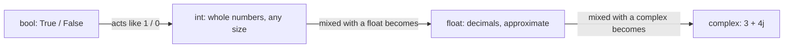

# Numbers

This chapter covers Python's simplest types: `bool`, `int` and `float`, plus
two exact alternatives, `Fraction` and `Decimal`. You will learn what each operator
returns, how Python converts between number types, and why floats can surprise you. Token
counts, prices, batch sizes and probabilities are all numbers, so this is daily material.



When two different number types meet in one expression, Python converts the one on the
left of the chain to the one on the right. The result type is the “wider” one.

## Booleans

A `bool` has exactly two values: `True` and `False`. Both start with a
capital letter. Write `true` and Python raises a `NameError`.

The function `bool(x)` converts *any* value to a boolean. This is the rule behind
**truthiness**: in an `if`, Python asks “is this value truthy?”. ([[06 - If and Match|Chapter 6]] uses it.)

| **Falsy (counts as False)** | **Truthy (counts as True)** |
|---|---|
| `False`, `None` | `True` |
| `0`, `0.0`, `0j` | any other number, including `-1` and `0.001` |
| `""` (empty string) | any non-empty string, even `"0"` and `"False"` |
| `[]`, `()`, `{}`, `set()` (empty containers) | any container with at least one item, even `[0]` |

```python
>>> bool(1), bool(-45), bool(0), bool(0.0)
(True, True, False, False)
>>> bool(""), bool("0"), bool("False")
(False, True, True)
>>> bool([]), bool([0]), bool(None)
(False, True, False)
```

> [!warning] Trap
> `bool("False")` is `True`, because the string is not empty. If you read a setting such as
> `DEBUG=False` from an environment variable, it arrives as text. Compare the text instead:
> `value.lower() == "true"`.

> [!example] Type check: a `bool` is an `int`
> `bool` is a subtype of `int`. `True` acts as 1 and `False` as 0 in arithmetic.
> ```python
> >>> True + True
> 2
> >>> int(True), int(False)
> (1, 0)
> >>> isinstance(True, int)
> True
> >>> type(True + 1)
> <class 'int'>
> ```
>

## Integers

An `int` is a whole number with an optional sign. In Python 3 it has no fixed size limit.

### Literal integers

```python
>>> tokens = 1_500_000
>>> tokens
1500000
>>> -42, +42
(-42, 42)
>>> 1,500
(1, 500)
```

- Underscores are allowed as digit separators for readability. They are ignored.
- Do not write commas: `1,500` is a *tuple* of two ints, not fifteen hundred.
- A leading zero followed by digits (`007`) is a `SyntaxError`. Prefixes
  `0b`, `0o`, `0x` mark other bases (see below).

### Integer operations

| **Op** | **Name** | **Example** | **Result** | **Result type** |
|---|---|---|---|---|
| `+` | add | `5 + 8` | `13` | `int` |
| `-` | subtract | `90 - 10` | `80` | `int` |
| `*` | multiply | `4 * 7` | `28` | `int` |
| `/` | true division | `7 / 2` | `3.5` | **always `float`** |
| `//` | floor division | `7 // 2` | `3` | `int` (for int operands) |
| `%` | remainder | `7 % 3` | `1` | `int` |
| `**` | power | `3 ** 4` | `81` | `int` (`float` if the exponent is negative) |

```python
>>> 7 / 2
3.5
>>> 8 / 2
4.0
>>> 7 // 2
3
>>> 7 % 2
1
>>> 7 ** 2
49
>>> 2 ** -1
0.5
```

\paragraph{Quotient and remainder.}
`//` and `%` are a pair: `a == (a // b) * b + (a % b)`. `divmod(a, b)` returns both
in a tuple. This is how you split work into batches.

```text
  10_500 tokens, chunk size 4_000:

  |<---- 4000 ---->|<---- 4000 ---->|<-- 2500 -->|
  |    chunk 1     |    chunk 2     |  leftover  |

  10_500 // 4_000 = 2 full chunks      10_500 % 4_000 = 2_500
```

```python
>>> n_tokens, chunk_size = 10_500, 4_000
>>> divmod(n_tokens, chunk_size)
(2, 2500)
>>> -(-n_tokens // chunk_size)
3
```

The last line is a trick for *ceiling* division: how many chunks you need in total,
counting the partial one. It works because `//` rounds down, as the next trap explains.

> [!warning] Trap
> `//` rounds toward minus infinity (it *floors*), not toward zero. They differ for negatives.
> `int()` truncates toward zero.
>
> ```text
>         -4        -3.5        -3
>    -----+----------+----------+-----
>      floor <-------- x --------> int() truncates
>      -7 // 2 = -4              int(-7 / 2) = -3
> ```
> ```python
> >>> -7 // 2
> -4
> >>> -7 % 2
> 1
> >>> divmod(-7, 2)
> (-4, 1)
> >>> int(-7 / 2)
> -3
> ```
>

\paragraph{Division by zero} raises `ZeroDivisionError` for both `/` and `//`.

```python
>>> 5 / 0
Traceback (most recent call last):
  ...
ZeroDivisionError: division by zero
>>> 7 // 0
Traceback (most recent call last):
  ...
ZeroDivisionError: integer division or modulo by zero
```

### Integers and variables

An operator on a variable does not change the variable unless you assign the result.
The right side of `=` is computed first.

```python
>>> budget = 1000
>>> used = 250
>>> budget - used
750
>>> budget
1000
>>> budget = budget - used
>>> budget
750
```

Shorthand operators combine the operation and the assignment:

| **Shorthand** | **Same as** |
|---|---|
| `x += 5` | `x = x + 5` |
| `x -= 5` | `x = x - 5` |
| `x *= 2` | `x = x * 2` |
| `x /= 4` | `x = x / 4` (x becomes a `float`) |
| `x //= 4` | `x = x // 4` |
| `x %= 4` | `x = x % 4` |
| `x **= 2` | `x = x ** 2` |

```python
>>> budget = 750
>>> budget //= 4
>>> budget
187
>>> budget /= 2
>>> budget
93.5
```

### Precedence

Python evaluates operators in a fixed order, tightest binding first. When in doubt, add parentheses.

| **Level** | **Operators** | **Note** |
|---|---|---|
| 1 (first) | `(...)` | parentheses always win |
| 2 | `**` | right to left: `2 ** 3 ** 2` is `2 ** 9` |
| 3 | unary `+x`, `-x` | `-3 ** 2` is `-(3 ** 2)` |
| 4 | `*`, `/`, `//`, `%` | left to right |
| 5 (last) | `+`, `-` | left to right |

```python
>>> 2 + 3 * 4
14
>>> (2 + 3) * 4
20
>>> -3 ** 2
-9
>>> (-3) ** 2
9
>>> 2 ** 3 ** 2
512
```

### Bases

Integers are decimal by default. Prefixes write them in binary, octal or hexadecimal. The
interpreter always prints the value in decimal. You may never need other bases in daily work, but
you will see hex in colors, memory addresses and byte data.

| **Base** | **Prefix** | **Digits** | **Value of 10 in that base** |
|---|---|---|---|
| 2 (binary) | `0b` | 0, 1 | 2 |
| 8 (octal) | `0o` | 0–7 | 8 |
| 10 (decimal) | none | 0–9 | 10 |
| 16 (hex) | `0x` | 0–9, a–f | 16 |

Hex is handy because one hex digit equals exactly four bits, so a byte is two hex digits.

```text
  byte 65  =  0100 0001   (binary)
              \__/ \__/
               4    1      (hex digits)   ->  0x41
```

```python
>>> 0b101, 0o17, 0xff
(5, 15, 255)
>>> bin(10), oct(10), hex(255)
('0b1010', '0o12', '0xff')
>>> int("ff", 16), int("101", 2)
(255, 5)
>>> chr(72), ord("H")
('H', 72)
```

Note that `bin()`, `oct()` and `hex()` return *strings*, not ints. `chr()` turns a
code number into a one-character string; `ord()` turns it back.

### Type conversions

`int(x)` takes one argument and returns an `int`. What it accepts depends on the input type.

| **Input** | **Result** | **Rule** |
|---|---|---|
| `int(True)` | `1` | bools become 1 or 0 |
| `int(98.6)` | `98` | float: drops the fraction (toward zero) |
| `int("42")` | `42` | string of digits; sign, `_` and surrounding spaces are fine |
| `int("10", 2)` | `2` | second argument gives the base of the text |
| `int("3.5")` | **ValueError** | a string with a decimal point is not accepted |
| `int("")` | **ValueError** | empty text |
| `int("1e3")` | **ValueError** | exponent notation is not accepted |

```python
>>> int(3.99), int(-3.99)
(3, -3)
>>> int("42"), int(" 42 "), int("1_000"), int("+7")
(42, 42, 1000, 7)
>>> int("3.5")
Traceback (most recent call last):
  ...
ValueError: invalid literal for int() with base 10: '3.5'
>>> int(float("3.5"))
3
```

> [!tip] Rule
> User input and JSON values often arrive as strings. Convert at the edge (`int(text)`,
> `float(text)`) and catch `ValueError`. Do not pass text into arithmetic.

When types are mixed in arithmetic, Python promotes automatically:

| **Expression** | **Result type** |
|---|---|
| `int + int`, `int * int` | `int` |
| `int + float` | `float` |
| `int / int` | `float` |
| `int // int` | `int` |
| `float // int` | `float` (value is still floored: `7.0 // 2` is `3.0`) |
| `bool + int` | `int` |
| `bool + float` | `float` |

```python
>>> 4 + 7.0
11.0
>>> True + 2.5
3.5
>>> 7.0 // 2
3.0
```

### How big is an int?

Older languages limit integers to 32 or 64 bits and overflow past that. Python 3 integers grow
as needed; only your memory limits them.

```python
>>> 2 ** 100
1267650600228229401496703205376
>>> len(str(10 ** 50))
51
```

## Floats

A `float` is a number with a fractional part, stored in binary.

```python
>>> 5., 5e1, 2.5e-3, 1_000.5
(5.0, 50.0, 0.0025, 1000.5)
>>> float("3.14"), float(7), float(True)
(3.14, 7.0, 1.0)
>>> float("1e3")
1000.0
>>> float("abc")
Traceback (most recent call last):
  ...
ValueError: could not convert string to float: 'abc'
```

- Exponent form: `2.5e-3` means $2.5\times10^{-3}$.
- All the integer operators work on floats; `divmod` works too.
- `float()` accepts strings with a decimal point or exponent; `int()` does not.

### Rounding

`round(x)` returns an `int`. `round(x, n)` keeps `n` decimal places and returns a `float`.
Exact halves round to the *nearest even* number, so `round(2.5)` is 2, not 3.

```text
  2.5 sits exactly between 2 and 3  ->  goes to the EVEN one: 2
  3.5 sits exactly between 3 and 4  ->  goes to the EVEN one: 4
```

```python
>>> round(3.14159, 2)
3.14
>>> round(2.5), round(3.5), round(-2.5)
(2, 4, -2)
>>> type(round(3.7)), type(round(3.7, 1))
(<class 'int'>, <class 'float'>)
```

### Special float values

Floats also include `inf` (overflow) and `nan` (“not a number”). `nan` is not equal to
anything, not even itself, so test it with `math.isnan`. NaNs can sneak into data
pipelines and silently poison averages.

```python
>>> 1e308 * 10
inf
>>> import math
>>> nan = float("nan")
>>> nan == nan
False
>>> math.isnan(nan)
True
```

## Floats Are Not Exact

Binary storage cannot hold most decimal fractions exactly, just as decimal cannot hold
$\tfrac13$. The tiny error is small but real.

```python
>>> 1 / 3
0.3333333333333333
>>> 0.1 + 0.2
0.30000000000000004
>>> 0.1 + 0.2 == 0.3
False
>>> f"{0.1:.20f}"
'0.10000000000000000555'
```

> [!tip] Rule
> Never compare floats with `==`. Use `math.isclose(a, b)`, which allows a small
> tolerance. Python's standard library offers exact alternatives for when it matters.
> ```python
> >>> import math
> >>> math.isclose(0.1 + 0.2, 0.3)
> True
> ```
>

### Fractions

`fractions.Fraction` stores a numerator and a denominator, so it is exact for ratios.

```python
>>> from fractions import Fraction
>>> Fraction(1, 3) + Fraction(1, 6)
Fraction(1, 2)
>>> Fraction("0.1") + Fraction("0.2") == Fraction("0.3")
True
>>> float(Fraction(1, 8))
0.125
```

### Decimals

`decimal.Decimal` stores decimal digits exactly. Use it for money. Always build it from
a *string*; building it from a float copies the float's error.

```python
>>> from decimal import Decimal
>>> Decimal("0.10") + Decimal("0.20")
Decimal('0.30')
>>> Decimal(0.1) == Decimal("0.1")
False
```

Another common approach is to count in the smallest unit as an `int` (cents, or
millionths of a dollar) and convert only for display.

```python
>>> price_cents, qty = 1999, 3
>>> total_cents = price_cents * qty
>>> f"${total_cents / 100:.2f}"
'$59.97'
```

> [!danger] Boss fight: choose the right number type
> Floats are right for measurements and model scores; they are wrong for money and for exact equality.
> Ask what you are counting before you pick a type.
>
> ```mermaid
> flowchart TD
>     Q{"What are you storing?"}
>     Q -->|"whole counts (tokens, rows)"| I["int"]
>     Q -->|"money"| D["Decimal from strings, or int cents"]
>     Q -->|"exact ratios"| R["Fraction"]
>     Q -->|"measurements, probabilities, scores"| F["float + math.isclose"]
> ```
>  
> A worked example. The prices are invented for the demo.
> ```python
> >>> from decimal import Decimal
> >>> tokens_in, tokens_out = 12_000, 800
> >>> rate_in, rate_out = Decimal("3.00"), Decimal("15.00")
> >>> cost = (tokens_in * rate_in + tokens_out * rate_out) / 1_000_000
> >>> cost
> Decimal('0.048')
> ```
>
> Rates are dollars per million tokens. The `int` times `Decimal` multiplication
> is allowed; mixing `Decimal` with `float` is not.

## Math Functions

A few functions are always available (`abs`, `min`, `max`, `round`, `divmod`); the rest
live in the `math` module ([[25 - Data Science|Chapter 25]] covers more). Complex numbers also exist, written with a `j`.

```python
>>> import math
>>> abs(-3), min(2, 9), max(2, 9)
(3, 2, 9)
>>> math.floor(2.7), math.ceil(2.1), math.sqrt(2)
(2, 3, 1.4142135623730951)
>>> abs(3 + 4j)
5.0
```

## Review

Booleans are tiny integers with a truthiness rule behind them. Integers have unlimited size.
`/` always gives a float, `//` floors. Floats are approximate: compare with a tolerance
and use `Decimal` or integer cents for money. Next: text.

> [!question-] Practice
>
> 1. What type does `9 / 3` return, and what does `9 // 3` return?
> 1. Predict `-9 // 4`, `-9 % 4` and `int(-9 / 4)`, then check them.
> 1. Why is `bool("0")` true while `bool(0)` is false?
> 1. You have 1 234 documents and send them 100 at a time. Write one expression for the number of batches.
> 1. Why does `0.1 + 0.2 == 0.3` fail, and what do you write instead?
> 1. Which conversions raise `ValueError`: `int("12")`, `int("12.0")`, `float("12.0")`, `int(" 12 ")`?
>

> [!success] Achievement unlocked: Number Cruncher
>
> - Predict the type and value of any expression with `+ - * / // % **`.
> - Split totals into batches with `divmod`, and know that `//` floors.
> - Convert between `int`, `float`, `bool` and `str` and handle `ValueError`.
> - Explain float inexactness and choose `isclose`, `Decimal`, `Fraction` or integer cents.
> - Use truthiness rules without guessing.
>

---
Related: [[02 - Types and Variables]] · [[04 - Strings]] · [[06 - If and Match]] · [[18 - Binary Data]] · [[25 - Data Science]]
