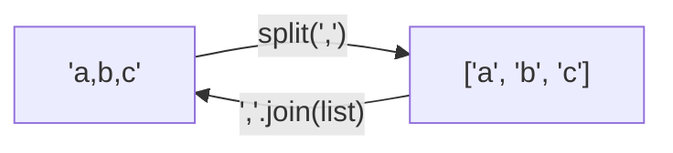

# Strings

Most programs spend more time on text than on math, and AI work is text work: prompts,
model replies, file names, JSON. This chapter covers how to create strings, pick them apart
with indexes and slices, search and clean them, and build new ones with f-strings. Everything here
applies to prompts you will format and replies you will clean.

## Strings Are Sequences

A `str` is an ordered **sequence** of characters. A character is the smallest unit of
writing: a letter, digit, symbol, space or newline. Python has no separate character type.
A single character is just a string of length 1, and a string may be empty.

Strings are **immutable**: no operation edits a string in place. Every operation
that seems to change one returns a *new* string. This is the most important fact in the chapter.

Every sequence (strings, and later lists and tuples) supports the same core operations:

| **Operation** | **Example** | **Returns** | **Meaning** |
|---|---|---|---|
| membership | `"fun" in s` | `bool` | is it present? |
| position of a value | `s.index("x")` | `int` | offset of first match |
| one element | `s[0]` | `str` (length 1) | item at an offset |
| slice | `s[2:5]` | `str` | a range of items |
| length | `len(s)` | `int` | number of items |
| smallest, largest | `min(s)`, `max(s)` | `str` (length 1) | by character code |

```python
>>> prompt = "Summarize this text"
>>> "text" in prompt
True
>>> prompt.index("this")
10
>>> prompt[0]
'S'
>>> prompt[10:14]
'this'
>>> len(prompt)
19
>>> min("model"), max("model")
('d', 'o')
```

## Create with Quotes

Wrap characters in matching single or double quotes. Python treats both the same.
The interpreter echoes strings with single quotes.

```python
>>> 'single' == "double"
False
>>> 'tokens' == "tokens"
True
>>> "It's fine"
"It's fine"
>>> 'She said "hi"'
'She said "hi"'
```

Having two quote styles lets you put one kind of quote inside the other. Triple quotes
(`”'` or `"""`) create *multi-line* strings and keep the line breaks.
That is the usual way to write a long prompt.

```python
>>> text = """line one
... line two"""
>>> text
'line one\nline two'
>>> print(text)
line one
line two
```

\paragraph{Echo versus print.} The interpreter echo shows the string's representation, with quotes and
escape codes like `\n`. `print()` shows the text itself, separates its arguments
with spaces and ends with a newline.

```python
>>> print("a", "b", 3)
a b 3
>>> len(""), bool("")
(0, False)
```

\paragraph{Prefixes.} A letter before the opening quote changes how the string is read.

| **Prefix** | **Kind** | **Use** |
|---|---|---|
| none | plain text (`str`) | most strings |
| `f` | f-string | insert values: `f"hi {name}"` |
| `r` | raw string | keep backslashes literally (paths, regular expressions) |
| `fr` | raw f-string | both |
| `b` | `bytes`, not `str` | binary data ([[05 - Bytes and Bytearray\|Chapter 5]]) |
| `u` | same as plain | historical; you can ignore it |

## Create with str()

`str(x)` converts any object to its text form. `print()` and f-strings do this for you.
`+` does *not*: mixing `str` and `int` with `+` is a `TypeError`.

```python
>>> str(42), str(3.5), str(True), str(None)
('42', '3.5', 'True', 'None')
>>> str([1, 2])
'[1, 2]'
>>> "tokens: " + 42
Traceback (most recent call last):
  ...
TypeError: can only concatenate str (not "int") to str
>>> "tokens: " + str(42)
'tokens: 42'
```

## Escape with \

A backslash gives the next character a special meaning (an **escape sequence**), or
removes its special meaning.

| **Write** | **You get** |
|---|---|
| `\n` | newline |
| `\t` | tab |
| `\\` | one backslash |
| `\'` and `\"` | a quote character |

```python
>>> "a\tb"
'a\tb'
>>> print("line1\nline2")
line1
line2
>>> print('C:\\logs\\new')
C:\logs\new
```

A **raw string** (`r"..."`) turns escapes off. It does not affect real line breaks inside triple quotes.

```python
>>> print(r"C:\logs\new")
C:\logs\new
>>> len(r"\n"), len("\n")
(2, 1)
```

> [!warning] Trap
> On Windows a path like `"C:\new"` contains a newline, because `\n` is
> an escape. Use a raw string, double the backslashes, or use forward slashes.
> ```python
> >>> print("C:\new")
> C:
> ew
> ```
>

## Combine with + and Duplicate with *

`+` joins two strings; `*` repeats a string by an `int`. Python adds no spaces.
Two string *literals* next to each other are joined automatically, which is handy for splitting
a long string over several lines inside parentheses.

```python
>>> "ab" + "cd"
'abcd'
>>> "ab" "cd"
'abcd'
>>> "-" * 10
'----------'
>>> "ha" * 3 + "!"
'hahaha!'
>>> "5" + "5", "5" * 3
('55', '555')
>>> prompt = ("You are a helpful assistant. "
...           "Answer in one sentence.")
>>> prompt
'You are a helpful assistant. Answer in one sentence.'
```

`*` binds tighter than `+`, so `"ha" * 3 + "!"` repeats first.

## Get a Character by [offset]

Offsets start at 0 on the left. Negative offsets count from the right, so `-1` is the last character.

```text
  word =   t    o    k    e    n    i    z    e
  offset:  0    1    2    3    4    5    6    7
  offset: -8   -7   -6   -5   -4   -3   -2   -1
```

```python
>>> word = "tokenize"
>>> word[0], word[3], word[-1], word[-2]
('t', 'e', 'e', 'z')
>>> word[8]
Traceback (most recent call last):
  ...
IndexError: string index out of range
```

An offset past the end raises `IndexError`. You cannot assign to an offset, because strings are immutable.
Build a new string instead:

```python
>>> word = "tokenize"
>>> word[0] = "T"
Traceback (most recent call last):
  ...
TypeError: 'str' object does not support item assignment
>>> "T" + word[1:]
'Tokenize'
>>> word.replace("t", "T", 1)
'Tokenize'
>>> word
'tokenize'
```

> [!example] Type check: what indexing returns
> `s[i]` returns a `str` of length 1, never a separate char type. `s[i]` needs an
> `int`; a `str` offset such as `s["a"]` is a `TypeError`. Compare with a dict, where the subscript
> is a key, not a position.

## Get a Substring with a Slice

`s[start:stop:step]` returns a new string. Think of the offsets as numbers on the
*lines between characters*. `start` is included; `stop` is excluded. Omitted parts
default to the beginning, the end, and step 1.

```text
   cut lines:  0   1   2   3   4   5   6   7   8   9   10
              +---+---+---+---+---+---+---+---+---+---+
   string:    | 0 | 1 | 2 | 3 | 4 | 5 | 6 | 7 | 8 | 9 |
              +---+---+---+---+---+---+---+---+---+---+
                      \___________/
                        s[2:5] = "234"
```

```python
>>> d = "0123456789"
>>> d[2:5], d[:3], d[7:], d[:]
('234', '012', '789', '0123456789')
>>> d[-3:], d[:-3], d[-5:-2]
('789', '0123456', '567')
>>> d[::2], d[1::2], d[2:9:3]
('02468', '13579', '258')
>>> d[::-1], d[8:2:-2]
('9876543210', '864')
```

| **Slice** | **Result for `d`** | **Reading it** |
|---|---|---|
| `d[2:5]` | `'234'` | from cut 2 up to (not including) cut 5 |
| `d[:3]` | `'012'` | first three characters |
| `d[7:]` | `'789'` | from cut 7 to the end |
| `d[-3:]` | `'789'` | last three characters |
| `d[:-3]` | `'0123456'` | everything except the last three |
| `d[::2]` | `'02468'` | every second character |
| `d[::-1]` | `'9876543210'` | reversed |

Slices are forgiving. Out-of-range offsets are clamped instead of raising an error. A slice
that selects nothing gives the empty string. Indexing (`d[10]`) is strict; slicing is not.

```python
>>> d = "0123456789"
>>> d[-50:3], d[7:99], d[20:30], d[5:2]
('012', '789', '', '')
>>> d[10]
Traceback (most recent call last):
  ...
IndexError: string index out of range
```

> [!danger] Boss fight: slices and cut lines
> Most slice mistakes come from counting characters instead of cut lines. Rules that always hold:
>
> - `s[a:b]` has length `b - a` when both are in range.
> - `s[:n] + s[n:] == s` for any `n`. The two halves meet at one cut.
> - With a negative step, start and stop swap roles: you walk backward from `start` down to, but not including, `stop`.
> - Prefer simple forms: `s[:n]`, `s[-n:]`, `s[::-1]`.
>
>
> ```mermaid
> flowchart LR
>     S["s[start:stop:step]"] --> A["start: first kept (included)"]
>     S --> B["stop: first NOT kept (excluded)"]
>     S --> C["step: stride, negative walks backward"]
> ```
> ```python
> >>> d = "0123456789"
> >>> d[:4] + d[4:] == d
> True
> >>> len(d[3:8])
> 5
> >>> d[:3] + "!" + d[-2:]
> '012!89'
> ```
>

## Get Length with len()

`len(s)` returns an `int`: the number of characters, including spaces and newlines.
The last valid offset is `len(s) - 1`. (Token counts are not character counts; models read
tokens, which are chunks of characters.)

```python
>>> len("hello world"), len("a\nb"), len("")
(11, 3, 0)
```

## Methods: Functions That Belong to a String

Many string operations are **methods**, called with a dot: `s.method(args)`. The dot
(attribute access) is different from the brackets used for indexing. A method *never*
changes `s`; it returns a result.

> [!example] Type check: what the common methods return
>
> | **Methods** | **Returns** | **Examples** |
> |---|---|---|
> | transforming | new `str` | `upper lower strip replace title center` |
> | splitting | `list[str]` | `split splitlines` |
> | joining | new `str` | `sep.join(list)` |
> | counting, finding | `int` | `find index count` |
> | testing | `bool` | `startswith endswith isdigit isalpha isalnum` |
>

> [!warning] Trap
> Forgetting to keep the result is the most common beginner bug with strings. Calling
> `name.upper()` alone computes a new string and throws it away. `name` is untouched.
>
> ```mermaid
> flowchart LR
>     N1["name -> 'ada'"] -->|"name.upper()"| X["'ADA' (new object, no name)"]
>     X -->|"name = ..."| N2["name -> 'ADA'"]
> ```
> ```python
> >>> name = "ada"
> >>> name.upper()
> 'ADA'
> >>> name
> 'ada'
> >>> name = name.upper()
> >>> name
> 'ADA'
> ```
>

### Split with split()

`s.split(sep)` cuts a string at each separator and returns a `list` of strings. With no
argument it splits on any run of whitespace and drops empty pieces. A second argument limits the
number of cuts.

```python
>>> line = "role:user,content:hello,tokens:5"
>>> line.split(",")
['role:user', 'content:hello', 'tokens:5']
>>> line.split(",", 1)
['role:user', 'content:hello,tokens:5']
>>> "a  b\tc\nd".split()
['a', 'b', 'c', 'd']
>>> "a,,b".split(",")
['a', '', 'b']
>>> "".split(","), "".split()
([''], [])
>>> "a\nb\nc".splitlines()
['a', 'b', 'c']
```

### Combine with join()

`join` is the reverse of `split`. It looks backward: the *separator* is the object, and the
list is the argument: `separator.join(list)`. All items must already be strings.



```python
>>> ", ".join(["one", "two", "three"])
'one, two, three'
>>> "\n".join(["l1", "l2"])
'l1\nl2'
>>> ",".join([str(1), str(2)])
'1,2'
>>> ",".join([1, 2])
Traceback (most recent call last):
  ...
TypeError: sequence item 0: expected str instance, int found
```

> [!tip] Rule
> To build one string from many pieces, collect the pieces in a list and call
> `"".join(pieces)` once. Do not grow a string with `+` inside a loop.

### Substitute with replace()

`s.replace(old, new)` returns a copy with every occurrence replaced. A third argument limits the count.
It matches raw text, so it can hit the middle of words.

```python
>>> s = "the cat sat on the mat"
>>> s.replace("the", "a")
'a cat sat on a mat'
>>> s.replace("the", "a", 1)
'a cat sat on the mat'
>>> s.replace("at", "og")
'the cog sog on the mog'
>>> s
'the cat sat on the mat'
```

For whole-word or pattern replacement you need regular expressions ([[17 - Text Data|Chapter 17]]).

### Prefixes and suffixes

```python
>>> f = "report_final.json"
>>> f.startswith("report"), f.endswith(".json")
(True, True)
>>> f.startswith(("a", "r"))
True
>>> f.removesuffix(".json")
'report_final'
>>> f.removeprefix("report_")
'final.json'
>>> f.removeprefix("zzz")
'report_final.json'
```

`startswith` and `endswith` accept a tuple of alternatives. `removeprefix` and `removesuffix`
(Python 3.9+) do nothing if the text is absent. To add a prefix or suffix, use `+`.

### Strip with strip()

`strip()` removes characters from the *ends*. With no argument it removes whitespace
(spaces, tabs, newlines). `lstrip()` works on the left end only, `rstrip()` on the right.
Given an argument, it treats it as a *set of characters*, not a substring.

```text
  "  \n  Paris.  \n"
   ^^^^^^^       ^^^^   <- strip() removes these
  =>  "Paris."
```

```python
>>> raw = "  \n  Paris.  \n"
>>> raw.strip()
'Paris.'
>>> raw.lstrip()
'Paris.  \n'
>>> raw.rstrip()
'  \n  Paris.'
>>> "***hi***".strip("*")
'hi'
>>> "..ok?!".strip(".?!")
'ok'
>>> "xxabcxx".strip("xa")
'bc'
```

A common job is cleaning a model reply that wraps JSON in a code fence:

````python
>>> reply = "```json\n{\"ok\": true}\n```"
>>> reply.removeprefix("```json").removesuffix("```").strip()
'{"ok": true}'
````

Chaining methods works because each one returns a new string for the next to use.

### Search and select

| **Call** | **Returns** | **If not found** |
|---|---|---|
| `s.find(x)` | offset (`int`) of the first match | `-1` |
| `s.rfind(x)` | offset of the last match | `-1` |
| `s.index(x)`, `s.rindex(x)` | same offsets | raises `ValueError` |
| `s.count(x)` | number of non-overlapping matches | `0` |
| `x in s` | `True` or `False` | `False` |

```python
>>> t = "to be or not to be"
>>> t.find("be"), t.rfind("be"), t.find("zz")
(3, 16, -1)
>>> t.index("or")
6
>>> t.index("zz")
Traceback (most recent call last):
  ...
ValueError: substring not found
>>> t.count("to"), t.count("o")
(2, 4)
>>> t.isalnum(), "abc123".isalnum(), "12".isdigit(), "abc".isalpha()
(False, True, True, True)
```

> [!warning] Trap
> `find` returns `-1` (truthy) when the text is missing and `0` (falsy) when it is at the start.
> So `if s.find("x"):` is wrong. To ask “is it there?”, use `"x" in s`.
> ```python
> >>> "abc".find("a"), bool("abc".find("a"))
> (0, False)
> >>> "abc".find("z"), bool("abc".find("z"))
> (-1, True)
> >>> "a" in "abc", "z" in "abc"
> (True, False)
> ```
>

### Change case

```python
>>> m = "hello, World"
>>> m.upper(), m.lower()
('HELLO, WORLD', 'hello, world')
>>> m.capitalize(), m.title(), m.swapcase()
('Hello, world', 'Hello, World', 'HELLO, wORLD')
>>> "Ab".lower() == "aB".lower()
True
```

To compare text ignoring case, lowercase both sides first.

### Set alignment

`center`, `ljust`, `rjust` pad a string to a total width; an optional second argument sets the pad character.
`zfill` pads with zeros on the left.

```python
>>> "ok".center(10, "*")
'****ok****'
>>> "ok".ljust(6, ".") + "|"
'ok....|'
>>> "ok".rjust(6) + "|"
'    ok|'
>>> "7".zfill(3)
'007'
```

## Apply Formatting

Building text from values is called **interpolation**. Python has three styles. Know all three
so you can read old code, but write f-strings.

| **Style** | **Looks like** | **Notes** |
|---|---|---|
| Old (`%`) | `"%s: %d" % (name, n)` | C-style; values go in a tuple after `%` |
| New (`.format`) | `"{}: {}".format(name, n)` | placeholders `{}`, `{0}`, `{name}` |
| f-string | `f"{name}: {n}"` | Python 3.6+; any expression inside braces |

### Old style: %

The format is `template % values`. A single value can go alone; several must be in a tuple.
Each `%` code has a type: `%s` text (works for anything), `%d` integer, `%f` float,
`%x` hex, `%e` exponent, `%%` a literal percent sign.

```python
>>> "%s has %d tokens" % ("prompt", 42)
'prompt has 42 tokens'
>>> "%.2f" % 3.14159
'3.14'
>>> "%5d|%-5d|" % (7, 7)
'    7|7    |'
>>> "%d%%" % 95
'95%'
>>> "%x" % 255
'ff'
```

### New style: format()

```python
>>> "{} has {} tokens".format("prompt", 42)
'prompt has 42 tokens'
>>> "{1} before {0}".format("a", "b")
'b before a'
>>> "{name} costs {cost:.2f}".format(name="draft", cost=1.5)
'draft costs 1.50'
>>> "{0[model]}".format({"model": "demo-1"})
'demo-1'
```

### Newest style: f-strings

Put `f` before the quote and write values or whole expressions inside braces.

```python
>>> model, n = "demo-1", 1234567
>>> f"{model} saw {n} tokens"
'demo-1 saw 1234567 tokens'
>>> f"{model.upper()} has {len(model)} characters"
'DEMO-1 has 6 characters'
```

After a colon comes a **format spec**, a tiny language shared by `format()` and f-strings.
Its parts, in order, are all optional:

```text
  f"{x:*>10,.2f}"      with x = 1234.5
      | | | |  | |
      | | | |  | +-- type: f float, d int, s str, x hex, b binary, % percent
      | | | |  +---- precision: .2 = two decimals
      | | | +------- thousands separator: , or _
      | | +--------- width: at least 10 characters
      | +----------- align: < left, ^ center, > right
      +------------- fill character: *
  result: '**1,234.50'
```

```python
>>> model, n = "demo-1", 1234567
>>> f"{1234.5:*>10,.2f}"
'**1,234.50'
>>> f"{n:,}"
'1,234,567'
>>> f"{0.4567:.1%}"
'45.7%'
>>> f"{model:>10}|{model:<10}|{model:^10}|"
'    demo-1|demo-1    |  demo-1  |'
>>> f"{7:03d}"
'007'
>>> f"{255:#x} {5:08b}"
'0xff 00000101'
```

| **Spec** | **Meaning** | **`f"{x:SPEC}"` for `x = 3.14159`** |
|---|---|---|
| `.2f` | 2 decimals | `3.14` |
| `8.2f` | width 8, 2 decimals | `'    3.14'` |
| `<8.2f` | left-aligned | `'3.14    '` |
| `08.2f` | zero padded | `00003.14` |
| `.2e` | scientific | `3.14e+00` |
| `.0%` | percent | `314%` |

Useful extras: `=` for debugging, `!r` for the `repr`, a nested field for a dynamic width, and
doubled braces for literal braces.

```python
>>> model, n = "demo-1", 1234567
>>> f"{model=}"
"model='demo-1'"
>>> f"{n * 2 = }"
'n * 2 = 2469134'
>>> f"{model!r}"
"'demo-1'"
>>> width = 8
>>> f"{model:>{width}}"
'  demo-1'
>>> f'{{"model": "{model}"}}'
'{"model": "demo-1"}'
```

> [!warning] Trap
> Braces are special in f-strings. To write a literal `{` or `}`, double it. This matters when you
> build JSON text or a prompt that contains braces. A single `{` that you meant literally makes
> Python try to evaluate what follows it. For real JSON, prefer `json.dumps(data)`.

```python
>>> topic = "tokenizers"
>>> prompt = f"""Explain {topic}.
... Use two sentences."""
>>> prompt
'Explain tokenizers.\nUse two sentences.'
```

> [!tip] Rule
> Use f-strings for new code. Never build prompts by gluing user text into a template with
> `+` and no check: the text may contain braces, quotes or instructions. Keep the template
> fixed and insert values deliberately.

## More String Things

Python has many more string methods (`partition`, `casefold`, `encode`, `isupper`, …).
The standard documentation lists them all. [[17 - Text Data|Chapter 17]] adds Unicode and regular expressions.

## Review

A string is an immutable sequence of characters. Index it with `[i]`, cut it with
`[start:stop:step]`, and remember that methods return new strings. Use `split` and `join`
to move between text and lists, `in` to ask whether something is present, and f-strings to build text.

```python
>>> s1 = "abcdef"
>>> s1[:2] + "!" + s1[-2:]
'ab!ef'
```

> [!question-] Practice
>
> 1. What do `"python"[1:4]`, `"python"[-3:]` and `"python"[::-1]` return? Check by hand first.
> 1. Why does `word[0] = "T"` fail, and what are two ways to get `"Tokenize"` from `"tokenize"`?
> 1. A reply contains `"  Yes.\n"`. Which method returns just `"Yes."`? What does the original value look like afterwards?
> 1. Why is `if s.find("key"):` a bug? What is the fix?
> 1. Turn `["a", "b", "c"]` into `"a-b-c"`, and back into a list.
> 1. Write an f-string that prints the float `0.8765` as a percentage with one decimal, right-aligned in 8 characters.
>

> [!success] Achievement unlocked: Text Wrangler
>
> - Create strings with quotes, triple quotes, raw strings and f-strings, and explain echo versus print.
> - Index and slice any string and predict the result from the cut-line picture.
> - Explain why strings are immutable and keep the result of every method.
> - Clean and search text with `strip`, `split`, `join`, `replace`, `in` and `find`.
> - Format numbers and layouts with the format-spec mini-language.
>

---
Related: [[02 - Types and Variables]] · [[03 - Numbers]] · [[05 - Bytes and Bytearray]] · [[08 - Tuples and Lists]] · [[17 - Text Data]]
