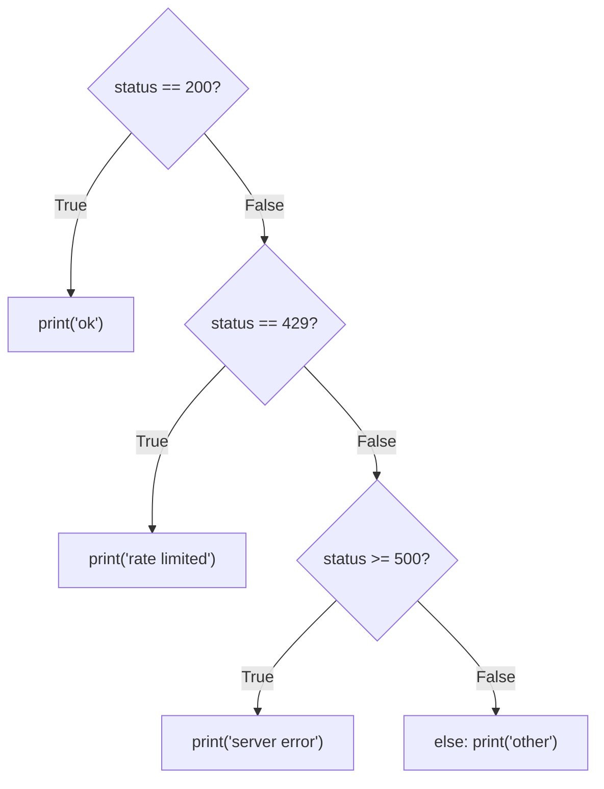
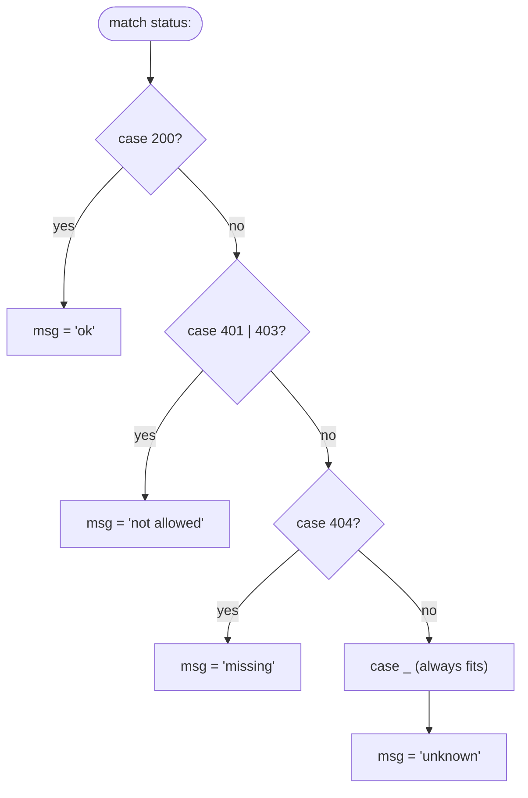

# If and Match

**What this chapter gives you:** the first tools that let a program *decide*. You will write
comments, split long lines, branch with `if`/`elif`/`else`, test membership with `in`,
and pick between patterns with `match`. Truthiness, `None`, and the one-line `a if c else b`
get extra attention, because they are the usual sources of silent bugs.

## Comment with #

A comment starts at `#` and runs to the end of the line. Python ignores it. Use comments to say
*why*, not to repeat what the code already says. There is no block comment: start every line with
`#`. Inside a string, `#` is just a character.

```python
>>> max_context = 200_000   # tokens the model can read at once
>>> note = "use # for comments"
>>> note
'use # for comments'
```

A triple-quoted string that stands alone is not a comment. It is a string value that Python builds and
throws away. Its proper use is as documentation ([[14 - Type Hints and Documentation|Chapter 14]]).

## Continue lines with \ and brackets

Keep lines under about 80 characters. If an expression is too long, you have two choices.

| **Method** | **How** | **Verdict** |
|---|---|---|
| Backslash | put `\` as the very last character of the line | works, but fragile |
| Brackets | break the line anywhere inside `( )`, `[ ]`, or `{ }` | preferred |

```python
>>> total = 1200 + \
...         350 + \
...         40
>>> total
1590
>>> total = (1200 +
...          350 +
...          40)
>>> total
1590
```

> [!warning] Trap: a space after the backslash
> A backslash followed by even one trailing space is a `SyntaxError`. You cannot see the space, which
> makes it painful. Prefer brackets and you never meet this bug.

Brackets also help with long prompts. Two string literals side by side are joined into one:

```python
>>> prompt = ("You are a helpful assistant. "
...           "Answer in one sentence.")
>>> prompt
'You are a helpful assistant. Answer in one sentence.'
```

> [!warning] Trap: a missing comma joins strings
> In a list, `["a" "b"]` is a one-item list containing `"ab"`. A forgotten comma between two
> string items silently merges them. You get no error, only a shorter list.

## Compare with if, elif, and else

### The shape of an if statement

An `if` line ends with a colon. The lines that belong to it are indented by the same amount, and
the standard is four spaces. Never mix tabs and spaces. Indentation *is* the structure: when the
indent goes back, the block ends.



```python
status = 429
if status == 200:
    print("ok")
elif status == 429:
    print("rate limited: wait and retry")
elif status >= 500:
    print("server error")
else:
    print("other:", status)
```

```text
rate limited: wait and retry
```

`elif` and `else` are optional. Tests inside tests are allowed, one more indent level each,
but flat `elif` chains read better than deep nesting.

### Comparison operators

Every comparison produces a `bool`.

| **Operator** | **Meaning** | **Watch for** |
|---|---|---|
| `==` | equal in value | `5 == 5.0` is `True`; `"5" == 5` is `False` |
| `!=` | not equal | the opposite of `==` |
| `<` `<=` `>` `>=` | ordering | mixing `int` and `str` raises `TypeError` |
| `is` / `is not` | same object | use it for `None`, not for numbers or strings |
| `=` | *assignment* | `if x = 5:` is a `SyntaxError` |

```python
>>> 5 == 5.0, "5" == 5
(True, False)
>>> 3 < "4"
Traceback (most recent call last):
  ...
TypeError: '<' not supported between instances of 'int' and 'str'
```

### and, or, not

Use `and`, `or`, and `not` to combine tests. Comparisons are worked out first, so no
parentheses are needed, but add them when a reader might hesitate. Order of strength: `not`, then
`and`, then `or`.

```python
>>> tokens, has_key = 800, True
>>> tokens < 1000 and has_key
True
>>> tokens > 1000 or not has_key
False
```

`and` and `or` are *short-circuit* operators. They stop as soon as the answer is known, and
they return one of their two *operands*, not necessarily a `bool`.

> [!example] Type check: what and / or / not return
> | **Expression** | **Rule** | **Type back** |
> |---|---|---|
> | `a and b` | if `a` is falsy, return `a`; otherwise return `b` | type of an operand |
> | `a or b` | if `a` is truthy, return `a`; otherwise return `b` | type of an operand |
> | `not a` | `True` if `a` is falsy, else `False` | always `bool` |

```python
>>> "" or "default"
'default'
>>> "hello" or "default"
'hello'
>>> "hi" and 42
42
>>> 0 and 1 / 0
0
>>> not []
True
```

The `0 and 1 / 0` line never divides, because the left side already decided the result.

> [!warning] Trap: `x == "a" or "b"` is always truthy
> `model == "claude" or "gemini"` means `(model == "claude") or "gemini"`. The right side is a
> non-empty string, so the whole expression is never falsy. Each side of `or` must be a full test, or
> use `in`.

```python
>>> model = "gpt"
>>> model == "claude" or "gemini"
'gemini'
>>> model == "claude" or model == "gemini"
False
>>> model in ("claude", "gemini")
False
```

### Chained comparisons

Python lets you write a range test the way you would on paper. `lo < x < hi` means
`lo < x and x < hi`, and `x` is evaluated once.

```text
 4    5         7                    10   11
 |----o=========X====================o----|     5 < x < 10  with x = 7
      (5 and 10 are excluded: open ends)
```

```python
>>> temperature = 0.7
>>> 0 <= temperature <= 2
True
>>> 5 < 7 < 10 < 999
True
```

### What is true?

An `if` does not need a real `bool`. Python asks every object "are you empty or zero?".
Empty and zero things are *falsy*; everything else is *truthy*. `bool(x)` shows the verdict.

| **Falsy (counts as False)** | **Truthy (counts as True)** |
|---|---|
| `False`, `None` | `True` |
| `0`, `0.0` | any other number, including `-1` and `0.1` |
| `""` (empty string) | any non-empty string, even `" "`, `"0"`, `"False"` |
| `[]`, `()`, `{}`, `set()`, `b""` | any container with at least one item, even `[0]` or `[None]` |

```python
>>> [bool(v) for v in (0, 0.0, "", [], (), {}, set(), None)]
[False, False, False, False, False, False, False, False]
>>> [bool(v) for v in ("0", "False", " ", [0], [None], 0.1)]
[True, True, True, True, True, True]
```

> [!tip] Rule
> Test emptiness the Python way: `if messages:` rather than `if len(messages) > 0:`. It also
> works for strings, dicts, and sets.

### None is not the same as empty or zero

`None` means "no value was given". It is falsy, but so are `0` and `""`, and those
are real, valid values. To ask "was anything given?" test identity: `x is None` or
`x is not None`.

```text
           value        if value:      if value is not None:
           None            False            False
           0               False            True    <- valid temperature!
           ""              False            True    <- valid empty string
           0.7             True             True
```

> [!danger] Boss fight: a falsy value that is perfectly valid
> A temperature of `0` is a real setting, yet it is falsy, so `if temperature:` treats it like
> "not provided". The same bug hides in `temperature or 1.0`, which swaps a valid `0` for
> `1.0`. 
> **Strategy:** when `None` means "missing", test `is None` / `is not None`. Use plain
> truthiness only when "empty or zero" really should be treated as "nothing".

```python
for temperature in (0, 0.7, None):
    wrong = temperature or 1.0
    right = 1.0 if temperature is None else temperature
    print(temperature, "wrong:", wrong, "right:", right)
```

```text
0 wrong: 1.0 right: 0
0.7 wrong: 0.7 right: 0.7
None wrong: 1.0 right: 1.0
```

(The `for` loop just repeats the block once per value; [[07 - For and While|Chapter 7]] explains it.)

### Conditional expressions: `a if cond else b`

When you only need to *choose a value*, a one-line form avoids a four-line `if`. The order is
unusual: the value for true comes first, the test is in the middle, and the value for false is last.
Python runs the test first.

```text
    "long"      if   tokens > 1000   else   "short"
      ^                   ^                    ^
  (2) used if         (1) test runs        (2) used if
      True                first                False
```

```python
>>> tokens = 1500
>>> label = "long" if tokens > 1000 else "short"
>>> label
'long'
>>> print("over limit" if tokens > 4096 else "fits")
fits
```

> [!example] Type check: what a conditional expression gives back
> It is an *expression*: it produces one value, so you can assign it, pass it to a function, or put
> it inside an f-string. The two branches may be different types; the result has the type of whichever
> branch ran. It has `else` always, because it must produce a value.

> [!warning] Trap: written backwards, it runs and is wrong
> Putting the test first looks natural but is valid Python with a different meaning. The line below does not
> raise an error. It treats `"long"` as the test, which is always truthy, so you get
> `tokens > 1000` (a `bool`) instead of a label.

```python
>>> tokens = 1500
>>> tokens > 1000 if "long" else "short"
True
>>> label = "long" if tokens > 1000 else "short"
```

> [!warning] Trap: it binds loosely
> The whole thing is chosen *after* the surrounding `+` is evaluated. Add parentheses when you mix
> them.

```python
>>> flag = False
>>> "Result: " + "yes" if flag else "no"
'no'
>>> "Result: " + ("yes" if flag else "no")
'Result: no'
```

> [!tip] Rule
> Use `a if c else b` to pick between two values. Use a normal `if` block when you want to
> *do* something (call functions, change variables). Do not chain several in one line.

## Do multiple comparisons with in

Many `or`-ed equality tests collapse into one `in`. `x in container` gives a `bool`.
What "in" means depends on the container.

| **Container** | **`in` checks** | **Speed** |
|---|---|---|
| `str` | is it a *substring*? (`"at" in "cat"` is True) | scans |
| `list`, `tuple` | is it equal to an item? (`"at" in ["cat"]` is False) | scans |
| `set` | is it an item? | instant |
| `dict` | is it a *key*? (values are ignored) | instant |

```python
>>> model = "claude-haiku-5-5"
>>> "haiku" in model
True
>>> allowed = {"claude-haiku-5-5", "claude-opus-5-5"}
>>> model in allowed
True
>>> limits = {"input": 100, "output": 20}
>>> "input" in limits, 100 in limits
(True, False)
>>> "at" in "cat", "at" in ["cat"]
(True, False)
>>> "gpt" not in allowed
True
```

> [!tip] Rule
> If you test membership many times against a fixed collection, store it in a `set`. Sets check
> instantly; lists check one item at a time ([[09 - Dictionaries and Sets|Chapter 9]]).

## The walrus operator

`name := expression` (Python 3.8+) assigns *and* gives back the value, so you can test and
keep a result in one step. It looks like a walrus lying on its side.

```python
>>> reply = "x" * 120
>>> limit = 100
>>> if (over := len(reply) - limit) > 0:
...     print("trim", over, "characters")
trim 20 characters
>>> over
20
```

The variable stays alive after the `if`. It also works in `while` loops ([[07 - For and While|Chapter 7]]).

> [!warning] Trap: parentheses decide what is assigned
> Without parentheses around the assignment, the walrus grabs the whole comparison, so you store a
> `bool`, not the number.

```python
>>> reply, limit = "x" * 120, 100
>>> if over := len(reply) - limit > 0:
...     print(over)
True
```

## Match

`match` (Python 3.10+) compares one *subject* against a list of *patterns*, top to bottom.
The first pattern that fits runs its block and the whole `match` ends. There is no fall-through and
no `break`. `case _` is the default.



### Simple matches

```python
status = 404
match status:
    case 200:
        msg = "ok"
    case 401 | 403:
        msg = "not allowed"
    case 404:
        msg = "missing"
    case _:
        msg = "unknown"
print(msg)
```

```text
missing
```

`401 | 403` is an *or-pattern*: either value fits. The same job can be done with an
`if`/`elif` chain or, for pure lookup, a dictionary. Pick by readability.

| **Tool** | **Best when** | **Default case** |
|---|---|---|
| `if`/`elif`/`else` | conditions are ranges or complex tests | `else` |
| `match`/`case` | you compare against shapes or exact values | `case _` |
| `dict.get(key, default)` | you only map a value to another value | the second argument |

```python
>>> messages = {200: "ok", 404: "missing"}
>>> messages.get(500, "unknown")
'unknown'
```

### Structural matches

"Structural" means the pattern describes the *shape* of the subject and can pull values out of it.
A sequence pattern matches a list or tuple of the same length. A name in a pattern *captures* that
part into a variable. `*rest` captures the remaining items as a list. A `case` may end with
`if condition`, called a *guard*.

```python
for line in ("quit", "add gpt-x", "add claude-a 3", "list all now"):
    parts = line.split()
    match parts:
        case ["quit"]:
            print("bye")
        case ["add", name]:
            print("add one:", name)
        case ["add", name, *rest]:
            print("add", name, "with extras", rest)
        case [cmd, *_] if cmd == "list":
            print("listing")
        case _:
            print("unknown")
```

```text
bye
add one: gpt-x
add claude-a with extras ['3']
listing
```

> [!example] Type check: pattern cheat sheet
> | **Pattern** | **Fits when the subject is** | **Binds** |
> |---|---|---|
> | `200`, `"ok"`, `None` | equal to that literal (`None` by identity) | nothing |
> | `401 \| 403` | any one of the alternatives | nothing |
> | `x` | *anything* | `x` |
> | `_` | anything | nothing |
> | `[a, b]` or `a, b` | a list or tuple of exactly 2 (not a `str`) | `a`, `b` |
> | `[a, *rest]` | a sequence of 1 or more | `a`, `rest` (list) |
> | `{"k": v}` | a dict with key `"k"`; extra keys are fine | `v` |
> | `int()`, `str()` | an instance of that type | nothing |
> | `case p if cond` | `p` fits and `cond` is true | as `p` |

### Matching JSON-like data

Model replies and tool calls are dicts. A mapping pattern checks keys and values and pulls out what you
need. Unlike sequences, a dict may have extra keys.

```python
events = [
    {"type": "text", "text": "Hello"},
    {"type": "tool_use", "name": "search", "input": {"q": "tokens"}},
    {"type": "ping"},
    42,
]
for event in events:
    match event:
        case {"type": "text", "text": body}:
            print("text:", body)
        case {"type": "tool_use", "name": name}:
            print("tool call:", name)
        case {"type": other}:
            print("ignored:", other)
        case int() | float():
            print("a number")
```

```text
text: Hello
tool call: search
ignored: ping
a number
```

If no case fits and there is no `case _`, the `match` simply does nothing. It is not an
error.

> [!warning] Trap: a bare name captures, it does not compare
> In a pattern, a plain name such as `LIMIT` is a *capture*: it always fits and overwrites the
> variable. To compare against a constant, use a dotted name (`Config.LIMIT`), a literal, or a guard.

```python
>>> LIMIT = 100
>>> match 5:
...     case LIMIT:
...         print("matched; LIMIT is now", LIMIT)
matched; LIMIT is now 5
>>> match 5:
...     case n if n == 100:
...         print("equal to 100")
...     case _:
...         print("not 100")
not 100
```

> [!warning] Trap: names are bound even when the guard fails
> A pattern may capture a name and then lose to its guard. The capture stays behind.

```python
>>> match [3, 5]:
...     case x, y if y > 6:
...         print("big")
...     case _:
...         print("no match")
no match
>>> x, y
(3, 5)
```

> [!question]- Practice
> 1. Write an `if`/`elif`/`else` that prints `"too low"`, `"too high"`, or `"just right"` when `guess` is compared with `secret`.
> 2. What does `"yes" and 0` evaluate to? What does `"" or None` evaluate to?
> 3. Rewrite `label = "big" if n > 10 else "small"` as a normal four-line `if`/`else`. Then explain what `n > 10 if "big" else "small"` would return.
> 4. Why is `if temperature:` wrong when 0 is a legal setting? Write the correct test.
> 5. Write a `match` that handles the strings `"start"` and `"stop"`, plus a default.
> 6. What is the difference between `"at" in "cat"` and `"at" in ["cat"]`?

> [!success] Achievement unlocked: Fork in the Road
> You can now:
>
> - add comments and split long lines with brackets;
> - build `if`/`elif`/`else` ladders and chained comparisons;
> - predict truthiness, and test `None` with `is None`;
> - write `a if cond else b` in the right order, and spot it written backwards;
> - use `in`, the walrus, and `match` with sequence and mapping patterns.

---
Related: [[02 - Types and Variables]] · [[03 - Numbers]] · [[04 - Strings]] · [[07 - For and While]] · [[09 - Dictionaries and Sets]]
