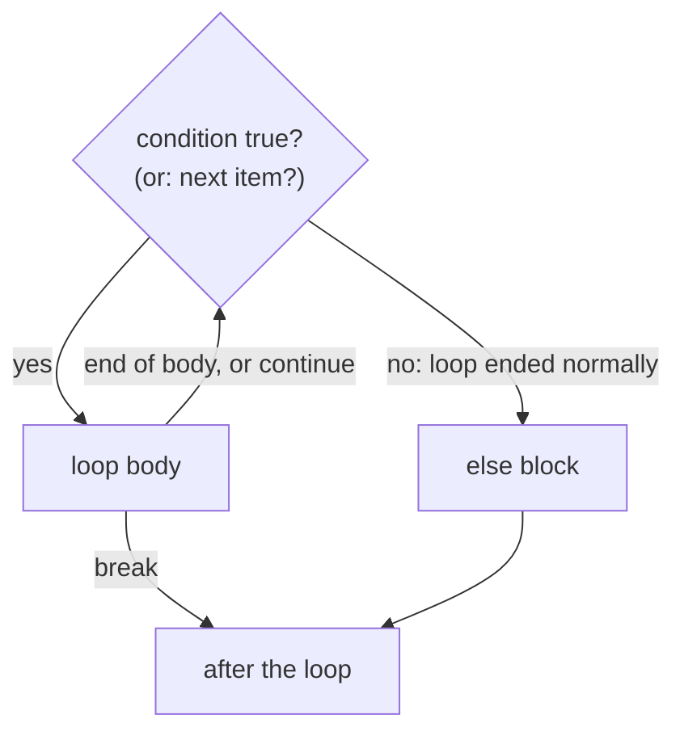

# For and While

**What this chapter gives you:** the two ways Python repeats work. `while` repeats as long as a
test stays true. `for` walks through the items of anything iterable. You will also use `range()`
to count, `break` and `continue` to steer, and the odd-looking `else` on a loop. Almost every
AI script is a loop over documents, messages, batches, or retries.

## Repeat with while

`while condition:` runs its indented block, then checks the condition again, over and over. When the
condition is false, Python skips to the line after the block. Something inside the block must eventually make
the condition false, or the loop never ends.

```python
budget = 1000
used = 0
while used + 300 <= budget:
    used += 300
    print("sent a batch, used", used)
print("stopped at", used)
```

```text
sent a batch, used 300
sent a batch, used 600
sent a batch, used 900
stopped at 900
```

Tracing the loop by hand, one row per check, is the best way to see what happens:

| **check #** | **`used`** | `used + 300 <= 1000` | **action** |
|---|---|---|---|
| 1 | 0 | `300 <= 1000` ✓ | run body: `used` becomes 300 |
| 2 | 300 | `600 <= 1000` ✓ | run body: `used` becomes 600 |
| 3 | 600 | `900 <= 1000` ✓ | run body: `used` becomes 900 |
| 4 | 900 | `1200 <= 1000` ✗ | leave the loop |

> [!warning] Trap: forgetting to change the thing you test
> If the body never changes `used`, the test is true forever and the program hangs. Stop it with
> `Ctrl+C`. When you write a `while`, point at the line that moves it toward the end.

### Cancel with break

`break` leaves the loop immediately. The pattern `while True:` plus a `break` inside is the
standard way to loop "until something happens". `input()` reads one line from the keyboard and
*always returns a string*.

```python
while True:
    line = input("prompt> ")
    if line == "q":
        break
    print(line.upper())
```

```text
prompt> hi
HI
prompt> q
```

### Skip ahead with continue

`continue` abandons the rest of this pass and jumps back to the top for the next pass. It is handy
for skipping items you do not want to process.

```python
lines = ["hello", "", "   ", "world"]
for line in lines:
    if not line.strip():
        continue
    print("got:", line)
```

```text
got: hello
got: world
```

### Check break use with else

A loop may have an `else` block. It runs only if the loop finished *without* hitting `break`.
Read it as "no break happened": the loop was searching, and `else` says it found nothing. It is
indented to match the `while`, not the `if`.



```python
batch = [3, 5, 7]
pos = 0
while pos < len(batch):
    if batch[pos] % 2 == 0:
        print("found an even number at", pos)
        break
    pos += 1
else:
    print("no even number")
```

```text
no even number
```

A realistic use is a retry loop: stop at the first success, and the `else` reports that every attempt
failed.

```python
statuses = [429, 429, 200]     # pretend replies from an API
attempts = 0
while attempts < 3:
    status = statuses[attempts]
    attempts += 1
    if status == 200:
        print("ok after", attempts, "tries")
        break
else:
    print("gave up")
```

```text
ok after 3 tries
```

## Iterate with for and in

`for name in iterable:` takes the items of the iterable one at a time, binds each to `name`, and
runs the block. You do not manage a counter or know the length in advance. An *iterable* is anything
you can step through: strings, lists, tuples, dicts, sets, ranges, files, and more.

```text
  models = ["haiku", "sonnet", "opus"]

     pass 1           pass 2           pass 3
  [ "haiku" ]      [ "sonnet" ]      [ "opus" ]
       \                |                /
        v               v               v
                 model  (a name that is
                         re-pointed each pass)
```

```python
>>> for letter in "thud":
...     print(letter)
t
h
u
d
>>> for model in ["haiku", "sonnet"]:
...     print(model.upper())
HAIKU
SONNET
```

> [!example] Type check: what `x` is in `for x in ...`
> | **Iterable** | **`x` is a ...** | **Example** |
> |---|---|---|
> | `str` | `str` (one character) | `"ab"` gives `"a"`, `"b"` |
> | `list`, `tuple` | the item itself | any type, even another list |
> | `dict` | the *key* | use `.values()` or `.items()` for more (Chapter 9) |
> | `range(n)` | `int` | `0` up to `n - 1` |
> | `bytes` | `int` | one byte as a number (Chapter 5) |
> | `enumerate(seq)` | a `(index, item)` tuple | unpack it: `for i, item in ...` |

### break, continue, else

All three work exactly as in a `while`. The `else` runs when the loop was not stopped by
`break`, and also when the iterable was empty.

```python
for letter in "thud":
    if letter == "x":
        print("found an x")
        break
else:
    print("no x in there")
```

```text
no x in there
```

A plain flag variable does the same job and some people find it clearer. Choose whichever you can read
at a glance six months later.

> [!danger] Boss fight: the `else` on a loop
> `else` on a `for` or `while` does *not* mean "otherwise, if the loop condition was
> false". It means "the loop ran to its natural end without a `break`". That includes the case where
> a `for` had nothing to iterate over. 
> **Strategy:** read it as `nobreak`. Use it only for search loops: `break` means "found it",
> `else` means "not found". If that reading feels forced, use a flag instead.

```python
for item in []:
    print("never printed")
    break
else:
    print("else ran: the list was empty")
```

```text
else ran: the list was empty
```

### Counting with enumerate

If you need both the position and the item, do not count by hand and do not write
`range(len(items))`. `enumerate()` hands you pairs.

```python
models = ["haiku", "sonnet", "opus"]
for i, name in enumerate(models, start=1):
    print(i, name)
```

```text
1 haiku
2 sonnet
3 opus
```

### Nested loops

A loop inside a loop runs its whole inner cycle for every outer pass. `break` and `continue`
only affect the *innermost* loop they sit in.

```python
for i in range(3):
    for j in range(3):
        if j == 1:
            break          # leaves only the inner loop
        print(i, j)
```

```text
0 0
1 0
2 0
```

> [!warning] Trap: changing a list while looping over it
> Removing items from the list you are iterating makes Python skip items, because the positions shift.
> Loop over a copy (`for n in nums[:]`) or build a new list instead ([[08 - Tuples and Lists|Chapter 8]]). The loop below should
> remove all the even numbers, but it leaves a 4 behind.

```python
nums = [2, 4, 6, 7]
for n in nums:
    if n % 2 == 0:
        nums.remove(n)
print(nums)
```

```text
[4, 7]
```

> [!warning] Trap: the loop variable lives on
> After a `for`, the name keeps the last item. If the iterable was empty, the name was never set and
> using it raises `NameError`.

## Generate number sequences with range()

`range(start, stop, step)` produces integers on demand without building a list. Only `stop` is
required. `start` defaults to 0 and `step` defaults to 1. The stop value is *never*
included, the same rule as slices.

```text
  range(2, 10, 3)   ->  2, 5, 8

  0  1  2  3  4  5  6  7  8  9  10
        *        *        *      |
        2        5        8    stop (10 is excluded)
```

```python
>>> list(range(3))
[0, 1, 2]
>>> list(range(2, 6))
[2, 3, 4, 5]
>>> list(range(0, 11, 2))
[0, 2, 4, 6, 8, 10]
>>> list(range(2, -1, -1))
[2, 1, 0]
>>> list(range(5, 2))
[]
```

> [!example] Type check: range is its own type
> `range(...)` returns a `range` object: an immutable, lazy sequence of ints. It is not a list, so
> it prints as `range(2, 10, 3)`; wrap it in `list()` to see the numbers. It supports `len()`,
> indexing, and `in`, and a huge range uses almost no memory.

```python
>>> r = range(0, 10, 3)
>>> r
range(0, 10, 3)
>>> len(r), r[2], 9 in r, 5 in r
(4, 6, True, False)
>>> len(range(10**12))
1000000000000
```

> [!warning] Trap: the stop value is not included
> `range(1, 5)` gives 1, 2, 3, 4. To get 1 to 5 you need `range(1, 6)`. A going-down range
> needs a negative step, or it is silently empty: `range(5, 2)` is `[]`, but
> `range(5, 2, -1)` is `[5, 4, 3]`.

## Other iterators

The thing a `for` loop really uses is an *iterator*: an object that gives the next item each time
it is asked and raises `StopIteration` when it runs out. `iter()` makes one from any iterable and
`next()` asks for the next item. You rarely call them yourself, but knowing they exist explains two
behaviours.

```python
>>> it = iter(["a", "b"])
>>> next(it), next(it)
('a', 'b')
>>> next(it)
Traceback (most recent call last):
  ...
StopIteration
>>> next(it, "done")
'done'
```

> [!warning] Trap: an iterator is used up after one pass
> A list can be looped over many times. An iterator (and things like streaming API replies, which behave
> like iterators) can be consumed only once. A second loop sees nothing.

```python
>>> stream = iter([1, 2])
>>> list(stream), list(stream)
([1, 2], [])
```

The walrus operator ([[06 - If and Match|Chapter 6]]) pairs well with `while`: read a piece, test it, and use it in one
line. This loop stops at the first empty piece.

```python
chunks = iter(["ab", "cd", ""])
while (chunk := next(chunks)) != "":
    print("chunk:", chunk)
```

```text
chunk: ab
chunk: cd
```

Later chapters show iteration over files ([[20 - Files|Chapter 20]]), how to make your own iterable objects
([[11 - Objects|Chapter 11]]), and the `itertools` module ([[12 - Modules and Packages|Chapter 12]]).

> [!tip] Rule
> Prefer `for` when you know what you are looping over, and `while` when you loop until a condition
> changes. If you catch yourself writing `i = 0 ... i += 1` to walk a list, switch to `for` or
> `enumerate`.

> [!question]- Practice
> 1. Print the numbers 3, 2, 1, 0 using a `for` loop over a list, then using `range()`.
> 2. Write a `while` loop with `number = 1` and `guess_me = 7` that prints `"too low"` while `number` is smaller, prints `"found it!"` and stops when equal, and increments `number` each pass.
> 3. What does `list(range(10, 0, -3))` give? Predict it first.
> 4. Rewrite `for i in range(len(items)): print(i, items[i])` using `enumerate`.
> 5. Explain in one sentence when the `else` block of a `for` loop runs.
> 6. Why does the loop that removes even numbers from `[2, 4, 6, 7]` leave a 4 in the list?

> [!success] Achievement unlocked: Loop Master
> You can now:
>
> - write `while` loops that end, and stop runaway ones;
> - steer loops with `break`, `continue`, and loop `else`;
> - choose the right form of `range()` and predict its numbers;
> - iterate with `for`, `enumerate`, and nested loops without skipping items;
> - explain why an iterator can be read only once.

---
Related: [[04 - Strings]] · [[06 - If and Match]] · [[08 - Tuples and Lists]] · [[09 - Dictionaries and Sets]] · [[10 - Functions]]
