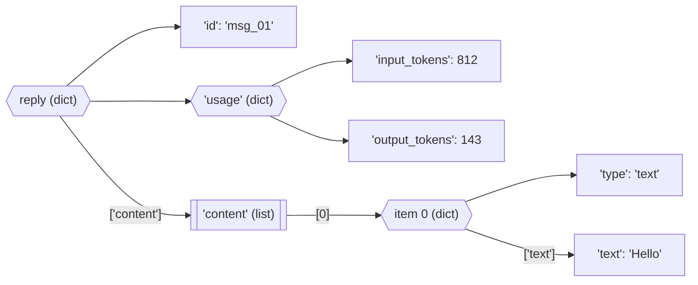

# Dictionaries and Sets

**What this chapter gives you:** the two containers that find things by *value* instead of by
position. A `dict` maps keys to values and is the shape of nearly all JSON, API requests, model replies,
and configuration. A `set` is a bag of unique items with fast membership tests and set algebra. After
this chapter you can read any nested API response and pull out one number safely.

## Dictionaries

A dictionary stores *key → value* pairs. You ask for a value by its key, not by a position.
Keys are unique. Since Python 3.7 a dict also remembers the order in which keys were added.

```text
  list: find by POSITION            dict: find by KEY

  ["haiku", "sonnet"]               {"fast": "haiku", "smart": "sonnet"}
    0        1                        "fast"   -> "haiku"
    |        |                        "smart"  -> "sonnet"
  m[0]     m[1]                     m["fast"]   m["smart"]
```

### Create with {} and dict()

```python
>>> usage = {"input_tokens": 812, "output_tokens": 143}
>>> usage["input_tokens"]
812
>>> same = dict(input_tokens=812, output_tokens=143)
>>> same == usage
True
>>> type(usage), len(usage), {}
(<class 'dict'>, 2, {})
```

`dict(name=value)` is handy, but the names must be legal variable names (no spaces, no hyphens, no
reserved words). For keys like `"max-tokens"`, use the brace form. A trailing comma after the last
pair is allowed.

### Convert with dict()

`dict()` also accepts a sequence of two-item sequences. `zip()` ([[08 - Tuples and Lists|Chapter 8]]) is the usual way to
make them.

```python
>>> dict([("a", 1), ("b", 2)])
{'a': 1, 'b': 2}
>>> dict(["ab", "cd"])
{'a': 'b', 'c': 'd'}
>>> dict(zip(["x", "y"], [10, 20]))
{'x': 10, 'y': 20}
>>> dict([("a", 1, 2)])
Traceback (most recent call last):
  ...
ValueError: dictionary update sequence element #0 has length 3; 2 is required
```

### Add or change an item with [key]

Assigning to a key adds it when it is new and replaces the value when it exists. There is no
out-of-range error as with lists. Duplicate keys in a literal keep the last value.

```python
>>> cfg = {"model": "haiku"}
>>> cfg["max_tokens"] = 1000
>>> cfg["model"] = "sonnet"
>>> cfg
{'model': 'sonnet', 'max_tokens': 1000}
>>> {"a": 1, "a": 2}
{'a': 2}
>>> list(cfg)
['model', 'max_tokens']
```

> [!example] Type check: what can be a key
> A key must be *hashable*, which in practice means immutable: `str`, `int`, `float`,
> `bool`, `None`, `bytes`, `frozenset`, and tuples whose items are hashable. A list, dict,
> or set cannot be a key. Values can be anything.

```python
>>> {(1, 2): "tuple key works"}
{(1, 2): 'tuple key works'}
>>> {[1, 2]: "no"}
Traceback (most recent call last):
  ...
TypeError: unhashable type: 'list'
```

> [!warning] Trap: keys that are equal count as the same key
> `1`, `1.0`, and `True` are equal, so they collide. The first key object stays, and the last
> value wins.

```python
>>> {1: "a", True: "b", 1.0: "c"}
{1: 'c'}
```

### Get an item by [key] or with get()

| **Expression** | **Key present** | **Key missing** |
|---|---|---|
| `d[k]` | the value | raises `KeyError` |
| `d.get(k)` | the value | returns `None` |
| `d.get(k, dflt)` | the value | returns `dflt` |
| `k in d` | `True` | `False` |
| `d.pop(k)` | value, and removes the pair | raises `KeyError` |
| `d.pop(k, dflt)` | value, and removes the pair | returns `dflt` |
| `d.setdefault(k, dflt)` | the value | stores `dflt` under `k`, then returns it |

```python
>>> resp = {"model": "claude-haiku-5-5", "stop_reason": "end_turn"}
>>> resp["model"]
'claude-haiku-5-5'
>>> resp["usage"]
Traceback (most recent call last):
  ...
KeyError: 'usage'
>>> resp.get("usage") is None
True
>>> resp.get("usage", {})
{}
>>> "usage" in resp
False
```

> [!warning] Trap: `d.key` is not how dicts work
> A dict is read with *brackets* and a key: `d["model"]`. Dot access (`d.model`) looks for an
> *attribute* and fails. SDK response objects are the opposite: they use dots
> (`response.usage`), while data parsed from JSON is a dict and uses brackets.

```python
>>> resp = {"model": "claude-haiku-5-5"}
>>> resp.model
Traceback (most recent call last):
  ...
AttributeError: 'dict' object has no attribute 'model'
```

| **Syntax** | **Looks up** | **Fails with** |
|---|---|---|
| `d["k"]` | a dict key | `KeyError` |
| `obj.x` | an attribute | `AttributeError` |
| `lst[0]` | a list position | `IndexError` |
| `d.get("k")` | a dict key, safely | never; gives `None` |

### Nested dictionaries: reading JSON

Values can be dicts and lists, so data nests as deeply as you like. Read it with one subscript per level,
left to right. The picture shows how `reply["content"][0]["text"]` walks down the tree.



```python
>>> reply = {
...     "id": "msg_01",
...     "usage": {"input_tokens": 812, "output_tokens": 143},
...     "content": [{"type": "text", "text": "Hello"}],
... }
>>> reply["usage"]["input_tokens"]
812
>>> reply["content"][0]["text"]
'Hello'
>>> reply["usage"]["total"]
Traceback (most recent call last):
  ...
KeyError: 'total'
>>> reply.get("error", {}).get("message", "no error")
'no error'
```

> [!danger] Boss fight: missing keys deep inside nested data
> Real replies are not always complete. A key can be absent, or present with the value `None`, or a list
> can be empty. `reply["a"]["b"]["c"]` fails at the first gap with a `KeyError` or `TypeError`
> that does not say which level was wrong. 
> **Strategy:** decide per level. Use `[ ]` when absence is a bug (you want the loud error). Use
> `.get(key, {})` to step through levels that may be missing, then `.get(key, default)` at the last
> one. Check lists with `if items:` before `items[0]`. Remember `.get(k, d)` returns `d`
> only when the key is *missing*, not when its value is `None`.

```python
>>> reply = {"usage": None, "content": []}
>>> reply.get("usage", {}).get("input_tokens", 0)
Traceback (most recent call last):
  ...
AttributeError: 'NoneType' object has no attribute 'get'
>>> (reply.get("usage") or {}).get("input_tokens", 0)
0
>>> first = reply["content"][0] if reply["content"] else None
>>> first is None
True
```

### Iterate with for and in

Looping over a dict gives its *keys*, in insertion order. `.keys()`, `.values()`, and
`.items()` return *views*: light objects that follow the dict and can be looped over or
turned into lists.

```python
>>> tokens = {"prompt": 812, "completion": 143}
>>> for name in tokens:
...     print(name)
prompt
completion
>>> list(tokens.keys()), list(tokens.values())
(['prompt', 'completion'], [812, 143])
>>> list(tokens.items())
[('prompt', 812), ('completion', 143)]
>>> for name, n in tokens.items():
...     print(name, "->", n)
prompt -> 812
completion -> 143
>>> sum(tokens.values())
955
```

> [!example] Type check: what the loop variable is
> `for k in d` and `for k in d.keys()`: the key. `for v in d.values()`: the value.
> `for item in d.items()`: a `(key, value)` *tuple*, so unpack it in the `for` line
> ([[08 - Tuples and Lists|Chapter 8]]) with `for k, v in d.items()`.

> [!warning] Trap: do not add or remove keys while looping
> Changing the number of keys during a loop raises `RuntimeError`. Loop over a copy of the keys
> (`list(d)`) when you must change the dict, or build a new dict.

```python
>>> d = {"a": 1, "b": 2}
>>> for k in d:
...     d[k + "x"] = 0
Traceback (most recent call last):
  ...
RuntimeError: dictionary changed size during iteration
>>> for k in list(d):
...     d[k + "x"] = 0
>>> sorted(d)
['a', 'ax', 'axx', 'b', 'bx']
```

### Combine dictionaries

When two dicts share a key, the one applied *last* wins. There are three ways to merge.

| **Way** | **Result** | **Changes the left dict?** |
|---|---|---|
| `a \| b` | new dict | no |
| `{**a, **b}` | new dict | no |
| `a.update(b)` | `None` | yes, in place |
| `a \|= b` | (assignment) | yes, in place |

```python
>>> base = {"model": "haiku", "temperature": 0.7}
>>> override = {"temperature": 0.0, "max_tokens": 500}
>>> base | override
{'model': 'haiku', 'temperature': 0.0, 'max_tokens': 500}
>>> {**base, **override} == base | override
True
>>> base
{'model': 'haiku', 'temperature': 0.7}
>>> base.update(override)
>>> base["max_tokens"]
500
```

This "defaults, then overrides" pattern is how you combine default request settings with per-call
settings. All three ways are shallow: nested values are shared, not copied.

### Delete items

```python
>>> d = {"a": 1, "b": 2, "c": 3}
>>> del d["a"]
>>> d.pop("b")
2
>>> d.pop("zzz", None) is None
True
>>> d.popitem()
('c', 3)
>>> d
{}
>>> del d["x"]
Traceback (most recent call last):
  ...
KeyError: 'x'
```

`popitem()` removes and returns the most recently added pair. `clear()` empties the dict in place;
assigning `d = {}` makes a new empty dict and leaves other names pointing at the old one.

### Test for a key with in

`in` on a dict checks *keys*, never values. Test values with `v in d.values()`, which scans.

```python
>>> limits = {"input": 100, "output": 20}
>>> "input" in limits, 100 in limits, 100 in limits.values()
(True, False, True)
```

### Assign, copy, deepcopy

Dicts are mutable, so everything from [[08 - Tuples and Lists|Chapter 8]] applies. `b = a` is a second name for one dict.
`a.copy()` is shallow: new outer dict, shared inner values. `copy.deepcopy(a)` copies all the way
down.

```python
>>> import copy
>>> a = {"model": "haiku", "stops": ["END"]}
>>> b = a
>>> c = a.copy()
>>> e = copy.deepcopy(a)
>>> a["stops"].append("STOP")
>>> c["stops"], e["stops"]
(['END', 'STOP'], ['END'])
>>> b is a, c is a, c["stops"] is a["stops"]
(True, False, True)
```

### Compare dictionaries

`==` and `!=` compare keys and values and ignore order. The ordering operators
(`<`, `>`) are not defined for dicts.

```python
>>> {1: 1, 2: 2, 3: 3} == {3: 3, 1: 1, 2: 2}
True
>>> {1: [1, 2]} == {1: [1, 1]}
False
>>> {1: 1} < {2: 2}
Traceback (most recent call last):
  ...
TypeError: '<' not supported between instances of 'dict' and 'dict'
```

### Dictionary comprehensions

The form is `{key_expr: value_expr for item in iterable if condition}`. Use it to build or reshape
dicts in one expression.

```python
>>> words = ["haiku", "opus", "sonnet"]
>>> {w: len(w) for w in words}
{'haiku': 5, 'opus': 4, 'sonnet': 6}
>>> {w: len(w) for w in words if len(w) > 4}
{'haiku': 5, 'sonnet': 6}
>>> {v: k for k, v in {"a": 1, "b": 2}.items()}
{1: 'a', 2: 'b'}
```

Swapping keys and values drops data when values repeat, and fails when a value is not hashable.

### Counting and grouping patterns

Two patterns appear constantly. Counting: `d.get(key, 0) + 1`. Grouping: `d.setdefault(key, [])`
then `.append`. For counting alone, `collections.Counter` does it in one call ([[12 - Modules and Packages|Chapter 12]]).

```python
>>> counts = {}
>>> for ch in "letters":
...     counts[ch] = counts.get(ch, 0) + 1
>>> counts
{'l': 1, 'e': 2, 't': 2, 'r': 1, 's': 1}
>>> by_label = {}
>>> for doc, label in [("d1", "spam"), ("d2", "ok"), ("d3", "spam")]:
...     by_label.setdefault(label, []).append(doc)
>>> by_label
{'spam': ['d1', 'd3'], 'ok': ['d2']}
>>> from collections import Counter
>>> Counter("letters").most_common(1)
[('e', 2)]
```

## Sets

A set is a dict with the values thrown away: a bag of *unique, hashable* items with no order and no
positions. Use one when you only care whether something is in there, or when you need to remove duplicates
or compare groups.

### Create with set() or {}

```python
>>> type({}), type(set())
(<class 'dict'>, <class 'set'>)
>>> seen = {3, 1, 3, 2}
>>> seen
{1, 2, 3}
>>> sorted(set("letters"))
['e', 'l', 'r', 's', 't']
>>> set((1,)), set([0, 2, 4]), set()
({1}, {0, 2, 4}, set())
```

> [!warning] Trap: `{}` is an empty dict, not an empty set
> Empty braces are a *dict*. Write `set()` for an empty set. Also `set()` takes *one*
> iterable, not several values, and a bare number is not iterable.

```python
>>> set(0, 2, 4)
Traceback (most recent call last):
  ...
TypeError: set expected at most 1 argument, got 3
>>> set(5)
Traceback (most recent call last):
  ...
TypeError: 'int' object is not iterable
```

Because a set is unordered, you cannot index it, and the order of a printed set of strings can change
between runs. Use `sorted(s)` when you need a stable order. Items must be hashable.

```python
>>> {1, 2}[0]
Traceback (most recent call last):
  ...
TypeError: 'set' object is not subscriptable
>>> {[1, 2]}
Traceback (most recent call last):
  ...
TypeError: unhashable type: 'list'
```

### Add, remove, length, membership

```python
>>> s = {1, 2, 3}
>>> s.add(4)
>>> s.add(2)
>>> s.remove(3)
>>> s.discard(99)
>>> s
{1, 2, 4}
>>> len(s), 2 in s, 3 in s
(3, True, False)
>>> s.remove(99)
Traceback (most recent call last):
  ...
KeyError: 99
```

`remove()` raises `KeyError` when the item is absent. `discard()` stays quiet. Adding an item
that is already there changes nothing. Testing `x in s` takes about the same time however big the set
is; on a list it scans every item.

A common use is removing duplicates. A set loses the order; a dict keeps it:

```python
>>> docs = ["b", "a", "b", "c", "a"]
>>> len(set(docs))
3
>>> list(dict.fromkeys(docs))
['b', 'a', 'c']
```

### Set operations

Set algebra answers "what do these two groups share?" and "what is missing?". Each operator has a
method twin. The methods accept any iterable; the operators need two sets.

```text
  a = {1, 2}     b = {2, 3}

  a | b  union          a & b  intersection      a - b  difference       a ^ b  symmetric diff.
  ( 1 [2] 3 )           ( 1  [2]  3 )            ( [1] 2   3 )           ( [1]  2  [3] )
  all items             items in both            in a, not in b          in exactly one
  {1, 2, 3}             {2}                      {1}                     {1, 3}
```

| **Operator** | **Method** | **Result is** |
|---|---|---|
| `a \| b` | `a.union(b)` | items in either |
| `a & b` | `a.intersection(b)` | items in both |
| `a - b` | `a.difference(b)` | items in `a` but not in `b` |
| `a \textasciicircum{} b` | `a.symmetric_difference(b)` | items in exactly one |
| `a <= b` | `a.issubset(b)` | `bool`: every item of `a` is in `b` |
| `a < b` | – | `bool`: proper subset (and not equal) |
| `a >= b` | `a.issuperset(b)` | `bool`: `a` contains all of `b` |
| – | `a.isdisjoint(b)` | `bool`: nothing in common |

```python
>>> a, b = {1, 2}, {2, 3}
>>> a | b, a & b, a - b, a ^ b
({1, 2, 3}, {2}, {1}, {1, 3})
>>> allowed = {"search", "calc", "email"}
>>> requested = {"calc", "shell"}
>>> sorted(requested & allowed), sorted(requested - allowed)
(['calc'], ['shell'])
>>> requested <= allowed, {1} <= {1, 2}, {1, 2} < {1, 2}
(False, True, False)
>>> a.union([5, 6]) == {1, 2, 5, 6}
True
>>> a | [5, 6]
Traceback (most recent call last):
  ...
TypeError: unsupported operand type(s) for |: 'set' and 'list'
```

The result of an operator is a new set, and an empty result is falsy, so
`if requested - allowed:` reads as "is anything missing?".

### Set comprehensions and frozenset

```python
>>> {n % 3 for n in range(10)}
{0, 1, 2}
>>> sorted({w[0] for w in ["apple", "avocado", "banana"]})
['a', 'b']
>>> fs = frozenset([3, 2, 1])
>>> fs
frozenset({1, 2, 3})
>>> fs.add(4)
Traceback (most recent call last):
  ...
AttributeError: 'frozenset' object has no attribute 'add'
>>> {frozenset({1, 2}): "usable as a dict key"}
{frozenset({1, 2}): 'usable as a dict key'}
```

A `frozenset` is an immutable set. Because it is hashable it can be a dict key or a member of another
set, which an ordinary set cannot.

> [!example] Type check: the four comprehensions and the odd one out
> | **Syntax** | **Builds a** | **Duplicates** | **Note** |
> |---|---|---|---|
> | `[x for ...]` | `list` | kept | ordered |
> | `{x for ...}` | `set` | dropped | unordered |
> | `{k: v for ...}` | `dict` | later key wins | the colon makes it a dict |
> | `(x for ...)` | generator | kept | lazy, one pass; *not* a tuple |

### Which container?

|  | **tuple** | **list** | **dict** | **set** |
|---|---|---|---|---|
| Ordered? | ✓ | ✓ | ✓ (by insertion) | ✗ |
| Duplicates? | ✓ | ✓ | keys: ✗ | ✗ |
| Mutable? | ✗ | ✓ | ✓ | ✓ |
| Find by | position | position | key | value (`in`) |
| Fast `x in`? | ✗ | ✗ | ✓ (keys) | ✓ |

> [!tip] Rule
> Reach for a dict when you have named fields or a lookup table, a set when you ask "have I seen this?",
> a list when order and repeats matter, and a tuple for a small fixed record.

> [!question]- Practice
> 1. Build a dict `prices` mapping `"haiku"`, `"sonnet"`, `"opus"` to three prices. Print the price of `"sonnet"` two ways, one of which cannot raise `KeyError`.
> 2. Given `prices`, build the inverse dict (price to name). What goes wrong if two models share a price?
> 3. What is the difference between `d.get("k")` returning `None` and `d["k"]`?
> 4. Merge `{"a": 1, "b": 2}` and `{"b": 9}` into a new dict without changing either. Which value does `"b"` get?
> 5. Why does `{}` not create an empty set, and what do you write instead?
> 6. Given two sets of tool names, `allowed` and `requested`, write one expression for the tools that were requested but not allowed.

> [!success] Achievement unlocked: Key Master
> You can now:
>
> - create, read, update, merge, and delete dict entries, choosing between `[ ]`, `get`, and `in`;
> - walk nested JSON-like data and handle missing keys safely;
> - loop with `keys()`, `values()`, and `items()` without changing the dict during the loop;
> - use sets for uniqueness, membership, and `|`, `&`, `-`, `\textasciicircum{}`;
> - explain why a list cannot be a dict key and when to use `frozenset`.

---
Related: [[06 - If and Match]] · [[07 - For and While]] · [[08 - Tuples and Lists]] · [[10 - Functions]] · [[11 - Objects]] · [[12 - Modules and Packages]]
