# Functions

A function is a named piece of code that you can run again and again with different inputs. This chapter shows how to define one, how arguments reach it, and how to treat functions as ordinary objects. It also covers closures, generators, decorators, scope and exceptions. These are the tools behind every API wrapper, retry loop and streaming loop you will write.

## Define and call a function

`def` creates a function. Parentheses call it. The `return` statement hands a value back to the caller.

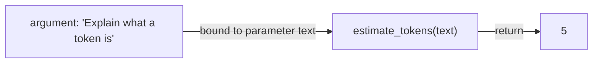

```python
>>> def do_nothing():
...     pass
...
>>> do_nothing()          # nothing shown: the result is None
>>> print(do_nothing())
None
>>> def estimate_tokens(text):
...     return len(text) // 4
...
>>> estimate_tokens("Explain what a token is")
5
```

**Parameters** are the names in the `def` line. **Arguments** are the values you pass in the call. The value is bound to the parameter name for the duration of the call.

> [!warning] Trap: print is not return
> `print` shows text on the screen. `return` gives a value back to the code that called the function. A function that only prints returns `None`, and you cannot use its result.

```python
>>> def show_tokens(text):
...     print(len(text) // 4)
...
>>> n = show_tokens("Explain what a token is")
5
>>> print(n)
None
```

A function can return only one object. If you write `return a, b`, that one object is a tuple, and you can unpack it.

```python
>>> def split_ratio(n):
...     return n * 0.8, n * 0.2
...
>>> split_ratio(100)
(80.0, 20.0)
>>> train, test = split_ratio(100)
>>> train
80.0
```

> [!example] Type check
> | **Expression** | **Type** | **What you can do** |
> |---|---|---|
> | `estimate_tokens` | `function` | pass it around, call it, read `.__name__` |
> | `estimate_tokens(s)` | `int` | whatever the `return` gave back |
> | `show_tokens(s)` | `NoneType` | nothing: no `return` means `None` |
> | `split_ratio(100)` | `tuple` | unpack it, index it |

## None, truthiness and falsiness

`None` is a single special object that means “no value here”. It is not the same as `False`, `0` or an empty string, but it behaves like `False` inside an `if`. Use `is` to test for `None`. `is` asks “same object?”, while `==` asks “equal value?”.

```text
FALSY (act like False)   : None   False   0   0.0   ""   []   ()   {}   set()
TRUTHY (everything else) : 1   "0"   " "   [0]   "False"   0.00001
```

```python
>>> bool(None), bool(0), bool(""), bool([]), bool({})
(False, False, False, False, False)
>>> bool(" "), bool([0]), bool("False")
(True, True, True)
>>> zero = 0
>>> zero == False       # equal values
True
>>> zero is False       # but two different objects
False
>>> x = None
>>> x is None
True
```

> [!warning] Trap: `if x:` cannot tell 0 from None
> A setting of `0` is a real value. Testing it with a plain `if` treats it like “missing”. Test for `None` explicitly when `0` or `""` are legal values.

```python
>>> def limit_bad(max_tokens=None):
...     if max_tokens:               # 0 counts as missing
...         return max_tokens
...     return 1024
...
>>> def limit_ok(max_tokens=None):
...     if max_tokens is None:
...         return 1024
...     return max_tokens
...
>>> limit_bad(0), limit_ok(0)
(1024, 0)
```

## Positional, keyword and default arguments

### Positional and keyword arguments

Positional arguments are matched to parameters by position. Keyword arguments are matched by name, in any order. In a call, positional arguments must come first.

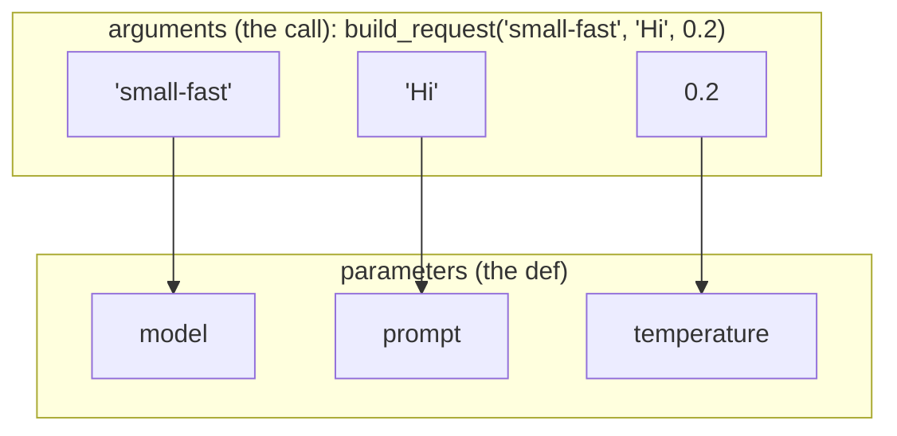

```python
>>> def build_request(model, prompt, temperature=0.7):
...     return {"model": model, "prompt": prompt, "temperature": temperature}
...
>>> build_request("small-fast", "Hi")
{'model': 'small-fast', 'prompt': 'Hi', 'temperature': 0.7}
>>> build_request("Hi", "small-fast")     # swapped: no error, wrong meaning
{'model': 'Hi', 'prompt': 'small-fast', 'temperature': 0.7}
>>> build_request(prompt="Hi", model="small-fast", temperature=0)
{'model': 'small-fast', 'prompt': 'Hi', 'temperature': 0}
>>> build_request("small-fast", temperature=0.2, prompt="Hi")
{'model': 'small-fast', 'prompt': 'Hi', 'temperature': 0.2}
>>> build_request("small-fast")
Traceback (most recent call last):
  ...
TypeError: build_request() missing 1 required positional argument: 'prompt'
```

Putting a positional argument after a keyword argument is a syntax error:

```python
build_request(prompt="Hi", "small-fast")
```

```text
SyntaxError: positional argument follows keyword argument
```

### Default values

A parameter with a default is optional. Parameters with defaults must come after those without. Prefer keyword arguments for optional settings: the call then explains itself.

```python
def bad(a=1, b):
    pass
```

```text
SyntaxError: parameter without a default follows parameter with a default
```

> [!warning] Trap: a mutable default is created once
> Python builds the default value *once*, when `def` runs. If it is a list or dict, every call that uses the default shares the same object and keeps adding to it.

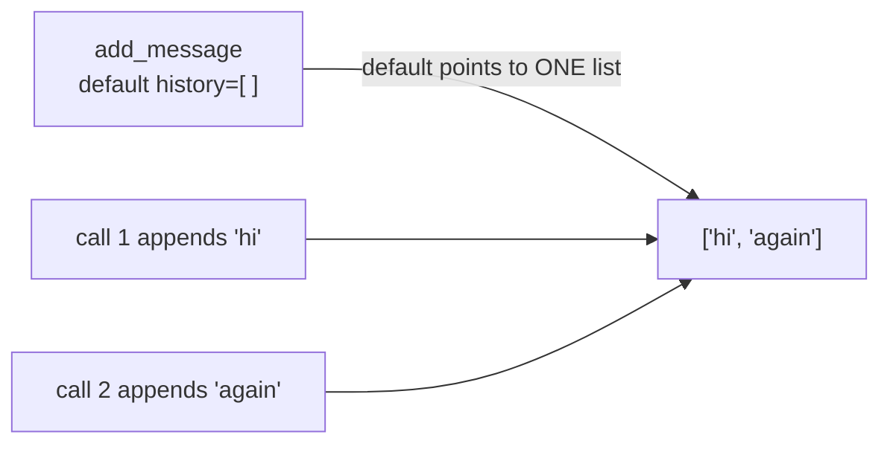

```python
>>> def add_message(text, history=[]):
...     history.append(text)
...     return history
...
>>> add_message("hi")
['hi']
>>> add_message("again")
['hi', 'again']
>>> add_message.__defaults__      # the function object holds the one list
(['hi', 'again'],)
```

> [!tip] Rule: use `None` as the default
> Default to `None`, then create the fresh list inside the function.

```python
>>> def add_message(text, history=None):
...     if history is None:
...         history = []
...     history.append(text)
...     return history
...
>>> add_message("hi")
['hi']
>>> add_message("again")
['again']
```

## Packing and unpacking: `*args` and `**kwargs`

In a `def` line, `*args` *gathers* extra positional arguments into a tuple, and `**kwargs` gathers extra keyword arguments into a dict. In a call, the same stars *explode* a tuple or dict back into separate arguments. The names `args` and `kwargs` are only a habit.

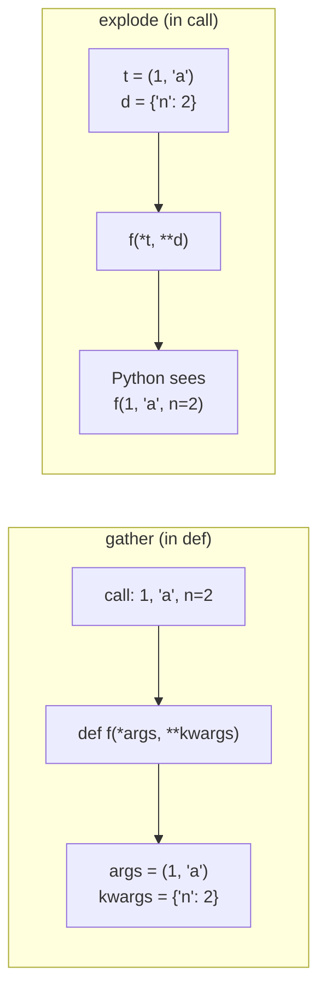

```python
>>> def show(*args, **kwargs):
...     print(args, kwargs)
...
>>> show()
() {}
>>> show(1, "a", model="small-fast", n=2)
(1, 'a') {'model': 'small-fast', 'n': 2}
>>> nums = (1, 2)
>>> show(nums)           # one argument that happens to be a tuple
((1, 2),) {}
>>> show(*nums)          # two arguments
(1, 2) {}
>>> opts = {"model": "small-fast", "n": 2}
>>> show(**opts)
() {'model': 'small-fast', 'n': 2}
```

> [!example] Type check
> | **Name** | **Type inside** | **Use it like** |
> |---|---|---|
> | `args` | `tuple` | `args[0]`, `len(args)`, `for a in args` |
> | `kwargs` | `dict` | `kwargs["n"]`, `kwargs.get("n", 1)`, `.items()` |

The usual order in a `def` line is: required parameters, then `*args`, then keyword parameters, then `**kwargs`. The stars only work in a definition or a call. A lone `*args` on a line by itself is a syntax error. (In a dict display, `{**a, **b}` merges two dicts.)

A typical use is a thin wrapper that forwards extra options:

```python
>>> def ask(prompt, **options):
...     request = {"prompt": prompt, "temperature": 0.7}
...     request.update(options)       # caller's options win
...     return request
...
>>> ask("Hi", temperature=0, max_tokens=50)
{'prompt': 'Hi', 'temperature': 0, 'max_tokens': 50}
>>> defaults = {"a": 1, "b": 2}
>>> {**defaults, "b": 3}
{'a': 1, 'b': 3}
```

## Keyword-only and position-only parameters

Two markers in the parameter list control how callers may pass arguments. A `/` means everything *before* it is position-only. A bare `*` means everything *after* it is keyword-only.

```text
+------------------+---+--------------+---+-----------------------+
|     prompt       | / |   (normal)   | * | model, temperature    |
+------------------+---+--------------+---+-----------------------+
  position only          either way        keyword only
```

```python
>>> def complete(prompt, /, *, model="small-fast", temperature=0.0):
...     return f"{model}@{temperature}: {prompt}"
...
>>> complete("Hi", model="large-slow")
'large-slow@0.0: Hi'
>>> complete("Hi", "large-slow")
Traceback (most recent call last):
  ...
TypeError: complete() takes 1 positional argument but 2 were given
>>> complete(prompt="Hi")
Traceback (most recent call last):
  ...
TypeError: complete() got some positional-only arguments passed as
keyword arguments: 'prompt'
```

> [!tip] Rule: make settings keyword-only
> For functions with several optional settings, put a `*` before them. Callers must write `temperature=0`, never a bare `0`. Reordering parameters later cannot silently break old calls. SDK methods for LLM calls are written this way.

## Mutable and immutable arguments

A parameter is just another name for the object the caller passed. If that object is mutable (list, dict, set), changes made through the parameter are visible to the caller. Assigning a new object to the parameter only moves the parameter's own name.

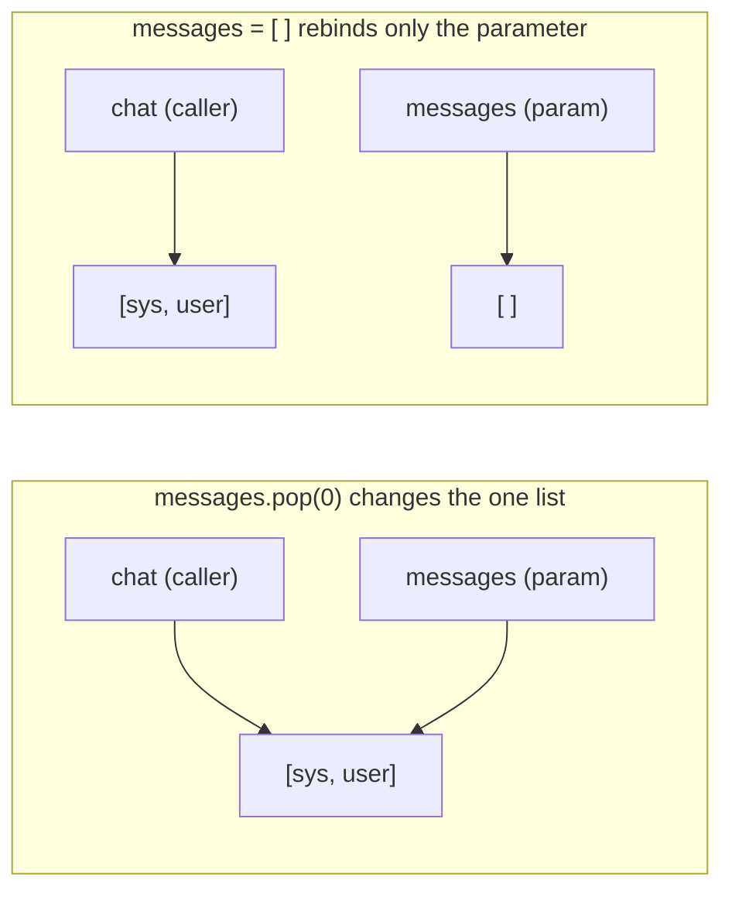

```python
>>> chat = [{"role": "system", "content": "Be brief"},
...         {"role": "user", "content": "Hi"}]
>>> def drop_system(messages):          # changes the caller's list
...     messages.pop(0)
...
>>> def without_system(messages):       # returns a new list
...     return messages[1:]
...
>>> def rebind(messages):
...     messages = []                   # only the local name moves
...
>>> rebind(chat); len(chat)
2
>>> trimmed = without_system(chat)
>>> len(chat), len(trimmed)
(2, 1)
>>> drop_system(chat); len(chat)
1
```

> [!tip] Rule
> Either return a new value, or say in the docstring that the argument is changed. Surprise mutation of the caller's data is a classic source of bugs. When you want a safe copy, use `messages.copy()` or `list(messages)`. Note that those are *shallow* copies: the dicts inside are still shared.

## Docstrings

A string placed first in a function body is its docstring. Python stores it in `.__doc__`, and `help()` prints it with the signature. Write one sentence saying what the function returns.

```python
>>> def cost_usd(tokens, price_per_million):
...     """Return the cost in dollars for a token count."""
...     return tokens * price_per_million / 1_000_000
...
>>> print(cost_usd.__doc__)
Return the cost in dollars for a token count.
>>> cost_usd(2_000_000, 0.10)
0.2
```

```python
help(cost_usd)
```

```text
Help on function cost_usd in module __main__:

cost_usd(tokens, price_per_million)
    Return the cost in dollars for a token count.
```

Longer docstrings use triple quotes and may span many lines. Editors show them as hover help, and later chapters ([[14 - Type Hints and Documentation]], [[15 - Testing]]) build on them.

## Functions are first-class objects

Everything with a value is an object, and a function is a value. It has a type (`function`), you can bind it to other names, put it in lists and dicts, pass it to functions and return it from functions. The parentheses are what *run* it.

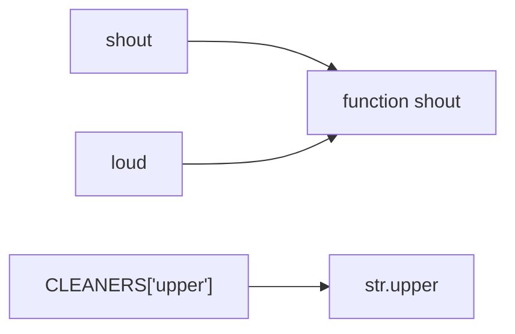

`loud = shout` has no parentheses, so nothing is called: it is a second name for the same function. The right-hand side shows a function stored as a dict value.

```python
>>> def shout(text):
...     return text.upper()
...
>>> loud = shout            # a second name for the same function
>>> loud is shout
True
>>> loud("hi")
'HI'
>>> type(shout), shout.__name__
(<class 'function'>, 'shout')
>>> callable(shout), callable(42)
(True, False)
```

Because functions are values, a dict of functions makes a clean “dispatch table”, and a list of functions makes a pipeline:

```python
>>> CLEANERS = {"upper": str.upper, "strip": str.strip, "title": str.title}
>>> def clean(text, steps):
...     for step in steps:
...         text = CLEANERS[step](text)     # look up a function, then call it
...     return text
...
>>> clean("  hello world ", ["strip", "title"])
'Hello World'
```

A function can also take a function and extra arguments, and forward them with the stars:

```python
>>> def call_with(func, *args, **kwargs):
...     return func(*args, **kwargs)
...
>>> call_with(max, 3, 9, 4)
9
>>> call_with(sorted, ["b", "a"], reverse=True)
['b', 'a']
```

> [!example] Type check
> | **Expression** | **Type** | **Meaning** |
> |---|---|---|
> | `shout` | `function` | the function object itself |
> | `shout("a")` | `str` | the function was *called* |
> | `shout()` | — | `TypeError`: missing argument |
> | `[shout, str.lower]` | `list` | a list holding two function objects |

### Arguments are not a tuple

Comma-separated arguments in a call are not one tuple. A function with one parameter and three arguments fails. To pass a single tuple, add a second pair of parentheses. Only `*args` on the receiving side collects arguments into a tuple.

```python
>>> def one(thing):
...     return thing
...
>>> one((1, 2, 3))
(1, 2, 3)
>>> one(1, 2, 3)
Traceback (most recent call last):
  ...
TypeError: one() takes 1 positional argument but 3 were given
```

## Inner functions

A function can be defined inside another function. The inner function exists only while the outer one runs, and it is a good place for a small helper that you use more than once.

```python
>>> def format_usage(input_tokens, output_tokens):
...     def fmt(label, n):
...         return f"{label}: {n:,}"
...     return fmt("in", input_tokens) + " | " + fmt("out", output_tokens)
...
>>> format_usage(1200, 85)
'in: 1,200 | out: 85'
```

## Closures

An inner function can read variables of the outer function. If the outer function *returns* the inner function, the inner function keeps those variables alive. That combination is a closure: a function plus the variables it remembers.

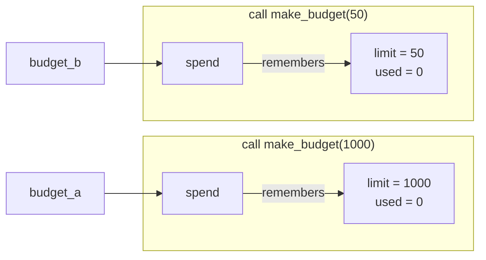

Two calls make two separate sets of variables.

```python
def make_budget(limit):
    used = 0
    def spend(tokens):
        nonlocal used          # rebind the outer variable
        used += tokens
        return limit - used
    return spend

budget_a = make_budget(1000)
budget_b = make_budget(50)
print(budget_a(300), budget_a(450))
print(budget_b(20))
```

```text
700 250
30
```

Each call to `make_budget` creates its own `limit` and `used`. Reading an outer variable needs nothing special. *Rebinding* it (`used += tokens`) needs `nonlocal`, otherwise Python assumes `used` is a new local variable and fails.

> [!info] Key idea: a closure is a tiny object with state
> Where you might write a small class that stores one value and has one method, a closure often does the same job. Reach for a class when you need several methods or want to inspect the state.

## Lambda: anonymous functions

A `lambda` is a function written as one expression, with no name and no `return`. It is mostly used as a short argument, such as a sort key.

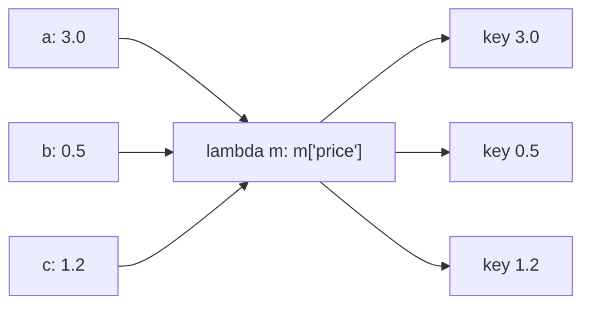

The keys decide the order: b (0.5), c (1.2), a (3.0).

```python
>>> models = [{"name": "a", "price": 3.0}, {"name": "b", "price": 0.5},
...           {"name": "c", "price": 1.2}]
>>> [m["name"] for m in sorted(models, key=lambda m: m["price"])]
['b', 'c', 'a']
>>> (lambda a, b: a + b)(2, 3)
5
>>> type(lambda: 0)
<class 'function'>
```

|  | **`def`** | **`lambda`** |
|---|---|---|
| Name | has one | none |
| Body | any number of statements | one expression only |
| `return` | explicit | the expression's value is returned |
| Best for | anything you reuse or explain | a one-off key or callback |

> [!tip] Rule
> If a lambda needs a name, or does not fit on one short line, write a `def` instead. Assigning a lambda to a variable gains nothing over `def`.

## Generators

A generator produces values one at a time and pauses between them, remembering where it was. It never builds the whole sequence in memory. You make one by writing a function that uses `yield` instead of `return`. Calling that function does not run the body (the address in its repr will differ on your machine). It returns a *generator object*, and each `next()` runs the body until the next `yield`.

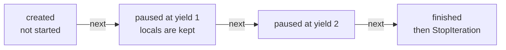

```python
>>> def batches(items, size):
...     for start in range(0, len(items), size):
...         yield items[start:start + size]
...
>>> gen = batches(["a", "b", "c", "d", "e"], 2)
>>> gen
<generator object batches at 0x...>
>>> next(gen)
['a', 'b']
>>> list(gen)           # the rest
[['c', 'd'], ['e']]
>>> list(gen)           # a generator can be used only once
[]
```

To go again, call the generator function again for a fresh generator object. A *generator comprehension* is the same idea in one line, written with parentheses:

```python
>>> texts = ["hi", "hello", "hey there"]
>>> lengths = (len(t) for t in texts)
>>> sum(lengths)
16
>>> sum(lengths)          # already used up
0
```

|  | **list** | **generator** |
|---|---|---|
| Values stored | all of them, in memory | none, made on demand |
| Reuse | as often as you like | once |
| Indexing, `len()` | yes | no |
| Good for | small data you revisit | big or endless streams, one pass |

> [!info] Key idea: streaming is a loop over a generator-like object
> When an LLM API streams a reply, you loop over an iterator that hands you one chunk at a time. Chunks arrive as they are produced, and you print each one at once. It is the same “produce one, pause, produce the next” idea.

## Decorators

A decorator is a function that takes a function and returns a function. It lets you wrap extra behavior (logging, timing, retrying) around a function without editing its body. The line `@log_call` above a `def` is shorthand for `add = log_call(add)`.

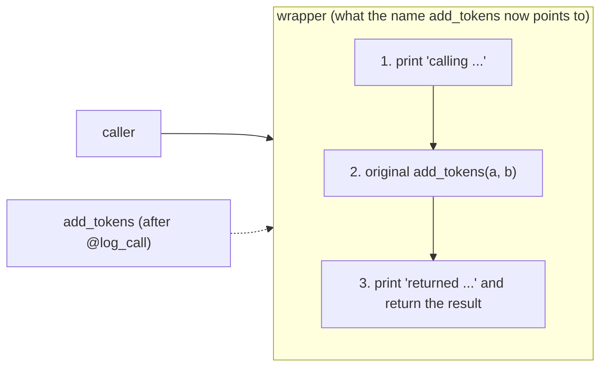

```python
import functools

def log_call(func):
    @functools.wraps(func)
    def wrapper(*args, **kwargs):
        print("calling", func.__name__, args, kwargs)
        result = func(*args, **kwargs)
        print("returned", result)
        return result
    return wrapper

@log_call
def add_tokens(a, b):
    return a + b

print(add_tokens(3, 5))
print(add_tokens.__name__)
```

```text
calling add_tokens (3, 5) {}
returned 8
8
add_tokens
```

The wrapper takes `*args, **kwargs` so it works for any signature, and it returns the result of the original call. `functools.wraps` copies the original name and docstring onto the wrapper. Without it, `add_tokens.__name__` would be `"wrapper"`, which confuses logs and debuggers.

### Stacking decorators

The decorator nearest the `def` is applied first. The one above wraps the result. Think of onion layers.

```text
+--------------------------------------------------------+
| @log_call   (outer layer: sees the final result)       |
|   +--------------------------------------------------+ |
|   | @double   (inner layer)                          | |
|   |   +--------------------------------------+       | |
|   |   | def f(a, b): return a + b            |       | |
|   |   +--------------------------------------+       | |
|   +--------------------------------------------------+ |
+--------------------------------------------------------+
```

```python
def double(func):
    @functools.wraps(func)
    def wrapper(*args, **kwargs):
        return func(*args, **kwargs) * 2
    return wrapper

@log_call
@double
def f(a, b):
    return a + b

@double
@log_call
def g(a, b):
    return a + b

print(f(3, 5))
print(g(3, 5))
```

```text
calling f (3, 5) {}
returned 16
16
calling g (3, 5) {}
returned 8
16
```

In `f`, logging sees the doubled value (16). In `g`, logging sees the original value (8) because doubling happens outside it. Order matters.

## Namespaces and scope

A namespace is a table of names. Each function call gets its own. When Python meets a name, it searches: the function's own namespace first (**L**ocal), then any enclosing function (**E**nclosing), then the module (**G**lobal), then the built-ins (**B**uilt-in). This is the LEGB rule.

```text
+-- built-ins: print, len, max, ... -----------------------------+
|  +-- global (the module): MODEL, show_model, ... ------------+ |
|  |  +-- enclosing function ---------------------------+     | |
|  |  |  +-- local: this call -------------+            |     | |
|  |  |  |  tokens = 5                     |            |     | |
|  |  |  +---------------------------------+            |     | |
|  |  +-------------------------------------------------+     | |
|  +------------------------------------------------------------+ |
+------------------------------------------------------------------+
Lookup order:  Local -> Enclosing -> Global -> Built-in   (LEGB)
```

```python
>>> MODEL = "small-fast"
>>> def show_model():
...     return MODEL                 # reads the global
...
>>> def shadow():
...     MODEL = "large-slow"         # a new local, global untouched
...     return MODEL
...
>>> def broken():
...     print(MODEL)                 # Python sees the assignment below ...
...     MODEL = "x"                  # ... so MODEL is local everywhere here
...
>>> def switch():
...     global MODEL
...     MODEL = "large-slow"
...
>>> show_model(), shadow(), MODEL
('small-fast', 'large-slow', 'small-fast')
>>> broken()
Traceback (most recent call last):
  ...
UnboundLocalError: cannot access local variable 'MODEL' where it is not
associated with a value
>>> switch(); MODEL
'large-slow'
```

> [!warning] Trap: assigning makes a name local
> If a function assigns to a name anywhere in its body, that name is local everywhere in that body, even in lines above the assignment. Reading a global is free. Rebinding one needs `global NAME`. Rebinding an enclosing function's variable needs `nonlocal NAME`.

> [!tip] Rule
> Prefer parameters and return values over `global`. Functions that depend on hidden global state are hard to test. Module-level constants (named in capitals, never reassigned) are fine.

`locals()` and `globals()` return the current namespaces as dicts, which is handy for debugging:

```python
>>> def peek():
...     tokens = 5
...     return locals()
...
>>> peek()
{'tokens': 5}
>>> "MODEL" in globals()
True
```

## Dunder names

Names that start and end with two underscores are called dunder names (double underscore). Python reserves them. You read them, and you define some of them in classes, but you do not invent your own. Functions carry `__name__` and `__doc__`. A module carries `__name__` too. It is `"__main__"` when the file is run directly and the module's own name when it is imported.

```python
# tool.py
def main():
    print("running as a script")

if __name__ == "__main__":
    main()
```

```text
$ python tool.py
running as a script

$ python -c "import tool"
(no output: main() was not called)
```

The `if __name__ == "__main__":` guard lets one file act as both a script and an importable module. You will see it at the bottom of most scripts.

## Recursion

A recursive function calls itself on a smaller version of the problem. It needs a *base case* that stops the calls. Each call gets its own frame on the call stack, and the frames unwind as results come back.

```text
call stack (grows upward)         returns
+---------------------------+
| countdown(0)  base case   |  -> ["liftoff"]
| countdown(1)              |  -> [1, "liftoff"]
| countdown(2)              |  -> [2, 1, "liftoff"]
| countdown(3)              |  -> [3, 2, 1, "liftoff"]
+---------------------------+
```

```python
>>> def countdown(n):
...     if n == 0:                       # base case
...         return ["liftoff"]
...     return [n] + countdown(n - 1)    # smaller problem
...
>>> countdown(3)
[3, 2, 1, 'liftoff']
>>> def endless():
...     return endless()
...
>>> endless()
Traceback (most recent call last):
  ...
RecursionError: maximum recursion depth exceeded
>>> import sys
>>> sys.getrecursionlimit()
1000
```

Recursion suits uneven, nested data. A generator can walk it and `yield from` hands the work to a recursive call:

```python
>>> def flatten(nested):
...     for item in nested:
...         if isinstance(item, list):
...             yield from flatten(item)      # same as looping and yielding
...         else:
...             yield item
...
>>> list(flatten(["a", ["b", ["c", "d"]], [], "e"]))
['a', 'b', 'c', 'd', 'e']
```

## Async functions, briefly

Normally one line runs after another, and a slow call (a network request to a model) blocks everything. Functions defined with `async def` can pause at an `await` so that other work runs meanwhile. Many LLM SDKs offer async clients for this reason. Details come later in the concurrency chapter ([[21 - Data in Time - Concurrency]]). Here is what to recognize:

|  | **`def`** | **`async def`** |
|---|---|---|
| Calling it | runs the body, returns the result | returns a coroutine; body has not run |
| To get the result | just call | `await` it, or `asyncio.run(...)` |
| `await` allowed inside | no | yes |

```python
import asyncio

async def fake_call(prompt):
    await asyncio.sleep(0.01)         # stands in for waiting on the network
    return prompt.upper()

async def main():
    return await asyncio.gather(fake_call("a"), fake_call("b"))

print(asyncio.run(main()))
```

```text
['A', 'B']
```

You do not need to write async code yet. Just know that `async def` and `await` mark it.

## Exceptions

When something goes wrong, Python *raises an exception*. Unless some code catches it, the exception travels up the call stack, function by function, and finally stops the program with a traceback.

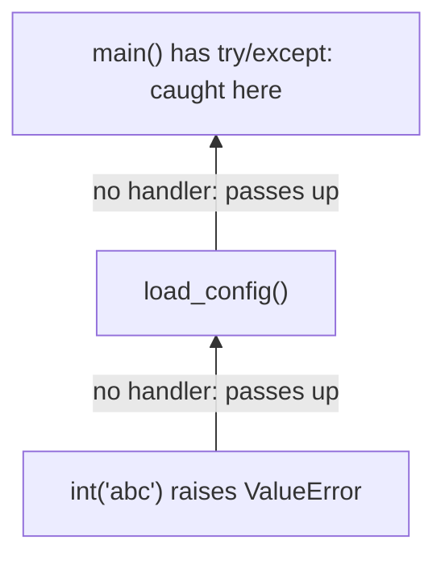

### try, except, else, finally

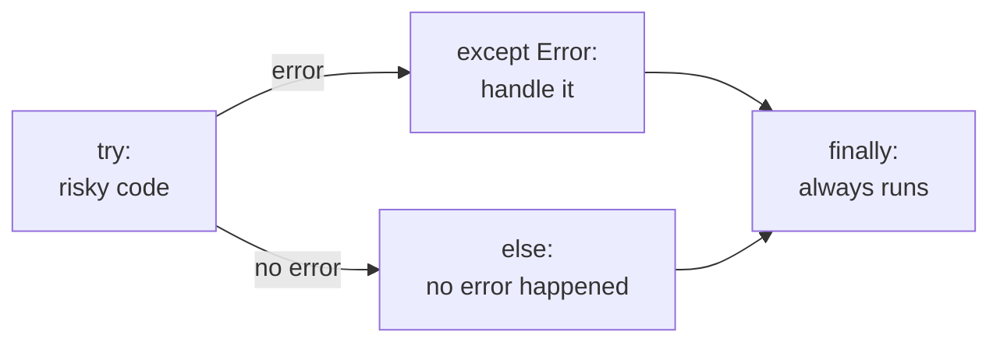

```python
>>> def parse_count(text):
...     try:
...         n = int(text)
...     except ValueError as exc:            # exc is the exception object
...         print("bad number:", exc)
...         return None
...     else:
...         return n                         # only if no exception
...     finally:
...         print("parsed", repr(text))      # runs in every case
...
>>> parse_count("12")
parsed '12'
12
>>> parse_count("twelve")
bad number: invalid literal for int() with base 10: 'twelve'
parsed 'twelve'
```

Several `except` clauses are checked from top to bottom, and the first match wins. Put specific exception types before general ones. `except Exception as exc` catches almost everything that is an ordinary error and gives you the object to print or log.

> [!warning] Trap: the bare `except:`
> A bare `except:` also catches `KeyboardInterrupt`, so Ctrl-C stops working. Writing `except Exception: pass` hides real bugs. Catch the narrowest type you expect, wrap only the lines that can fail, and do something useful in the handler: log, retry, return a default, or re-raise.

### Exception types form a tree

An `except` for a parent type also catches its children. That is why `LookupError` catches both `IndexError` and `KeyError`.

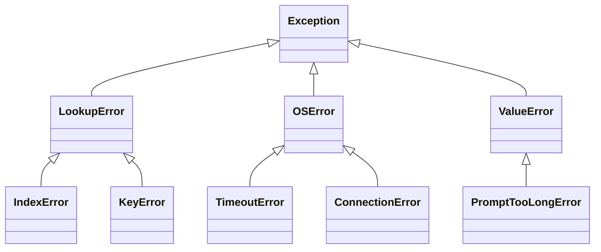

### Raise and define your own exceptions

Use `raise` to signal a problem yourself. To make a new kind of error, write a class that inherits from `Exception` (or from a closer parent such as `ValueError`). The class body can be just `pass`: the parent supplies the behavior. Classes are the subject of the next chapter ([[11 - Objects]]).

```python
class PromptTooLongError(ValueError):
    pass

def check_prompt(text, limit=20):
    if len(text) > limit:
        raise PromptTooLongError(f"{len(text)} chars, limit {limit}")
    return text

try:
    check_prompt("x" * 50)
except PromptTooLongError as exc:
    print("caught:", exc)
    print(type(exc).__name__, exc.args)
    print(isinstance(exc, ValueError))
```

```text
caught: 50 chars, limit 20
PromptTooLongError ('50 chars, limit 20',)
True
```

> [!example] Type check
> | **Name** | **Type** | **Notes** |
> |---|---|---|
> | `PromptTooLongError` | a class | call it to make an exception object |
> | `exc` (in `except ... as exc`) | an instance of that class | `str(exc)` is the message; `exc.args` is a tuple |

> [!danger] Boss fight: a decorator that takes arguments
> `@retry(3)` looks like one call, but it is three layers of function. Slow down and trace it.
>
> | **Step** | **What runs** | **What it gives back** |
> |---|---|---|
> | 1 | `retry(3)` runs when Python reads `@retry(3)` | `decorator`, a function that remembers `times=3` |
> | 2 | `decorator(flaky_call)` runs at once | `wrapper`, which remembers `func` and `times` |
> | 3 | the name `flaky_call` is rebound | now points to `wrapper` |
> | 4 | each later call runs `wrapper(...)` | the result of `func`, or the last error |
>
> Three layers means three closures: `times` is remembered by `decorator` and `wrapper`, and `func` by `wrapper`.

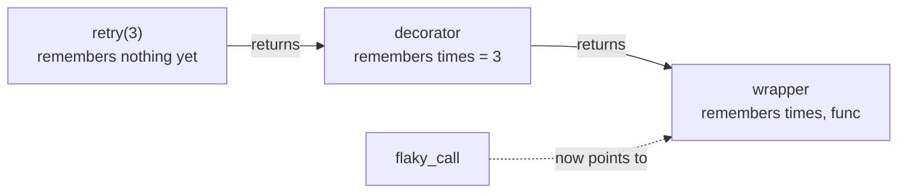

```python
import functools

def retry(times):
    def decorator(func):
        @functools.wraps(func)
        def wrapper(*args, **kwargs):
            for attempt in range(1, times + 1):
                try:
                    return func(*args, **kwargs)
                except ConnectionError as exc:
                    print(f"attempt {attempt} failed: {exc}")
                    if attempt == times:
                        raise              # out of tries: pass the error on
        return wrapper
    return decorator

calls = {"n": 0}

@retry(3)
def flaky_call():
    calls["n"] += 1
    if calls["n"] < 3:
        raise ConnectionError("timeout")
    return "ok"

print(flaky_call())
```

```text
attempt 1 failed: timeout
attempt 2 failed: timeout
ok
```

This is the shape of almost every retry helper you will meet when calling model APIs.

> [!question]- Practice
> 1. Write a function `count_words(text)` that *returns* the number of words. Then write a version that only prints the number. What does each give you when you assign the result to a variable?
> 2. Explain why `def log(msg, lines=[])` is a bug waiting to happen, and rewrite it so each call without `lines` starts with an empty list.
> 3. Write `chunk(items, n)` as a generator that yields lists of at most `n` items. Show what `list(...)` gives on a second use of the *same* generator object.
> 4. A function reads a global `DEBUG` and, a few lines later, assigns `DEBUG = True`. What error do you get, and what are two ways to fix it?
> 5. Write a decorator `timed` that prints how long a function took (use `time.perf_counter()`), and keep the original function name with `functools.wraps`.
> 6. Define your own exception `EmptyPromptError`. Write a function that raises it for an empty string, then catch it and print a friendly message while letting `finally` print “done”.

> [!success] Achievement unlocked: Function Wielder
> You can now:
>
> - define functions with positional, keyword, default, `*args`, `**kwargs`, keyword-only and position-only parameters;
> - pass functions around as values and build closures, generators and decorators;
> - predict which variable a name refers to using the LEGB rule;
> - handle and raise exceptions, including your own types.

---
Related: [[09 - Dictionaries and Sets]] | [[11 - Objects]] | [[12 - Modules and Packages]] | [[14 - Type Hints and Documentation]] | [[15 - Testing]] | [[16 - Debugging]] | [[21 - Data in Time - Concurrency]]
