# Objects

Everything in Python is an object, but you only need to look inside objects when you build your own. This chapter explains classes, `__init__` and `self`, inheritance, properties, and the special methods (`__repr__`, `__eq__`, `__call__`) that make your objects behave like built-in ones. It ends with named tuples, dataclasses and nested objects, which is the shape of almost every API response you will handle.

## What are objects?

An object bundles **data** (called *attributes*) with **code** (functions called *methods*). Think of objects as nouns and methods as verbs. The integer `7` is an object, `"hi"` is an object, and each belongs to a *class* (`int`, `str`) that says what such objects can do. A class is the mold, an object (an *instance*) is one thing made from it. Many instances of one class can exist at once, each with its own data.

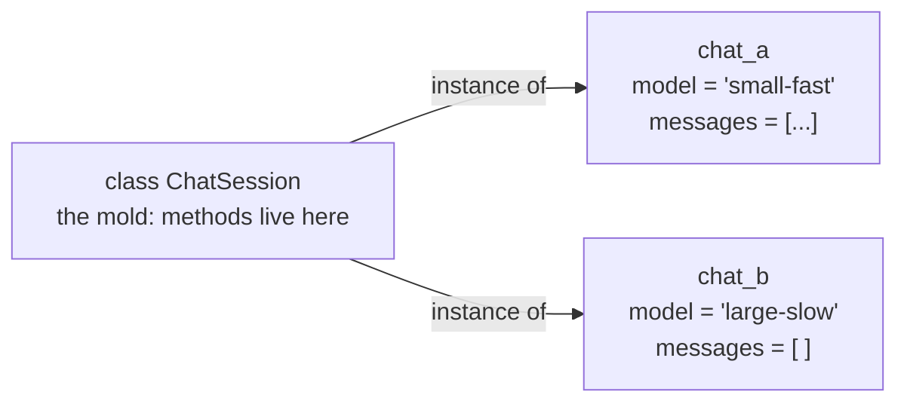

```python
>>> type(7), type("hi"), type([1])
(<class 'int'>, <class 'str'>, <class 'list'>)
>>> z = 3 + 4j
>>> z.real                  # an attribute: stored data
3.0
>>> z.conjugate()           # a method: a function that belongs to the object
(3-4j)
```

|  | **attribute** | **method** |
|---|---|---|
| What it is | a variable stored on the object (or class) | a function stored on the class |
| Read it | `obj.name` | `obj.name` gives the method, `obj.name()` calls it |
| Example | `z.real` | `z.conjugate()` |

## Simple objects

### Define a class and create objects

The `class` keyword defines a new class. Calling the class like a function makes an instance.

```python
>>> class Prompt:
...     pass
...
>>> p1 = Prompt()
>>> p2 = Prompt()
>>> p1
<__main__.Prompt object at 0x...>
>>> p1 is p2, p1 == p2       # two different objects
(False, False)
```

### Assign attributes

An attribute is a variable that belongs to an object. You can attach one at any time with `obj.name = value`. Read it back with a dot. Reading one that was never set raises `AttributeError`.

```python
>>> p1.text = "Say hi"
>>> p1.max_tokens = 50
>>> p1.text, p1.max_tokens
('Say hi', 50)
>>> vars(p1)                 # the object's attributes, stored as a dict
{'text': 'Say hi', 'max_tokens': 50}
>>> p2.text
Traceback (most recent call last):
  ...
AttributeError: 'Prompt' object has no attribute 'text'
```

Setting attributes one by one after creation is fragile: nothing guarantees every object gets the same ones. The fix is the initializer.

### Methods, `__init__` and `self`

A method is a function defined inside a class. `__init__` is a special method that Python calls right after it creates a blank instance, so you can fill in its attributes. Every instance method receives the instance itself as its first parameter, named `self` by convention. `self.model = model` means “store the value on *this* object”.

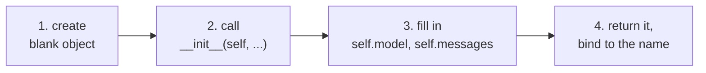

All of this happens when you write `chat = ChatSession("small-fast")`.

```python
>>> class ChatSession:
...     def __init__(self, model, system=None):
...         self.model = model
...         self.system = system
...         self.messages = []              # a fresh list for every instance
...
...     def add_user(self, text):
...         self.messages.append({"role": "user", "content": text})
...
...     def add_assistant(self, text):
...         self.messages.append({"role": "assistant", "content": text})
...
...     def turns(self):
...         return len(self.messages)
...
>>> chat = ChatSession("small-fast", system="Be brief")
>>> chat.add_user("Hello")
>>> chat.add_assistant("Hi!")
>>> chat.turns()
2
>>> chat.model
'small-fast'
>>> chat.messages
[{'role': 'user', 'content': 'Hello'},
 {'role': 'assistant', 'content': 'Hi!'}]
>>> ChatSession("large-slow").turns()       # a new, separate object
0
```

`__init__` is an *initializer*, not a constructor: Python has already built the object by the time it runs. It should set attributes and return nothing.

> [!example] Type check
> | **Expression** | **Type** | **What you can do** |
> |---|---|---|
> | `ChatSession` | `type` (a class) | call it to make instances; it is an object too |
> | `chat` | `ChatSession` | read and set attributes, call methods |
> | `chat.model` | `str` | any `str` method |
> | `chat.messages` | `list` | `.append`, index, loop |
> | `chat.add_user` | bound `method` | call it; `self` is already filled in |
> | `ChatSession.add_user` | `function` | plain function; you must pass the instance yourself |

> [!warning] Trap: forgetting `self`
> Two classic mistakes. Writing `model = model` in `__init__` only sets a local variable, so nothing is stored on the object. Leaving `self` out of a method's parameters makes Python pass one argument too many.

```python
>>> class Broken:
...     def __init__(self, model):
...         model = model                   # missing "self."
...     def hello():                        # missing self
...         return "hi"
...
>>> Broken("x").model
Traceback (most recent call last):
  ...
AttributeError: 'Broken' object has no attribute 'model'
>>> Broken("x").hello()
Traceback (most recent call last):
  ...
TypeError: Broken.hello() takes 0 positional arguments but 1 was given
```

## Inheritance

A subclass is a new class built from an existing one. It gets everything the parent has and may add or change things. The parent is also called the base or superclass. The relationship is *is-a*: a `Counting` client is a `Client`.

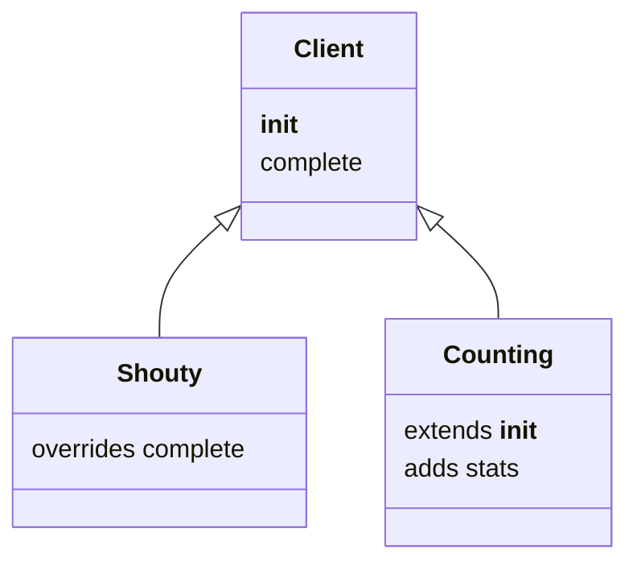

### Inherit, override, add a method

```python
>>> class Client:
...     def __init__(self, name):
...         self.name = name
...     def complete(self, prompt):
...         return f"[{self.name}] {prompt}"
...
>>> class Shouty(Client):                   # overrides complete
...     def complete(self, prompt):
...         return super().complete(prompt).upper()
...
>>> class Counting(Client):
...     def __init__(self, name):
...         super().__init__(name)          # let the parent set self.name
...         self.calls = 0
...     def complete(self, prompt):
...         self.calls += 1
...         return super().complete(prompt)
...     def stats(self):                    # a new method only Counting has
...         return f"{self.calls} calls"
...
```

Now use them:

```python
>>> Client("a").complete("hi")
'[a] hi'
>>> Shouty("b").complete("hi")
'[B] HI'
>>> c = Counting("c")
>>> c.complete("x")
'[c] x'
>>> c.complete("y")
'[c] y'
>>> c.stats()
'2 calls'
>>> issubclass(Counting, Client), isinstance(c, Client), isinstance(c, Shouty)
(True, True, False)
>>> Client("a").stats()
Traceback (most recent call last):
  ...
AttributeError: 'Client' object has no attribute 'stats'
```

`super()` gives access to the parent's version of a method. Use it when the child does something its own way but still needs what the parent does. Defining `__init__` in a child *replaces* the parent's, so call `super().__init__(...)` yourself.

> [!warning] Trap: a child `__init__` that skips the parent's
> If the child's `__init__` never calls `super().__init__`, the attributes the parent would have set simply do not exist.

```python
>>> class Forgetful(Client):
...     def __init__(self, name):
...         self.calls = 0                  # forgot super().__init__(name)
...
>>> Forgetful("z").complete("hi")
Traceback (most recent call last):
  ...
AttributeError: 'Forgetful' object has no attribute 'name'
```

### Multiple inheritance and method resolution order

A class can have several parents. When an attribute is missing from the object, Python looks through the *method resolution order* (MRO), a fixed list of classes. The first class that has the name wins. The order follows the parents as you wrote them.

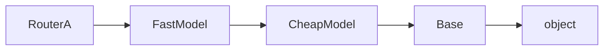

MRO of `class RouterA(FastModel, CheapModel)`: search left to right; the first match wins.

```python
>>> class Base:
...     def label(self):
...         return "base"
...
>>> class FastModel(Base):
...     def label(self):
...         return "fast"
...
>>> class CheapModel(Base):
...     def label(self):
...         return "cheap"
...
>>> class RouterA(FastModel, CheapModel):
...     pass
...
>>> class RouterB(CheapModel, FastModel):
...     pass
...
>>> RouterA().label(), RouterB().label()
('fast', 'cheap')
>>> [cls.__name__ for cls in RouterA.mro()]
['RouterA', 'FastModel', 'CheapModel', 'Base', 'object']
```

### Mixins

A mixin is a small parent class that adds one helper behavior and is not meant to stand alone, such as logging or JSON output. It avoids the confusion of overlapping method names because it shares no names with its siblings.

```python
>>> import json
>>> class JsonMixin:
...     def to_json(self):
...         return json.dumps(vars(self))
...
>>> class Usage(JsonMixin):
...     def __init__(self, input_tokens, output_tokens):
...         self.input_tokens = input_tokens
...         self.output_tokens = output_tokens
...
>>> Usage(12, 5).to_json()
'{"input_tokens": 12, "output_tokens": 5}'
```

> [!info] Key idea: inheritance is easy to overuse
> Deep inheritance trees couple children tightly to their parents. Prefer composition (an object *has* other objects, see below) unless the child truly *is* a more specific parent.

## In self defense

Python makes `self` visible, which many newcomers find noisy. The reason is simple: a method is an ordinary function stored in the class, and `self` is just its first argument. When you write `chat.add_user("x")`, Python looks up `add_user` on the class of `chat` and passes `chat` as the first argument.

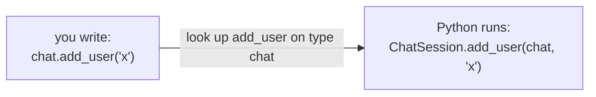

```python
>>> chat.add_user("Another")
>>> ChatSession.add_user(chat, "Third")     # exactly what Python does for you
>>> chat.turns()
4
>>> type(chat.add_user), type(ChatSession.add_user)
(<class 'method'>, <class 'function'>)
>>> chat.add_user.__self__ is chat          # bound method keeps its instance
True
```

## Attribute access

Python has no truly private attributes. The culture is “consenting adults”: a leading underscore (`_name`) says “internal, please do not touch”. Here is the ladder of options.

| **Style** | **Reading / writing** | **When** |
|---|---|---|
| Direct attribute | `obj.name`, `obj.name = v` | the default; start here |
| Getter / setter methods | `obj.get_name()`, `obj.set_name(v)` | avoid in Python |
| Property | looks like `obj.name`, runs code | validation or computed values |
| Name mangling | `self.__name` | rarely; avoids clashes in subclasses |

### Getters, setters and properties

Languages like Java need getter and setter methods from day one. In Python you start with a plain attribute and switch to a *property* later if you need control. Callers keep writing `obj.name`, so no other code changes. A property is a method you access like an attribute.

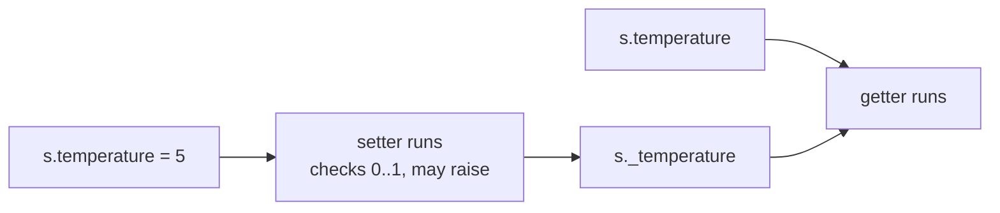

The real value hides behind a leading underscore.

```python
>>> class Sampler:
...     def __init__(self, temperature=0.7):
...         self.temperature = temperature     # goes through the setter
...
...     @property
...     def temperature(self):
...         return self._temperature
...
...     @temperature.setter
...     def temperature(self, value):
...         if not 0.0 <= value <= 1.0:
...             raise ValueError(f"temperature must be 0..1, got {value}")
...         self._temperature = value
...
>>> s = Sampler()
>>> s.temperature
0.7
>>> s.temperature = 0.2
>>> s.temperature = 5
Traceback (most recent call last):
  ...
ValueError: temperature must be 0..1, got 5
>>> vars(s)
{'_temperature': 0.2}
```

The older spelling builds the same thing from two ordinary methods. The decorator form above is the one to write.

```python
>>> class TokenBudget:
...     def __init__(self, tokens):
...         self._tokens = tokens
...     def get_tokens(self):
...         return self._tokens
...     def set_tokens(self, value):
...         self._tokens = value
...     tokens = property(get_tokens, set_tokens)
...
>>> b = TokenBudget(100)
>>> b.tokens = 250
>>> b.tokens
250
```

### Properties for computed values

A property does not have to store anything. It can compute a value from other attributes each time. Without a setter it is read-only.

```python
>>> class Usage:
...     def __init__(self, input_tokens, output_tokens):
...         self.input_tokens = input_tokens
...         self.output_tokens = output_tokens
...     @property
...     def total(self):
...         return self.input_tokens + self.output_tokens
...
>>> u = Usage(120, 30)
>>> u.total
150
>>> u.output_tokens = 80
>>> u.total                        # recomputed
200
>>> u.total = 1
Traceback (most recent call last):
  ...
AttributeError: property 'total' of 'Usage' object has no setter
```

### Name mangling

An attribute named with two leading underscores gets its name rewritten to `_ClassName__name`. This stops accidental clashes, but it is not security.

```python
>>> class Client2:
...     def __init__(self, key):
...         self.__key = key
...
>>> c2 = Client2("sk-test")
>>> c2.__key
Traceback (most recent call last):
  ...
AttributeError: 'Client2' object has no attribute '__key'
>>> c2._Client2__key
'sk-test'
```

> [!tip] Rule
> Never put real secrets in objects you print or log. A default `repr` does not show attributes, but a dataclass `repr` does. Keep API keys in environment variables and hide them from `repr` (see the dataclass section).

## Class attributes and object attributes

A variable assigned in the class body belongs to the class and is shared. Instances can read it. Assigning through an instance creates a new attribute on *that instance* that hides the class one (it does not change the class). Python looks up a name on the instance first, then the class, then the parent classes.

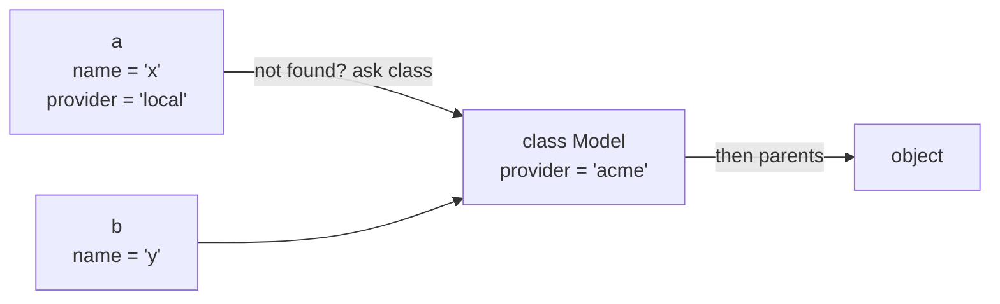

`a.provider` is found on `a` first, so it is `"local"`. `b.provider` is not on `b`, so the class gives `"acme"`.

```python
>>> class Model:
...     provider = "acme"                  # class attribute
...     def __init__(self, name):
...         self.name = name               # instance attribute
...
>>> a, b = Model("x"), Model("y")
>>> Model.provider, a.provider
('acme', 'acme')
>>> a.provider = "local"                   # makes an instance attribute
>>> a.provider, b.provider, Model.provider
('local', 'acme', 'acme')
>>> Model.provider = "other"               # hits instances without their own
>>> a.provider, b.provider
('local', 'other')
>>> vars(a)
{'name': 'x', 'provider': 'local'}
```

> [!warning] Trap: a mutable class attribute is shared by all instances
> `history = []` in the class body creates one list for the whole class. Every instance that appends to it changes the same list. Create per-instance lists in `__init__`.

```python
>>> class Shared:
...     history = []                       # one list for everyone
...     def add(self, text):
...         self.history.append(text)
...
>>> x, y = Shared(), Shared()
>>> x.add("hi")
>>> y.history                              # y never added anything
['hi']
```

## Method types

| **Kind** | **Decorator** | **First parameter** | **Use it for** |
|---|---|---|---|
| Instance method | none | `self`, the object | work on one object's data |
| Class method | `@classmethod` | `cls`, the class | class-wide data; alternative constructors |
| Static method | `@staticmethod` | nothing special | a helper that lives in the class for tidiness |

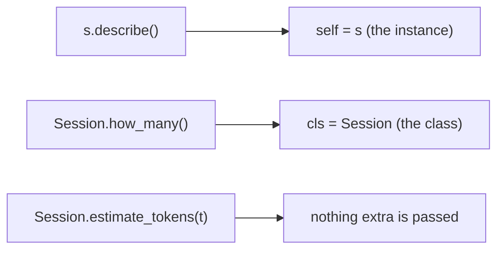

Instance method, class method, static method (top to bottom).

```python
>>> class Session:
...     count = 0                          # class attribute: sessions made
...     def __init__(self, model):
...         self.model = model
...         Session.count += 1
...     def describe(self):                # instance method
...         return f"session on {self.model}"
...     @classmethod
...     def how_many(cls):                 # class method
...         return cls.count
...     @classmethod
...     def from_dict(cls, data):          # alternative constructor
...         return cls(data["model"])
...     @staticmethod
...     def estimate_tokens(text):         # static method
...         return len(text) // 4
...
>>> s1 = Session("small-fast")
>>> s2 = Session.from_dict({"model": "large-slow"})
>>> Session.how_many()
2
>>> s2.describe()
'session on large-slow'
>>> Session.estimate_tokens("Explain what a token is")
5
```

> [!tip] Rule
> `@classmethod def from_dict(cls, data)` is the standard way to build an object from parsed JSON. Use `cls(...)` rather than the class name so subclasses build themselves.

## Duck typing

Python does not check an object's class when you call a method. It only asks: does the object have that method? If it walks like a duck and quacks like a duck, treat it as a duck. Two unrelated classes that both have `complete(prompt)` are interchangeable for any code that only calls `complete`.

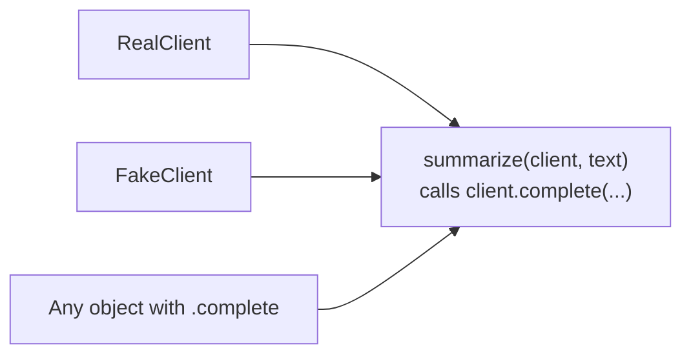

No shared parent is needed: only the method name matters.

```python
>>> class RealClient:
...     def complete(self, prompt):
...         return "(would call the network here)"
...
>>> class FakeClient:
...     def complete(self, prompt):
...         return "canned reply"
...
>>> def summarize(client, text):
...     return client.complete("Summarize: " + text)
...
>>> summarize(FakeClient(), "a long article")   # handy in tests: no network
'canned reply'
>>> summarize(object(), "a long article")
Traceback (most recent call last):
  ...
AttributeError: 'object' object has no attribute 'complete'
```

## Magic methods

Operators and built-in functions call special methods on your object. These methods have names that start and end with two underscores (“dunder” methods). Define them and your class works with `==`, `+`, `print`, `len`, `[]` and even `()`.

| **You write** | **Python calls** | **Typical return** |
|---|---|---|
| `a == b`, `a != b` | `a.__eq__(b)`, `a.__ne__(b)` | `bool` |
| `a < b`, `>`, `<=`, `>=` | `a.__lt__(b)`, `__gt__`, `__le__`, `__ge__` | `bool` |
| `a + b`, `a - b`, `a * b` | `a.__add__(b)`, `__sub__`, `__mul__` | a new object |
| `a / b`, `a // b`, `a % b`, `a ** b` | `__truediv__`, `__floordiv__`, `__mod__`, `__pow__` | a new object |
| `str(a)`, `print(a)` | `a.__str__()` | `str`, for people |
| `repr(a)`, REPL echo | `a.__repr__()` | `str`, for developers |
| `len(a)` | `a.__len__()` | `int` |
| `a[i]` | `a.__getitem__(i)` | the item |
| `a(x)` | `a.__call__(x)` | anything |

### Equality, ordering and math

By default `==` on your objects means “the very same object”. Define `__eq__` to compare by value. If the other object is a different type, return the special value `NotImplemented` instead of crashing, and Python tries other options.

```python
>>> class TokenCount:
...     def __init__(self, n):
...         self.n = n
...     def __eq__(self, other):
...         if not isinstance(other, TokenCount):
...             return NotImplemented
...         return self.n == other.n
...     def __lt__(self, other):
...         return self.n < other.n
...     def __add__(self, other):
...         return TokenCount(self.n + other.n)
...     def __repr__(self):
...         return f"TokenCount({self.n})"
...     def __str__(self):
...         return f"{self.n} tokens"
...
>>> TokenCount(3) == TokenCount(3), TokenCount(3) == 3
(True, False)
>>> TokenCount(2) + TokenCount(3)
TokenCount(5)
>>> sorted([TokenCount(5), TokenCount(2), TokenCount(9)])     # uses __lt__
[TokenCount(2), TokenCount(5), TokenCount(9)]
```

> [!warning] Trap: `__eq__` without `__hash__`
> When you define `__eq__`, Python removes the default `__hash__`, so the objects can no longer go in sets or be dict keys. If you need that, define `__hash__` as well (on objects that never change), or use a frozen dataclass.

```python
>>> {TokenCount(1)}
Traceback (most recent call last):
  ...
TypeError: unhashable type: 'TokenCount'
```

### `__repr__` and `__str__`

`__repr__` is the developer view. The REPL, debuggers and containers use it, and ideally it looks like code that could rebuild the object. `__str__` is the friendly view for `print` and f-strings. If you define only one, define `__repr__`: `str()` falls back to it.

```python
>>> t = TokenCount(7)
>>> t                          # REPL uses repr
TokenCount(7)
>>> print(t)                   # print uses str
7 tokens
>>> f"{t}", repr(t)
('7 tokens', 'TokenCount(7)')
>>> print([t])                 # inside a list, elements use repr
[TokenCount(7)]
```

### `__len__` and `__getitem__`: subscript syntax

`obj[i]` is not magic of the language, it just calls `__getitem__`. Dicts and lists define it. Your classes can too. Defining `__len__` also makes an empty object falsy.

```python
>>> class Transcript:
...     def __init__(self, messages):
...         self.messages = list(messages)
...     def __len__(self):
...         return len(self.messages)
...     def __getitem__(self, i):
...         return self.messages[i]
...
>>> tr = Transcript(["hi", "yo", "bye"])
>>> len(tr), tr[0], tr[-1], tr[0:2]
(3, 'hi', 'bye', ['hi', 'yo'])
>>> [m.upper() for m in tr]            # looping works through __getitem__
['HI', 'YO', 'BYE']
>>> bool(Transcript([]))
False
```

### `__call__`: objects you can call

If a class defines `__call__`, then writing `obj(args)` runs `type(obj).__call__(obj, args)`. The object behaves like a function that also remembers state in its attributes. (A closure from the previous chapter ([[10 - Functions]]) does a similar job, but an object lets you inspect and change the state.)

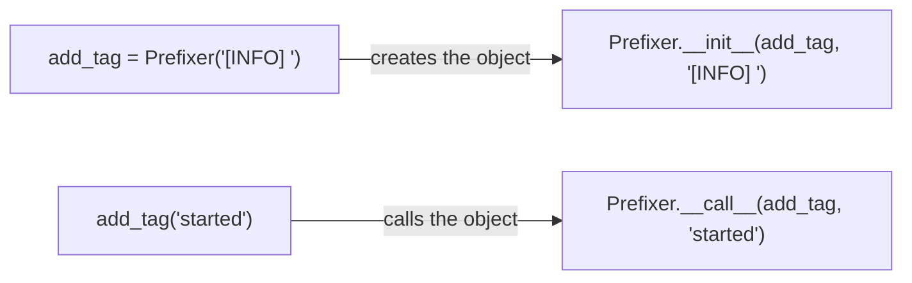

```python
>>> class Prefixer:
...     def __init__(self, prefix):
...         self.prefix = prefix
...         self.calls = 0
...     def __call__(self, text):
...         self.calls += 1
...         return self.prefix + text
...
>>> add_tag = Prefixer("[INFO] ")
>>> add_tag("started")
'[INFO] started'
>>> add_tag("done")
'[INFO] done'
>>> add_tag.calls
2
>>> callable(add_tag), add_tag.__call__("manual")
(True, '[INFO] manual')
>>> list(map(add_tag, ["a", "b"]))        # works anywhere a function does
['[INFO] a', '[INFO] b']
```

The same idea gives a class-based decorator: the object is built once with the function, and every later call of the decorated name runs `__call__`.

```python
>>> class CountCalls:
...     def __init__(self, func):
...         self.func = func
...         self.count = 0
...     def __call__(self, *args, **kwargs):
...         self.count += 1
...         return self.func(*args, **kwargs)
...
>>> @CountCalls
... def ping():
...     return "pong"
...
>>> ping(), ping()
('pong', 'pong')
>>> ping.count
2
```

## Composition and aggregation

Inheritance says *is-a*. Composition says *has-a*: an object holds other objects as attributes and delegates work to them. In composition the parts belong to the whole (a memory created for one agent). In aggregation the whole merely uses something that exists independently (a client shared by several agents).

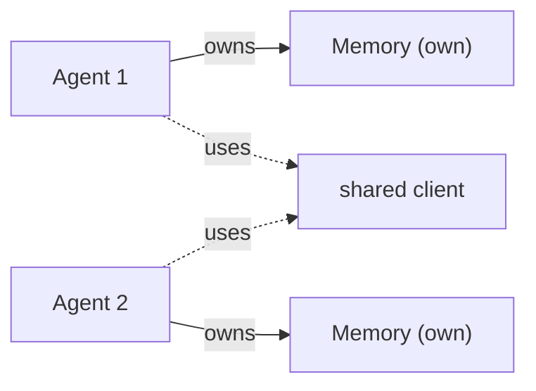

```python
>>> class Memory:
...     def __init__(self):
...         self.items = []
...     def remember(self, text):
...         self.items.append(text)
...
>>> class Agent:
...     def __init__(self, client, memory):
...         self.client = client               # passed in: can be shared
...         self.memory = memory
...     def run(self, prompt):
...         self.memory.remember(prompt)
...         return self.client.complete(prompt)
...
>>> shared = FakeClient()
>>> a1 = Agent(shared, Memory())
>>> a2 = Agent(shared, Memory())
>>> a1.run("hi")
'canned reply'
>>> a1.memory.items, a2.memory.items
(['hi'], [])
>>> a1.client is a2.client
True
```

## When to use objects or something else

Use the simplest structure that does the job. A dict, list or tuple is simpler than a class. Reach for a class when many pieces of data travel together and have behavior of their own.

| **Tool** | **Good when** | **Watch out** |
|---|---|---|
| `dict` | ad-hoc, keys vary, JSON in/out | typos in keys, no structure |
| `tuple` / named tuple | fixed small record, never changes | positions or no behavior |
| `dataclass` | mostly data, you want `repr`/`==` for free | types are hints only |
| pydantic model | data from outside (JSON, API) that must be validated | third-party package |
| plain class | behavior plus state, several methods | more code to write |
| module | you want exactly one of something | no inheritance |

> [!info] Key idea
> You can write plenty of useful Python without defining a class. But you will *use* classes constantly: API clients, response objects and data models are all classes written by others.

## Named tuples

A named tuple is a tuple whose positions also have names. It is immutable, lightweight, and works as a dict key. You get it from `collections.namedtuple`.

```python
>>> from collections import namedtuple
>>> Usage = namedtuple("Usage", "input_tokens output_tokens")
>>> u = Usage(120, 30)
>>> u
Usage(input_tokens=120, output_tokens=30)
>>> u.input_tokens, u[1]                   # by name or by position
(120, 30)
>>> inp, out = u                           # unpacks like any tuple
>>> u._replace(output_tokens=99)           # "changes" it by making a new one
Usage(input_tokens=120, output_tokens=99)
>>> u._asdict()
{'input_tokens': 120, 'output_tokens': 30}
>>> Usage(**{"input_tokens": 1, "output_tokens": 2})
Usage(input_tokens=1, output_tokens=2)
>>> u.input_tokens = 5
Traceback (most recent call last):
  ...
AttributeError: can't set attribute
```

## Dataclasses

A dataclass is a normal class where Python writes `__init__`, `__repr__` and `__eq__` for you from a list of annotated fields. You write the fields as `name: type` or `name: type = default`. The decorator does the rest.

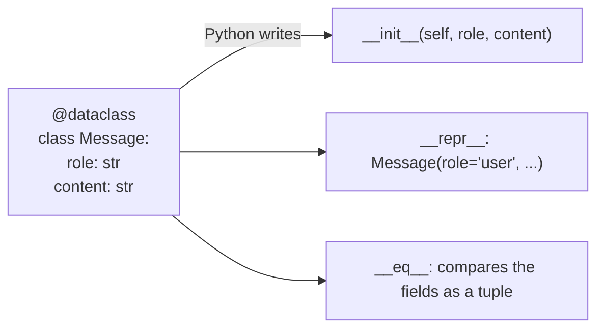

```python
>>> from dataclasses import dataclass, field, asdict, replace
>>> @dataclass
... class Message:
...     role: str
...     content: str
...
>>> m = Message("user", "Hi")
>>> m
Message(role='user', content='Hi')
>>> m.content = "Yo"                       # mutable by default
>>> m == Message("user", "Yo")             # equal fields, so equal
True
>>> m is Message("user", "Yo")             # but a different object
False
>>> asdict(m)
{'role': 'user', 'content': 'Yo'}
>>> replace(m, content="Bye")              # a modified copy
Message(role='user', content='Bye')
```

To see what the decorator saved you, here is the hand-written equivalent of the first two methods. This is how `__init__`, `__repr__` and `__eq__` work in any class.

```python
>>> class MessageByHand:
...     def __init__(self, role, content):
...         self.role = role
...         self.content = content
...     def __repr__(self):
...         return (f"MessageByHand(role={self.role!r}, "
...                 f"content={self.content!r})")
...     def __eq__(self, other):
...         if other.__class__ is not self.__class__:
...             return NotImplemented
...         return (self.role, self.content) == (other.role, other.content)
...
>>> MessageByHand("user", "Hi")
MessageByHand(role='user', content='Hi')
>>> MessageByHand("user", "Hi") == MessageByHand("user", "Hi")
True
```

### Defaults, options and validation

> [!warning] Trap: mutable defaults need `default_factory`
> Writing `messages: list = []` would share one list between all instances, so dataclasses refuse it. Use `field(default_factory=list)` to build a fresh list per instance.

```python
>>> @dataclass
... class Chat:
...     model: str
...     system: str = ""
...     messages: list = field(default_factory=list)
...
>>> Chat("small-fast")
Chat(model='small-fast', system='', messages=[])
>>> @dataclass
... class Oops:
...     items: list = []
...
Traceback (most recent call last):
  ...
ValueError: mutable default <class 'list'> for field items is not allowed:
use default_factory
```

`@dataclass(frozen=True)` makes instances immutable (and hashable). `order=True` adds `<` and friends that compare the fields in order. `__post_init__` runs right after the generated `__init__`, a good place for checks. `field(repr=False)` keeps a value out of the `repr`.

```python
>>> @dataclass(frozen=True, order=True)
... class Version:
...     major: int
...     minor: int
...     def __post_init__(self):
...         if self.minor < 0:
...             raise ValueError("minor must be >= 0")
...
>>> Version(1, 2) < Version(1, 10)
True
>>> v = Version(1, 2)
>>> v.minor = 3
Traceback (most recent call last):
  ...
dataclasses.FrozenInstanceError: cannot assign to field 'minor'
>>> {v: "ok"}                             # frozen means hashable
{Version(major=1, minor=2): 'ok'}
>>> @dataclass
... class Credentials:
...     user: str
...     api_key: str = field(repr=False)   # never shows up in logs
...
>>> Credentials("ana", "sk-secret")
Credentials(user='ana')
```

> [!warning] Trap: annotations are not enforced
> The `str` in `role: str` is only a hint. A dataclass accepts `Message(1, None)` without complaint. Enforcing types is what validation libraries such as pydantic do.

## Nested objects, and attribute versus subscript access

Real API data is nested: a reply holds usage numbers, content blocks and so on. You can model that by letting one dataclass field hold another dataclass. Reading a deep value is a chain of dots.

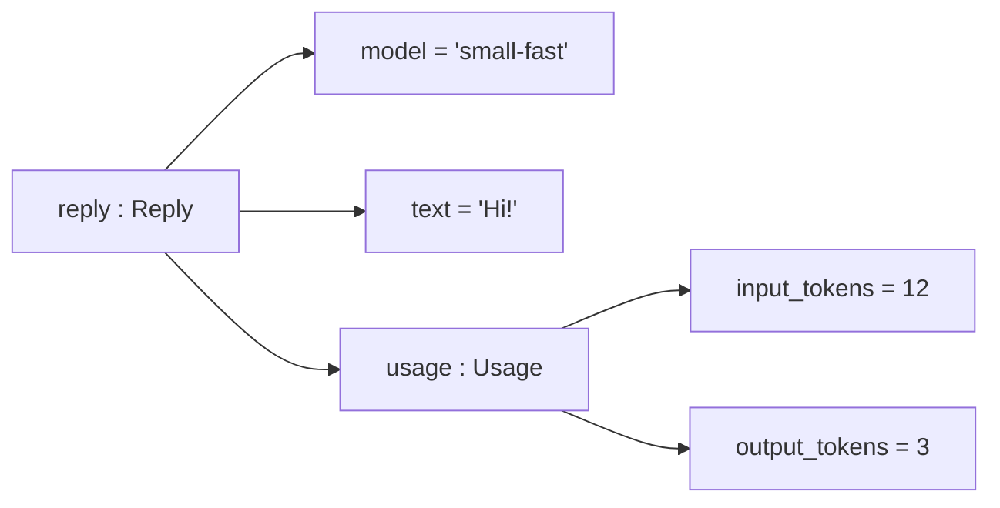

Path to `output_tokens`: `reply.usage.output_tokens` (one dot per level).

```python
>>> @dataclass
... class Usage:
...     input_tokens: int
...     output_tokens: int
...
>>> @dataclass
... class Reply:
...     model: str
...     text: str
...     usage: Usage                       # a field that holds another object
...
>>> reply = Reply("small-fast", "Hi!", Usage(12, 3))
>>> reply.usage.output_tokens
3
>>> asdict(reply)                          # nested objects become dicts
{'model': 'small-fast', 'text': 'Hi!',
 'usage': {'input_tokens': 12, 'output_tokens': 3}}
>>> reply["text"]
Traceback (most recent call last):
  ...
TypeError: 'Reply' object is not subscriptable
```

|  | **attribute: `obj.x`** | **subscript: `d["x"]`** |
|---|---|---|
| Works on | instances of classes, dataclasses, models | dicts, lists, tuples, anything with `__getitem__` |
| Missing name | `AttributeError` | `KeyError` (dict) or `IndexError` (list) |
| Name or key is a variable | `getattr(obj, name)` | `d[name]` |
| Typical source | your own classes, SDK response objects | parsed JSON (`json.loads`) |
| Nested read | `reply.usage.output_tokens` | `data["usage"]["output_tokens"]` |

### From a dict to nested objects

JSON gives you nested dicts. Passing it straight to a dataclass with `**` only converts the *top* level. The inner dict stays a dict, and dot access then fails.

```python
>>> data = {"model": "small-fast", "text": "Hi!",
...         "usage": {"input_tokens": 12, "output_tokens": 3}}
>>> data["usage"]["output_tokens"]
3
>>> half = Reply(**data)                   # usage is still a plain dict
>>> half.usage.output_tokens
Traceback (most recent call last):
  ...
AttributeError: 'dict' object has no attribute 'output_tokens'
>>> full = Reply(data["model"], data["text"], Usage(**data["usage"]))
>>> full.usage.output_tokens
3
>>> full == reply
True
```

Writing that conversion for every nested level is tedious. A validation library does it for you. **pydantic** (a third-party package, installed with `pip install pydantic`) builds nested models from nested dicts, converts compatible values, and raises a clear error otherwise. Many LLM SDKs return pydantic objects (see [[26 - AI]]), so `response.usage.input_tokens` is exactly this pattern.

```python
from pydantic import BaseModel, ValidationError

class UsageM(BaseModel):
    input_tokens: int
    output_tokens: int

class ReplyM(BaseModel):
    model: str
    text: str
    usage: UsageM

data = {"model": "small-fast", "text": "Hi!",
        "usage": {"input_tokens": "12", "output_tokens": 3}}
r = ReplyM.model_validate(data)        # nested dict -> nested objects
print(r.usage.input_tokens, type(r.usage).__name__)
print(r.model_dump())                  # back to plain dicts
try:
    ReplyM.model_validate({"model": "m", "text": "t"})
except ValidationError as exc:
    print(exc.error_count(), "error:", exc.errors()[0]["loc"])
```

```text
12 UsageM
{'model': 'small-fast', 'text': 'Hi!',
 'usage': {'input_tokens': 12, 'output_tokens': 3}}
1 error: ('usage',)
```

Note the string `"12"` became the integer `12`, and a missing `usage` was reported by name. This block needs the `pydantic` package.

> [!example] Type check
> | **Expression** | **Type** | **Note** |
> |---|---|---|
> | `r` | `ReplyM` | attributes, no `["..."]` |
> | `r.usage` | `UsageM` | a nested model object |
> | `r.usage.input_tokens` | `int` | converted from `"12"` |
> | `r.model_dump()` | `dict` | plain nested dicts, ready for `json.dumps` |

## attrs

`attrs` is a third-party library that predates dataclasses. It offers the same “write the fields, get the methods” idea plus validators and converters. It is optional reading: dataclasses cover most needs, and pydantic covers validation. If you meet `@attrs.define` in someone's code, read it as a dataclass with extras.

```python
# needs: pip install attrs   (not run here: package not installed)
import attrs

@attrs.define
class Msg:
    role: str
    content: str = attrs.field(validator=attrs.validators.instance_of(str))
```

> [!danger] Boss fight: three different “calls” that look alike
> `Cls(...)`, `obj.method(...)` and `obj(...)` all use parentheses, but Python does a different thing each time. If you can say which row you are in, `self`, `__init__` and `__call__` stop being confusing.
>
> | **You write** | **Python does** | **`self` is** |
> |---|---|---|
> | `Cls(a)` | builds a blank object, then runs `Cls.__init__(new, a)` | the new blank object |
> | `obj.m(a)` | finds `m` on the class, runs `Cls.m(obj, a)` | `obj` |
> | `obj(a)` | runs `Cls.__call__(obj, a)` | `obj` |

```python
class Tracer:
    def __init__(self, label):
        print("__init__ runs, self is the new object, label =", label)
        self.label = label

    def method(self, x):
        print("method runs, self.label =", self.label, "| x =", x)

    def __call__(self, x):
        print("__call__ runs, self.label =", self.label, "| x =", x)

t = Tracer("T")          # row 1
t.method(1)              # row 2
t(2)                     # row 3
print(t.method.__self__ is t)
```

```text
__init__ runs, self is the new object, label = T
method runs, self.label = T | x = 1
__call__ runs, self.label = T | x = 2
True
```

> [!question]- Practice
> 1. Write a class `PromptTemplate` whose `__init__` takes a template string with `{name}` placeholders, and a method `render(**values)` that fills them in. Then make instances callable with `__call__` so `tpl(name="Ana")` works too.
> 2. Explain in your own words what `self` is, and show two ways to call the same method (one through the instance, one through the class).
> 3. Given `class A: items = []`, why do two instances share the list? Rewrite the class so each instance gets its own.
> 4. Make a `Temperature` class with a property `celsius` (stored) and a read-only property `fahrenheit` (computed). What error do you get when you assign to `fahrenheit`?
> 5. Write two dataclasses, `Author` and `Book`, where `Book` has an `Author` field. Build a `Book` from a nested dict, then print `asdict(book)`. Why does `Book(**data)` alone not give you an `Author` object?
> 6. Add `__eq__` and `__repr__` to a small class by hand, then rewrite it as a dataclass. What do you get for free, and what is still up to you?

> [!success] Achievement unlocked: Object Builder
> You can now:
>
> - write classes with `__init__`, `self`, methods, properties and class attributes, and say how each lookup works;
> - reuse code with inheritance, `super()` and composition, and know when to prefer which;
> - make objects work with `==`, `print`, `len`, `[]` and `()`;
> - model data with named tuples and dataclasses, including nested objects and validation with pydantic.

---
Related: [[10 - Functions]] | [[09 - Dictionaries and Sets]] | [[12 - Modules and Packages]] | [[14 - Type Hints and Documentation]] | [[15 - Testing]] | [[26 - AI]]
