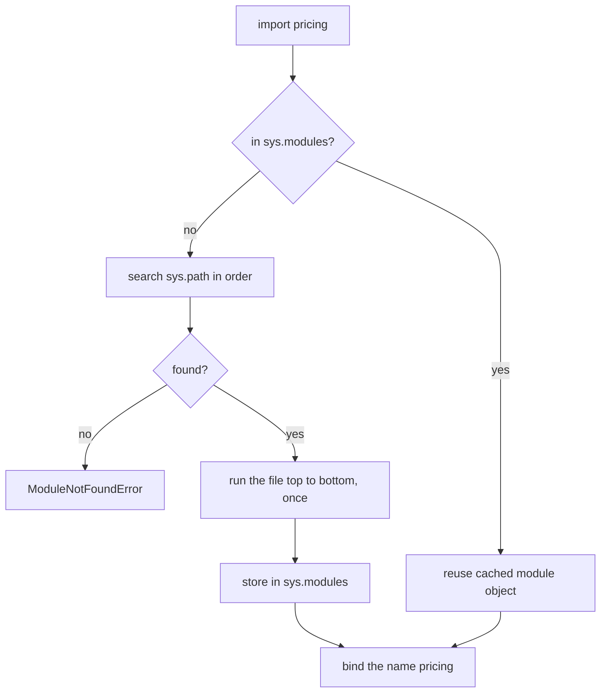
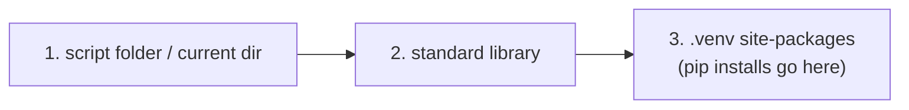
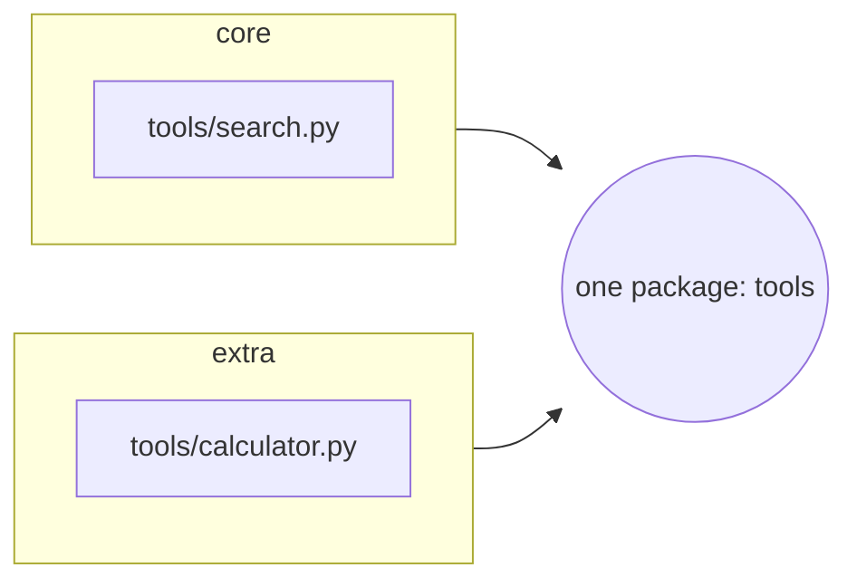
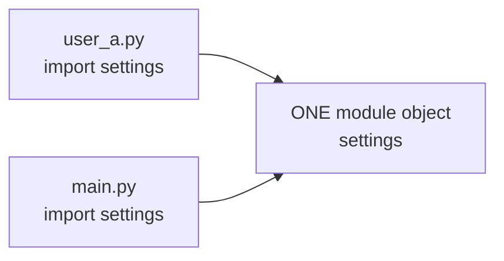

# Modules and Packages

Until now your code lived in one file. This chapter shows how to split it across files (modules), group files into folders (packages), and reuse the large standard library. These are the skills you need before you can organise a real LLM project, or install the `anthropic` package and import it.

## Modules and the import statement

A **module** is any Python file. There is nothing to declare: if a file is called `pricing.py`, then `import pricing` makes its names available.

```python
# pricing.py  (the module)
print("pricing.py is running")

PRICES = {"small": (0.10, 0.50), "large": (4.00, 20.00)}  # USD per 1M tokens

def cost_usd(model, tokens_in, tokens_out):
    price_in, price_out = PRICES[model]
    return tokens_in / 1e6 * price_in + tokens_out / 1e6 * price_out
```

```python
# app1.py  (same folder)
import pricing

print(type(pricing))
print(pricing.__name__)
print(f"{pricing.cost_usd('small', 22, 73):.6f}")
import pricing           # second import: file is NOT run again
import sys
print("pricing" in sys.modules)
```

```text
pricing.py is running
<class 'module'>
pricing
0.000039
True
```

Note that `pricing.py is running` printed only once, even though we imported twice.

> [!example] Type check
> `import pricing` binds the name `pricing` to a **module object** (`<class 'module'>`). Names inside it are attributes: `pricing.PRICES`, `pricing.cost_usd`. The *file* runs once, the first time it is imported.

### How an import is resolved



### The three import forms

| **Form** | **You get** | **Use when** |
|---|---|---|
| `import pricing` | module object; write `pricing.cost_usd(...)` | default choice, no name clashes |
| `import pricing as p` | the same module, shorter name | long names, or two modules with the same name |
| `from pricing import cost_usd` | the *function itself*, no prefix | you use one or two names a lot |
| `from pricing import cost_usd as price` | the function under a new name | name clash with your own code |
| `from pricing import *` | every public name | almost never |

```python
# app2.py
from pricing import cost_usd as price_it
import pricing as p

print(type(price_it))
print(price_it("large", 1000, 500))
print(p.PRICES["small"])
```

```text
pricing.py is running
<class 'function'>
0.014
(0.1, 0.5)
```

> [!example] Type check
> `import x` gives you a `module`. `from x import y` gives you whatever `y` is (a function, a dict, a class). Even with `from`, the whole module still runs, as the first output line shows.

> [!warning] Trap
> `from module import *` dumps unknown names into your file. A later line can silently overwrite one of your own variables, and you cannot tell where a name came from. Import the names you need, or the module.

> [!tip] Rule: where to put imports
> Put imports at the top of the file, standard library first, then third-party (such as `anthropic`), then your own modules. Everyone can see the dependencies at a glance. Import inside a function only when it is rarely used or slow to load.

### `__name__` and running a module as a script

Every module has a `__name__`. If you import it, the name is the module name. If you run the file directly, the name is `"__main__"`. This lets one file be both a library and a script.

```python
# greet.py
def hello(name):
    return f"hello {name}"

if __name__ == "__main__":      # only true when run directly
    print(hello("world"))
```

## Packages

A **package** is a folder of modules. You import from it with a dotted name. Put an (often empty) `__init__.py` in the folder: it marks the folder as a regular package and its code runs when the package is first imported.

```text
chatapp/
|-- main.py
`-- chatkit/              <- the package
    |-- __init__.py       <- runs on "import chatkit"
    |-- tokens.py         <- import chatkit.tokens
    `-- costs.py          <- import chatkit.costs
```

Here are the three small files. They are plain Python.

```python
# chatkit/tokens.py
def rough_tokens(text):
    """Very rough estimate: about 4 characters per token."""
    return max(1, len(text) // 4)
```

```python
# chatkit/costs.py
from .tokens import rough_tokens      # relative import (same package)
from chatkit import tokens            # absolute import (also fine)

RATE_IN = 0.10  # USD per 1M input tokens (made up)

def prompt_cost(text):
    return rough_tokens(text) / 1e6 * RATE_IN

def same_function():
    return rough_tokens is tokens.rough_tokens
```

```python
# main.py  (run from the chatapp folder)
from chatkit import costs, tokens

print(tokens.rough_tokens("Hello, how many tokens am I?"))
print(f"{costs.prompt_cost('x' * 4000):.8f}")
print(costs.same_function())
```

```text
7
0.00010000
True
```

> [!example] Type check
> `chatkit` is a package object, `chatkit.costs` is a module object inside it. Both have type `module`. `from chatkit import costs` works because `costs` is a submodule; `costs.prompt_cost` is then a plain function.

> [!tip] Rule: be explicit in `__init__.py`
> A one-line docstring is enough for an `__init__.py`. If you want users to write `from chatkit import prompt_cost`, re-export it there with `from .costs import prompt_cost`. Do not put heavy logic in it.

## The module search path

Python looks for a module in the folders listed in `sys.path`, in order. The **first match wins**.

```python
import sys
for place in sys.path:
    print(repr(place))
```

```text
''
'C:\\...\\Python312\\python312.zip'
'C:\\...\\Python312\\DLLs'
'C:\\...\\Python312\\Lib'
'C:\\...\\Python312'
'C:\\...\\ai-engineering\\.venv'
'C:\\...\\ai-engineering\\.venv\\Lib\\site-packages'
```

(Output from `python -c` in a project with a `.venv`; paths shortened. When you run a script file, the first entry is the script's folder instead of the empty string.)



You can add a folder at run time, but prefer a proper install or running from the project root.

```python
import sys
sys.path.insert(0, r"C:\my\modules")   # searched first
```

> [!warning] Trap
> **Shadowing.** A file in your folder with the same name as a library hides the library. Name a file `random.py` (or `json.py`, or, in an AI project, `anthropic.py`) and `import random` loads *your* file.
>
> ```python
> # random.py (yours)
> def choice(items):
>     return items[0]
> ```
>
> ```python
> # pick.py
> import random
> print(random.__file__)
> print(random.randint(1, 6))
> ```
>
> ```text
> C:\...\shadow\random.py
> Traceback (most recent call last):
>   File "...\shadow\pick.py", line 3, in <module>
>     print(random.randint(1, 6))
> AttributeError: module 'random' has no attribute 'randint'
> ```
>
> Clue: the error says the *module* lacks the name. Print `module.__file__` to see which file was really loaded, then rename your file.

## Relative and absolute imports

| **Style** | **Example** | **Meaning** |
|---|---|---|
| absolute | `from chatkit import tokens` | start at a folder on `sys.path` |
| relative, same folder | `from . import tokens` | start at the current package |
| relative, same folder, one name | `from .tokens import rough_tokens` | the same, picking one name |
| relative, parent | `from .. import config` | one package up |
| relative, sibling package | `from ..utils import clean` | up, then down into `utils` |

Relative imports only work *inside a package*. They need to know the parent package. That causes the most common beginner error:

```text
> python chatkit\costs.py
Traceback (most recent call last):
  File "...\chatkit\costs.py", line 1, in <module>
    from .tokens import rough_tokens
ImportError: attempted relative import with no known parent package
```

Run the module *as part of its package* with `-m`, from the project root:

```text
> python -m chatkit.costs
running as a script, __name__ = __main__
1.4999999999999999e-05
```

(That ends with the two-line `if __name__ == "__main__":` block added to `costs.py`.)

> [!tip] Rule
> In an application, prefer absolute imports (`from chatkit import tokens`); they read the same everywhere. Use relative imports for tight, internal links in a package you may rename or move. Run package code with `python -m package.module` from the project root.

## Namespace packages

If a folder has *no* `__init__.py`, Python can treat it as a **namespace package**. The useful trick: one package name can be spread across several folders on `sys.path`, and Python merges them. This lets separately shipped plug-ins share one name.



```python
# demo.py  (folders core/tools/search.py and extra/tools/calculator.py,
#           no __init__.py anywhere)
import sys
sys.path.insert(0, "core")
sys.path.insert(0, "extra")

from tools import search, calculator    # two files, two folders, one name
import tools
print(type(tools), len(list(tools.__path__)), tools.__file__)
```

```text
<class 'module'> 2 None
```

A namespace package has no single file (`__file__` is `None`) and its `__path__` lists all the folders. For your own small project, just use a normal package with `__init__.py`.

## Modules versus objects

Modules and objects look alike: both give you `thing.name`. The difference is the number of copies.

|  | **Module** | **Class / object** |
|---|---|---|
| Copies in a program | exactly one (a *singleton*) | as many instances as you create |
| Hiding data | none; every name is public by convention | `_name`, properties, methods |
| Good for | shared constants, config, helper functions | many things with their own state |



```python
# settings.py:   MODEL = "small"
# user_a.py:     import settings
#                def show(): return settings.MODEL
import math
import settings
import user_a

print(user_a.show())
settings.MODEL = "large"        # change it in one place...
print(user_a.show())            # ...every importer sees it
print(settings is user_a.settings)

math.pi = 3.0                   # legal! but only inside this process
print(math.pi)
```

```text
small
large
True
3.0
```

Restarting Python restores `math.pi` to `3.141592653589793`. You changed the copy in memory, not the file on disk.

> [!warning] Trap
> Because a module is shared, changing its variables is a hidden side effect for every other importer. Use module-level *constants* freely. For state that varies per user or per conversation, make a class ([[11 - Objects|Chapter 11]]) so each one gets its own instance.

## Goodies in the standard library

“Batteries included”: before writing a helper, check whether the standard library has it. Five tools you will use constantly follow.

### Missing keys: `setdefault` and `defaultdict`

`d[key]` on a missing key raises `KeyError`. `d.get(key, default)` returns a default but does not store it. `setdefault` returns the default *and stores it*.

```python
usage = {"haiku": 3}
print(usage.get("opus", 0))           # 0, dict unchanged
print(usage)
print(usage.setdefault("opus", 0))    # 0, and now stored
print(usage)
print(usage.setdefault("haiku", 99))  # key exists: old value wins
```

```text
0
{'haiku': 3}
0
{'haiku': 3, 'opus': 0}
3
```

A `defaultdict` sets the default up front. Pass it a *function with no arguments* (a “factory”); it is called when a key is missing. The factory is the *function*, so write `list`, not `list()`.

```python
from collections import defaultdict

by_model = defaultdict(list)
by_model["haiku"].append("hi")        # no KeyError: starts as []
by_model["opus"].append("yo")
by_model["haiku"].append("again")
print(dict(by_model))

tally = defaultdict(int)              # int() returns 0
for m in ["haiku", "opus", "haiku"]:
    tally[m] += 1
print(tally)

plain = {}
try:
    plain["haiku"] += 1               # a normal dict has no default
except KeyError as e:
    print("KeyError:", e)
```

```text
{'haiku': ['hi', 'again'], 'opus': ['yo']}
defaultdict(<class 'int'>, {'haiku': 2, 'opus': 1})
KeyError: 'haiku'
```

> [!example] Type check
> `defaultdict` is a subclass of `dict`. The argument is a **callable** that takes no arguments: `int` gives `0`, `list` gives `[]`, `dict` gives `{}`, and `lambda: "n/a"` gives any value you like. With no argument it behaves like a normal dict.

> [!warning] Trap
> Reading a missing key in a `defaultdict` *creates* it. After `by_model["ghost"]`, the test `"ghost" in by_model` is `True`. Use `.get()` when you only want to look.

### Counting: `Counter`

```python
from collections import Counter

words = "the cat saw the dog and the cat ran".split()
c = Counter(words)
print(c)
print(c.most_common(2))     # top two, as (item, count) tuples
print(c["unicorn"])         # missing -> 0, no KeyError
```

```text
Counter({'the': 3, 'cat': 2, 'saw': 1, 'dog': 1, 'and': 1, 'ran': 1})
[('the', 3), ('cat', 2)]
0
```

Counters combine with operators, like sets of items with counts.

| **Operator** | **Meaning** | **`a = x:2, y:1`, `b = x:1, z:1`** |
|---|---|---|
| `a + b` | add counts | `x:3, y:1, z:1` |
| `a - b` | subtract, drop zero and negative | `x:1, y:1` |
| `a & b` | lower count of common items | `x:1` |
| `a \| b` | higher count of any item | `x:2, y:1, z:1` |

```python
a = Counter(["x", "x", "y"])
b = Counter(["x", "z"])
print(a + b, a - b, a & b, a | b, sep="\n")
print(isinstance(c, dict))
```

```text
Counter({'x': 3, 'y': 1, 'z': 1})
Counter({'x': 1, 'y': 1})
Counter({'x': 1})
Counter({'x': 2, 'y': 1, 'z': 1})
True
```

### `OrderedDict`: mostly history

Since Python 3.7 a normal `dict` remembers insertion order, so you rarely need `OrderedDict`. Two differences remain: it compares order too, and it has `move_to_end`.

```python
from collections import OrderedDict

d1 = {"a": 1, "b": 2}
d2 = {"b": 2, "a": 1}
print(d1 == d2)                                  # order ignored
print(OrderedDict(d1) == OrderedDict(d2))        # order matters
od = OrderedDict(a=1, b=2, c=3)
od.move_to_end("a")
print(list(od))
```

```text
True
False
['b', 'c', 'a']
```

### Stack, queue, and `deque`

A **stack** is last-in, first-out (a pile of plates). A **queue** is first-in, first-out (a line). A `deque` (“deck”, double-ended queue) is fast at both ends, so it can be either. A `list` is slow when you remove from the front.

Its best feature for chat apps is `maxlen`: old items fall off automatically, a ready-made sliding window of recent messages.

```text
 appendleft -> [ t2 | t3 | t4 ] <- append        deque(maxlen=3)
 popleft   <-                   -> pop
 append("t5") pushes t2 out the left side: [ t3 | t4 | t5 ]
```

```python
from collections import deque

history = deque(maxlen=3)
for turn in ["t1", "t2", "t3", "t4"]:
    history.append(turn)           # t1 falls off when t4 arrives
print(history)
history.appendleft("t0")           # t4 falls off the right instead
print(history)
print(history.popleft(), history.pop(), history)
```

```text
deque(['t2', 't3', 't4'], maxlen=3)
deque(['t0', 't2', 't3'], maxlen=3)
t0 t3 deque(['t2'], maxlen=3)
```

### `itertools`: loops without the loop code

Each function returns an **iterator**: it produces one item at a time and remembers where it is. Wrap in `list(...)` to see everything. Never call `list()` on an infinite one such as `cycle`.

```python
import itertools

print(list(itertools.chain([1, 2], ["a"])))             # one long sequence
print(list(itertools.islice(itertools.cycle("ab"), 5))) # cap an endless one
print(list(itertools.accumulate([10, 20, 5])))          # running total
print(list(itertools.accumulate([1, 2, 3, 4], lambda a, b: a * b)))
print(list(itertools.batched(range(7), 3)))             # Python 3.12+
print(list(itertools.combinations("abc", 2)))
print(list(itertools.product("ab", [1, 2])))
```

```text
[1, 2, 'a']
['a', 'b', 'a', 'b', 'a']
[10, 30, 35]
[1, 2, 6, 24]
[(0, 1, 2), (3, 4, 5), (6,)]
[('a', 'b'), ('a', 'c'), ('b', 'c')]
[('a', 1), ('a', 2), ('b', 1), ('b', 2)]
```

`batched` is handy for sending documents to an API in chunks of $n$. It exists from Python 3.12, so older interpreters will not have it.

### `random`

| **Call** | **Returns** |
|---|---|
| `choice(seq)` | one item from a sequence |
| `sample(seq, k)` | `k` different items (no repeats of the same position) |
| `randint(a, b)` | integer, **both ends included** |
| `randrange(a, b, step)` | like `range`: `b` is excluded |
| `random()` | float in $[0.0, 1.0)$ |
| `shuffle(list)` | shuffles the list *in place*, returns `None` |
| `seed(n)` | makes the sequence repeatable |

```python
import random

random.seed(7)
first = random.choice(["a", "b", "c"])
random.seed(7)                       # same seed ...
second = random.choice(["a", "b", "c"])
print(first == second)               # ... same result
print(random.randint(1, 6) in range(1, 7))
```

```text
True
True
```

> [!tip] Rule
> Seed the generator in tests and experiments (for example when sampling an evaluation set), so a run can be reproduced. `random` is not secure; for tokens or secrets use the `secrets` module.

## More batteries: third-party code

When the standard library is not enough, look on **PyPI** (the Python Package Index; what `pip` searches), on GitHub, and on Read the Docs for documentation. The `anthropic` SDK you use is one such package. Before installing an unknown one, check the maintainer, the release date, the download count and the source repository. Installation is the topic of [[13 - Development Environment|Chapter 13]].

> [!danger] Boss fight: why did `import` give me the wrong thing?
> Three facts explain nearly every import bug: (1) Python searches `sys.path` in order and takes the **first** match; (2) the result is cached in `sys.modules`, so the file runs only once; (3) the first entry of `sys.path` is your script's folder, so your own files can hide library modules. When an import misbehaves, print `module.__file__` and `sys.path[:3]`. If the path is not what you expect, you have a shadowing or a working-directory problem, not a bug in the library.

> [!question]- Practice
> 1. Create `tokens.py` with a function `count(text)` that returns the number of words. Import it in four ways (module, alias, one name, one name with alias) and call it each time.
> 2. You run `python app.py` and get `AttributeError: module 'json' has no attribute 'loads'`. What do you check first, and with which line of code?
> 3. Why does `python helpers/util.py` fail on `from . import config`, and what command fixes it?
> 4. Write a loop that counts how many times each `stop_reason` string appears in a list, once with `defaultdict(int)` and once with `Counter`.
> 5. Keep only the last 5 messages of a chat using one data structure. Which one, and why not a list?
> 6. Use `itertools.batched` to split 10 file names into groups of 4. What does the last group look like?

> [!success] Achievement unlocked: Module Mapper
> - Split a program into modules and a package, and import from it four ways.
> - Explain how Python finds a module and why a file called `random.py` breaks things.
> - Choose `defaultdict`, `Counter` or `deque` instead of hand-written loops.
> - Run package code with `python -m`, and know why relative imports need it.

**Related:** [[10 - Functions]] (what is inside a module), [[11 - Objects]] (module vs class), [[13 - Development Environment]] (pip, venv), [[15 - Testing]] (importing code under test), [[16 - Debugging]] (print `__file__`).
