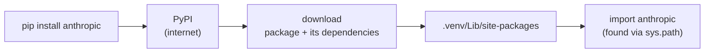
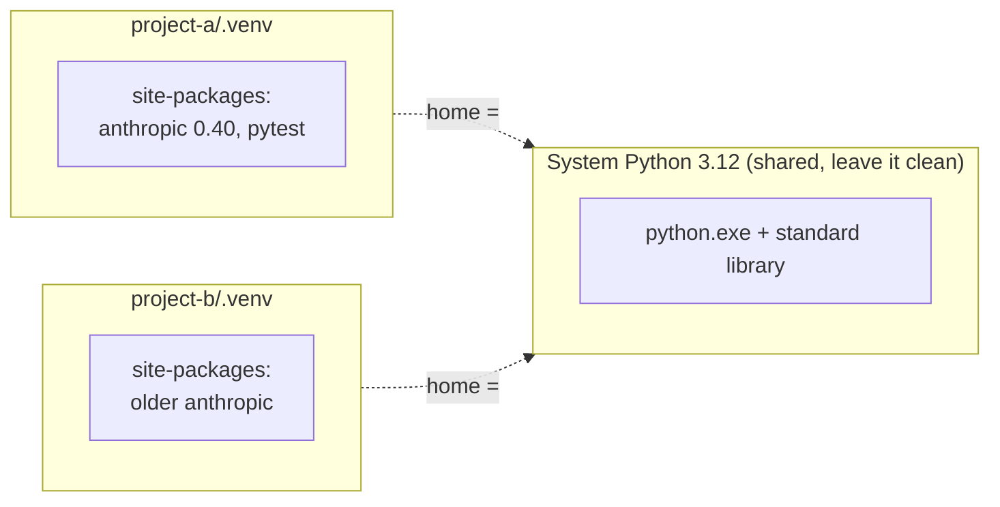

# Development Environment

Writing code is half the job. The other half is the setup around it: where to get packages, how to keep each project's packages separate, which editor to use, and how to save your history safely. This chapter is the setup you need for every Python and `anthropic` project.

## Find Python code

Before writing something, check if it already exists. Look in this order:

| **Source** | **What it is** | **Notes** |
|---|---|---|
| Standard library | ships with Python, no install | start here ([[12 - Modules and Packages\|Chapter 12]]) |
| PyPI | the Python Package Index; what `pip` downloads from | more than half a million packages |
| GitHub | source code hosting | sort by stars; check the last commit date |
| Recipe collections | short snippets for one task | good for ideas, read before you paste |

> [!tip] Rule: judge a package before installing
> Open its PyPI page and check: recent releases, a source link, a reasonable download count, a maintainer you can identify. Copy the name *exactly*: fake packages with near-identical names (`anthropic` versus a typo) exist to steal API keys.

## Install packages



| **Tool** | **What it does** | **When to pick it** |
|---|---|---|
| `pip` | installs packages from PyPI; comes with Python | the default; learn it first |
| `venv` | standard-library module that makes virtual environments | every project |
| `virtualenv` | third-party ancestor of `venv` | old projects, extra features |
| Pipenv | pip + virtualenv + a lock file | legacy teams |
| Poetry | dependency management through `pyproject.toml` | publishing packages |
| Conda | installs Python *and* non-Python libraries (science stack) | data science, GPU libraries |
| `uv` | very fast tool written in Rust; replaces pip, venv and more | new projects, if you want speed |

### pip

On Windows, prefer `python -m pip`. It runs pip *for the exact interpreter* on the left, so you cannot install into one Python and run another.

```text
> python -m pip install anthropic              latest version
> python -m pip install "anthropic>=0.40"      minimum version
> python -m pip install pytest==8.3.4          exact version
> python -m pip install --upgrade anthropic    update
> python -m pip uninstall anthropic            remove
> python -m pip list                           what is installed here
> python -m pip freeze                         the same, in requirements format
```

(The text on the right is a note, not part of the command. Not run here: these download from the internet and change an environment. The version numbers are only examples of the syntax.)

> [!warning] Trap
> Quote any specifier with `>`, `<` or `=` signs. In both PowerShell and cmd the shell reads `>` as “redirect output to a file”, so `pip install anthropic>=0.40` creates a file called `=0.40`.

| **Specifier** | **Meaning** |
|---|---|
| `pkg` | any version, usually the newest |
| `pkg==1.4.2` | exactly this version |
| `pkg>=1.4` | this version or newer |
| `pkg>=1.4,<2` | newer than 1.4 but not 2.x |
| `pkg~=1.4.2` | compatible: at least 1.4.2, below 1.5 |

**Requirements file.** A text file listing the packages a project needs, one per line. Anyone can rebuild the same setup with one command.

```text
# requirements.txt
anthropic>=0.40
pytest>=8
python-dotenv

> python -m pip install -r requirements.txt
```

> [!tip] Rule
> Keep `requirements.txt` in the project and commit it to Git. Use `pip freeze > requirements.txt` to record the *exact* versions that work today, so a teammate (or you in six months) gets the same ones.

### Other ways to install

- **Native package managers** install programs, not just Python packages: Homebrew on macOS, `apt` on Linux, and on Windows the MSI installer or `winget`. Python itself on Windows usually comes this way, along with the `py` launcher.
- **From source.** If a project is not on PyPI, download or `git clone` it, then run `python -m pip install .` inside its folder. (The book mentions `python setup.py install`; that old command is no longer recommended.) You can also install straight from Git with `pip install git+https://...`.

> [!warning] Trap
> Installing code means running someone else's code on your machine, with access to your files and environment variables, including your `ANTHROPIC_API_KEY`. Pure-Python packages are readable, but malware in them has happened. Install only what you trust.

## Virtual environments

### Why you need one

Project A may need `anthropic` 0.40, project B an older release. If both install into the one system Python, they collide. A **virtual environment** is a private folder holding a Python interpreter link plus its own `site-packages`. Each project gets its own.



### Create and use one with `venv`

```text
> cd my-chat-app
> python -m venv .venv                  create the folder .venv
> .venv\Scripts\activate                cmd.exe
> .venv\Scripts\Activate.ps1            PowerShell  (see the trap below)
(.venv) > python -m pip install anthropic
(.venv) > deactivate                    leave the environment
```

On macOS and Linux the activation command is `source .venv/bin/activate`, and the folder is `bin` instead of `Scripts`. This is what the folder contains (real listing on Windows):

```text
.venv/
|-- pyvenv.cfg        <- records "home =" the base Python
|-- Include/
|-- Lib/site-packages <- packages for THIS project
`-- Scripts/          <- python.exe, pip.exe, activate scripts
```

### What “activate” really does

Your shell finds programs by searching the folders in the `PATH` environment variable, left to right. Activation puts `.venv Scripts` at the *front*, so typing `python` or `pip` finds the project's copies first. Nothing else changes, and only in that terminal window.

```text
before activate:  PATH = C:\Windows\System32 ; ...\Python312 ; ...
after  activate:  PATH = ...\.venv\Scripts ; C:\Windows\System32 ; ...\Python312 ; ...
                         ^ found first, so "python" means the venv's python
```

> [!warning] Trap
> **PowerShell may refuse the script.** Windows can block `Activate.ps1` with an error about “running scripts is disabled”. You do not need activation at all: call the interpreter directly, `.venv Scripts python.exe -m pip install anthropic`. VS Code selects the interpreter for you (command palette, *Python: Select Interpreter*) and activates it in new terminals.

### Am I inside the venv?

Two attributes tell you. `sys.prefix` is the environment you run in; `sys.base_prefix` is the Python it was built from. They differ only inside a venv.

```python
# envcheck.py
import os
import sys

print(sys.executable.endswith("python.exe"))
print("in a venv:", sys.prefix != sys.base_prefix)

key = os.environ.get("DEMO_API_KEY")        # None if the variable is missing
print(type(key))
print("key is set" if key else "key is missing")

os.environ["DEMO_PORT"] = "8080"            # values are always str
port = os.environ["DEMO_PORT"]
print(type(port), int(port) + 1)

try:
    os.environ["NOPE_NOT_SET"]
except KeyError as err:
    print("KeyError:", err)
```

```text
True
in a venv: True
<class 'NoneType'>
key is missing
<class 'str'> 8081
KeyError: 'NOPE_NOT_SET'
```

(Run with the interpreter of a venv created by `python -m venv .venv`.)

> [!example] Type check
> `os.environ` behaves like a `dict[str, str]`: every value is a **string**, so convert with `int(...)` yourself. `os.environ["X"]` raises `KeyError` when missing; `os.environ.get("X")` returns `None`. That is why you check an `Optional[str]` before using an API key.

> [!tip] Rule: keep secrets out of code
> Put `ANTHROPIC_API_KEY` in an environment variable or a `.env` file, never in a `.py` file. List `.env` and `.venv/` in `.gitignore` so neither is ever committed.

### The other tools, in a sentence each

- **virtualenv**: the older third-party tool that `venv` was modelled on; same idea.
- **Pipenv**: runs pip and a virtualenv for you and writes a lock file of exact versions.
- **Poetry**: manages dependencies and packaging from a `pyproject.toml` file; needs a recent Python 3.
- **Conda**: a general package manager (not only Python), common for scientific stacks.
- **uv**: a fast modern replacement for most of the above. Same ideas, different commands: `uv venv`, `uv pip install`.

## Integrated development environments

An IDE adds to a plain editor: autocomplete, inline docs, formatting and style checks, a file tree, source control, test and debug buttons. Pick one and learn it well.

| **Tool** | **Kind** | **Comment** |
|---|---|---|
| Notepad++, vi/Vim, Neovim | text editors | fast and light; Vim keys take weeks to learn |
| Sublime Text, Zed | fast code editors | Zed has built-in AI assistant features |
| IDLE | Python's own small IDE | ships with Python; fine for first steps |
| PyCharm | full Python IDE | free Community edition; heavy but complete |
| **VS Code** | editor plus extensions | **free, most popular; you use it**; install the Python extension |
| Cursor | VS Code fork with AI built in | same look and settings as VS Code |
| IPython | improved interactive shell | `?` help, Tab completion, history lists `In` and `Out` |
| Jupyter, JupyterLab | notebooks: code, output and text in cells | data and experiments; also inside VS Code |

### IPython and Jupyter

IPython is a nicer version of the plain interactive Python prompt. Install it with `python -m pip install ipython`. Typing `name?` shows the type, value and docstring of any object, and the *Tab* key completes names. Jupyter wraps this in a browser notebook (`pip install jupyterlab`, run `jupyter lab`): you run small cells and see results below each one. Notebooks are excellent for trying out prompts and looking at data.

> [!warning] Trap
> A notebook keeps variables alive between cells, in the order you *ran* them, not the order they appear. A result can depend on a cell you deleted. Before trusting a notebook, restart the kernel and run all cells from the top. For application code, use plain `.py` files.

## Source control

Source control records every saved version of your project, so you can see what changed, undo a mistake or work with others. **Git** is the standard; **Mercurial** (written in Python) is similar but less common. Both are *distributed*: every copy holds the full history. **GitHub** is a website that hosts Git repositories.

### The three places a change lives


### A first repository, step by step

Real output from a scratch folder (Git 2.x on Windows):

```text
> git init -b main
Initialized empty Git repository in .../repo/.git/

> echo print("Oops") > hello.py
> git add hello.py
> git status
On branch main
No commits yet
Changes to be committed:
        new file:   hello.py

> git commit -m "add hello script"
[main (root-commit) 8357896] add hello script
 1 file changed, 1 insertion(+)
 create mode 100644 hello.py
```

Now edit `hello.py` (change `Oops` to `Hi`) and look at the change before saving it:

```text
> git status
Changes not staged for commit:
        modified:   hello.py

> git diff
--- a/hello.py
+++ b/hello.py
@@ -1 +1 @@
-print("Oops")
+print("Hi")

> git add hello.py
> git commit -m "fix greeting"
[main 619bb0e] fix greeting
 1 file changed, 1 insertion(+), 1 deletion(-)

> git log --oneline
619bb0e fix greeting
8357896 add hello script
```

(Git on Windows may also print `warning: LF will be replaced by CRLF`. It is about line endings and is harmless here.)


| **Command** | **What it does** |
|---|---|
| `git init` | turn the current folder into a repository |
| `git status` | show what is changed, staged, or untracked |
| `git add file` / `git add .` | put a file (or all changes) into the staging area |
| `git commit -m "msg"` | save the staged snapshot with a message |
| `git diff` | show line changes not yet staged |
| `git log` / `git log –oneline` | show history, newest first |
| `git clone url` | copy a whole repository from a host such as GitHub |

> [!warning] Trap
> `git commit` saves only what you staged. If you edit a file and commit without `git add`, Git answers “no changes added to commit” and nothing is saved. Also: `git add .` stages *everything*, including a `.env` file with a key. Write the `.gitignore` first:
>
> ```text
> .venv/
> __pycache__/
> .env
> ```

> [!tip] Rule
> Commit small and often, with a message that says *what* changed (“fix greeting”), not “stuff”. Commit when the tests pass. Review with `git diff` before every commit.

> [!danger] Boss fight: “which Python am I running?”
> Most setup bugs are a mismatch: you installed a package into one Python and run your code with another (`ModuleNotFoundError: No module named 'anthropic'` right after a successful install). Ask three questions: (1) `import sys; print(sys.executable)`: which interpreter is running? (2) `sys.prefix != sys.base_prefix`: is it a venv? (3) `python -m pip –version`: does pip belong to the same interpreter? Always install with `python -m pip` and make VS Code use the `.venv` interpreter, and the mismatch disappears.

> [!question]- Practice
> 1. Create a project folder with a `.venv`. Which two commands activate it in PowerShell and in cmd, and how do you leave it?
> 2. You ran `pip install anthropic` but Python says the module is missing. List three causes you would check.
> 3. Write a `requirements.txt` that needs any `anthropic`, `pytest` 8 or newer, and nothing else. How does a teammate install it?
> 4. What does `git add` do that `git commit` does not? Why is there a staging area at all?
> 5. Write the lines for a `.gitignore` in an LLM project and say why each line is there.
> 6. Read an API key from an environment variable. What is the type of the result when the variable is missing, and what do you do about it?

> [!success] Achievement unlocked: Environment Engineer
> - Create a virtual environment, install packages into it, and prove which Python you are using.
> - Record and rebuild a project's dependencies with `requirements.txt`.
> - Keep secrets out of code and out of Git with environment variables and `.gitignore`.
> - Make, review and list commits with Git.

**Related:** [[12 - Modules and Packages]] (what pip installs), [[14 - Type Hints and Documentation]] (mypy runs in the venv), [[15 - Testing]] (pytest, CI), [[16 - Debugging]] (find which Python), [[20 - Files]] (reading `.env`).
