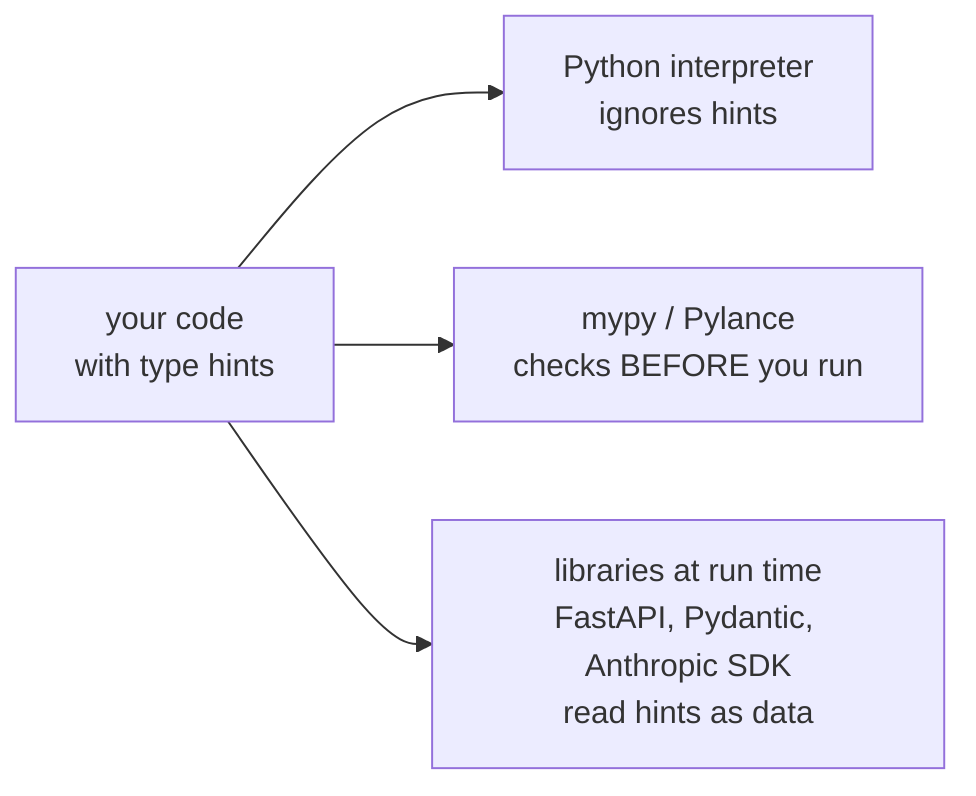
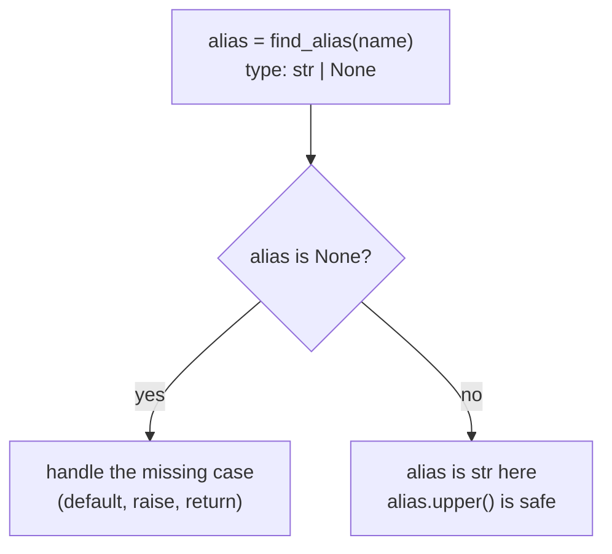

# Type Hints and Documentation

Python variables are just names attached to objects, so nothing in the language says what kind of object a name should hold. Type hints are optional notes that say it. This chapter shows how to write them, how a checker (mypy) uses them to find bugs before you run the code, and how comments, docstrings and README files explain your code to the next reader, which may be you.

## Type hints

A **type hint** (also *type annotation*) says what type a variable, parameter or return value is *supposed* to have. Python itself ignores hints. They are for people and for tools.



### Variable hints

The form is `name: type` or `name: type = value`.

```python
from typing import Any

model: str = "small-model"
temperature: float = 0.7
max_tokens: int                       # hint only: no value, no variable yet
stop: list[str] = ["END"]             # a list of str
usage: dict[str, int] = {"in": 22, "out": 73}      # keys str, values int
pair: tuple[int, str] = (1, "a")      # exactly: one int, then one str
price: int | float = 4                # either type (Python 3.10+)
alias: str | None = None              # a str, or missing
anything: Any = object()              # opt out: could be anything

print(__annotations__["model"], __annotations__["usage"])
print(sorted(__annotations__))
try:
    print(max_tokens)
except NameError as e:
    print("NameError:", e)
```

```text
<class 'str'> dict[str, int]
['alias', 'anything', 'max_tokens', 'model', 'pair', 'price', 'stop', 'temperature', 'usage']
NameError: name 'max_tokens' is not defined
```

> [!example] Type check
> The hint is stored in `__annotations__`, a plain `dict` mapping names to types. It is only a record. `max_tokens: int` *does not create* the variable, so reading it raises `NameError`. `list[str]` means “list whose items are `str`”; `tuple[int, str]` means a pair of exactly those types.

| **Hint** | **Meaning** | **Python** |
|---|---|---|
| `int`, `str`, `float`, `bool` | the plain type | any |
| `list[str]`, `dict[str, int]`, `set[int]` | container and what is inside | 3.9+ |
| `tuple[int, str]` / `tuple[int, ...]` | fixed pair / any number of ints | 3.9+ |
| `int \| float` | one of several types | 3.10+ |
| `str \| None` | a value, or `None` (same as `Optional[str]`) | 3.10+ |
| `Any` (from `typing`) | anything; switches checking off for it | any |
| `Union[int, float]`, `Optional[float]` | older spellings of the two lines above | any |

> [!warning] Trap
> The book's older spelling is `Union[int, float]` with square brackets. Writing `Union(int, float)` with round brackets is an error. On Python 3.10+ prefer the shorter `int | float`.

### Function hints

Parameters get `name: type`; the return type goes after `->`. A function that returns nothing is `-> None`.

```python
def token_cost(model: str, tokens_in: int, tokens_out: int = 0) -> float:
    rates = {"small": (0.10, 0.50), "large": (4.0, 20.0)}   # USD per 1M
    rate_in, rate_out = rates[model]
    return (tokens_in * rate_in + tokens_out * rate_out) / 1e6

def no_return(n: int) -> None:
    print("got", n)

print(token_cost.__annotations__)
print(token_cost("small", 1000, 500))
x = no_return(3)
print(x)
```

```text
{'model': <class 'str'>, 'tokens_in': <class 'int'>, 'tokens_out': <class 'int'>, 'return': <class 'float'>}
0.00035
got 3
None
```

### Hints are not enforced

```python
def double(n: int) -> int:
    return n * 2

print(double("ab"))
```

```text
abab
```

Python happily multiplied a string. The hint said `int`, but nobody checked. Only a tool such as mypy would have flagged the call.

### Optional values: `str | None`

When a function may have nothing to return, say so. The checker then forces you to handle `None` before you use the value.

```python
def find_alias(name: str) -> str | None:
    aliases = {"fast": "small"}
    return aliases.get(name)          # .get returns None when missing

r = find_alias("slow")
print(r, type(r))
try:
    print(r.upper())                  # a checker flags this line
except AttributeError as e:
    print("AttributeError:", e)

r2 = find_alias("fast")
if r2 is not None:                    # narrowing: inside, r2 is a plain str
    print(r2.upper())
```

```text
None <class 'NoneType'>
AttributeError: 'NoneType' object has no attribute 'upper'
SMALL
```



> [!example] Type check
> `str | None` is a *union*: a value of this type is either a `str` or `None`. You may use string methods only after you prove it is not `None`. Every `dict.get(...)`, `os.environ.get(...)` and `re.match(...)` returns this kind of value.

### Messages, `Literal` and `TypedDict`

LLM code passes around lists of small dicts. Two helpers from `typing` describe them precisely. `Literal` lists the allowed exact values; `TypedDict` describes a dict with fixed keys.

```python
from typing import Literal, TypedDict

class Message(TypedDict):
    role: Literal["user", "assistant"]
    content: str

def last_user(history: list[Message]) -> str | None:
    for m in reversed(history):
        if m["role"] == "user":
            return m["content"]
    return None

msgs: list[Message] = [{"role": "user", "content": "hi"},
                       {"role": "assistant", "content": "hello"}]
print(last_user(msgs), type(msgs[0]))
```

```text
hi <class 'dict'>
```

At run time a `TypedDict` is just a `dict`; only the checker knows the rules. A checker would reject `{"role": "robot", "content": "x"}`. The SDK uses the same trick: you can read the allowed `stop_reason` values off its types.

```python
from anthropic.types import Message
print(Message.model_fields["stop_reason"].annotation)
```

```text
typing.Optional[typing.Literal['end_turn', 'max_tokens', 'stop_sequence', 'tool_use', 'pause_turn', 'refusal', ...]]
```

(Needs the `anthropic` package; the list shown is shortened and depends on your installed version.)

> [!tip] Rule
> Hint every function signature (parameters and return). Hint a variable only when the type is not obvious from the value. Use `X | None` for “maybe missing” and handle it. Use `Any` rarely: it turns checking off.

## Mypy

**mypy** reads your code without running it and reports places where a hint is violated. Install and run it inside your `.venv`:

```text
> python -m pip install mypy
> python -m mypy errs.py
```

Here is a file with three type mistakes and one value mistake:

```python
# errs.py
def int_to_str(num: int) -> str:
    return str(num)

def str_to_int(txt: str) -> int:
    return int(txt)

a = int_to_str(19)        # fine
b = int_to_str(47.5)      # float, expected int
c = int_to_str("")        # str, expected int
d = str_to_int("56")      # fine
e = str_to_int("")        # type ok, value bad
f = str_to_int(98)        # int, expected str
```

Typical mypy report (*not run here: mypy is not installed in this environment; the file does compile*):

```text
errs.py:10: error: Argument 1 to "int_to_str" has incompatible type "float"; expected "int"  [arg-type]
errs.py:11: error: Argument 1 to "int_to_str" has incompatible type "str"; expected "int"  [arg-type]
errs.py:14: error: Argument 1 to "str_to_int" has incompatible type "int"; expected "str"  [arg-type]
Found 3 errors in 1 file (checked 1 source file)
```

Running the same file with plain Python gets only as far as the first *runtime* failure, and it is the one line mypy does *not* report (this is real output, last lines):

```text
    return int(txt)
           ^^^^^^^^
ValueError: invalid literal for int() with base 10: ''
```

|  | **mypy (static)** | **Python (run time)** |
|---|---|---|
| When | before the program runs, on the whole file | only when that line executes |
| Catches | wrong argument or return *types*, missing `None` checks | whatever actually fails on this run |
| Misses | wrong *values*: `int("")`, empty list, bad JSON | type mistakes on lines that never run |

> [!warning] Trap
> Types do not describe values. `txt: str` accepts `""`, so mypy is silent about `int("")`. A checker removes a class of bugs; you still need tests ([[15 - Testing|Chapter 15]]) for values and logic.

> [!tip] Rule
> Run the checker as part of your routine, next to tests. In VS Code, the Pylance extension shows the same kind of errors as you type, with no command. Start with the default settings; add `–strict` later.

## Documentation

Code says *what happens*. Documentation says *why*, and *how to use it*. Hints cover part of that; text covers the rest.

### Comments

A comment starts with `#` and is for the reader. Explain *why*, not what the code already says.

```python
retries = 3                    # bad: says what the code says
retries = 3                    # 429 errors come in bursts; 3 tries was enough
```

### Docstrings

A **docstring** is a string literal as the first statement of a function, class or module. Python stores it in `__doc__` and `help()` prints it. IDEs show it as a tooltip when you hover.

```python
def echo(text):
    "Return the input unchanged."
    return text

print(echo.__doc__)
help(echo)
```

```text
Return the input unchanged.
Help on function echo in module __main__:

echo(text)
    Return the input unchanged.
```

For anything longer, use a multi-line docstring: a one-line summary, then details. The common “Google style” lists arguments, return value and errors.

```python
def token_cost(model: str, tokens_in: int, tokens_out: int = 0) -> float:
    """Return the cost in USD of one API call.

    Args:
        model: model name, "small" or "large".
        tokens_in: number of input tokens.
        tokens_out: number of output tokens (default 0).

    Returns:
        Cost in US dollars as a float.

    Raises:
        KeyError: if the model name is unknown.
    """
    rates = {"small": (0.10, 0.50), "large": (4.0, 20.0)}
    rate_in, rate_out = rates[model]
    return (tokens_in * rate_in + tokens_out * rate_out) / 1e6

print(token_cost.__doc__.splitlines()[0])
```

```text
Return the cost in USD of one API call.
```

Because the types are already in the signature, the docstring does not need to repeat them; describe meaning, units (USD, tokens) and errors.

### Markup files

Project-level documentation lives in text files beside the code. **Markdown** (`README.md`) is the standard on GitHub; AsciiDoc and reStructuredText are alternatives. A README says what the project is, how to install it (the `requirements.txt` and venv steps from [[13 - Development Environment|Chapter 13]]), and how to run it.

| **Tool** | **Answers the question** | **Read by** |
|---|---|---|
| type hint | what type goes in and out? | checker, IDE, library |
| comment `#` | why is this line odd? | someone reading the source |
| docstring | what does this function do, and how do I call it? | `help()`, IDE tooltips |
| `README.md` | what is this project and how do I run it? | new users and teammates |

> [!danger] Boss fight: hints are a promise, not a guard
> Python never checks hints. They are a contract that a *tool* verifies before running, and that *libraries* may read while running. Hold two things apart: (1) the interpreter runs even when the hints are wrong; (2) a clean mypy report says the *types* line up, not that the *values* are valid. If data comes from outside your program (JSON from an API, user input), the hint on that variable is your *belief*. Validate the data, or use a library such as Pydantic that checks it at run time using the hints.

> [!question]- Practice
> 1. Write `most_used(counts)` that takes a `dict[str, int]` of tokens per model and returns the model with the largest count, or `None` if the dict is empty. Add complete hints and a docstring.
> 2. Why does a type checker complain about `find_alias("x").upper()` when `find_alias` returns `str | None`? Show two ways to fix it.
> 3. Python runs `double("ab")` without error though `n: int` is hinted. Who *would* complain, and when?
> 4. What is the difference between a comment, a docstring and a README? Give one thing each should say about a `summarize(text)` function.
> 5. Hint a variable holding a list of chat messages, where each message is a dict with a `role` and a `content` string.
> 6. Name one kind of mistake mypy cannot find and the tool from [[15 - Testing|Chapter 15]] that can.

> [!success] Achievement unlocked: Signature Writer
> - Annotate variables and function signatures, including `None`, unions and containers.
> - Explain that hints are ignored at run time and checked by mypy or your editor.
> - Read a mypy error and say which line and which type are wrong.
> - Write a useful docstring and know where `help()` and your editor find it.

**Related:** [[10 - Functions]] (signatures, docstrings), [[09 - Dictionaries and Sets]] (`dict.get` returns `None`), [[13 - Development Environment]] (install mypy), [[15 - Testing]] (tests check values, doctest), [[16 - Debugging]] (read the traceback), [[26 - AI]].
