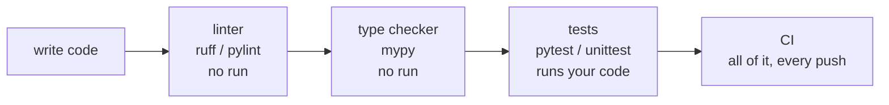
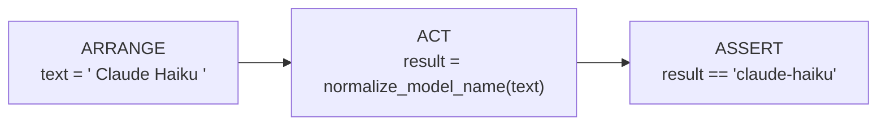
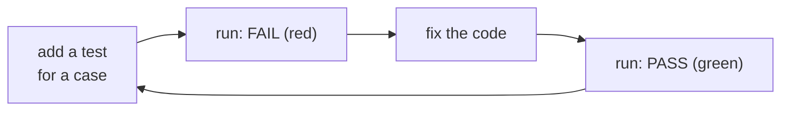
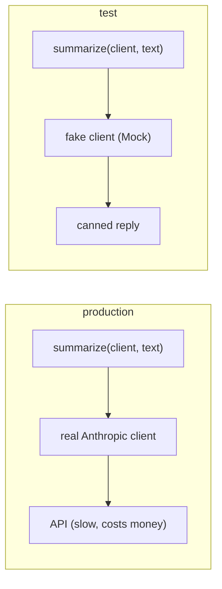
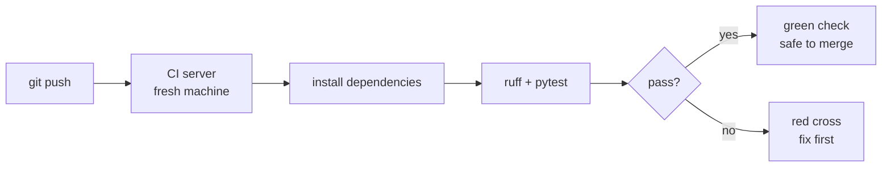

# Testing

Even a tiny change can break code that used to work. A test is a small program that calls your code with known input and checks the output, so a break shows up in seconds, not in production. This chapter covers the tools that check code without running it (linters), the two standard-library test tools, `pytest` (the one you will use), plus fakes for API calls, property tests and automation.

## The ladder of checks

Printing values and eyeballing them does not scale. Use layers, cheapest first:



| **Layer** | **Finds** | **Misses** |
|---|---|---|
| Linter | undefined names, unused imports, style problems | wrong logic |
| Type checker | wrong types passed or returned ([[14 - Type Hints and Documentation\|Chapter 14]]) | wrong values |
| Tests | wrong behaviour on the inputs you thought of | inputs you did not think of |

## Linters: Pylint, Pyflakes and Ruff

A **linter** reads source code and reports likely errors and style problems without running it. Take this three-line file. It has a typo: `totl` instead of `total`.

```python
# style1.py
import os
total = 1
print(totl)
```

Running it would crash with `NameError` only when line 3 executes. A linter reports it at once.

### Ruff (real output)

**Ruff** is a very fast linter and formatter written in Rust. Install it with `python -m pip install ruff` (or `uv`). Real output, with its default rule set for this version:

```text
> ruff check --output-format concise style1.py
style1.py:1:1: I001 [*] Import block is un-sorted or un-formatted
style1.py:1:8: F401 [*] `os` imported but unused
style1.py:3:7: F821 Undefined name `totl`
Found 3 errors.
[*] 2 fixable with `--fix`.
```

Read it as `file:line:column: CODE message`. `F821` is the real bug. The `[*]` marks problems Ruff can fix itself:

```text
> ruff check --fix style1.py           (removes the unused import, keeps the bug)
```

Ruff also formats code, like a strict spell-checker for whitespace. Given an untidy file:

```python
def add(a,b):
    return a+b
x=add( 1,2 )
```

`ruff format messy.py` rewrites it to:

```python
def add(a, b):
    return a + b

x = add(1, 2)
```

### Pylint, Pyflakes, pycodestyle

| **Tool** | **Checks** | **Character** |
|---|---|---|
| `pyflakes` | errors only: undefined names, unused imports | quick, few opinions |
| `pycodestyle` (was `pep8`) | layout against PEP 8: spacing, blank lines | style only |
| `pylint` | errors, style, naming, design smells, and a score out of 10 | thorough and noisy; configure it |
| `ruff` | most of the three above plus a formatter and import sorting | fast; the modern default |

Pylint prefixes each message with a letter: `E` error, `W` warning, `C` convention (style), `R` refactor, `F` fatal. For the file above its report has the shape below (*typical form; Pylint is not installed here, so not run*). An `E` line is the one to fix first.

```text
************* Module style1
style1.py:1:0: C0114: Missing module docstring (missing-module-docstring)
style1.py:3:6: E0602: Undefined variable 'totl' (undefined-variable)
```

> [!tip] Rule
> Fix errors (`E`, `F`) first, style later. Do not chase a perfect score. Run `ruff check` and `ruff format` before every commit; your editor can do it on save.

## Unittest

Linters cannot know what your function *should* return. For that, write a test. `unittest` is in the standard library and needs no install.

### Arrange, act, assert

Every test has three steps. The *assertion* is the claim that must be true; if it is not, the test fails.



Here is the function under test, a first and naive version. It makes a model name safe for file names.

```python
# names.py
def normalize_model_name(name):
    return name.lower().replace(" ", "-")
```

A test class derives from `unittest.TestCase`. Each method whose name starts with `test` is a test.

```python
# test_names.py
import unittest

import names

class TestNormalize(unittest.TestCase):
    def setUp(self):
        self.fn = names.normalize_model_name   # runs before EACH test

    def tearDown(self):
        pass                                   # runs after EACH test

    def test_one_word(self):
        self.assertEqual(self.fn("Haiku"), "haiku")

    def test_two_words(self):
        self.assertEqual(self.fn("Claude Haiku"), "claude-haiku")

    def test_extra_spaces(self):
        self.assertEqual(self.fn("  Claude   Haiku "), "claude-haiku")

    def test_rejects_none(self):
        with self.assertRaises(AttributeError):
            self.fn(None)

if __name__ == "__main__":
    unittest.main()
```

```text
> python test_names.py
F...
======================================================================
FAIL: test_extra_spaces (__main__.TestNormalize.test_extra_spaces)
----------------------------------------------------------------------
Traceback (most recent call last):
  File "...\test_names.py", line 20, in test_extra_spaces
    self.assertEqual(self.fn("  Claude   Haiku "), "claude-haiku")
AssertionError: '--claude---haiku-' != 'claude-haiku'
- --claude---haiku-
? --       --     -
+ claude-haiku

----------------------------------------------------------------------
Ran 4 tests in 0.001s

FAILED (failures=1)
```

Read the first line: one character per test, `.` passed and `F` failed. The `-` and `+` lines show actual and expected, and the `?` line points to the differences. The test found a real bug. Fix the function, then rerun:

```python
# names.py, fixed
def normalize_model_name(name):
    return "-".join(name.lower().split())    # split() drops all extra spaces
```

```text
> python test_names.py
....
----------------------------------------------------------------------
Ran 4 tests in 0.000s

OK
```



> [!example] Type check
> A test class is a *class* ([[11 - Objects|Chapter 11]]) inheriting `TestCase`; `self.assertEqual(a, b)` is an inherited method. It prints the difference when `a != b`. Plain `assert a == b` also works in unittest, but its failure message is poor.

| **Method** | **Passes when** |
|---|---|
| `assertEqual(a, b)` | `a == b` |
| `assertTrue(x)` / `assertFalse(x)` | `x` is truthy / falsy |
| `assertIn(a, seq)` | `a in seq` |
| `assertIsNone(x)` | `x is None` |
| `assertAlmostEqual(a, b)` | floats equal to 7 decimal places |
| `assertRaises(Err)` | the block raises `Err` (use `with`) |

Run all tests in a folder with `python -m unittest` (it finds files named `test*.py`); add `-v` for one line per test.

```text
test_a:  setUp -> test_a -> tearDown
test_b:  setUp -> test_b -> tearDown      (fresh start for every test)
```

## Doctest

`doctest` runs the examples you put *inside a docstring*. They look like a session at the `>>>` prompt. The test is also documentation that cannot go out of date.

```python
# names2.py
def normalize_model_name(name):
    """Make a model name safe for file names.

    >>> normalize_model_name("Haiku")
    'haiku'
    >>> normalize_model_name("  Claude   Haiku ")
    'claude-haiku'
    >>> normalize_model_name("")
    ''
    """
    return "-".join(name.lower().split())

if __name__ == "__main__":
    import doctest
    doctest.testmod()
```

Run it. No output means every example passed. Add `-v` to see them all:

```text
> python names2.py
> python names2.py -v
Trying:
    normalize_model_name("Haiku")
Expecting:
    'haiku'
ok
...
3 tests in 2 items.
3 passed and 0 failed.
Test passed.
```

(Middle lines omitted.) You can also run it without the `if` block: `python -m doctest names2.py`. A wrong expectation shows what Python really returned:

```text
Failed example:
    twice(2)
Expected:
    5
Got:
    4
***Test Failed*** 1 failures.
```

> [!warning] Trap
> Doctest compares the *printed text* exactly. The result `'haiku'` must be written with the quotes, and a float such as `0.30000000000000004` must match digit for digit. Use doctest for short examples; use pytest for real test suites.

## Pytest

**pytest** is the most popular test tool. Install it with `python -m pip install pytest`. Tests are plain functions with plain `assert`; there is no class and no `self.assertEqual`.

```text
> python -m pytest -q
```

| **Feature** | **What you get** |
|---|---|
| Discovery | finds `test_*.py` files and `test_*` functions below the current folder |
| Rich failures | a failing `assert` shows both sides and a diff, no special method needed |
| Fixtures | functions that prepare test data or resources, injected by name |
| Parametrization | run one test over a table of inputs |
| Built-ins | `tmp_path`, `monkeypatch`, `capsys`, `pytest.raises`, `pytest.approx` |

### A first test file

```python
# costs.py
RATES = {"small": (0.10, 0.50), "large": (4.0, 20.0)}   # USD per 1M tokens

def token_cost(model, tokens_in, tokens_out=0):
    if tokens_in < 0 or tokens_out < 0:
        raise ValueError("token counts must be >= 0")
    rate_in, rate_out = RATES[model]
    return (tokens_in * rate_in + tokens_out * rate_out) / 1e6
```

```python
# test_costs_pytest.py   (needs: pytest)
import pytest

from costs import token_cost

def test_zero_tokens_cost_nothing():
    assert token_cost("small", 0, 0) == 0

def test_known_value():
    assert token_cost("small", 1_000_000, 0) == pytest.approx(0.10)

def test_negative_tokens_rejected():
    with pytest.raises(ValueError, match="must be >= 0"):
        token_cost("small", -1)

def test_unknown_model():
    with pytest.raises(KeyError):
        token_cost("huge", 1)
```

Typical pytest report for a passing run (*pytest is not installed in this environment, so this is the usual format, not a captured run*; the file itself was syntax-checked and its logic verified by calling the functions):

```text
============================= test session starts =============================
collected 4 items

test_costs_pytest.py ....                                               [100%]

============================== 4 passed in 0.03s ==============================
```

On a failure, pytest prints the test source, a `>` on the failing line, and `E` lines with the values.

> [!warning] Trap
> **Never compare floats with `==`.** Binary floats are approximate. Compare with `pytest.approx(x)` (or `math.isclose` in plain code).
>
> ```python
> import math
> print(0.1 + 0.2 == 0.3, math.isclose(0.1 + 0.2, 0.3))
> ```
>
> ```text
> False True
> ```

### Parametrization: one test, many cases

`parametrize` takes a string of argument names and a list of tuples; pytest runs the test once per tuple and reports each separately.

```python
import pytest
from costs import token_cost

@pytest.mark.parametrize(
    "model, tin, tout, expected",
    [
        ("small", 1_000_000, 0, 0.10),
        ("small", 0, 1_000_000, 0.50),
        ("large", 1_000, 500, 0.014),
    ],
)
def test_token_cost_table(model, tin, tout, expected):
    assert token_cost(model, tin, tout) == pytest.approx(expected)
```

### Fixtures

A **fixture** is a function marked `@pytest.fixture`. A test that lists its name as a parameter receives its return value. Fixtures replace `setUp` and `tearDown`.

```python
# test_fixtures.py   (needs: pytest)
import sqlite3

import pytest

@pytest.fixture                      # scope="function" is the default
def history():
    return [{"role": "user", "content": "hi"}]

@pytest.fixture(scope="module")      # created once for this file
def calls_db():
    conn = sqlite3.connect(":memory:")
    conn.execute("create table calls (model text, cost real)")
    yield conn                       # the test runs here
    conn.close()                     # teardown, after the last test
```

The tests then list the fixtures they need by name:

```python
def test_insert(calls_db, history):
    calls_db.execute("insert into calls values ('small', 0.0001)")
    assert calls_db.execute("select count(*) from calls").fetchone()[0] == 1

def test_same_connection_reused(calls_db):
    assert calls_db.execute("select count(*) from calls").fetchone()[0] == 1

def test_save_reply(tmp_path):
    out = tmp_path / "reply.txt"     # tmp_path: a fresh temp folder
    out.write_text("hello")
    assert out.read_text() == "hello"
```

```text
scope="function" (default):   test_a [fixture A1]   test_b [fixture A2]   test_c [fixture A3]
scope="module":               test_a [---------- one fixture, shared ----------] test_c
```

> [!tip] Rule
> Keep the default `function` scope so each test starts clean. Raise the scope (`module`, `session`) only for something slow to build, like a database connection, and only if tests do not change it in ways that leak between them.

### Handy flags

| **Command** | **Effect** |
|---|---|
| `python -m pytest -q` | quiet: one dot per test |
| `python -m pytest -v` | one line per test, with names |
| `python -m pytest -x` | stop at the first failure |
| `python -m pytest -k normalize` | run only tests whose name contains *normalize* |
| `pytest test_costs_pytest.py::test_unknown_model` | run one test (start with `python -m`) |
| `python -m pytest -s` | show `print` output (otherwise captured) |

### Testing code that calls the API

A test must be fast, free and repeatable. A real API call is slow, costs money and gives a different answer each time. So **pass the client in** as a parameter and give the test a fake one.



```python
# summarize.py
def summarize(client, text):
    """Ask the model for a one-line summary. Returns '' if no text block."""
    response = client.messages.create(
        model="small-model",
        max_tokens=200,
        messages=[{"role": "user", "content": f"Summarize in one line: {text}"}],
    )
    for block in response.content:
        if block.type == "text":
            return block.text.strip()
    return ""
```

`unittest.mock.Mock` (standard library) creates an object that accepts any attribute or call. We set what `create` returns and later check how it was called.

```python
# test_summarize.py
import unittest
from types import SimpleNamespace
from unittest.mock import Mock

from summarize import summarize

def fake_client(*blocks):
    client = Mock()
    client.messages.create.return_value = SimpleNamespace(content=list(blocks))
    return client
```

Each test builds a fake client with the blocks the “model” should return:

```python
class TestSummarize(unittest.TestCase):
    def test_returns_text(self):
        client = fake_client(SimpleNamespace(type="text", text=" Short. "))
        self.assertEqual(summarize(client, "long text"), "Short.")

    def test_skips_thinking_block(self):
        client = fake_client(SimpleNamespace(type="thinking", thinking="..."),
                             SimpleNamespace(type="text", text="Answer"))
        self.assertEqual(summarize(client, "x"), "Answer")

    def test_no_text_block(self):
        client = fake_client(SimpleNamespace(type="thinking", thinking="..."))
        self.assertEqual(summarize(client, "x"), "")

    def test_sends_one_request(self):
        client = fake_client(SimpleNamespace(type="text", text="ok"))
        summarize(client, "hello")
        client.messages.create.assert_called_once()
        kwargs = client.messages.create.call_args.kwargs
        self.assertEqual(kwargs["max_tokens"], 200)
        self.assertIn("hello", kwargs["messages"][0]["content"])

if __name__ == "__main__":
    unittest.main(verbosity=2)
```

```text
test_no_text_block (__main__.TestSummarize.test_no_text_block) ... ok
test_returns_text (__main__.TestSummarize.test_returns_text) ... ok
test_sends_one_request (__main__.TestSummarize.test_sends_one_request) ... ok
test_skips_thinking_block (__main__.TestSummarize.test_skips_thinking_block) ... ok

----------------------------------------------------------------------
Ran 4 tests in 0.001s

OK
```

Note that the same fake lets us test the “thinking block first” case without paying for a real model. In pytest, the `monkeypatch` fixture does a similar job for environment variables, for example `monkeypatch.setenv(...)` with a dummy value for `ANTHROPIC_API_KEY`.

> [!warning] Trap
> A test that passes only when the network is up, or when today's date is right, or when the model answers a certain way, is a *flaky* test. Fake the clock, the network and the model. Never put a real API key in a test or commit it.

## Hypothesis: property-based tests

Instead of listing inputs, describe the *kind* of input and a rule that must always hold; **Hypothesis** generates many cases (100 by default), including odd ones you would not write, and shrinks a failure to a minimal example.

```python
# test_props.py   (needs: hypothesis)
from hypothesis import given
from hypothesis import strategies as st

from costs import token_cost

counts = st.integers(min_value=0, max_value=10**7)

@given(counts, counts, counts)
def test_more_output_never_cheaper(tokens_in, tokens_out, extra):
    cheaper = token_cost("small", tokens_in, tokens_out)
    dearer = token_cost("small", tokens_in, tokens_out + extra)
    assert dearer >= cheaper
```

(Install with `python -m pip install hypothesis`; not installed here. I checked the rule itself against 100 000 random inputs with plain `random`: it held.) If you let `counts` include negative numbers, Hypothesis would report a counterexample at once, since `token_cost` raises `ValueError` for them. That is the point: it finds the cases you forgot.

## Nox

**Nox** runs your checks in fresh environments, for several Python versions or tool combinations. You describe the sessions in a Python file named `noxfile.py` and run `nox`.

```python
# noxfile.py   (needs: nox)
import nox

@nox.session(python=["3.11", "3.12"])
def tests(session):
    session.install("-r", "requirements.txt", "pytest")
    session.run("pytest", "-q")

@nox.session
def lint(session):
    session.install("ruff")
    session.run("ruff", "check", ".")
```

Nox is the successor of `tox`. Use it when your package must work on more than one Python version; for a personal project, a plain `pytest` is enough.

## Continuous integration

**CI** runs your checks automatically on a server each time code is pushed, so a break is caught before it is merged.



A minimal GitHub Actions workflow (file `.github/workflows/tests.yml`), not run here:

```text
name: tests
on: [push, pull_request]
jobs:
  test:
    runs-on: ubuntu-latest
    steps:
      - uses: actions/checkout@v4
      - uses: actions/setup-python@v5
        with:
          python-version: "3.12"
      - run: python -m pip install -r requirements.txt pytest ruff
      - run: ruff check .
      - run: python -m pytest -q
```

| **System** | **Note** |
|---|---|
| GitHub Actions | built into GitHub; free for public repositories; the easy start |
| Jenkins | self-hosted, written in Java; common in companies |
| Buildbot | self-hosted, written in Python |
| Travis CI, CircleCI | hosted services; free tiers for open source |

> [!tip] Rule: CI and secrets
> CI machines are not yours. Store an API key, if a job truly needs one, in the host's *secrets* setting, never in the repository. Most tests should not need a key: use fakes.

> [!danger] Boss fight: testing what you do not control
> The hard part of testing is not `assert`; it is *isolation*. Code that reads the clock, the environment, a random number or a web API gives a different answer on each run or costs money. The fix is one idea: do not reach out from inside the function; **pass the dependency in** (the client, the current time, a random seed) and give the test a fake or a fixed value. Then the test depends only on its inputs, which is what makes it fast, free and repeatable. Practise it on `summarize(client, text)`: the function never creates its own client.

> [!question]- Practice
> 1. Run `ruff check` on a file that uses a variable before defining it. What is the code of the error, and does the linter run your program?
> 2. Write three `unittest` tests for a function `clip(text, n)` that cuts text to at most `n` characters. Which edge case would you add first?
> 3. What do `setUp` and `tearDown` do, and which pytest feature replaces them?
> 4. Rewrite your three tests as one `parametrize` test. What do you gain?
> 5. Why is `assert cost == 0.014` a bad test, and what do you write instead?
> 6. Your function calls `client.messages.create`. Describe how you test it without internet or an API key.

> [!success] Achievement unlocked: Green Build
> - Lint and format code with Ruff, and read an error code and its location.
> - Write unit tests in `unittest` and `pytest`, including edge cases and exceptions.
> - Use fixtures and `parametrize` to remove repeated test code.
> - Test API-calling code with a fake client, with no network and no key.
> - Describe how CI runs the same checks on every push.

**Related:** [[10 - Functions]] (what you test), [[11 - Objects]] (`TestCase` is a class), [[13 - Development Environment]] (install pytest, ruff), [[14 - Type Hints and Documentation]] (mypy, docstrings), [[16 - Debugging]] (when a test fails), [[23 - Data in a Box - Persistent Storage]] (sqlite fixture).
