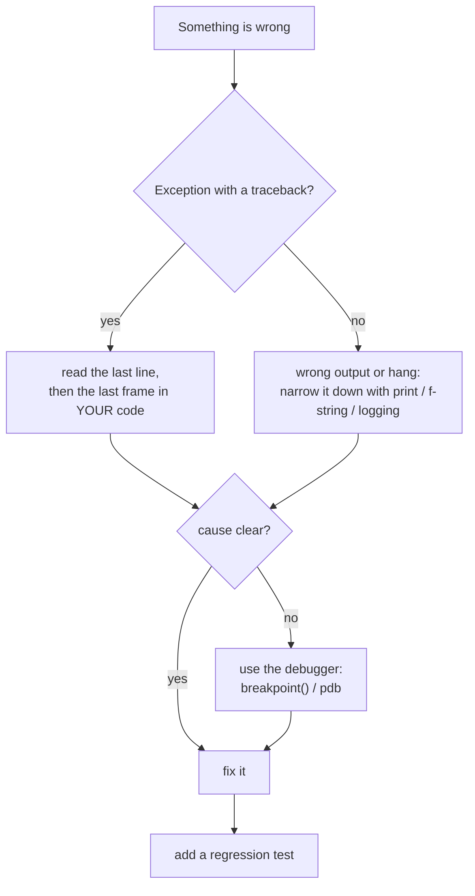
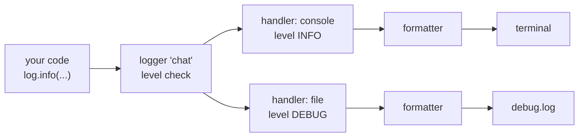

# Debugging

Bugs happen even with good tests. Debugging is the skill of finding out *why* the program does what it does, quickly and without guessing. This chapter goes from cheap tools (reading a traceback, `print`, f-strings) to better ones (`assert`, `logging`) to the real debugger (`pdb`, `breakpoint()`).

## Start here: read the traceback

Debug from the bottom up first: you or a recent change broke it, so look at what you changed last. If that fails, question what you trusted (a library, the data from an API); that is the slower, top-down search.

A **traceback** lists the chain of function calls that led to the error. Here is a program that fails when the API returns an error payload instead of a normal reply (paths shortened with `...`):

```python
# usage_report.py
import json

def get_tokens(payload):
    return payload["usage"]["output_tokens"]

def report(raw):
    payload = json.loads(raw)
    return f"output tokens: {get_tokens(payload)}"

ok = '{"usage": {"output_tokens": 73}}'
error = '{"type": "error", "error": {"message": "overloaded"}}'

print(report(ok))
print(report(error))
```

```text
output tokens: 73
Traceback (most recent call last):
  File ".../usage_report.py", line 17, in <module>
    print(report(error))
  File ".../usage_report.py", line 10, in report
    return f"output tokens: {get_tokens(payload)}"
  File ".../usage_report.py", line 5, in get_tokens
    return payload["usage"]["output_tokens"]
           ~~~~~~~^^^^^^^^^
KeyError: 'usage'
```

(Real output. The `~` and `^` marker lines under the first two frames are left out.)

```text
<module>      usage_report.py:17   print(report(error))        oldest call
   | calls
   v
report()      usage_report.py:10   get_tokens(payload)
   | calls
   v
get_tokens()  usage_report.py:5    payload["usage"][...]       <- failed here
   v
KeyError: 'usage'    <- WHAT went wrong (last line)
```

> [!info] Key idea: how to read a traceback
> Read from the **bottom**. The last line names the error and its message. The frame just above it is the line that failed. Walk upward until you find the first frame in *your own* code; library frames are rarely the cause. Here the real question is not “why a `KeyError`” but “why did the API return no `usage`?”: the answer is an error payload.



## Assert

`assert condition, message` states something that *must* be true. If it is false, Python raises `AssertionError` on the spot, with your message. Use it to catch impossible data early, before it causes a confusing failure ten lines later.

```python
# assert_demo.py
def avg_tokens(counts):
    assert len(counts) > 0, "counts must not be empty"
    assert all(isinstance(c, int) for c in counts), f"ints only: {counts!r}"
    return sum(counts) / len(counts)

print(avg_tokens([10, 20]))
print(avg_tokens([]))
```

```text
15.0
Traceback (most recent call last):
  ...
AssertionError: counts must not be empty
```

> [!warning] Trap
> Run Python with `-O` (`python -O assert_demo.py`) and every `assert` is *skipped*. The same call then fails later with a less helpful error:
>
> ```text
> ZeroDivisionError: division by zero
> ```
>
> So use `assert` for internal sanity checks and tests. For input you do not control (user input, API data), check explicitly with `if ...: raise ValueError(...)`.

## Print

`print` is the fastest debugger. Print the values that matter, with labels. Three built-ins show variables: `vars()` (or `locals()`) gives the local variables as a dict; `globals()` gives the module's.

```python
import sys

def func(*args, **kwargs):
    print(vars())
    print(sorted(locals()))

func(1, 2, model="small")
print("x" in globals())
print("debug info", file=sys.stderr)       # to the error stream
```

```text
{'args': (1, 2), 'kwargs': {'model': 'small'}}
['args', 'kwargs']
True
debug info
```

Debug output sent to `sys.stderr` stays separate from normal output: you can redirect your program's real output to a file and still see the debug lines in the terminal.

> [!warning] Trap
> Print debugging leaves clutter. Remove the prints before committing, or move them to `logging` (below), which you can switch off.

## F-strings

An f-string inserts the value of any expression in `{}`. Adding `=` inside the braces prints the *expression text and its value*, so you never mislabel a debug line.

```python
x = "thing"
print(f"{x=}", f"{ x = }", f"{10/2=}")
tokens = 1234
print(f"{tokens=:,}")                   # with a format spec after the =
print(f"{type(tokens)=}")
```

```text
x='thing'  x = 'thing' 10/2=5.0
tokens=1,234
type(tokens)=<class 'int'>
```

Note `x='thing'`: the value is shown with `repr`, so strings have quotes, which makes stray spaces and `None` visible.

## Pprint

`pprint` (“pretty print”) lays out nested data over several lines, indented. Use it for JSON-like API replies.

```python
from pprint import pprint

text = "Hello there, how can I help you today?"
reply = {"type": "message", "role": "assistant",
         "content": [{"type": "text", "text": text}],
         "usage": {"input_tokens": 22, "output_tokens": 73}}
pprint(reply)
```

```text
{'content': [{'text': 'Hello there, how can I help you today?',
              'type': 'text'}],
 'role': 'assistant',
 'type': 'message',
 'usage': {'input_tokens': 22, 'output_tokens': 73}}
```

By default `pprint` sorts keys. Pass `sort_dicts=False` to keep insertion order, and `width=60` to wrap sooner. For real JSON you may prefer `json.dumps(obj, indent=2)`.

## IceCream

**IceCream** is a third-party package (`python -m pip install icecream`; not installed here, so the output below is the documented style, not a captured run). Its `ic()` prints the expression, its value, and optionally the file, line and function, and it *returns* its argument, so you can wrap any sub-expression.

```python
from icecream import ic

tokens = 73
ic(tokens)                 # prints: ic| tokens: 73
ic(tokens * 2)             # prints: ic| tokens * 2: 146

def cost(n):
    ic()                   # prints file:line and the function name
    return n * 2

total = ic(cost(5)) + 1    # ic returns 10, so the expression still works
```

It is a nice shortcut, but `print(f"{x=}")` gives you most of the benefit with no install.

## Decorators

A decorator wraps a function to run code before or after it, without editing the function. That makes it a good place for debug output. Here `trace` prints the arguments and the result of every call:

```python
import functools

def trace(func):
    """Print arguments and result of every call."""
    @functools.wraps(func)              # keep the original name and docstring
    def wrapper(*args, **kwargs):
        print(f"call {func.__name__} args={args} kwargs={kwargs}")
        result = func(*args, **kwargs)
        print(f"  -> {result!r}")
        return result
    return wrapper

@trace
def token_cost(model, tokens_in, tokens_out=0):
    rates = {"small": (0.10, 0.50)}
    r_in, r_out = rates[model]
    return (tokens_in * r_in + tokens_out * r_out) / 1e6

token_cost("small", 1000, tokens_out=500)
print(token_cost.__name__)
```

```text
call token_cost args=('small', 1000) kwargs={'tokens_out': 500}
  -> 0.00035
token_cost
```

> [!example] Type check
> After `@trace`, the name `token_cost` refers to `wrapper`, a new function. `*args` collects positional arguments into a tuple and `**kwargs` collects keyword arguments into a dict, so the wrapper accepts any call. Without `functools.wraps` the name would print as `wrapper`.

## Logging

`print` output vanishes when the terminal closes, and has no timestamp or importance. The standard `logging` module records messages with a **level**, a time, and a name, and sends them where you choose. Use it in anything that runs longer than a quick script.

### Levels

```text
CRITICAL 50  -----------------------+
ERROR    40                         |  shown when level=INFO
WARNING  30  (default level)        |
INFO     20  -----------------------+
---------------- level=INFO cuts here ----------------
DEBUG    10  hidden
```

Before any setup, only `WARNING` and above appear. This explains the book's puzzle of `debug` and `info` “doing nothing”:

```python
import logging

logging.debug("not shown: default level is WARNING")
logging.info("not shown either")
logging.warning("shown")
logging.error("shown too")
```

```text
WARNING:root:shown
ERROR:root:shown too
```

(The functions `logging.warn` and `logging.fatal` are old, deprecated spellings; use `warning` and `critical`.)

### Configure once, with named loggers

Call `basicConfig` *once*, at the start of the program. Then each module asks for its own logger by name. Names with dots form a family tree: `"chat.api"` is a child of `"chat"`, which is a child of the root logger.

```python
# log2.py
import logging

logging.basicConfig(level=logging.DEBUG,
                    format="%(levelname)-8s %(name)s:%(lineno)d %(message)s")
log = logging.getLogger("chat.api")

log.debug("sending request, model=%s", "small")
log.info("got reply, output_tokens=%d", 73)
log.warning("retrying after 429")
try:
    {}["usage"]
except KeyError:
    log.exception("could not read usage")     # message + the traceback
print("parent:", log.parent.name)
```

```text
DEBUG    chat.api:7 sending request, model=small
INFO     chat.api:8 got reply, output_tokens=73
WARNING  chat.api:9 retrying after 429
ERROR    chat.api:13 could not read usage
Traceback (most recent call last):
  File ".../log2.py", line 11, in <module>
    {}["usage"]
    ~~^^^^^^^^^
KeyError: 'usage'
parent: root
```

Two habits are visible here. Pass values as arguments (`"model=%s", "small"`) instead of building the string yourself, so Python formats it only if the message is actually emitted. Use `log.exception` inside `except`: it logs the traceback too.

> [!warning] Trap
> `basicConfig` does nothing if the root logger already has handlers (an earlier call, or a library did it). Your level or format silently stays as before. Pass `force=True` to reset. Real output of three calls:
>
> ```python
> import logging
> logging.basicConfig(level=logging.INFO, format="A %(message)s")
> logging.basicConfig(level=logging.DEBUG, format="B %(message)s")   # ignored
> logging.debug("debug?")                  # level is still INFO: hidden
> logging.info("info")
> logging.basicConfig(level=logging.DEBUG, format="C %(message)s", force=True)
> logging.debug("debug now")
> ```
>
> ```text
> A info
> C debug now
> ```

### Handlers and formatters

Logging has four parts. A **logger** is what your code calls. A **handler** decides *where* a record goes (screen, file, email, web service). A **formatter** decides how it looks. A **filter** can drop records.



```python
# log4.py
import logging
import sys

log = logging.getLogger("chat")
log.setLevel(logging.DEBUG)                  # logger lets everything through

console = logging.StreamHandler(sys.stdout)
console.setLevel(logging.INFO)               # but the screen shows INFO+
console.setFormatter(logging.Formatter("%(levelname)s %(message)s"))

logfile = logging.FileHandler("debug.log", encoding="utf-8")
logfile.setLevel(logging.DEBUG)              # the file keeps everything
logfile.setFormatter(logging.Formatter("%(levelname)s %(name)s %(message)s"))

log.addHandler(console)
log.addHandler(logfile)

log.debug("prompt has 12 messages")
log.info("reply received")
log.error("rate limited")
```

```text
INFO reply received
ERROR rate limited
```

The file `debug.log` then contains all three:

```text
DEBUG chat prompt has 12 messages
INFO chat reply received
ERROR chat rate limited
```

For a simple one-file setup, `basicConfig(filename="app.log", level=..., format=...)` is enough. A format such as `"%(asctime)s %(levelname)s %(message)s"` adds a time stamp, which looks like `2026-11-02 13:02:01,655 ERROR boom`. Other useful fields: `%(name)s`, `%(lineno)d`, `%(funcName)s`.

> [!tip] Rule: logging in an LLM app
> Log the model name, token counts, latency and the request id, at `INFO`. Log the full prompt only at `DEBUG`, because prompts can contain private data. **Never log an API key.** Keep the file out of Git (`.gitignore`).

## Pdb: the debugger

A debugger runs your program under your control: you pause it, look at variables, and step through lines. Python's built-in debugger is `pdb`. Here is a data-dependent bug. The function should total tokens per model from lines like `"small,100"`, but the total for `small` comes out wrong.

```python
# totals.py
def total_usage(lines):
    totals = {}
    for line in lines:
        model, tokens = line.split(",")
        totals[model] = int(tokens)
    return totals

if __name__ == "__main__":
    data = ["small,100", "large,40", "small,50"]
    print(total_usage(data))
```

```text
{'small': 50, 'large': 40}
```

No exception, so there is no traceback to read: it is a *logic* error. `small` should be 150. Start the program under pdb (`-m pdb`), set a breakpoint on line 5 with `b 5`, and continue with `c`:

```text
> python -m pdb totals.py
> ...\totals.py(1)<module>()
-> def total_usage(lines):
(Pdb) b 5
Breakpoint 1 at ...\totals.py:5
(Pdb) c
> ...\totals.py(5)total_usage()
-> totals[model] = int(tokens)
(Pdb) c
> ...\totals.py(5)total_usage()
-> totals[model] = int(tokens)
(Pdb) c
> ...\totals.py(5)total_usage()
-> totals[model] = int(tokens)
(Pdb) p line
'small,50'
(Pdb) p totals
{'small': 100, 'large': 40}
(Pdb) n
> ...\totals.py(3)total_usage()
-> for line in lines:
(Pdb) p totals
{'small': 50, 'large': 40}
```

(Real session; only the long path is shortened.) After the third stop, `totals` holds `small: 100`. The next *single* line replaces it with 50: the code *assigns* (`=`) where it should *add*. Fix it, and turn the bug into a regression test:

```python
from collections import defaultdict

def total_usage(lines):
    totals = defaultdict(int)
    for line in lines:
        model, tokens = line.split(",")
        totals[model] += int(tokens)        # add, do not overwrite
    return dict(totals)

def test_repeated_model_is_added():
    data = ["small,100", "large,40", "small,50"]
    assert total_usage(data) == {"small": 150, "large": 40}

test_repeated_model_is_added()
print(total_usage(["small,100", "large,40", "small,50"]))
```

```text
{'small': 150, 'large': 40}
```

### Commands you will use

| **pdb** | **Name** | **Does** | **VS Code** |
|---|---|---|---|
| `n` | next | run this line, *step over* any call | F10 |
| `s` | step | *step into* the call on this line | F11 |
| `r` | return | run until the current function returns | Shift+F11 |
| `c` | continue | run until the next breakpoint or the end | F5 |
| `b 5` / `b` | breakpoint | set one on line 5 / list them all | click the gutter |
| `l` / `ll` | list | show code around the line / the whole function | the editor |
| `p expr` / `pp expr` | print | show a value / pretty-print it | Variables panel |
| `w`, `u`, `d` | where, up, down | show the call stack, move between frames | Call Stack panel |
| `q` | quit | stop the program and leave | Shift+F5 |

```text
 line 8:  total = add(a, b)      <- paused here
               |
    n ---------+--------> line 9   (add() ran in one go)
    s ---------+--------> line 2 inside add()   (you are now in add)
```

> [!tip] Rule
> Use `n` when you trust a function (library code, code you tested) and `s` when you suspect it. Do not step line by line from the top: set a breakpoint near the suspect and `c` to it.

### Post-mortem: debug a crash where it happened

If a program crashes, run it under `python -m pdb script.py` and type `c`. On the uncaught exception pdb stops at the failing frame (“post mortem”), with all variables intact. For `usage_report.py` that looks like this (condensed from a real session):

```text
(Pdb) c
Uncaught exception. Entering post mortem debugging
> ...\usage_report.py(5)get_tokens()
-> return payload["usage"]["output_tokens"]
(Pdb) p payload
{'type': 'error', 'error': {'message': 'overloaded'}}
(Pdb) up
> ...\usage_report.py(10)report()
(Pdb) p raw
'{"type": "error", "error": {"message": "overloaded"}}'
```

Now you can *see* that the payload is an error object. The fix is to check before reading it:

```python
def get_tokens(payload):
    if payload.get("type") == "error":
        raise RuntimeError(payload["error"]["message"])
    return payload["usage"]["output_tokens"]
```

Another useful flag is `python -i script.py`: after the script ends or crashes, you stay in the interactive prompt and can inspect the variables.

## `breakpoint()`

Add `breakpoint()` to your code and Python opens pdb *at that line*, with no setup. It is the quickest way into the debugger.

```python
# bp.py
def total_usage(lines):
    totals = {}
    for line in lines:
        model, tokens = line.split(",")
        breakpoint()                       # pause here on every loop
        totals[model] = totals.get(model, 0) + int(tokens)
    return totals

print(total_usage(["small,100", "small,50"]))
```

```text
> ...\bp.py(6)total_usage()
-> totals[model] = totals.get(model, 0) + int(tokens)
(Pdb) p model, tokens
('small', '100')
(Pdb) c
> ...\bp.py(6)total_usage()
-> totals[model] = totals.get(model, 0) + int(tokens)
(Pdb) p totals
{'small': 100}
(Pdb) c
{'small': 150}
```

The environment variable `PYTHONBREAKPOINT` chooses what `breakpoint()` does. Setting it to `0` turns every breakpoint off without editing the code (real output of the same run):

```text
> set PYTHONBREAKPOINT=0                (cmd.exe)
> $env:PYTHONBREAKPOINT = "0"           (PowerShell)
> python bp.py
{'small': 150}
```

Setting it to the name of another debugger function (for example `web_pdb.set_trace`, from a package you install) switches debugger.

> [!warning] Trap
> Never commit a `breakpoint()` call: a server or a CI job would stop and wait for input forever. Search for it before every commit (`git grep breakpoint`), or let your linter flag it.

> [!danger] Boss fight: find the cause, do not guess
> Programmers lose hours changing code at random. A better loop has four steps: (1) **reproduce** the bug with the smallest input that still fails (three lines of data, not the whole file); (2) **state a hypothesis** about the cause (“the dict value is overwritten, not added”); (3) **test the hypothesis** by observing, not changing: `print`, a log line, or `p totals` in pdb at the right moment; (4) **fix one thing, then add a test** that fails without the fix. If the observation does not match your hypothesis, your mental model is wrong; revise it instead of editing more code. Most hard bugs are a wrong assumption about the data, not a wrong line of code.

> [!question]- Practice
> 1. A traceback ends with `KeyError: 'usage'`. Which line of the traceback do you read first, and what two questions do you ask next?
> 2. Use an f-string with `=` to print the expression `len(messages) * 2` and its value, and the type of the variable `reply`.
> 3. Why does `logging.debug("x")` print nothing in a fresh script? Give two different ways to make it appear.
> 4. Set up logging so that INFO and above go to the screen but DEBUG and above also go to a file. Which objects do you create?
> 5. You run `python -O` and a check vanishes. Which statement was it, and what should you use for checking user input instead?
> 6. In pdb, you are on a line that calls `summarize(client, text)`. What is the difference between typing `n` and `s`?

> [!success] Achievement unlocked: Bug Hunter
> - Read a traceback from the bottom and locate the failing line in your own code.
> - Debug with f-string `=`, `pprint`, `assert` and a tracing decorator.
> - Configure `logging` with levels, named loggers, a file handler and a format.
> - Step through code in `pdb`, set breakpoints, inspect variables, and debug a crash post-mortem.
> - Turn a fixed bug into a regression test.

**Related:** [[10 - Functions]] (decorators, `*args`), [[04 - Strings]] (f-strings), [[09 - Dictionaries and Sets]] (`KeyError`), [[13 - Development Environment]] (which Python?), [[14 - Type Hints and Documentation]] (catch bugs earlier), [[15 - Testing]] (regression tests), [[20 - Files]] (log files).
