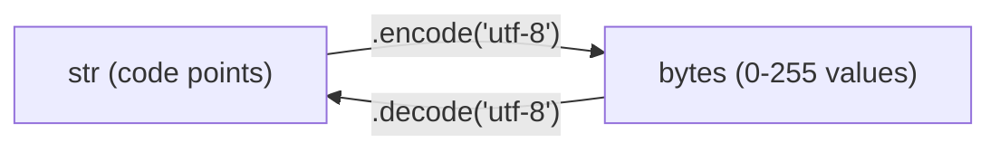
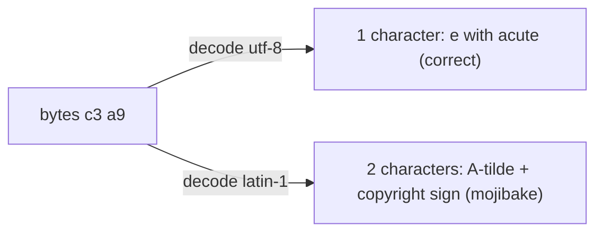

# Text Data

**What this chapter gives you:** a clear picture of what a Python `str` really is (a sequence of Unicode code points), how text turns into bytes and back, and how to pull fields out of messy text with regular expressions. You will need both skills every time you read model output, log files, scraped pages or JSON from an API.

## Text Strings: Unicode

### Python Unicode strings

A Python 3 `str` is a sequence of *code points*. A code point is just a number that Unicode assigns to one character. ASCII covers only 128 of them. Unicode covers more than 150,000: accented letters, other alphabets, math symbols, emoji. You can write any character with an escape sequence, so your source file can stay plain ASCII.

| **Escape** | **Example** | **Meaning** |
|---|---|---|
| `\u` + 4 hex digits | `"\u00e9"` | code point up to `FFFF` |
| `\U` + 8 hex digits | `"\U0001f47b"` | any code point, pad with zeros |
| `\N{name}` | `"\N{SNOWMAN}"` | the official Unicode name (any case) |

The `unicodedata` module converts between names and characters. The built-ins `ord()` and `chr()` convert between a character and its number.

```python
import unicodedata

a = "caf\u00e9"
b = "caf\N{LATIN SMALL LETTER E WITH ACUTE}"
print(a == b, len(a))                       # same text, 4 characters
print(unicodedata.name("\u00e9"))
print(hex(ord("\u00e9")), ascii(chr(233)))
print(unicodedata.lookup("snowman") == "\u2603")
print(len("\U0001f47b"))                    # one emoji is one character
```

```text
True 4
LATIN SMALL LETTER E WITH ACUTE
0xe9 '\xe9'
True
1
```

> [!example] Type check
> `len(s)` counts *code points*, not bytes and not what you see on screen. One emoji is length 1. A `str` has no encoding at all. It is only when you turn it into `bytes` that an encoding appears.

> [!warning] Trap
> Your terminal or font may not be able to *show* a character that Python holds correctly. A box or question mark on screen does not mean the string is broken. Use `ascii(s)` or `s.encode("unicode-escape")` to see what is really inside. On Windows, `print()` of non-ASCII text can even raise an error if the console uses an old code page.

### UTF-8: encode and decode

Files, sockets and APIs carry `bytes`, not `str`. Two operations cross the border:



UTF-8 uses one to four bytes per character. ASCII characters take one byte, so plain English text looks the same in ASCII and UTF-8. Accented Latin letters take two, most other scripts three, emoji four. It is the default almost everywhere, so use it unless you are forced not to.

The picture below shows what happens to `"caf\u00e9"`: four characters become five bytes, because the last character needs two.

```text
str    :  c    a    f    é (U+00E9)
          |    |    |     |     \
bytes  : 63   61   66    c3     a9      (hex)   -> 4 characters, 5 bytes
```

```python
s = "na\u00efve \u2603"          # naive with a diaeresis, plus a snowman
data = s.encode("utf-8")
print(data, len(s), len(data))
print(type(s), type(data))
print(data.decode("utf-8") == s)
```

```text
b'na\xc3\xafve \xe2\x98\x83' 7 10
<class 'str'> <class 'bytes'>
True
```

#### Encode: what if the character does not fit?

Encodings other than UTF-8 cannot hold every character. The default error handler is `"strict"`, which raises `UnicodeEncodeError`. The second argument of `encode()` picks another policy.

```python
for enc in ("ascii", "latin-1"):
    try:
        print(enc, s.encode(enc))
    except UnicodeEncodeError as e:
        print(enc, "failed:", e.reason)
print(s.encode("ascii", "ignore"))
print(s.encode("ascii", "replace"))
print(s.encode("ascii", "backslashreplace"))
print(s.encode("ascii", "xmlcharrefreplace"))
```

```text
ascii failed: ordinal not in range(128)
latin-1 failed: ordinal not in range(256)
b'nave '
b'na?ve ?'
b'na\\xefve \\u2603'
b'na&#239;ve &#9731;'
```

| **Handler** | **What it does with a character that does not fit** |
|---|---|
| `strict` | raise an error (default) |
| `ignore` | drop it silently |
| `replace` | write `?` |
| `backslashreplace` | write a Python-style escape such as `\u2603` |
| `xmlcharrefreplace` | write an HTML/XML numeric entity such as `&#9731;` |

#### Decode: the encoding is a guess you must get right

Bytes carry no label saying which encoding made them. You must know it from the source: a file header, an HTTP `Content-Type`, a spec. Decode with the wrong one and you get either an error or, worse, wrong text without any error.

```python
raw = "caf\u00e9".encode("utf-8")
print(raw)
print(ascii(raw.decode("latin-1")))     # no error, but wrong text
try:
    raw.decode("ascii")
except UnicodeDecodeError as e:
    print("ascii failed:", e.reason, "at", e.start)
print(ascii(b"caf\xe9".decode("utf-8", errors="replace")))
```

```text
b'caf\xc3\xa9'
'caf\xc3\xa9'
ascii failed: ordinal not in range(128) at 3
'caf\ufffd'
```

The second line is the classic garbled text (called mojibake): two strange characters where one `é` should be. The last line shows the `"replace"` handler on decode: bad bytes become the replacement character `U+FFFD`.



> [!tip] Rule: UTF-8 everywhere
> Decode bytes to `str` as soon as they enter your program. Work only with `str` inside. Encode to bytes as late as possible, when you write or send. Always name the encoding explicitly (`"utf-8"`) instead of trusting the platform default.

> [!warning] Trap
> `errors="ignore"` and `errors="replace"` hide data loss. They are fine for a log viewer. They are dangerous in a data pipeline, because corrupted training or eval text goes in without any warning. Prefer `strict` and fix the cause.

> [!danger] Boss fight: the str/bytes border
> Most Unicode bugs come from one mistake: not knowing whether a value is `str` or `bytes` at this point in the program. Keep a mental label on every variable. Bytes arrive from outside (`.decode` them), text goes out (`.encode` it). Never mix: `"a" + b"a"` raises `TypeError`, and `"a" == b"a"` is just `False`, not an error. If you see `UnicodeDecodeError`, ask first: *which encoding made these bytes?*

### HTML entities

Web text often hides characters behind entities such as `&eacute;`, `&#233;` or `&#xe9;`. The `html` module converts them both ways. This matters when you scrape pages or clean model output that was copied from a web page.

```python
import html

print(ascii(html.unescape("&eacute; &#233; &#xe9; &amp; &lt;b&gt;")))
print(html.escape('<a href="x">Q&A</a>'))
print(ascii("caf\u00e9".encode("ascii", "xmlcharrefreplace").decode()))
```

```text
'\xe9 \xe9 \xe9 & <b>'
&lt;a href=&quot;x&quot;&gt;Q&amp;A&lt;/a&gt;
'caf&#233;'
```

> [!example] Type check
> `html.unescape(str)` returns `str`. For the other direction on a whole string, you encode to ASCII with `xmlcharrefreplace` and get `bytes`; call `.decode()` to get a `str` again. For the markup characters `< > & "` use `html.escape()`. The module `html.entities` also holds dictionaries of names such as `html5` and `codepoint2name`.

### Normalization

Some visible characters can be built in more than one way. The letter é can be one code point (`U+00E9`) or a plain `e` followed by a combining accent (`U+0301`). They look identical. They are not equal.

```python
import unicodedata

one = "\u00e9"
two = "e\u0301"
print(one == two, len(one), len(two))
n = unicodedata.normalize("NFC", two)
print(n == one, len(n))
print(len(unicodedata.normalize("NFD", one)))
print(unicodedata.normalize("NFKC", "\ufb01"), len("\ufb01"))
```

```text
False 1 2
True 1
2
fi 1
```

```text
"é"  = [U+00E9]            length 1  ─┐
                                       ├─ normalize("NFC") ─> [U+00E9]  (equal)
"é"  = [e][U+0301]         length 2  ─┘
```

`NFC` composes characters into the shortest form, `NFD` splits them apart. The `NFKC` and `NFKD` forms also fold look-alikes (the one-character ligature *fi* becomes the two letters `fi`).

> [!tip] Rule
> Normalize text with `unicodedata.normalize("NFC", s)` before you compare it, hash it, use it as a dict key, or deduplicate a dataset. Two strings from different sources can look the same and still be different keys.

## Text Strings: Regular Expressions

A regular expression (regex) is a small pattern language for describing text. The standard module is `re`. You give it a pattern and a source string. The pattern is itself a `str`.

### The five basic functions

| **Function** | **Returns** | **Meaning** |
|---|---|---|
| `re.match(p, s)` | `Match` or `None` | pattern must match at the *start* of `s` |
| `re.search(p, s)` | `Match` or `None` | first match anywhere in `s` |
| `re.findall(p, s)` | `list` | every non-overlapping match |
| `re.split(p, s)` | `list` | pieces of `s` between matches |
| `re.sub(p, repl, s)` | `str` | copy of `s` with matches replaced |

The difference between the first two functions is where they are willing to look:

```text
index :  0 1 2 3 4 5 6 7 8 9
source:  e r r _ 4 0 4 _ o k
match : ^ tries only index 0 -> no digit there -> None
search: ----------> slides right, first hit is "404" at span (4, 7)
```

Our sample is one log line from a training run.

```python
import re

line = "2025-03-14 12:01:07 INFO run=a17 model=small-7b loss=0.3125 tokens=1520"

print(re.match(r"\d{4}", line))      # starts with 4 digits
print(re.match(r"INFO", line))       # INFO is not at the start
print(re.search(r"INFO", line))      # but it is somewhere
m = re.search(r"loss=(\d+\.\d+)", line)
print(type(m))
print(m.group(), m.group(1), m.groups(), m.span())
print(float(m.group(1)) + 1)
print(re.search(r"nope", line))
if m := re.search(r"tokens=(\d+)", line):
    print(int(m.group(1)) * 2)
```

```text
<re.Match object; span=(0, 4), match='2025'>
None
<re.Match object; span=(20, 24), match='INFO'>
<class 're.Match'>
loss=0.3125 0.3125 ('0.3125',) (48, 59)
1.3125
None
3040
```

Here is what the groups of the `loss` pattern cover. Group 0 is the whole match, group 1 is only the part in parentheses.

```text
index :  0 1 2 3 4 5 6 7 8 9 10 11 12 13 14 15
text  :  r u n _ l o s s = 0  .  3  1  _  o  k
                 |<---- group 0 ---->|              span (4, 13)  "loss=0.31"
                           |<- g1 ->|                span (9, 13)  "0.31"
pattern: loss=(\d+\.\d+)
```

> [!example] Type check
> `match` and `search` return a `re.Match` object or `None`, never a plain string. `m.group()` is the whole match, `m.group(1)` is the first parenthesised part, `m.groups()` is a tuple of all of them. Every group is a `str`, even if it looks like a number. Convert with `float()` or `int()`.

> [!warning] Trap
> Calling `m.group()` when `m` is `None` raises `AttributeError`. Always test first (`if m:`) or use the walrus form shown above. And remember: `match` only tries the start of the string. People expect it to behave like `search`.

`findall`, `split` and `sub` work on the whole string:

```python
print(re.findall(r"\d+", line))
print(re.findall(r"(\w+)=(\S+)", line))
print(dict(re.findall(r"(\w+)=(\S+)", line)))
print(re.split(r"\s*,\s*", "a , b,c ,d"))
print(re.sub(r"\d", "#", "key 12345 here"))
print(re.sub(r"(\w+)=(\S+)", r"\2:\1", "a=1 b=2"))
print(re.sub(r"\d+", lambda m: str(int(m.group()) * 2), "3 apples 10 pears"))
```

```text
['2025', '03', '14', '12', '01', '07', '17', '7', '0', '3125', '1520']
[('run', 'a17'), ('model', 'small-7b'), ('loss', '0.3125'), ('tokens', '1520')]
{'run': 'a17', 'model': 'small-7b', 'loss': '0.3125', 'tokens': '1520'}
['a', 'b', 'c', 'd']
key ##### here
1:a 2:b
6 apples 20 pears
```

Notes on the output:
- The first `findall` grabs digits from inside `a17`, `small-7b` and `0.3125` too. A pattern that is too loose finds too much.
- `findall` returns a list of strings if the pattern has no groups, a list of strings if it has one group, and a list of *tuples* if it has two or more.
- In `sub`, `\1`, `\2` refer to groups. The replacement can also be a *function* that receives the match and returns a string.

Other tools you will use daily: `re.finditer()` (like `findall` but yields `Match` objects with positions), `re.fullmatch()` (the whole string must match), and `re.compile(p)` (build the pattern once, reuse it; the compiled object has the same methods).

```python
for mm in re.finditer(r"\d+", "x12 y345"):
    print(mm.group(), mm.start(), mm.end())
print(re.fullmatch(r"\d+", "123"))
print(re.fullmatch(r"\d+", "123a"))
pat = re.compile(r"error", re.IGNORECASE)
print(pat.findall("Error ERROR error"))
```

```text
12 1 3
345 5 8
<re.Match object; span=(0, 3), match='123'>
None
['Error', 'ERROR', 'error']
```

### Patterns

#### Special characters

| **Pattern** | **Matches** |
|---|---|
| `\d` / `\D` | a digit / a non-digit |
| `\w` / `\W` | a letter, digit or underscore / anything else |
| `\s` / `\S` | a whitespace character / a non-whitespace character |
| `\b` / `\B` | a word boundary / not a word boundary |
| `.` | any single character except newline |

For `str` patterns these classes are Unicode-aware. `\d` matches digits from other scripts, and `\w` matches accented letters. Add the flag `re.ASCII` if you want plain ASCII only.

```python
print(ascii(re.findall(r"\d", "a1\u0663")))
print(ascii(re.findall(r"\d", "a1\u0663", re.ASCII)))
x = "abc-/*\u00ea\u0115"
print(ascii(re.findall(r"\w", x)))
```

```text
['1', '\u0663']
['1']
['a', 'b', 'c', '\xea', '\u0115']
```

#### Specifiers

| **Pattern** | **Meaning** |
|---|---|
| `abc` | the literal text `abc` |
| `(expr)` | group: treat `expr` as a unit and capture it |
| `a\|b` | `a` or `b` |
| `^`   `$` | start / end of the string (anchors) |
| `x?`  `x*`  `x+` | zero or one / zero or more / one or more `x` |
| `x{m}`  `x{m,n}` | exactly `m` / between `m` and `n` `x` |
| `x*?`  `x+?`  `x??` | the same, but match as *little* as possible (lazy) |
| `[abc]`  `[^abc]` | one of these characters / any character *not* listed |
| `x(?=y)`  `x(?!y)` | `x` only if followed / not followed by `y` |
| `(?<=y)x`  `(?<!y)x` | `x` only if preceded / not preceded by `y` |

```python
src = "I wish I may, I wish I might\nHave a dish of fish tonight."
print(re.findall(r"wish|fish", src))
print(re.findall(r"^wish", src), re.findall(r"^I wish", src))
print(re.findall(r"fish$", src), re.findall(r"fish tonight\.$", src))
print(re.findall(r"[wf]ish", src))
print(re.findall(r"[^aeiou\s]+", "hello world"))
print(re.findall(r"I (?=wish)", src))
print(re.findall(r"(?<=I) wish", src))
print(re.findall(r"I (?!wish)", src))
```

```text
['wish', 'wish', 'fish']
[] ['I wish']
[] ['fish tonight.']
['wish', 'wish', 'fish']
['h', 'll', 'w', 'rld']
['I ', 'I ']
[' wish', ' wish']
['I ', 'I ']
```

By default `^` and `$` look only at the start and end of the *whole* string. Add `re.MULTILINE` to make them work per line, and `re.DOTALL` so that `.` also matches a newline.

```python
print(re.findall(r"^\w+", "ab cd\nef gh"))
print(re.findall(r"^\w+", "ab cd\nef gh", re.MULTILINE))
print(re.findall(r"a.b", "a\nb"), re.findall(r"a.b", "a\nb", re.DOTALL))
```

```text
['ab']
['ab', 'ef']
[] ['a\nb']
```

#### Greedy versus lazy

Quantifiers grab as much as they can. That surprises people when they extract text between two markers.

```python
t = "<b>one</b><b>two</b>"
print(re.findall(r"<b>.*</b>", t))      # greedy: one big match
print(re.findall(r"<b>.*?</b>", t))     # lazy: stops at the first </b>
print(re.findall(r"a{2,3}", "a aa aaa aaaa"))
```

```text
['<b>one</b><b>two</b>']
['<b>one</b>', '<b>two</b>']
['aa', 'aaa', 'aaa']
```

```text
source: <b>one</b><b>two</b>
greedy  <b>.*</b> : [<b>one</b><b>two</b>]            one big match
lazy    <b>.*?</b>: [<b>one</b>] [<b>two</b>]         two small matches
```

#### Always use raw strings for patterns

In a normal string, `"\b"` is the backspace character. In a regex, `\b` means word boundary. Put an `r` before the quote so Python leaves backslashes alone.

```python
print(len("\b"), len(r"\b"))
print(re.findall("\bcat", "cat"), re.findall(r"\bcat", "cat"))
print(re.findall(r"\bcat\b", "cat concat cat."))
print(re.escape("a.b*c"))
print(re.findall("price: $5", "price: $5"))
print(re.findall(re.escape("price: $5"), "price: $5"))
```

```text
1 2
[] ['cat']
['cat', 'cat']
a\.b\*c
[]
['price: $5']
```

> [!warning] Trap
> Forgetting the `r` prefix often *works by accident* (`"\d"` is left alone by Python) and then fails on `\b`. Make the `r` a habit. Also escape special characters when you want them literally: use `\.` for a dot, or let `re.escape()` do it for user-supplied text. The unescaped `$` in the last example means “end of string”, so it found nothing.

### Specifying match output

Parentheses make groups. Add `?P<name>` inside to name a group; then you read it by name, or get a ready-made dict.

```python
m = re.search(r"run=(?P<run>\w+) .*loss=(?P<loss>[\d.]+)", line)
print(m.group("run"), m["loss"], m.groupdict())
out = "Answer: 42. Confidence: 0.87"
print(re.search(r"Confidence:\s*([\d.]+)", out).group(1))
```

```text
a17 0.3125 {'run': 'a17', 'loss': '0.3125'}
0.87
```

> [!tip] Rule
> Use named groups for any pattern with more than one group, and compile it once at module level with a clear name (`LOSS_RE`). Regexes are write-only if you do not name their parts. When the text is JSON, parse it with `json`, not regex. Use regex for text that has no better structure.

## Review and what comes next

You now know that a `str` is Unicode code points, that `.encode()` and `.decode()` are the only doors between `str` and `bytes`, and that the `re` module finds, splits and rewrites text by pattern. The next chapter looks at the `bytes` side: [[18 - Binary Data|binary data]].

> [!question]- Practice
> 1. Build a string holding the Unicode character with code point `U+1F984` using only an escape sequence. Print its official name and its length.
> 2. Encode that string to UTF-8. How many bytes do you get? Decode them back and compare with the original using `==`.
> 3. Why does `"e\u0301" == "\u00e9"` give `False`? Which call makes the comparison true?
> 4. Write a pattern, with a raw string, that finds every number with a decimal point in the text `"lr 0.001, wd 0.01, epochs 3"`. What does `findall` return?
> 5. Given `"[A] x [B] y"`, extract only the letters in brackets. First write it greedy so it fails, then fix it.
> 6. You get `b"caf\xc3\xa9"` from an API. Which line turns it into a `str`, and what goes wrong if you pass `"latin-1"`?

> [!success] Achievement unlocked: Text Wrangler
> - Tell `str` from `bytes` and convert between them with an explicit encoding.
> - Handle encoding errors on purpose, and recognise mojibake.
> - Normalize Unicode text before comparing it.
> - Extract fields from a log line with `search`, `findall` and named groups.
> - Write regex patterns as raw strings and avoid the greedy trap.
>

---
Related: [[04 - Strings]] | [[05 - Bytes and Bytearray]] | [[18 - Binary Data]] | [[20 - Files]]
