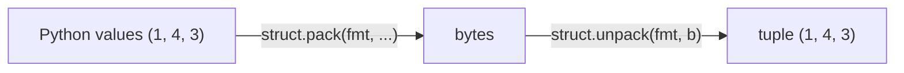
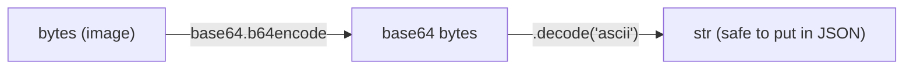

# Binary Data

**What this chapter gives you:** the tools to read and write raw bytes with fixed layouts (`struct`), to show bytes as hex or base64 (`binascii`, `base64`), and to work on single bits with Python's bit operators. You need this for model weight files, embedding dumps, image bytes in API payloads and network packets.

## Convert Binary Data with struct

Python has many text tools and few binary ones. The standard `struct` module is the main one. It converts between Python values and a `bytes` object laid out like a C `struct`: fixed-size fields, one after another, no separators, no labels.


*`fmt` must be the same on both sides.*

Suppose a small file starts with a 12-byte header: a 4-byte tag, a 2-byte version, a 2-byte vector size and a 4-byte count. The format string `"<4sHHI"` describes exactly that.

```text
offset :   0  1  2  3 | 4  5 | 6  7 | 8  9 10 11
bytes  :  45 4d 42 31 |01 00 |04 00 |03 00 00 00      (hex)
field  :  magic "EMB1"|version|  dim | count
format :     4s      |   H   |  H   |    I           -> "<4sHHI"
```

```python
import struct

header = struct.pack("<4sHHI", b"EMB1", 1, 4, 3)
print(header)
print(len(header), struct.calcsize("<4sHHI"))
magic, version, dim, count = struct.unpack("<4sHHI", header)
print(magic, version, dim, count)
print(type(header), type(struct.unpack("<4sHHI", header)))
```

```text
b'EMB1\x01\x00\x04\x00\x03\x00\x00\x00'
12 12
b'EMB1' 1 4 3
<class 'bytes'> <class 'tuple'>
```

> [!example] Type check
> `pack` returns `bytes`. `unpack` always returns a *tuple*, even when there is one value, so write `(n,) = struct.unpack("<I", b)` or use `[0]`. A `4s` field comes back as `bytes`, not `str`. Decode it yourself if it holds text.

### The format string

The *first* character sets byte order (and whether sizes are standard). Then one letter per field, optionally with a count in front: `"4f"` means four floats, `"2H"` means two unsigned shorts.

| **Char** | **Meaning** | **Python type** |
|---|---|---|
| `<`  `>` | little / big endian, standard sizes | (prefix) |
| `=`  `@` | native order; `@` also adds alignment padding | (prefix) |
| `b`  `B` | signed / unsigned byte (1) | `int` |
| `h`  `H` | signed / unsigned short (2) | `int` |
| `i`  `I` | signed / unsigned int (4) | `int` |
| `q`  `Q` | signed / unsigned long long (8) | `int` |
| `f`  `d` | float32 (4) / float64 (8) | `float` |
| `?` | bool (1) | `bool` |
| `Ns` | `N` raw bytes, padded with zero bytes | `bytes` |
| `x` | one padding byte, skipped | (no value) |

> [!tip] Rule
> Always start the format with `<` or `>`. Without a prefix Python uses your machine's native order *and* may insert padding bytes between fields, so `@bI` is 8 bytes while `<bI` is 5. A file format is defined by its spec, not by your CPU.

### Endianness

A number bigger than one byte must be stored in some order. *Big endian* puts the most significant byte first, *little endian* the least significant first. Most CPUs (x86, ARM in normal mode) are little endian. Network protocols and many file headers are big endian.

```text
value 0x12345678
address        :   0    1    2    3
big endian ">I":  12   34   56   78    (most significant byte first)
little endian "<I": 78   56   34   12    (least significant byte first)
```

```python
print(struct.pack(">I", 0x12345678).hex(" "))
print(struct.pack("<I", 0x12345678).hex(" "))
print((0x12345678).to_bytes(4, "big").hex(" "))
print(int.from_bytes(b"\x01\x00", "little"), int.from_bytes(b"\x01\x00", "big"))
print(int.from_bytes(b"\xff\xff", "big", signed=True))
```

```text
12 34 56 78
78 56 34 12
12 34 56 78
1 256
-1
```

For a single integer, `int.to_bytes()` and `int.from_bytes()` are simpler than `struct`. The same two bytes `01 00` are 1 in little endian and 256 in big endian, so a wrong guess gives a wrong number, not an error.

### Reading from the middle of a buffer

You rarely have just the header. `unpack_from(fmt, buf, offset)` reads at an offset without slicing. `iter_unpack` walks over a repeated record. The `x` code skips bytes you do not care about.

```python
vec = struct.pack("<4f", 0.5, -1.25, 3.0, 0.1)
blob = header + vec
print(struct.unpack_from("<4f", blob, 12))
print(struct.unpack_from("<4sHHI", blob))
for (x,) in struct.iter_unpack("<f", vec):
    print(x)
print(struct.unpack("<8xHH2x", b"12345678\x07\x00\x08\x00.."))
```

```text
(0.5, -1.25, 3.0, 0.10000000149011612)
(b'EMB1', 1, 4, 3)
0.5
-1.25
3.0
0.10000000149011612
(7, 8)
```

Look at the last float: `0.1` stored as float32 comes back as `0.10000000149011612`. Float32 holds about seven decimal digits. This is why model weights saved as float32 and read as Python `float` (which is float64) show these long tails. It is not a bug.

### Typical errors

```python
for bad in (lambda: struct.unpack("<I", b"\x01\x02"),
            lambda: struct.pack("<B", 300),
            lambda: struct.pack("<4s", "abcd")):
    try:
        bad()
    except struct.error as e:
        print(e)
print(struct.pack("<8s", b"abc"))
print(struct.calcsize("@bI"), struct.calcsize("<bI"))
```

```text
unpack requires a buffer of 4 bytes
'B' format requires 0 <= number <= 255
argument for 's' must be a bytes object
b'abc\x00\x00\x00\x00\x00'
8 5
```

> [!warning] Trap
> Three classic mistakes: giving `unpack` a buffer of the wrong length (it must match `calcsize` exactly), passing a `str` to an `s` field (you need `bytes`), and packing a number that does not fit the type. All raise `struct.error`.

### A real-world shape: length, then JSON, then data

Many ML file formats start with a small fixed header that tells you how long the next, flexible part is. The pattern below (a length, a JSON block, then raw floats) imitates this idea.

```python
import json

meta = json.dumps({"w": {"dtype": "F32", "shape": [2]}}).encode("utf-8")
blob = struct.pack("<Q", len(meta)) + meta + struct.pack("<2f", 1.5, -2.0)
(n,) = struct.unpack_from("<Q", blob)
info = json.loads(blob[8:8 + n])
print(n, info)
print(struct.unpack_from("<2f", blob, 8 + n))
print(type(info))
```

```text
37 {'w': {'dtype': 'F32', 'shape': [2]}}
(1.5, -2.0)
<class 'dict'>
```

> [!danger] Boss fight: nothing in the bytes tells you the layout
> Binary data has no field names, no types, no separators. The same 4 bytes can be an `int`, a `float`, four tiny numbers or text. The meaning lives in a spec, and your format string is your copy of that spec. To decode safely: (1) check a magic value first, (2) pick byte order explicitly, (3) pick the exact sizes and signedness, (4) check the total length with `calcsize`. When a number comes out absurd (millions where you expect 3), suspect byte order first.

## Extraction with Binary Data Tools

`struct` gets clumsy when formats are nested or conditional. Third-party packages describe the layout declaratively instead: `construct`, `bitstring`, `hachoir` and Kaitai Struct are the ones to know. You describe the fields once and the library parses (and sometimes builds) the bytes. Below is the same header with `construct`. It needs `pip install construct`; I did not run it here, so check the library docs for the exact API of your version.

```python
# needs: pip install construct   (not run in these notes)
from construct import Struct, Const, Int16ul, Int32ul

Header = Struct(
    "magic" / Const(b"EMB1"),
    "version" / Int16ul,      # ul = unsigned, little endian
    "dim" / Int16ul,
    "count" / Int32ul,
)
h = Header.parse(header)         # header = the 12 bytes built above
print(h.dim, h.count)
```

|  | **`struct`** | **declarative library** |
|---|---|---|
| Install | built in | `pip install` |
| Style | format string, positions by hand | named fields, nested records |
| Good for | flat, fixed records | complex or conditional formats |
| Readability | terse, easy to mis-type | self-documenting |

## Convert Bytes/Strings with binascii

Raw bytes print as a mix of letters and `\x` escapes. To *see* them, convert to hex. To *send* them through a text-only channel such as JSON, convert to base64.

```python
import binascii, base64

print(binascii.hexlify(b"\x89PNG"))
print(binascii.unhexlify(b"89504e47"))
print(b"\x89PNG".hex(), bytes.fromhex("89 50 4e 47"))
print(type(b"ab".hex()), type(binascii.hexlify(b"ab")))
```

```text
b'89504e47'
b'\x89PNG'
89504e47 b'\x89PNG'
<class 'str'> <class 'bytes'>
```

> [!example] Type check
> `bytes.hex()` returns a `str`, and `bytes.fromhex(str)` takes one. The older `binascii.hexlify` returns `bytes`. The methods on `bytes` are usually nicer. Pass `hex(" ")` to put a space between bytes.

Base64 turns any bytes into plain ASCII letters, digits, `+`, `/` and `=`. APIs that accept an image inside JSON expect exactly this.

```python
raw = bytes(range(250, 256)) + b"hi"
b64 = base64.b64encode(raw)
print(b64, type(b64))
print(b64.decode("ascii"))
print(base64.b64decode(b64) == raw)
print(hex(binascii.crc32(b"hello")))
```

```text
b'+vv8/f7/aGk=' <class 'bytes'>
+vv8/f7/aGk=
True
0x3610a686
```



> [!warning] Trap
> `b64encode` returns `bytes`, and `json.dumps` cannot serialize `bytes`. Call `.decode("ascii")` to get a `str` first. Base64 is an *encoding*, not encryption, and it makes the data about one third larger.

## Use Bit Operators

Integers are stored as bits. Python lets you work on those bits with six operators. They work on `int` only.

| **Operator** | **Name** | **Result bit is 1 when ...** | **Example** |
|---|---|---|---|
| `&` | and | both bits are 1 | `5 & 3 = 1` |
| `\|` | or | at least one bit is 1 | `5 \| 3 = 7` |
| `^` | xor | exactly one bit is 1 | `5 ^ 3 = 6` |
| `~` | not | flips every bit (`~x` is `-x-1`) | `~5 = -6` |
| `<<` | left shift | bits move left, zeros fill in (times 2) | `5 << 1 = 10` |
| `>>` | right shift | bits move right (floor-divide by 2) | `5 >> 1 = 2` |

```text
x      = 5   0 1 0 1
y      = 3   0 0 1 1
             -------
x & y  = 1   0 0 0 1     1 only where both are 1
x | y  = 7   0 1 1 1     1 where at least one is 1
x ^ y  = 6   0 1 1 0     1 where exactly one is 1
```

```python
x, y = 0b0101, 0b0011
print(x & y, x | y, x ^ y, ~x, x << 1, x >> 1)
print(bin(x), format(x, "08b"), f"{x:#06b}", f"{255:#x}")
print(~x, ~x & 0xF, f"{~x & 0xFF:08b}")
print(-1 & 0xFF, -6 & 0xFF)
```

```text
1 7 6 -6 10 2
0b101 00000101 0b0101 0xff
-6 10 11111010
255 250
```

> [!example] Type check
> Python's `int` has no fixed width, so `~5` is `-6`, not a big positive number. Use a mask to see a fixed width: `~5 & 0xFF` is `250`. Negative numbers behave as if they had infinitely many leading 1 bits (two's complement), which is why `-6 & 0xFF` gives 250.

### Using bits as flags and fields

A common use is packing several yes/no options into one integer, or pulling a field out of a byte with a shift and a mask.

```python
READ, WRITE, EXEC = 0b100, 0b010, 0b001
perm = READ | WRITE              # set two flags
print(perm, bool(perm & WRITE), bool(perm & EXEC))
perm |= EXEC                     # set a flag
perm &= ~WRITE                   # clear a flag
print(f"{perm:03b}")
perm ^= READ                     # toggle a flag
print(f"{perm:03b}")
b = 0b10110100
print((b >> 4) & 0xF, b & 0xF)   # high nibble, low nibble
print((255).bit_count(), (0b1011).bit_length())
```

```text
6 True False
101
001
11 4
8 4
```

```text
b = 1 0 1 1 | 0 1 0 0
    high nibble  low nibble
    b >> 4 = 1011 = 11      b & 0xF = 0100 = 4
```

> [!warning] Trap
> Do not confuse `&` with `and`. `6 and 3` is `3` (logical: the last truthy value), `6 & 3` is `2` (bit by bit). And `<<` with a huge shift quietly builds a huge integer. It never overflows.

## Review and what comes next

You can now describe a binary layout with a format string, read and write it with `struct`, display bytes as hex, move them through JSON as base64, and flip single bits. The next chapter turns to [[19 - Dates and Times|dates and times]].

> [!question]- Practice
> 1. Write the hex string `"4749463839"` to a `bytes` variable with `bytes.fromhex`. Does it start with the ASCII letters `GIF`? Show how you check.
> 2. Pack the three integers 7, 300 and 70000 as unsigned 1-, 2- and 4-byte little-endian values. What is the length of the result, and which format string did you use?
> 3. The bytes `b"\x00\x00\x01\x00"` are an unsigned 4-byte integer. What are its values read big endian and little endian?
> 4. Why does `struct.unpack("<I", data)` raise an error when `data` has 5 bytes? Show two ways to read only the first four.
> 5. Store the flags `ADMIN=1`, `BETA=2`, `DARK=4` in one integer. Turn on `BETA`, turn off `ADMIN`, and test for `DARK`.
> 6. Take 10 random bytes, convert to base64, put it in a dict, dump it with `json`, load it back and recover the original bytes.

> [!success] Achievement unlocked: Byte Wrangler
> - Read and write fixed binary layouts with `struct`, choosing byte order on purpose.
> - Explain endianness and spot it as the cause of absurd numbers.
> - Show bytes as hex, and ship them inside JSON as base64.
> - Set, clear, toggle and test bits, and extract a bit field with shift and mask.
>

---
Related: [[05 - Bytes and Bytearray]] | [[17 - Text Data]] | [[20 - Files]] | [[22 - Data in Space - Networks]]
