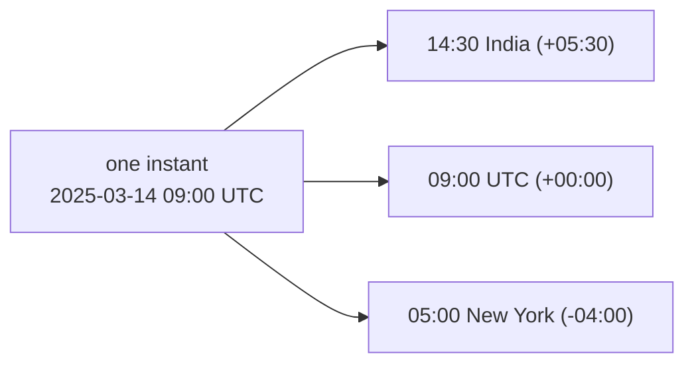
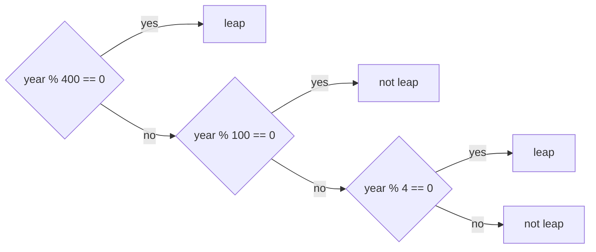
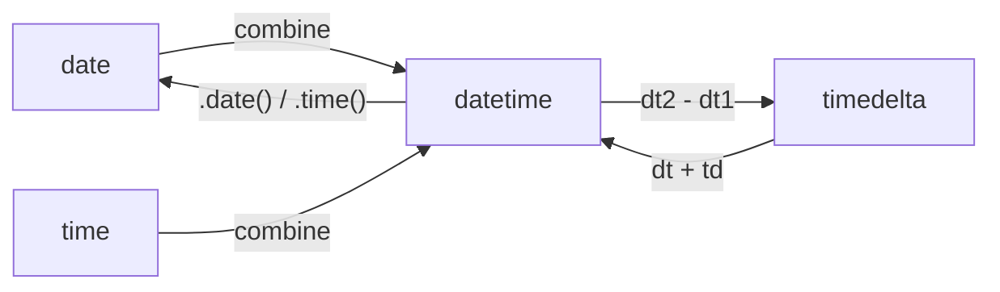
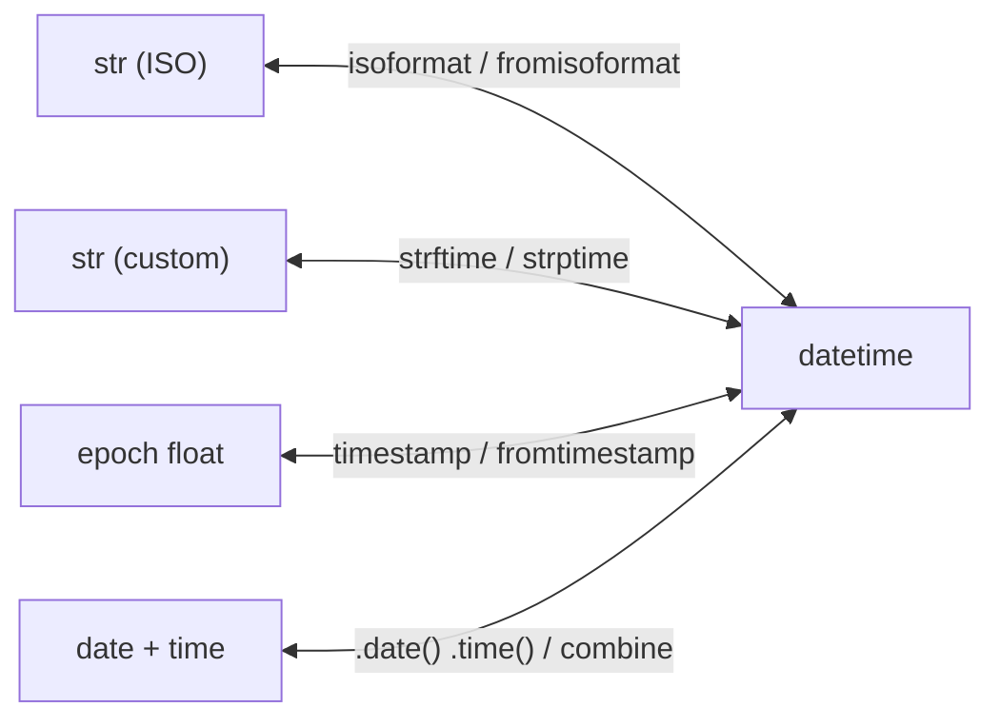

# Dates and Times

**What this chapter gives you:** the four types you need from `datetime` (`date`, `time`, `datetime`, `timedelta`), the difference between a `str`, a `datetime` and a float of seconds, and a few rules that stop time zone bugs. In AI work you meet this in log timestamps, API `created` fields, run durations and dated dataset files.

## Why dates and times are hard

The same day can be written many ways, and some are ambiguous.

| **Text** | **Problem** |
|---|---|
| `21 Jul 1987` | month name depends on the language |
| `7/21/1987` | only the US order; 21 cannot be a month |
| `03/04/2025` | 4 March or 3 April? Depends on the country |
| `2025-03-04` | ISO 8601: year, month, day. Unambiguous, and it sorts as text |

Times have a worse problem: time zones follow politics, not geometry, and daylight saving time (DST) moves the clock on different days in different countries. One moment in time has many local clock readings.



DST makes it worse. In spring one local hour does not exist. In autumn one local hour happens twice. Here is New York in 2025:

```text
9 March 2025 (spring forward):   01:30 -> [02:xx does not exist] -> 03:00
2 Nov 2025 (fall back):          01:30 (EDT) -> 01:30 (EST, again!) -> 02:00
```

> [!tip] Rule: store UTC, show local
> Keep every stored or computed timestamp in UTC (or as an epoch number). Convert to a local zone only at the edge, when a human reads it. Servers should run on UTC. Local wall-clock times with DST create hours that do not exist and hours that happen twice.

Python spreads dates over several modules: `datetime` (the main one), `time` (epoch seconds and clocks) and `calendar` (calendar facts). They overlap, which is confusing at first.

## Leap Year

A year has about 365.2422 days, so calendars add a day now and then. The rule has three layers, checked from the most special case outward.



```python
import calendar

print([(y, calendar.isleap(y)) for y in (1900, 1996, 2000, 2023, 2024)])
print(calendar.monthrange(2024, 2)[1], calendar.monthrange(2023, 2)[1])
print(calendar.day_name[0], calendar.month_name[2])
```

```text
[(1900, False), (1996, True), (2000, True), (2023, False), (2024, True)]
29 28
Monday February
```

`monthrange(year, month)` returns the weekday of the first day and the number of days. Do not write your own leap rule. Use `calendar.isleap`, or better, let `datetime` do the date arithmetic so leap days are handled for you.

## The datetime Module

`datetime` has four main classes.

| **Class** | **Holds** | **Looks like** |
|---|---|---|
| `date` | year, month, day | `2025-03-14` |
| `time` | hour, minute, second, microsecond | `09:30:00` |
| `datetime` | a date and a time together | `2025-03-14T09:30:00` |
| `timedelta` | a length of time | `1 day, 3:00:00` |



### date and timedelta

```python
from datetime import date, datetime, timedelta, timezone
from datetime import time as dtime   # avoid a clash with the time module

d = date(2025, 3, 14)
print(d, repr(d))
print(d.year, d.month, d.day, d.weekday(), d.strftime("%A"))
print(d + timedelta(days=30), d - timedelta(weeks=2))
gap = date(2025, 12, 25) - d
print(gap, type(gap), gap.days)
print(date.min, date.max)
two = timedelta(days=2)
print(date(2024, 2, 28) + two, date(2025, 2, 28) + two)
```

```text
2025-03-14 datetime.date(2025, 3, 14)
2025 3 14 4 Friday
2025-04-13 2025-02-28
286 days, 0:00:00 <class 'datetime.timedelta'> 286
0001-01-01 9999-12-31
2024-03-01 2025-03-02
```

`weekday()` counts Monday as 0, so Friday is 4. `isoweekday()` counts Monday as 1. The leap day in 2024 shows up with no extra code.

> [!example] Type check
> `print(d)` shows `2025-03-14`, but `d` is a `date` object, not a string. `repr(d)` shows its real nature. Subtracting two dates gives a `timedelta`, not an `int`: use `.days` or `.total_seconds()` to get a number.

A `timedelta` stores days, seconds and microseconds. Careful with `.seconds`: it is only the seconds part after whole days, not the full length.

```python
a = datetime(2025, 3, 14, 12, 0, 0)
b = datetime(2025, 3, 14, 12, 0, 7, 250000)
td = b - a
print(td, td.total_seconds(), td.seconds, td.microseconds)
print(timedelta(days=1, hours=3), timedelta(minutes=90).total_seconds())
print(timedelta(days=1.5), timedelta(hours=3) / timedelta(hours=2))
print(timedelta(hours=25) // timedelta(hours=2), timedelta(hours=1) * 3)
print(timedelta(seconds=-5))
```

```text
0:00:07.250000 7.25 7 250000
1 day, 3:00:00 5400.0
1 day, 12:00:00 1.5
12 3:00:00
-1 day, 23:59:55
```

> [!warning] Trap
> Negative timedeltas print strangely: five seconds backward is `-1 day, 23:59:55`. It is correct, just stored as days plus a positive remainder. Use `total_seconds()` when you want `-5.0`. Also, `.seconds` of a 2-day delta is `0`, not 172800.

```python
for bad in (lambda: a - d, lambda: d + d):
    try:
        bad()
    except TypeError as e:
        msg = str(e).replace("unsupported operand type(s) for ", "")
        print("TypeError:", msg)
```

```text
TypeError: -: 'datetime.datetime' and 'datetime.date'
TypeError: +: 'datetime.date' and 'datetime.date'
```

| **Expression** | **Result type** | **Note** |
|---|---|---|
| `date - date` | `timedelta` | also `datetime - datetime` |
| `date + timedelta` | `date` | `datetime + timedelta` gives `datetime` |
| `timedelta * int` | `timedelta` |  |
| `timedelta / timedelta` | `float` | `//` gives an `int` |
| `date + date` | `TypeError` | adding two points in time makes no sense |
| `datetime - date` | `TypeError` | do not mix the two types |

### time and datetime

```python
t = dtime(9, 30)
print(repr(t), t.hour, t.isoformat())
dt = datetime(2025, 1, 2, 3, 4, 5, 6)   # y, m, d, h, min, s, microsecond
print(repr(dt))
print(dt.isoformat())
print(dt.isoformat(sep=" ", timespec="seconds"))
full = datetime.combine(d, t)
print(full, repr(full.date()), full.time())
print(full.replace(hour=0, minute=0), full.replace(year=2026))
print(type(datetime.now()), type(date.today()))
```

```text
datetime.time(9, 30) 9 09:30:00
datetime.datetime(2025, 1, 2, 3, 4, 5, 6)
2025-01-02T03:04:05.000006
2025-01-02 03:04:05
2025-03-14 09:30:00 datetime.date(2025, 3, 14) 09:30:00
2025-03-14 00:00:00 2026-03-14 09:30:00
<class 'datetime.datetime'> <class 'datetime.date'>
```

Objects of these classes are *immutable*. `replace()` returns a new object. The `now()` and `today()` calls give the current moment, so their results change each time you run them; I show only their types above.

> [!warning] Trap
> `datetime.now()` returns local time *without* any time zone attached. Two machines in different zones produce different values for the same instant, and Python cannot tell which is which. See the section on aware datetimes below.

### Naive versus aware

A `datetime` is *naive* when it has no `tzinfo`, and *aware* when it carries a UTC offset. Naive values mean “some wall clock, somewhere”. Aware values mean one exact instant.

```python
naive = datetime(2025, 3, 14, 9, 0)
aware = datetime(2025, 3, 14, 9, 0, tzinfo=timezone.utc)
print(naive.tzinfo, aware.tzinfo, aware.isoformat())
try:
    naive < aware
except TypeError as e:
    print("TypeError:", e)
ist = timezone(timedelta(hours=5, minutes=30), "IST")
local = aware.astimezone(ist)
print(local.isoformat(), local == aware)
print(datetime.now(timezone.utc).tzinfo)
```

```text
None UTC 2025-03-14T09:00:00+00:00
TypeError: can't compare offset-naive and offset-aware datetimes
2025-03-14T14:30:00+05:30 True
UTC
```

`astimezone` changes how the instant is *shown*, not which instant it is, so `local == aware` is `True`. For real zones with DST rules, use the standard `zoneinfo` module. On Windows it needs the `tzdata` package (`pip install tzdata`); I could not run that here.

```python
# needs: tzdata on Windows (pip install tzdata); not run in these notes
from zoneinfo import ZoneInfo

ny = ZoneInfo("America/New_York")
instant = datetime(2025, 3, 14, 9, 0, tzinfo=timezone.utc)
print(instant.astimezone(ny))      # the same instant on a New York wall clock
```

> [!danger] Boss fight: naive versus aware
> Most date bugs in real systems are naive/aware bugs. A naive `datetime` is just numbers; it does not say which zone it is in. An aware one is an exact instant. You cannot compare or subtract the two kinds (Python raises `TypeError`, which is the helpful outcome). The safe pattern: create aware UTC values (`datetime.now(timezone.utc)`), store them as ISO strings with an offset or as epoch numbers, and convert with `astimezone` only for display.

## The time Module

The `time` module is *not* the same as the `datetime.time` class. It works with *epoch seconds*: the number of seconds since midnight UTC on 1 January 1970. This is the simplest way to pass a moment between systems, such as JavaScript, databases or API fields (`"created": 1700000000`).

```text
0                        1,000,000,000              1,700,000,000        ---> seconds
|------------------------|--------------------------|
1970-01-01 00:00:00 UTC   2001-09-09 01:46:40 UTC     2023-11-14 22:13:20 UTC
```

```python
import calendar, time

st = time.gmtime(1_700_000_000)          # UTC, as a struct_time
print(type(st).__name__, tuple(st))
print(time.asctime(st))
print(st.tm_year, st[0], st.tm_yday, st.tm_wday)
print(time.strftime("%Y-%m-%d %H:%M:%S", st))
print(calendar.timegm(st))               # back to epoch seconds (UTC)
print(type(time.time()), type(time.perf_counter()))
```

```text
struct_time (2023, 11, 14, 22, 13, 20, 1, 318, 0)
Tue Nov 14 22:13:20 2023
2023 2023 318 1
2023-11-14 22:13:20
1700000000
<class 'float'> <class 'float'>
```

`time.time()` returns a `float` of epoch seconds. `localtime(secs)` gives a `struct_time` in your zone, `gmtime(secs)` in UTC. A `struct_time` is a named tuple of nine fields: year, month, day, hour, minute, second, weekday, day of year, DST flag. Weekday counts from 0 (Monday), day of year from 1.

| **Function** | **Returns** | **Use it for** |
|---|---|---|
| `time.time()` | `float`, epoch seconds | timestamps to store or send |
| `time.gmtime(s)` / `localtime(s)` | `struct_time` | breaking seconds into parts |
| `time.mktime(st)` | `float` | `struct_time` in local zone back to seconds |
| `calendar.timegm(st)` | `int` | `struct_time` in UTC back to seconds |
| `time.perf_counter()` | `float` | measuring how long code takes |
| `time.monotonic()` | `float` | timeouts that must never go backward |
| `time.sleep(s)` | `None` | pause for `s` seconds |

> [!tip] Rule
> To time code, use `time.perf_counter()`, not `time.time()`. The wall clock can jump (clock sync, DST), while `perf_counter` only moves forward and has high resolution. The absolute value is meaningless; subtract two readings.

```python
t0 = time.perf_counter()
time.sleep(0.05)
elapsed = time.perf_counter() - t0
print(0.04 < elapsed < 0.2)
```

```text
True
```

## Read and Write Dates and Times

### ISO 8601: the default choice

`isoformat()` writes it, `fromisoformat()` reads it. In Python 3.11 and later it accepts a trailing `Z` too. Use ISO for logs, JSON, JSONL eval files and file names: it is unambiguous and sorts correctly as plain text.

```python
print(date.fromisoformat("2025-03-14") == d)
print(sorted(["2025-03-14", "2025-01-09", "2024-12-31"]))
print(datetime.fromisoformat("2025-02-14T15:05:09+00:00"))
print(repr(datetime.fromisoformat("2025-02-14T15:05:09Z")))
```

```text
True
['2024-12-31', '2025-01-09', '2025-03-14']
2025-02-14 15:05:09+00:00
datetime.datetime(2025, 2, 14, 15, 5, 9, tzinfo=datetime.timezone.utc)
```

### strftime: object to string

`strftime` (“string from time”) formats a date or time with percent codes. `strptime` (“string parsed to time”) goes the other way with the same codes.

```text
format string:  %Y  -  %m  -  %d  space  %H  :  %M
                 |      |      |           |      |
result       :  2025 - 02  -  14   space   15  :  05      ->  "2025-02-14 15:05"
```

| **Code** | **Meaning** | **Example** | **Note** |
|---|---|---|---|
| `%Y`  `%y` | year 4 / 2 digits | `2025`  `25` |  |
| `%m` | month | `02` | zero-padded |
| `%d` | day of month | `14` | zero-padded |
| `%H`  `%I`  `%p` | hour 24 / 12, AM or PM | `15`  `03`  `PM` |  |
| `%M`  `%S` | minute, second | `05`  `09` |  |
| `%f` | microseconds | `123456` | 6 digits |
| `%b`  `%B` | month name short / long | `Feb`  `February` | locale dependent |
| `%a`  `%A` | weekday short / long | `Fri`  `Friday` | locale dependent |
| `%j` | day of year | `045` |  |
| `%z`  `%Z` | UTC offset, zone name | `+0000`  `UTC` | aware values only |

```python
dt = datetime(2025, 2, 14, 15, 5, 9)
fmt = "It's %A, %B %d, %Y, %I:%M:%S%p"
print(dt.strftime(fmt))
print(dt.strftime("%Y%m%d-%H%M%S"))
print(date(2025, 2, 14).strftime("%d/%m/%Y %H:%M"))
print(dtime(10, 35).strftime("%H:%M"), dtime(10, 35).strftime("%Y-%m-%d"))
```

```text
It's Friday, February 14, 2025, 03:05:09PM
20250214-150509
14/02/2025 00:00
10:35 1900-01-01
```

> [!warning] Trap
> A `date` has no time, so `%H:%M` prints midnight (`00:00`). A `time` has no date, so `%Y-%m-%d` prints the meaningless `1900-01-01`. Format only the parts the object really has.

### strptime: string to object

`datetime.strptime(text, fmt)` returns a `datetime`. It is not a regex: the characters that are not percent codes (dashes, spaces, slashes) must match exactly. It also checks that the date exists.

```python
p = datetime.strptime("2025-02-14 15:05:09", "%Y-%m-%d %H:%M:%S")
print(repr(p), p == dt, type(p))
print(datetime.strptime("14 Feb 2025", "%d %b %Y").date())
print(datetime.strptime("03/04/2025", "%d/%m/%Y").date())
print(datetime.strptime("03/04/2025", "%m/%d/%Y").date())
for text in ("2025 02 14", "2025-02-30"):
    try:
        datetime.strptime(text, "%Y-%m-%d")
    except ValueError as e:
        print("ValueError:", e)
```

```text
datetime.datetime(2025, 2, 14, 15, 5, 9) True <class 'datetime.datetime'>
2025-02-14
2025-04-03
2025-03-04
ValueError: time data '2025 02 14' does not match format '%Y-%m-%d'
ValueError: day is out of range for month
```

> [!warning] Trap
> The same text `03/04/2025` gives 3 April or 4 March depending on the format you choose, and Python will not warn you. Never guess the order. Ask the data source, or demand ISO. Also, `strptime` returns a *naive* datetime unless the text contains an offset parsed with `%z`.

### Locale and names

Month and weekday names come from the operating system's locale. `locale.setlocale(locale.LC_TIME, "fr_FR")` switches them. That works only if the OS has that locale installed (names vary, such as `fr_FR.UTF-8` on Linux). It changes process-wide state, so avoid it in servers. For storing and exchanging data, use numeric or ISO formats, which do not depend on language.

## All the Conversions

You end up converting among a handful of forms all the time. The `datetime` object is the hub.



```python
a = datetime(2025, 3, 14, 9, 0, tzinfo=timezone.utc)
print(a.timestamp())
print(datetime.fromtimestamp(1_700_000_000, tz=timezone.utc).isoformat())
print(a.strftime("%Y-%m-%dT%H:%M:%SZ"))
print(a.timetuple().tm_yday)
```

```text
1741942800.0
2023-11-14T22:13:20+00:00
2025-03-14T09:00:00Z
73
```

> [!warning] Trap
> `datetime.fromtimestamp(secs)` *without* `tz=` gives a naive datetime in your local zone. For API timestamps, always pass `tz=timezone.utc`. Likewise `timestamp()` on a naive datetime assumes local time, which is a silent source of off-by-hours errors.

A short AI-flavored example: duration of a run from ISO log timestamps.

```python
lines = [
    "2025-03-14T09:00:01Z start run=a",
    "2025-03-14T09:00:03.500Z first token run=a",
    "2025-03-14T09:02:11Z done run=a",
]
stamps = [datetime.fromisoformat(l.split()[0]) for l in lines]
print([str(y - x) for x, y in zip(stamps, stamps[1:])])
print((stamps[-1] - stamps[0]).total_seconds())
print(date(1990, 5, 17) + timedelta(days=10000))
```

```text
['0:00:02.500000', '0:02:07.500000']
130.0
2017-10-02
```

The last line answers a typical “when am I 10,000 days old” question for someone born on 17 May 1990.

## Alternative Modules

If the standard library feels clumsy, these packages exist. None is needed for this series.

| **Package** | **What it is good for** |
|---|---|
| `python-dateutil` | parses almost any date text; relative dates such as “next month” |
| `arrow` | one friendly object for create, shift, format |
| `whenever` | newer, fast library (written in Rust) with clear naive/aware types |
| `iso8601` | fills gaps in ISO 8601 parsing |
| `astropy.time`, `TAI64` | astronomy-size dates, atomic time |

> [!tip] Rule
> Before you add a date library, try `datetime` with `timezone.utc` and `fromisoformat`. It covers most log and API work. Use `dateutil.parser` only for messy human-written dates you cannot control.

## Review and what comes next

You can now tell a date, a time, a datetime and a timedelta apart, convert between ISO strings, custom strings, epoch numbers and objects, and you know to keep UTC at the core. The next chapter [[20 - Files|opens files]]: reading, writing and moving data on disk.

> [!question]- Practice
> 1. Which of the years 1800, 2000, 2023 and 2100 are leap years? Check with code.
> 2. Create the date of your birthday, print its ISO form and its weekday name, and compute the date on which you turn 10,000 days old.
> 3. Why does `date(2025, 3, 1) - date(2025, 2, 1)` have type `timedelta` and not `int`? Which attribute gives a number of days?
> 4. Parse `"07/08/2025"` two times, once as day-first and once as month-first. Print both results in ISO format.
> 5. Write one line that turns the API field `1700000000` into an ISO string in UTC.
> 6. What happens if you subtract `datetime.now()` from `datetime.now(timezone.utc)`? Why is that error a good thing?

> [!success] Achievement unlocked: Time Keeper
> - Choose the right type among `date`, `time`, `datetime` and `timedelta`.
> - Parse and format timestamps with ISO, `strptime` and `strftime`.
> - Convert between epoch seconds, aware datetimes and strings.
> - Explain naive versus aware datetimes and why you store UTC.
> - Time a piece of code correctly with `perf_counter`.
>

---
Related: [[17 - Text Data]] | [[20 - Files]] | [[21 - Data in Time - Concurrency]]
