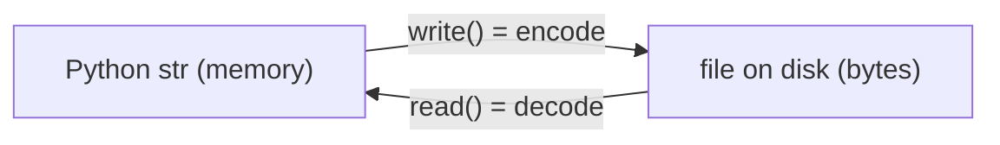
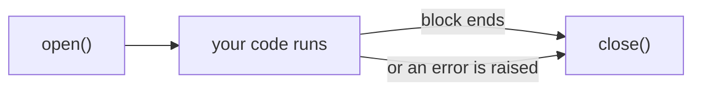
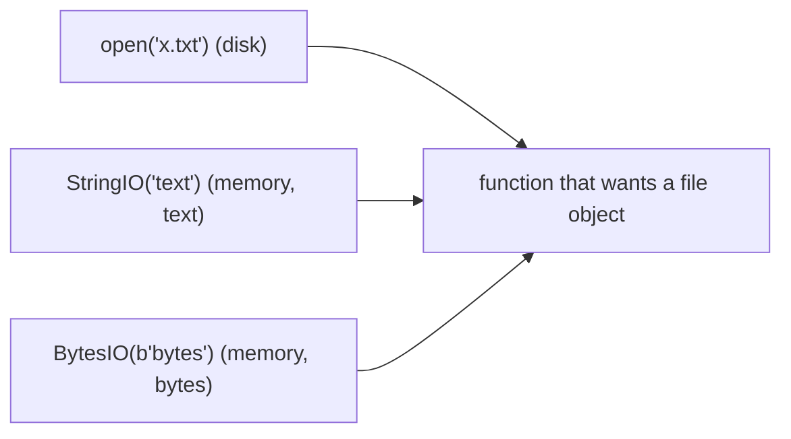

# Files

**What this chapter gives you:** how to open, read, write and close files safely, how to jump around inside a file, and how to find, copy, move and name files and folders. You will use this for JSONL eval sets, logs, model outputs, checkpoints and config files. You also meet `StringIO` and `BytesIO`, which make memory behave like a file.

## Files and directories

A *file* is a sequence of bytes stored under a name. A *directory* (folder) holds files and other directories, so the whole thing forms a tree. Text and bytes are the same on disk. The only difference is whether Python decodes the bytes into `str` for you.

```text
project/
├── data/
│   ├── train.jsonl
│   └── eval.jsonl
└── runs/
    ├── run-001.log
    └── run-002.log
```

## File Input and Output

### Create or open with open()

`open(name, mode)` returns a *file object*. It is your handle on the file: you call methods on it to read and write. When you are done you must close it, so that buffered writes reach the disk.

| **Mode** | **Meaning** | **File must exist?** | **Erases old content?** | **Pointer starts** |
|---|---|---|---|---|
| `"r"` | read (default) | yes | no | start |
| `"w"` | write | no, created | **yes** | start |
| `"x"` | write, but only if new | must *not* exist | – | start |
| `"a"` | append | no, created | no | end |
| `"r+"` | read and write | yes | no | start |

A second letter picks the kind: `t` for text (the default) or `b` for bytes. So `"wb"` is write-bytes and `"rt"` is the same as `"r"`.


*Text mode does the encoding for you; binary mode skips it.*

```python
f = open("notes.txt", "w", encoding="utf-8", newline="\n")
print(type(f))
n = f.write("line one\nline two\nline three\n")
print(n)
f.close()
print(f.closed)
```

```text
<class '_io.TextIOWrapper'>
29
True
```

> [!example] Type check
> `open(..., "w")` returns a `TextIOWrapper`, and `open(..., "wb")` returns a `BufferedWriter`. They are not strings. `write()` returns how many characters (text mode) or bytes (binary mode) it wrote, and it adds nothing: no space, no newline. A closed file object still exists, but using it raises `ValueError`.

> [!tip] Rule
> Always pass `encoding="utf-8"` in text mode. If you leave it out, Python uses the system default, which on many Windows machines is a legacy code page, so the same script can write different bytes on different computers.

> [!warning] Trap
> Mode `"w"` destroys the old content the moment you open the file, before you write anything. A typo in the filename can wipe an important file. Use `"x"` when the file must be new, and `"a"` to add to the end (for example, a log or a JSONL results file).

### with: close files automatically

Writing `f.close()` by hand is easy to forget, and it is skipped if an error happens in the middle. A `with` block closes the file for you when the block ends, normally or by an exception.


*`with open(...) as f:` manages all of this.*

```python
with open("notes.txt", "a", encoding="utf-8", newline="\n") as f:
    print("line four", file=f)
    f.write("line five\n")
print(f.closed)
with open("notes.txt", encoding="utf-8") as f:
    text = f.read()
print(type(text), len(text))
print(text, end="")
```

```text
True
<class 'str'> 49
line one
line two
line three
line four
line five
```

Two ways to write text: `f.write(s)` writes exactly `s`. `print(s, file=f)` is `print` aimed at a file, so it adds a newline unless you pass `end=""`. It also joins several arguments with spaces unless you change `sep`.

### Read a text file

| **Call** | **Returns** | **Memory use** |
|---|---|---|
| `f.read()` | one `str`, the whole file | whole file in memory |
| `f.read(n)` | next `n` characters | small, you choose |
| `f.readline()` | one line, with its `\n` | one line |
| `f.readlines()` | `list` of all lines | whole file in memory |
| `for line in f:` | one line at a time | one line; best for big files |

At the end of the file, `read()` and `readline()` return an empty string `""`. That is how you detect the end. A blank line in the middle is `"\n"`, which is not empty, so it is still truthy.

```python
with open("notes.txt", encoding="utf-8") as f:
    print(repr(f.readline()))
    print(repr(f.read(4)))
    print(repr(f.read()))
    print(repr(f.read()), repr(f.readline()))
with open("notes.txt", encoding="utf-8") as f:
    lines = f.readlines()
print(len(lines), repr(lines[0]), repr(lines[-1]))
with open("notes.txt", encoding="utf-8") as f:
    for i, line in enumerate(f, 1):
        print(i, line.rstrip("\n"))
```

```text
'line one\n'
'line'
' two\nline three\nline four\nline five\n'
'' ''
5 'line one\n' 'line five\n'
1 line one
2 line two
3 line three
4 line four
5 line five
```

> [!example] Type check
> A file object is its own iterator: `iter(f) is f`. Looping over it yields `str` lines *including* the trailing newline, so you often write `line.rstrip("\n")`. Because it is an iterator, you can use it once. A second loop over the same open file yields nothing, since the pointer is already at the end.

> [!tip] Rule
> For anything that could be large (logs, datasets), loop over the file object. Do not call `read()` or `readlines()`: a 5 GB file would need 5 GB of memory.

#### Example: JSONL, one JSON object per line

JSONL is the common format for eval sets and fine-tuning data: each line is a complete JSON document. Write with `json.dumps(obj) + "\n"`, read with `json.loads(line)`.

```python
import json

rows = [{"id": 1, "score": 0.5}, {"id": 2, "score": 0.75}]
with open("out.jsonl", "w", encoding="utf-8", newline="\n") as f:
    for r in rows:
        f.write(json.dumps(r) + "\n")
with open("out.jsonl", "rb") as f:
    print(f.read())
with open("out.jsonl", encoding="utf-8") as f:
    back = [json.loads(line) for line in f]
print(back == rows, type(back[0]))
with open("out.jsonl", encoding="utf-8") as f:
    print(sum(json.loads(line)["score"] for line in f if line.strip()))
```

```text
b'{"id": 1, "score": 0.5}\n{"id": 2, "score": 0.75}\n'
True <class 'dict'>
1.25
```

The last loop streams the file and keeps one line in memory at a time, so it scales to files much bigger than RAM.

### Errors you will meet

```python
try:
    open("notes.txt", "x", encoding="utf-8")
except FileExistsError as e:
    print("FileExistsError", e.errno)
try:
    open("missing.txt", encoding="utf-8")
except FileNotFoundError as e:
    print("FileNotFoundError:", e.strerror)
with open("cafe.txt", "w", encoding="utf-8") as f:
    f.write("caf\u00e9\n")
try:
    with open("cafe.txt", encoding="ascii") as f:
        f.read()
except UnicodeDecodeError as e:
    print("UnicodeDecodeError:", e.reason)
```

```text
FileExistsError 17
FileNotFoundError: No such file or directory
UnicodeDecodeError: ordinal not in range(128)
```

The error text for a missing file differs between operating systems, but the exception class does not. Catch the class. The third error is the str/bytes border from the [[17 - Text Data|Text Data chapter]] again: you told Python the bytes were ASCII, but the file is UTF-8.

### Newlines

Lines end with `"\n"` on Linux and macOS and `"\r\n"` on Windows. In text mode Python translates for you: reading turns any ending into `"\n"`, and writing turns `"\n"` into the platform's ending unless you pass `newline`.

```python
with open("a.txt", "w", newline="") as f:        # no translation
    f.write("a\nb\n")
with open("b.txt", "w", newline="\r\n") as f:    # force Windows endings
    f.write("a\nb\n")
print(open("a.txt", "rb").read(), open("b.txt", "rb").read())
print(open("b.txt", encoding="utf-8").read().splitlines())
```

```text
b'a\nb\n' b'a\r\nb\r\n'
['a', 'b']
```

### Binary files and seek()

Add `b` to the mode and you get `bytes` back, with no decoding and no newline translation. Use it for images, model weights, pickles and anything that is not text.

```python
data = bytes(range(256))
with open("b.bin", "wb") as f:
    print(f.write(data))
with open("b.bin", "rb") as f:
    raw = f.read()
print(type(raw), len(raw), raw[:4])
```

```text
256
<class 'bytes'> 256 b'\x00\x01\x02\x03'
```

A file object remembers a *position* (a pointer). Every `read` and `write` starts at the pointer and moves it forward. `tell()` reports it, `seek(offset, origin)` moves it. The position counts *bytes* from the start of the file.

```text
offset :   0   1   2   3   4   5   6   7   8   9  ...
bytes  : [00][01][02][03][04][05][06][07][08][09] ...
                        ^
                        pointer after read(3)  -> tell() == 3
```

```text
        start                                    end
offset:   0  1  2  3  4  5  6  7  8  9 (N=10)

seek(3, 0)   -> position 3          0 = from the start (os.SEEK_SET)
seek(2, 1)   -> current + 2         1 = from the current position (os.SEEK_CUR)
seek(-3, 2)  -> end - 3 = 7         2 = from the end, offset negative (os.SEEK_END)
```

```python
import os

with open("b.bin", "rb") as f:
    print(f.tell(), f.seek(255), f.read(), f.tell())
    print(f.seek(-1, os.SEEK_END), f.read(1))
    print(f.seek(10), f.seek(5, os.SEEK_CUR), f.read(3))
print(os.SEEK_SET, os.SEEK_CUR, os.SEEK_END)
```

```text
0 255 b'\xff' 256
255 b'\xff'
10 15 b'\x0f\x10\x11'
0 1 2
```

`seek` returns the new position. Reading the last byte of a huge file this way is instant, because nothing before it is read.

> [!warning] Trap
> In text mode, `seek` and `tell` work with opaque numbers. Only `seek(0)` and values that `tell()` gave you are safe. With UTF-8, one character can be several bytes, so “go to character 100” is not “go to byte 100”. For arbitrary jumps, open the file in binary mode.

> [!danger] Boss fight: the file pointer
> A file object is not the file. It is a cursor plus a buffer. Reading moves the cursor, so the *same* file object returns different data on each call, and returns nothing once it is at the end. Writing in mode `"w"` erases first, then moves forward. Most confusing file bugs come from forgetting where the cursor is: a second `read()` that returns `""`, a loop over a file that runs only once, or a write that overwrote the start because of `"r+"` and no `seek`. When in doubt, print `f.tell()`.

### Memory mapping

The standard `mmap` module can map a file into memory so that it looks like a `bytearray`: you slice it and search it, and the operating system loads pages on demand. It helps for very large binary files you need random access to. For everyday work, plain `open` is enough.

## File Operations

Python's names come from Unix. The `os`, `os.path` and `shutil` modules hold the functions. The newer `pathlib` module (later in this chapter) does the same jobs with objects.

| **Task** | **Function** | **Returns / note** |
|---|---|---|
| exists? | `os.path.exists(p)` | `bool`; works for files and directories |
| is a file? | `os.path.isfile(p)` | `bool` |
| is a directory? | `os.path.isdir(p)` | `bool` |
| is it absolute? | `os.path.isabs(p)` | `bool`; does not check the disk |
| size | `os.path.getsize(p)` | `int` bytes |
| copy | `shutil.copy(src, dst)` | returns the destination path |
| move or rename | `os.rename(a, b)`, `shutil.move` | `move` also works across disks |
| delete a file | `os.remove(p)` | permanent; no recycle bin |
| hard / soft link | `os.link`, `os.symlink` | Unix concepts; `islink()` tests |
| permissions | `os.chmod(p, mode)` | Unix; `0o400` = owner can read only |
| owner | `os.chown(p, uid, gid)` | Unix only |

```python
import shutil

with open("oops.txt", "w", encoding="utf-8", newline="\n") as f:
    f.write("hello\n")
print(os.path.exists("oops.txt"), os.path.exists("waffles"))
print(os.path.exists("."))
print(os.path.isfile("oops.txt"), os.path.isdir("oops.txt"), os.path.isdir("."))
print(os.path.isabs("oops.txt"), os.path.isabs(os.path.abspath("oops.txt")))
print(shutil.copy("oops.txt", "copy.txt"))
os.rename("copy.txt", "renamed.txt")
print(sorted(x for x in os.listdir(".") if x.endswith(".txt")))
os.remove("renamed.txt")
print(os.path.exists("renamed.txt"), os.path.getsize("oops.txt"))
```

```text
True False
True
True False True
False True
copy.txt
['a.txt', 'b.txt', 'cafe.txt', 'notes.txt', 'oops.txt', 'renamed.txt']
False 6
```

*Links.* A *hard link* is a second name for the same bytes on disk. A *symbolic link* is a small file that points to another path. `os.symlink` needs special rights on Windows, so it is not run here. `chmod` and `chown` are for Unix-like systems. A typical call is `os.chmod("secrets.txt", 0o600)` so that only you can read your key file.

> [!warning] Trap
> `os.remove` and `shutil.rmtree` delete for good. `os.rename` silently overwrites an existing destination on Unix. Check with `os.path.exists` first, or write to a temporary name and then `Path.replace()` into place, which swaps the file in one step.

## Directory Operations

| **Task** | **Function** | **Note** |
|---|---|---|
| create | `os.mkdir(d)` | one level; `FileExistsError` if present |
| create nested | `os.makedirs(d, exist_ok=True)` | all missing levels, no error if present |
| delete empty | `os.rmdir(d)` | fails if not empty |
| delete tree | `shutil.rmtree(d)` | deletes everything inside: careful |
| list names | `os.listdir(d)` | `list` of `str`, unsorted |
| current dir | `os.getcwd()`, `os.chdir(d)` | changes for the whole program |
| match names | `glob.glob(pattern)` | shell-style patterns, not regex |

```python
import glob

os.makedirs("data/runs/a1", exist_ok=True)
print(os.listdir("data"), os.path.isdir("data/runs/a1"))
try:
    os.rmdir("data")
except OSError as e:
    print("OSError:", type(e).__name__)
shutil.rmtree("data")
print(os.path.exists("data"))
os.mkdir("runs")
for name in ("a.jsonl", "b.jsonl", "notes.md"):
    with open("runs/" + name, "w", encoding="utf-8") as f:
        f.write("x\n")
os.chdir("runs")
print(sorted(os.listdir(".")), os.path.basename(os.getcwd()))
os.chdir("..")
```

```text
['runs'] True
OSError: OSError
False
['a.jsonl', 'b.jsonl', 'notes.md'] runs
```

The glob patterns are *not* regular expressions.

| **Pattern** | **Matches** | **Regex equivalent** |
|---|---|---|
| `*` | any number of any characters | `.*` |
| `?` | exactly one character | `.` |
| `[abc]` | one of `a`, `b`, `c` | same |
| `[!abc]` | one character that is not `a`, `b`, `c` | `[^abc]` |

```python
print(sorted(glob.glob("*.txt")))
print(glob.glob("ru??"), glob.glob("[rz]*"))
print(sorted(os.path.basename(p) for p in glob.glob("runs/*.jsonl")))
```

```text
['a.txt', 'b.txt', 'cafe.txt', 'notes.txt', 'oops.txt']
['runs'] ['runs']
['a.jsonl', 'b.jsonl']
```

> [!warning] Trap
> `os.listdir` gives names only, not paths, and in no fixed order. Wrap it in `sorted()` if order matters, and join the folder name back on before opening a file. Also `os.chdir` changes the whole program's idea of “here”; avoid it in library code and use full paths.

## Pathnames

A *pathname* says where a file is: *absolute* from the root, or *relative* to the current directory. Unix, macOS and URLs separate parts with `/`. Windows uses `\`. Python accepts `/` on Windows too, so you can often use slashes everywhere. If you write backslashes yourself, double them or use a raw string (`r"eek\urk"`); `"eek\urk"` contains an escape sequence, not a path.

### os.path

```python
p = os.path.join("eek", "urk", "snort.txt")        # uses the OS separator
print(p.replace(os.sep, "/"))
print(os.path.splitext("a/b/model.tar.gz"))
print(os.path.basename("a/b/c.txt"), os.path.dirname("a/b/c.txt"))
print(os.path.isabs(os.path.abspath("x")))
```

```text
eek/urk/snort.txt
('a/b/model.tar', '.gz')
c.txt a/b
True
```

`os.path.abspath(p)` turns a relative path into an absolute one. `os.path.realpath(p)` also follows symbolic links to the real file. Never build paths with `"a" + "/" + "b"`: let `join` or `pathlib` insert the right separator.

### pathlib

`pathlib.Path` treats a path as an *object*, not a string. The `/` operator joins parts, and the object has handy attributes and methods.

```text
Path("runs/2025/eval.jsonl")
      |-------- .parent --------|  |------ .name ------|
      runs / 2025                  /  eval  .jsonl
                                      .stem  .suffix
.parts = ('runs', '2025', 'eval.jsonl')
```

```python
from pathlib import Path, PurePosixPath, PureWindowsPath

p = Path("eek") / "urk" / "snort.txt"
print(p.as_posix(), p.name, p.stem, p.suffix)
print(p.parent.as_posix(), p.parts)
print(p.with_suffix(".jsonl").as_posix(), p.with_name("x.md").as_posix())
print(PureWindowsPath(PurePosixPath("eek/urk/snort.txt")))
print(type(p).__name__ in ("WindowsPath", "PosixPath"))
```

```text
eek/urk/snort.txt snort.txt snort .txt
eek/urk ('eek', 'urk', 'snort.txt')
eek/urk/snort.jsonl eek/urk/x.md
eek\urk\snort.txt
True
```

`print(p)` shows the path in your platform's style, and `repr(p)` shows `WindowsPath(...)` or `PosixPath(...)` depending on the system. The `Pure...` classes only manipulate path text and never touch the disk, so you can build a Windows path on a Mac.

`Path` objects also do the file work:

```python
runs = Path("runs")
body = '{"x": 2}\n{"x": 3}\n'
(runs / "c.jsonl").write_text(body, encoding="utf-8", newline="\n")
print(sorted(x.name for x in runs.iterdir()))
print(sorted(x.name for x in runs.glob("*.jsonl")))
print(sorted(x.as_posix() for x in Path(".").rglob("*.md")))
print((runs / "c.jsonl").read_text(encoding="utf-8").splitlines())
print((runs / "c.jsonl").exists(), (runs / "c.jsonl").is_file(), runs.is_dir())
print((runs / "c.jsonl").stat().st_size, runs.resolve().is_absolute())
tmp = Path("final.json.tmp")
tmp.write_text("{}", encoding="utf-8")
tmp.replace("final.json")
print(sorted(x for x in os.listdir(".") if x.startswith("final")))
```

```text
['a.jsonl', 'b.jsonl', 'c.jsonl', 'notes.md']
['a.jsonl', 'b.jsonl', 'c.jsonl']
['runs/notes.md']
['{"x": 2}', '{"x": 3}']
True True True
18 True
['final.json']
```

| **Job** | **os / os.path style** | **pathlib style** |
|---|---|---|
| join | `os.path.join(a, b)` | `Path(a) / b` |
| file name | `os.path.basename(p)` | `p.name` |
| extension | `os.path.splitext(p)[1]` | `p.suffix` |
| exists | `os.path.exists(p)` | `p.exists()` |
| read all text | `open(p).read()` | `p.read_text(encoding=...)` |
| list folder | `os.listdir(d)` | `d.iterdir()` |
| find by pattern | `glob.glob("d/*.py")` | `d.glob("*.py")` |

> [!tip] Rule
> Prefer `pathlib` in new code. Paths become objects with a clear type, the `/` join is portable, and one-line helpers like `read_text` and `write_text` close the file for you. You can pass a `Path` anywhere a filename string is accepted, including `open()`.

## BytesIO and StringIO

Many functions want a file object, but your data is already in memory. `io.StringIO` wraps a `str` and `io.BytesIO` wraps `bytes`. They have the same methods as real files (`read`, `write`, `seek`, iteration) but no disk is touched.



```python
import io, csv

s = io.StringIO()
s.write("a,b\n")
print("x", file=s)
print(repr(s.getvalue()), type(s).__name__)
s.seek(0)
print(s.readline(), end="")
print(list(io.StringIO("p\nq\n")))
bio = io.BytesIO(b"\x89PNG\r\n")
print(bio.read(4), bio.tell(), bio.getvalue())
bio.seek(0)
bio.write(b"AB")
print(bio.getvalue())
print(list(csv.DictReader(io.StringIO("name,score\nx,1\ny,2\n"))))
```

```text
'a,b\nx\n' StringIO
a,b
['p\n', 'q\n']
b'\x89PNG' 4 b'\x89PNG\r\n'
b'ABNG\r\n'
[{'name': 'x', 'score': '1'}, {'name': 'y', 'score': '2'}]
```

> [!example] Type check
> `StringIO` holds `str` and `BytesIO` holds `bytes`. Do not mix them: writing a `str` into a `BytesIO` raises `TypeError`. `getvalue()` returns the whole content regardless of the pointer, while `read()` starts from the pointer. After you write into a `StringIO`, call `seek(0)` before reading it back.

Typical uses: unit tests for code that reads a file, capturing what a function prints into a string, building a CSV or an image in memory before sending it over the network, and converting an image format with the Pillow library (`Image.open(BytesIO(data))`, which needs `pip install pillow`; not run here).

## File Formats: Determination

You may meet a file and not know what it is. The file extension is only a hint: anyone can rename `.png` to `.txt`. Better checks look at the first bytes, the *magic number* ([[18 - Binary Data|chapter on binary data]]: a PNG starts with the bytes `\x89PNG`).

| **Tool** | **What it does** |
|---|---|
| `file` (Unix command) | identifies files by magic bytes and other rules |
| `python-magic` | Python wrapper around the `libmagic` library used by `file` |
| `magika` | Google's learned file-type detector; `pip install magika` |
| your own check | compare `f.read(8)` with a known header such as `b"\x89PNG\r\n\x1a\n"` |

```python
sig = b"\x89PNG\r\n\x1a\n"
with open("fake.png", "wb") as f:
    f.write(sig + b"rest of image")
with open("fake.png", "rb") as f:
    print(f.read(8) == sig)
```

```text
True
```

## Review and what comes next

You can now open files in the right mode, read them line by line without loading them whole, use `with` so that they close, move the file pointer with `seek`, and manage files and folders with `os`, `shutil` and `pathlib`. The next chapter is about [[21 - Data in Time - Concurrency|concurrency: doing several things]] at once.

> [!question]- Practice
> 1. Write the string `"This is a test of the emergency text system"` to `test.txt` with a `with` block and UTF-8. Read it back into `test2`. Are they equal?
> 2. List all `.txt` files in the current folder, sorted, using `pathlib` and then using `glob`.
> 3. Why does a second `for line in f:` over the same open file print nothing? Show two ways to fix it.
> 4. You have a 4 GB JSONL file of eval rows. Write the loop that counts rows with `"score" > 0.5` without loading the file into memory.
> 5. Write 100 bytes, then use `seek` to read the last 10 bytes in two different ways.
> 6. What goes wrong if you open an existing file with mode `"w"` just to look at it? Which mode would you use to append a line to a log?

> [!success] Achievement unlocked: File Handler
> - Choose the correct open mode and always close files with `with`.
> - Stream large text files line by line and read or write JSONL.
> - Move around a binary file with `seek` and `tell`.
> - Build, split and search paths with `pathlib` and `glob`.
> - Use `StringIO` and `BytesIO` to treat memory like a file.
>

---
Related: [[17 - Text Data]] | [[18 - Binary Data]] | [[19 - Dates and Times]] | [[23 - Data in a Box - Persistent Storage]]
