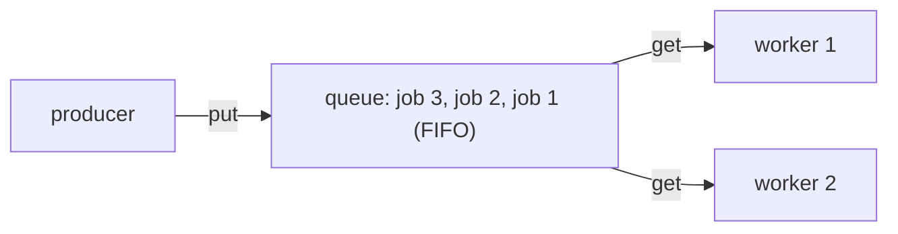
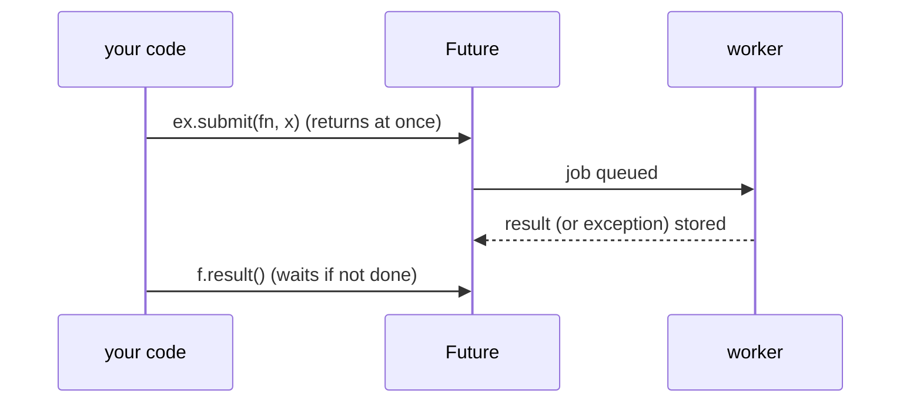
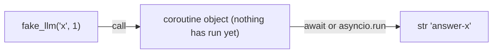
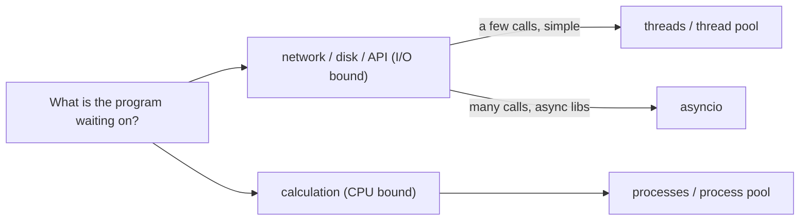

# Data in Time: Concurrency

**What this chapter gives you:** a map of the ways Python can do more than one thing at a time (processes, threads, a thread pool, `asyncio`, queues), and a rule for choosing among them. The core question is always: is my program *waiting* (on an API, a disk, a network) or *computing*? Calling many LLM APIs at once is the typical case, and this is where it pays off. All examples use `sleep` to fake slow network calls, so you can run them offline.

## Programs and Processes

When you run a program, the operating system creates a *process*: its own memory, its own open files, its own ID. Processes are isolated. One cannot read another's variables. The OS gives each a short slice of CPU time and switches between them so fast that they seem to run together.

```python
import os, sys

print(type(os.getpid()), type(os.cpu_count()), type(os.getcwd()))
```

```text
<class 'int'> <class 'int'> <class 'str'>
```

`os.getpid()` is the process ID (an `int`), `os.cpu_count()` the number of logical CPUs, `os.getcwd()` the current directory (a `str`). Other `os` helpers such as `os.uname()`, `os.getloadavg()` and `os.getuid()` exist only on Unix-like systems. The third-party `psutil` package (`pip install psutil`) gives CPU, memory, disk and per-process information on every platform; it is not needed here.

### Create a process with subprocess

`subprocess` starts *another program* and talks to it. The modern entry point is `subprocess.run`. It waits for the child to finish and returns a `CompletedProcess`.


To stay portable, the examples start the Python interpreter itself (`sys.executable`).

```python
import subprocess

r = subprocess.run([sys.executable, "-c", "print('hi from child')"],
                   capture_output=True, text=True)
print(type(r).__name__, r.returncode, repr(r.stdout), repr(r.stderr))
r3 = subprocess.run([sys.executable, "-c", "import sys; sys.exit(3)"])
print(r3.returncode)
try:
    subprocess.run([sys.executable, "-c", "raise SystemExit(2)"], check=True)
except subprocess.CalledProcessError as e:
    print("failed with", e.returncode)
out = subprocess.check_output([sys.executable, "-c", "print(1 + 1)"])
print(out.strip(), type(out))
```

```text
CompletedProcess 0 'hi from child\n' ''
3
failed with 2
b'2' <class 'bytes'>
```

| **Call** | **What it gives you** |
|---|---|
| `run(args, capture_output=True, text=True)` | `CompletedProcess` with `.stdout` and `.stderr` as `str`, and `.returncode` |
| `run(..., check=True)` | raises `CalledProcessError` if the exit code is not 0 |
| `check_output(args)` | only stdout, as `bytes` unless `text=True`; raises on failure |
| `getoutput(cmd)` | shell command string in, output `str` out (stdout and stderr mixed) |
| `getstatusoutput(cmd)` | tuple `(status, output)` |
| `call(args)` | runs it, output goes to your terminal, returns the exit code |

> [!example] Type check
> Without `text=True`, `.stdout` is `bytes`. With it, `str`. The exit status is an `int`: `0` means success, anything else means failure. Pass the command as a *list* of strings: `["git", "status"]`.

> [!warning] Trap
> `shell=True` (or `getoutput`) hands a single string to a shell. If any part of that string comes from user input or model output, a crafted value such as `x; rm -rf ~` can run extra commands. Prefer the list form without a shell. Never build shell strings from untrusted text.

### Create a process with multiprocessing

`multiprocessing` runs a *Python function* in a new process. Each process has its own interpreter and its own memory, so it can use a separate CPU core. A `Pool` hands a list of inputs to a fixed set of worker processes.

```python
# file: mp_demo.py
import multiprocessing as mp

def count_primes(limit):                  # CPU-bound work
    n = 0
    for x in range(2, limit):
        if all(x % d for d in range(2, int(x ** 0.5) + 1)):
            n += 1
    return n

def square_to(q, n):
    q.put((n, n * n))

if __name__ == "__main__":                # required on Windows and macOS
    with mp.Pool(2) as pool:
        print(pool.map(count_primes, [100, 1000, 10000]))
    q = mp.Queue()
    ps = [mp.Process(target=square_to, args=(q, n)) for n in range(3)]
    for p in ps:
        p.start()
    got = sorted(q.get() for _ in ps)
    for p in ps:
        p.join()
    print(got, [p.exitcode for p in ps])
```

```text
[25, 168, 1229]
[(0, 0), (1, 1), (2, 4)] [0, 0, 0]
```

Save this as a file and run it; processes do not work well in a notebook or the REPL. The numbers are the counts of primes below 100, 1000 and 10000.

> [!tip] Rule
> Always put the start-up code under `if __name__ == "__main__":`. On Windows and macOS a new process *re-imports* your file. Without the guard it would start new processes again and again.

> [!warning] Trap
> A child process cannot change your variables. Whatever it computes must come back through a `Queue`, a `Pipe`, a return value (`Pool.map`) or a file. Arguments and results are [[11 - Objects|pickled]] (serialized) on the way, so they must be picklable. Lambdas and open files are not.

### Kill a process with terminate()

A process you started can be stopped with `p.terminate()`, followed by `p.join()` to collect it. `p.is_alive()` tells you whether it still runs, and `p.exitcode` is `None` until it ends. Threads have no equivalent, which is one reason to use processes for work that you may need to cancel hard.

```python
# file: mp_kill.py
import multiprocessing as mp, time

def forever():
    while True:
        time.sleep(0.1)

if __name__ == "__main__":
    p = mp.Process(target=forever)
    p.start()
    print(p.is_alive())
    p.terminate()
    p.join()
    print(p.is_alive(), p.exitcode is not None)
```

```text
True
False True
```

## Command Automation

For repeatable command-line tasks, third-party tools wrap `subprocess` with a nicer interface. `invoke` turns decorated Python functions into command-line tasks.

```python
# needs: pip install invoke   (not run in these notes)
# tasks.py
from invoke import task

@task
def clean(ctx):               # ctx is required, invoke fills it in
    ctx.run("echo cleaning")
```

You then type `invoke clean` in a shell, and `invoke -l` lists the tasks. Related tools: `click` (build command-line programs), `doit`, `sh` (call commands like functions) and `fabric` (remote commands over SSH). Reach for them only when plain `subprocess.run` and a small script stop being enough.

## Concurrency

A program is usually slow for one of two reasons.

|  | **I/O bound** | **CPU bound** |
|---|---|---|
| The program is ... | waiting for network, disk, a database, an API | busy calculating |
| Typical AI examples | calling LLM APIs, downloading files, reading many files | tokenizing a huge corpus, parsing, local math |
| The CPU is ... | mostly idle | fully used |
| What helps | overlap the waiting | use more CPU cores |

*Synchronous* code does one thing, finishes, then starts the next. *Asynchronous* code lets other work proceed while one task waits. The picture shows why that matters. Every call needs a little of our code (blue) and a long wait (gray).

```text
time ->  0    5    10   15   18
One after another (18 units):
  call A [#][....][#]
  call B             [#][....][#]
  call C                         [#][....][#]

Overlapped waiting (8 units):
  call A [#][....][#]
  call B    [#][....][#]
  call C       [#][....][#]

[#] = our code runs      [....] = waiting for I/O
```

The CPU is idle during every gray block. Overlapping the waits cuts total time from 18 units to 8, without any extra CPU. If the work were *computing* instead, the blue blocks would be long and overlap would not help on one core. That case needs several cores, hence several processes.

### Queues

A queue holds items in order: you add at one end and take from the other. *FIFO* means first in, first out. Queues let one part of a program hand work to another without the two having to move at the same speed. The producer puts jobs in. The workers take jobs out when free.



There is one queue type per world: `multiprocessing.Queue` (between processes), `queue.Queue` (between threads), `asyncio.Queue` (between coroutines), and external servers such as Redis (between machines). Their methods look the same: `put`, `get`, `task_done`, `join`.

A common trick is a *sentinel*: a special item such as `None` that means “no more work”. Each worker stops when it sees it.

```python
import queue, threading

q = queue.Queue()
results = []

def consumer():
    while True:
        item = q.get()                 # blocks until an item arrives
        if item is None:               # sentinel: stop
            q.task_done()
            break
        results.append(item.upper())
        q.task_done()

c = threading.Thread(target=consumer)
c.start()
for w in ["salad", "bread", "soup"]:
    q.put(w)
q.put(None)
q.join()                               # wait until every item is processed
c.join()
print(results)
```

```text
['SALAD', 'BREAD', 'SOUP']
```

### Threads

A *thread* is a path of execution inside a process. All threads of a process share the same memory. That is what makes them light and handy, and also what makes them dangerous.

```text
Two processes: separate memory         One process, three threads: shared memory
+-------------+  +-------------+       +------------------------------------+
| own memory  |  | own memory  |       |  shared memory (all variables)     |
| [thread]    |  | [thread]    |       |  [thread] [thread] [thread]        |
+-------------+  +-------------+       +------------------------------------+
```

```python
import threading, time

def fake_call(i):
    time.sleep(0.2)               # pretend to wait for a network reply
    return i * i

t = threading.Thread(target=fake_call, args=(1,))
t.start()
t.join()                          # wait for the thread to finish
print(threading.current_thread().name, threading.active_count())
```

```text
MainThread 1
```

`Thread(target=f, args=(...))` makes a thread, `start()` launches it, `join()` waits for it. A thread's return value is lost, so give it a queue or a list to write into (or use a thread pool, below). There is no `terminate()` for threads.

#### Shared data and locks

When two threads change the same variable, the order of tiny steps can interleave and results go wrong (a *race condition*). A `Lock` lets only one thread into a block at a time.

```python
counter = 0
lock = threading.Lock()

def work():
    global counter
    for _ in range(50000):
        with lock:                # only one thread at a time in here
            counter += 1

ts = [threading.Thread(target=work) for _ in range(4)]
for t in ts:
    t.start()
for t in ts:
    t.join()
print(counter)
```

```text
200000
```

> [!warning] Trap
> Race conditions are hard bugs: the code works nine times and fails on the tenth, and adding a `print` can hide it. `counter += 1` looks like one step but is read, add, write. Keep shared mutable state to a minimum, protect it with a `with lock:` block, or avoid sharing by passing data through a `Queue`. Forgetting to release a lock (or two locks waiting on each other, a *deadlock*) freezes the program; `with` releases it for you.

#### The GIL

CPython has a *Global Interpreter Lock*: only one thread at a time may run Python bytecode. The consequences are:

- Threads waiting on I/O release the lock, so threads *do* help I/O-bound programs.
- Threads doing pure-Python calculation take turns, so they give *no speed-up*, and can even be slower than one thread.
- Processes each have their own interpreter and lock, so they use several cores.
- C extensions such as NumPy release the lock inside long computations.
- Python 3.13 has an experimental build without the GIL. Do not count on it yet.

```text
CPU-bound, threads (GIL):    T1 T2 T1 T2 T1 T2 T1 T2    (one at a time, no speed-up)
CPU-bound, processes:        core 1: P1 P1 P1 P1 P1 P1
                             core 2: P2 P2 P2 P2 P2 P2   (side by side, about half the time)
```

> [!tip] Rule
> Threads for I/O-bound work. Processes for CPU-bound work. For most AI-engineering scripts (calling APIs) threads or `asyncio` are right. Use processes when you crunch data in pure Python.

### concurrent.futures

Managing threads and processes by hand is fiddly. `concurrent.futures` gives one simple interface over both: a *pool* of workers, and a *future* for each job that you submitted. A future is a receipt: it will hold the result later (or the exception that was raised).



```python
from concurrent.futures import ThreadPoolExecutor, as_completed

def timed(workers):
    t0 = time.perf_counter()
    with ThreadPoolExecutor(max_workers=workers) as ex:
        out = list(ex.map(fake_call, range(6)))      # keeps input order
    return out, time.perf_counter() - t0

t0 = time.perf_counter()
serial = [fake_call(i) for i in range(6)]
t_serial = time.perf_counter() - t0
out3, t3 = timed(3)
out6, t6 = timed(6)
print(serial == out3 == out6)
print(round(t_serial, 1), round(t3, 1), round(t6, 1))
```

```text
True
1.2 0.4 0.2
```

Six calls of 0.2 s each take about 1.2 s one by one, 0.4 s with three workers (two rounds) and 0.2 s with six (one round). Your numbers will differ slightly. `ex.map` returns the results *in input order*. `submit` returns a `Future` at once, and `as_completed` yields futures in the order they *finish*.

```python
with ThreadPoolExecutor(max_workers=3) as ex:
    futs = [ex.submit(fake_call, i) for i in range(4)]
    print(type(futs[0]).__name__, futs[0].done())
    print(sorted(f.result() for f in as_completed(futs)))

def boom(x):
    raise ValueError("bad input %d" % x)

with ThreadPoolExecutor(2) as ex:
    f = ex.submit(boom, 7)
    try:
        f.result()                # the worker's exception is raised here
    except ValueError as e:
        print("caught:", e)
```

```text
Future False
[0, 1, 4, 9]
caught: bad input 7
```

> [!example] Type check
> `ex.submit(...)` returns a `Future`, not the result. `f.result()` returns the function's return value and *re-raises* any exception from the worker, so errors are not lost; they appear where you ask for the result. `ProcessPoolExecutor` has the same API, but the function and its arguments must be picklable, and the start-up needs the `__main__` guard.

### Green threads and gevent

Another idea is *event-based* programming: one loop watches many waiting tasks and runs whichever is ready. The `gevent` library does this with *greenlets* (“green threads”) and rewrites standard library calls such as `socket` (“monkey patching”) so that ordinary-looking blocking code yields to others instead of freezing. It is third-party (`pip install gevent`), not run here, and it only works with pure-Python code, not C libraries that block. It lost ground to `asyncio`, but you will see it in older servers.

### Twisted

`Twisted` is an older event-driven networking framework built on *callbacks*: you register a function to run when “data arrives” or “connection closed”. It is powerful and covers many protocols, but callback code can get tangled as a program grows (*callback hell*). New code usually chooses `asyncio`. Install with `pip install twisted`; not needed in this series.

### asyncio

`asyncio` (standard library) runs many tasks in *one thread*. Tasks cooperate: a task runs until it reaches an `await`, which says “I am waiting, someone else can go now”. A single *event loop* decides who runs next.

- `async def f(): ...` defines a *coroutine function*.
- Calling `f()` does *not* run it. It returns a *coroutine object*.
- `await x` runs a coroutine to completion (inside another coroutine) and gives its result.
- `asyncio.run(f())` starts the event loop from normal code and runs `f()`.
- `asyncio.create_task(f())` starts `f()` in the background, concurrently.
- `asyncio.gather(a, b, c)` runs several and returns their results as a list, in order.



```python
import asyncio

async def fake_llm(name, delay):
    print("start", name)
    await asyncio.sleep(delay)        # a fake network wait that lets others run
    print("done", name)
    return f"answer-{name}"

c = fake_llm("x", 0)
print(type(c).__name__)               # nothing has run yet
print(asyncio.run(c))
```

```text
coroutine
start x
done x
answer-x
```

> [!example] Type check
> `fake_llm("x", 0)` is a `coroutine` object, *not* a `str`. The `str` appears only after `await` (or `asyncio.run`). Forgetting the `await` is the number one async bug: Python warns `coroutine ... was never awaited` and your code silently did nothing.

Now three fake API calls with different delays, started together.

```python
async def main():
    t0 = time.perf_counter()
    out = await asyncio.gather(fake_llm("a", 0.3), fake_llm("b", 0.1),
                               fake_llm("c", 0.2))
    return out, time.perf_counter() - t0

out, elapsed = asyncio.run(main())
print(out, round(elapsed, 1))
```

```text
start a
start b
start c
done b
done c
done a
['answer-a', 'answer-b', 'answer-c'] 0.3
```

All three started at once. They finished in the order of their delays (b, c, a). The total time is about the *longest* delay (0.3 s), not the sum (0.6 s). Yet `gather` returned the results in the order of the arguments (a, b, c), not the order of finishing.

```text
event loop (one thread):  [a][b][c][ idle: all waiting ][a][b][c]
                            ^ each runs until its next await; they resume when their wait ends
```

#### Tasks, timeouts and limits

```python
async def with_timeout():
    try:
        await asyncio.wait_for(fake_llm("slow", 1.0), timeout=0.1)
    except asyncio.TimeoutError:
        print("timed out")

async def limited():
    sem = asyncio.Semaphore(2)          # at most 2 calls in flight
    active = peak = 0
    async def one(i):
        nonlocal active, peak
        async with sem:
            active += 1
            peak = max(peak, active)
            await asyncio.sleep(0.05)
            active -= 1
    await asyncio.gather(*(one(i) for i in range(6)))
    return peak

async def collect_errors():
    async def ok():
        return 1
    async def bad():
        raise RuntimeError("api down")
    return await asyncio.gather(ok(), bad(), return_exceptions=True)

asyncio.run(with_timeout())
print(asyncio.run(limited()))
print(asyncio.run(collect_errors()))
```

```text
start slow
timed out
2
[1, RuntimeError('api down')]
```

| **Tool** | **Use it to ...** |
|---|---|
| `asyncio.gather(*coros)` | run many coroutines at once; results in argument order |
| `asyncio.create_task(coro)` | start one in the background, `await` it later |
| `asyncio.TaskGroup()` | structured version (3.11+): all tasks are awaited, and one failure cancels the rest |
| `asyncio.wait_for(coro, t)` | give up after `t` seconds (raises `TimeoutError`) |
| `asyncio.Semaphore(n)` | cap how many run at once, for example to respect an API rate limit |
| `asyncio.Queue()` | hand work between coroutines |
| `gather(..., return_exceptions=True)` | get exceptions as values instead of failing the whole batch |

> [!warning] Trap
> A normal blocking call inside a coroutine freezes the *whole* event loop, because there is only one thread. `time.sleep(0.2)` in three coroutines takes 0.6 s in total, not 0.2 s. Inside `async def`, use `await asyncio.sleep`, an async library (for example async SDK clients such as `AsyncAnthropic`, `httpx.AsyncClient`, `aiohttp`), or push the blocking call to a thread with `await asyncio.to_thread(fn, x)`.

```python
async def blocking():
    async def bad(n):
        time.sleep(0.2)               # blocks the loop: no overlap
        return n
    t0 = time.perf_counter()
    await asyncio.gather(bad(1), bad(2), bad(3))
    return time.perf_counter() - t0

async def threaded():
    t0 = time.perf_counter()
    await asyncio.gather(*(asyncio.to_thread(fake_call, n) for n in range(3)))
    return time.perf_counter() - t0

print(round(asyncio.run(blocking()), 1), round(asyncio.run(threaded()), 1))
```

```text
0.6 0.2
```

> [!danger] Boss fight: await means "let someone else run"
> Concurrency in `asyncio` is *cooperative*. A coroutine runs without interruption until it hits an `await` on something that actually waits. Three ideas must click together. (1) Calling an `async def` gives a coroutine object, not a result. (2) `await` is both “give me the result” and “you may switch away now”. (3) Only `await`ed waits overlap; anything that blocks the thread, such as `time.sleep` or a slow loop, stops everyone. If your async program is no faster than the plain one, look for a blocking call or a forgotten `gather`: `await a(); await b()` runs them *one after the other*.

```python
async def sequential():
    t0 = time.perf_counter()
    await fake_llm("a", 0.3)
    await fake_llm("b", 0.1)          # starts only after a is finished
    return time.perf_counter() - t0

print(round(asyncio.run(sequential()), 1))
```

```text
start a
done a
start b
done b
0.4
```

### Asyncio alternatives

`async`/`await` is part of the language, and `asyncio` is just one event-loop library. `Trio` and `Curio` are alternatives with different designs. `Trio` uses a “nursery” to group tasks, an idea that influenced `TaskGroup`. `AnyIO` offers one API on top of `asyncio` and `Trio`. Third-party, not needed here.

### Async versus ...

| **Approach** | **Strength** | **Cost or catch** |
|---|---|---|
| Processes | use all CPU cores; real isolation | heavy, slow start, data must be pickled |
| Threads | easy; fine for I/O waits; shared memory | GIL limits CPU work; races and locks |
| Coroutines (`asyncio`) | tiny per task: thousands or more at once; no data races between awaits | needs async libraries; one blocking call stalls all |
| Green threads (`gevent`) | looks like normal code | needs monkey patching; not for C libraries |
| Callbacks (`Twisted`) | mature; fine for network servers | “inside-out” code that is hard to follow |
| Queues (Redis, Celery) | spread work over machines; durable | more moving parts to run |



### Async frameworks and servers

Async support is spreading through the Python web world. *ASGI* is the async successor of WSGI, the standard between web servers and apps. This is where it shows up when you serve a model behind an API.

| **Kind** | **Examples** |
|---|---|
| ASGI servers | Uvicorn, Hypercorn |
| async web frameworks | FastAPI (uses type hints), Starlette, Sanic, Tornado, aiohttp, Quart |
| async HTTP clients | `httpx` (async mode), `aiohttp` |
| async database drivers | asyncpg (Postgres), aiomysql, redis-py's async client |

### Redis

When one machine is not enough, put the queue *outside* the programs, on a server that all of them can reach over the network. A Redis list works as a queue: producers `rpush` messages, workers `blpop` (a pop that blocks until a message arrives, with an optional timeout). The workers can run on other computers. It needs a Redis server and `pip install redis`, so it is not run here.

```python
# needs: a Redis server and  pip install redis   (not run in these notes)
import redis

conn = redis.Redis()

# producer
for job in ["salad", "bread", "soup"]:
    conn.rpush("jobs", job.encode("utf-8"))   # Redis stores bytes
conn.rpush("jobs", b"quit")                     # sentinel

# worker
while True:
    item = conn.blpop("jobs", timeout=20)   # None on timeout, else tuple
    if item is None or item[1] == b"quit":
        break
    print("processed", item[1].decode("utf-8"))
```

> [!example] Type check
> Redis returns `bytes`, so you `.decode("utf-8")` what comes out, exactly as in the [[17 - Text Data|Text Data chapter]]. `blpop` returns either `None` (timed out) or a tuple `(key, value)`, both `bytes`.

Two ways to end workers: a sentinel (`quit`), or a timeout (no message for N seconds means stop). Several workers can `blpop` from the same list; each message goes to exactly one of them.

### Beyond queues

More moving parts mean more ways to fail. Typical strategies:

| **Strategy** | **Meaning** |
|---|---|
| fire and forget | send the job and do not check. Simple, but lost jobs go unnoticed |
| request and reply | the receiver confirms each job (an acknowledgment) |
| back pressure (throttling) | a slow stage tells fast stages to slow down, so queues do not grow forever |
| retry with limits | try again after a failure, a few times, with growing delays |

Ready-made task systems add tracking of pending, running, finished and failed jobs: `Celery` (distributed tasks, many back ends) and `RQ` (simple, Redis-based). If you only need to cap how many API calls run at once, an `asyncio.Semaphore` is often enough.

## Review and what comes next

Processes isolate and use many cores. Threads share memory and suit waiting. `asyncio` runs many waiting tasks in one thread and needs `await`. Pools and queues organize the work. The next chapter moves [[22 - Data in Space - Networks|from time to space: networks]].

> [!question]- Practice
> 1. You must call an LLM API for 200 prompts. Is the program I/O bound or CPU bound? Name two tools that would speed it up and one that would not.
> 2. Rewrite `[fake_call(i) for i in range(6)]` with a `ThreadPoolExecutor` with four workers. In which order do results arrive with `map`? With `as_completed`?
> 3. Why does `await a(); await b()` not run the two coroutines at the same time? Show the one-line change that does.
> 4. What is the type of `fake_llm("q", 1)`, and what do you have to do to get a `str`?
> 5. Three threads each run `counter += 1` 100000 times on a shared global without a lock. Why can the final value be wrong, and what fixes it?
> 6. Start a child process that sleeps for 10 seconds, then stop it after one second. Which calls do you need, and what does `exitcode` tell you?
> 7. A program using `asyncio.gather` on 50 calls is rate-limited by the API. How do you allow at most 5 calls at a time?

> [!success] Achievement unlocked: Time Bender
> - Tell I/O-bound from CPU-bound work and pick processes, threads or `asyncio`.
> - Run commands and Python functions in other processes safely.
> - Fan out work with `concurrent.futures` and collect results and errors.
> - Write `async`/`await` code with `gather`, timeouts and a semaphore.
> - Pass work between workers with queues and sentinels.
>

---
Related: [[20 - Files]] | [[22 - Data in Space - Networks]] | [[27 - Performance]] | [[10 - Functions]]
