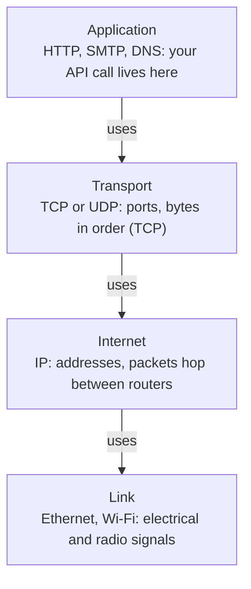
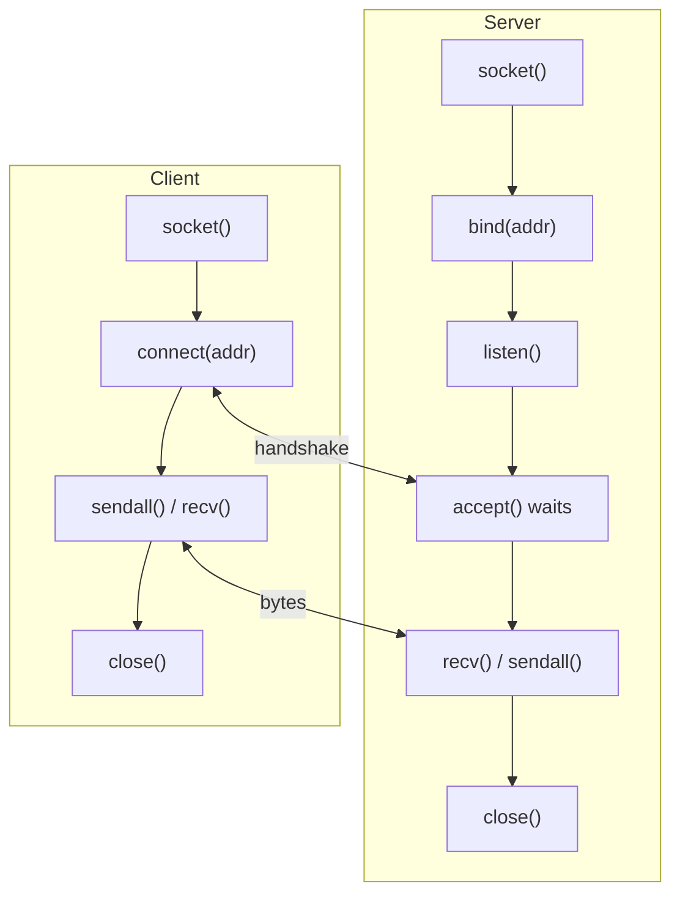
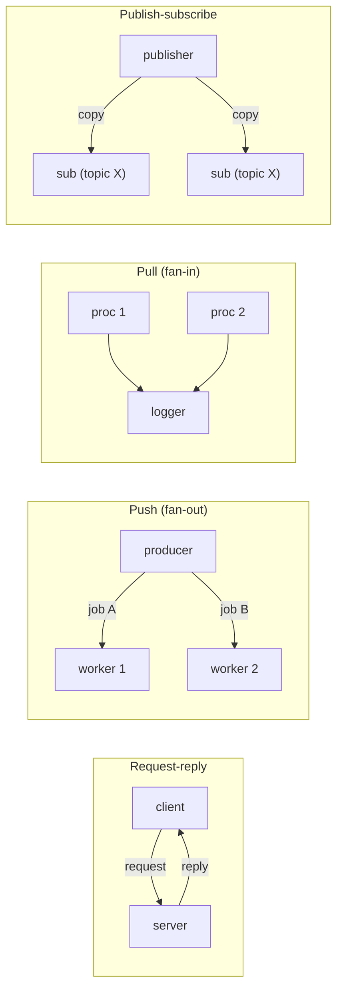
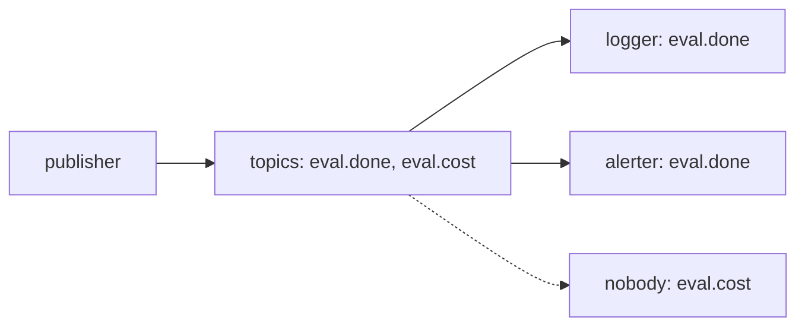
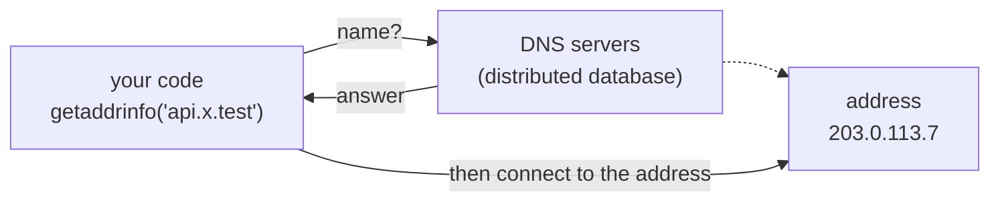
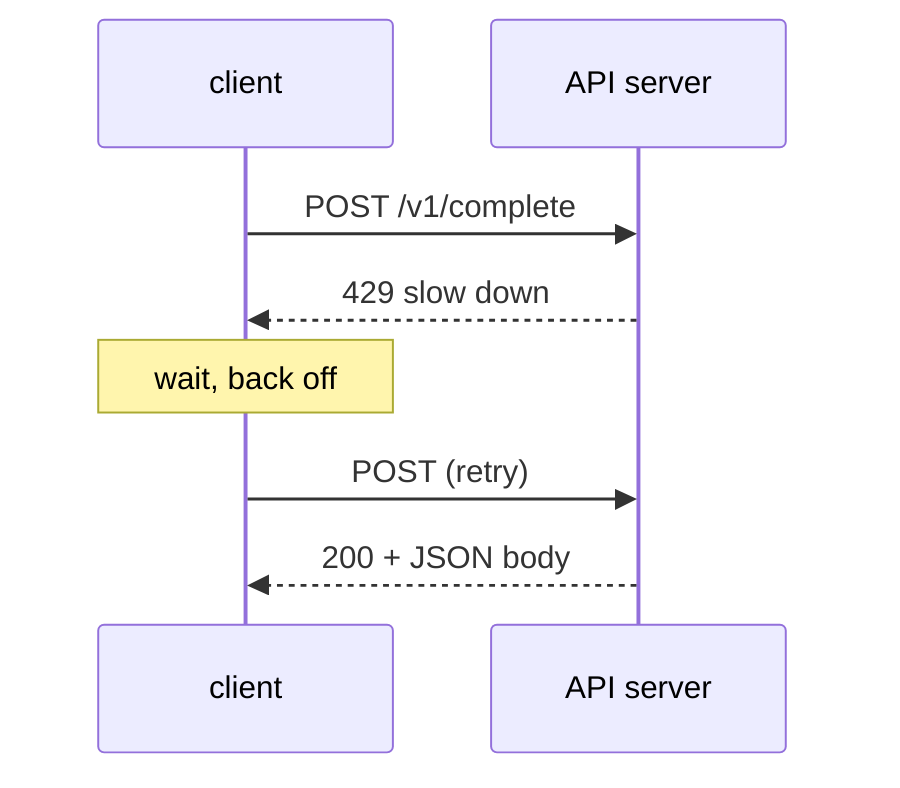
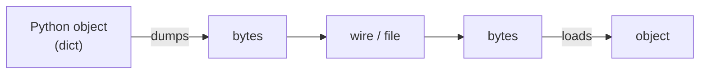
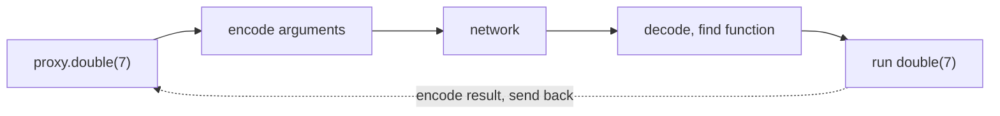
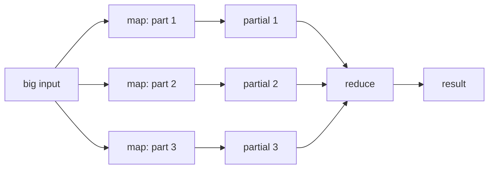

# Data in Space: Networks

[[21 - Data in Time - Concurrency|Chapter 21]] was about doing many things at once. This chapter is about doing things in
many places: programs on different machines that exchange bytes. You get the layers
under every web and LLM API call (TCP/IP, sockets), the common message patterns, and the
tools that sit on top (serialization, RPC, cloud basics).

## TCP/IP

Networks work because everyone follows layered rules called *protocols*. A layer
only needs to know the layer directly below it.



Two protocols matter at the transport layer.

|  | **UDP** | **TCP** |
|---|---|---|
| Unit of data | datagram (one small packet) | stream of bytes |
| Setup | none, just send | handshake first (connect) |
| Delivery | may be lost, duplicated, reordered | retried, in order, no duplicates |
| Speed | fast, light | slower |
| Typical use | voice, games, DNS lookups | web, databases, most APIs |

HTTP/3 runs on QUIC, which itself sits on UDP, so the choice is not always black and white.

Your own machine is always `127.0.0.1`, also called `localhost` or the
*loopback* interface. Two programs on one machine can talk over it without any
real network. Every example below uses it.

## Sockets

A *socket* is the lowest-level network tool: an endpoint you send bytes into and
read bytes from. It comes from C and Unix. Its address is a tuple
`(host, port)`: the host is like a building, the port like a door number.

### UDP: send one datagram

This example runs server and client in one script. The server runs in a thread (Chapter
21). Port `0` asks the OS to pick any free port, so the example never clashes with
another program.

```python
import socket
import threading

ready = threading.Event()
addr = {}

def server():
    s = socket.socket(socket.AF_INET, socket.SOCK_DGRAM)   # DGRAM = UDP
    s.bind(("127.0.0.1", 0))          # port 0: OS picks a free port
    addr["value"] = s.getsockname()
    ready.set()
    data, client = s.recvfrom(4096)   # waits for one datagram
    print("server got:", data)
    s.sendto(data.upper(), client)    # reply to whoever sent it
    s.close()

t = threading.Thread(target=server)
t.start()
ready.wait()

c = socket.socket(socket.AF_INET, socket.SOCK_DGRAM)
c.sendto("ping from eval worker".encode("utf-8"), addr["value"])
reply, who = c.recvfrom(4096)
print("client got:", reply)
print(type(reply), who == addr["value"])
c.close()
t.join()
```

```text
server got: b'ping from eval worker'
client got: b'PING FROM EVAL WORKER'
<class 'bytes'> True
```

> [!example] Type check
> Sockets move `bytes`, never `str`. `sendto("text", addr)` raises
> `TypeError`. Encode on the way out (`.encode("utf-8")`) and decode on the way
> in (`.decode("utf-8")`). `AF_INET` means an IP socket; `SOCK_DGRAM` means
> UDP.

The client never calls `bind`. The OS gives it a random port, and the server learns
that port from `recvfrom`, which returns `(bytes, (host, port))`.

### TCP: a connection

TCP adds a handshake, so the roles are more visible: the server *listens* and
*accepts*; the client *connects*.



TCP code looks easy until you meet one problem: where does one message end?

### TCP is a stream, not messages

> [!danger] Boss fight: no message boundaries
> TCP delivers a *stream of bytes*. If you call `sendall` three times, the other
> side may get all three pieces in one `recv`, or one piece split into two. The
> number of `send` calls and the number of `recv` calls are unrelated.

```text
byte stream:  H E L L O N E T W O R L D
sends      :  [ send 1 ][ s2 ][ send 3 ]      (5 + 3 + 5 bytes)
recvs      :  [ recv 1: 8 B  ][r2:3][r3]      (8 + 3 + 2 bytes)
```

To exchange whole messages you must add structure yourself: a fixed size, a delimiter
character, or a length prefix. The length prefix is the most robust. Write a 4-byte
number first, then the body.

```text
+-------------+-----------------+
| 00 00 00 05 | H E L L O       |
+-------------+-----------------+
  4-byte length   body: exactly 5 bytes
  (big-endian)
```

```python
import socket
import struct
import threading

ready = threading.Event()
box = {}

def recv_exact(sock, n):
    """Read exactly n bytes, however many recv() calls it takes."""
    chunks = []
    while n > 0:
        chunk = sock.recv(n)
        if not chunk:                      # b"" means the peer closed
            raise ConnectionError("peer closed early")
        chunks.append(chunk)
        n -= len(chunk)
    return b"".join(chunks)

def send_msg(sock, text):
    body = text.encode("utf-8")
    sock.sendall(struct.pack(">I", len(body)) + body)  # header + body

def recv_msg(sock):
    (size,) = struct.unpack(">I", recv_exact(sock, 4))
    return recv_exact(sock, size).decode("utf-8")

def server():
    with socket.socket(socket.AF_INET, socket.SOCK_STREAM) as srv:
        srv.bind(("127.0.0.1", 0))
        srv.listen()
        box["addr"] = srv.getsockname()
        ready.set()
        conn, peer = srv.accept()          # blocks until a client connects
        with conn:
            while True:
                try:
                    msg = recv_msg(conn)
                except ConnectionError:
                    break
                send_msg(conn, "echo: " + msg)

t = threading.Thread(target=server)
t.start()
ready.wait()

with socket.socket(socket.AF_INET, socket.SOCK_STREAM) as cli:
    cli.connect(box["addr"])
    for prompt in ["hello", "second request", "x" * 5000]:
        send_msg(cli, prompt)
        reply = recv_msg(cli)
        print(len(prompt), "->", reply[:22], len(reply))
t.join()
print(struct.pack(">I", 5))
```

```text
5 -> echo: hello 11
14 -> echo: second request 20
5000 -> echo: xxxxxxxxxxxxxxxx 5006
b'\x00\x00\x00\x05'
```

The 5000-byte message needs several `recv` calls underneath. Because
`recv_exact` loops, the caller never notices.

> [!warning] Trap: `recv(n)` may return fewer than n bytes
> `recv(1000)` means *at most* 1000. Assuming you got a whole message is the
> classic socket bug: it works on localhost with tiny messages and fails in production.
> An empty result `b""` is not “no data yet”; it means the other side closed.

> [!example] Type check
> Length is counted in *bytes*, not characters. `len("caf\u00e9")` is
> 4 but `len("caf\u00e9".encode("utf-8"))` is 5. Compute the header from the
> encoded bytes, as `send_msg` does. `struct.pack(">I", 5)` gives the `bytes`
> value `b'\x00\x00\x00\x05'`.

> [!warning] Trap: “Address already in use”
> A fixed port such as 6789 stays busy while an old server (or a recently closed
> connection) holds it. Use port 0 for tests, or kill the old process.

> [!tip] Rule: bind to localhost while learning
> Use `"127.0.0.1"` in `bind`. Binding to `"0.0.0.0"` or `"*"` exposes
> the port to every network the machine is on. Do that only on purpose.

### Scapy and Netcat

| **Tool** | **What it is for** |
|---|---|
| Scapy (`pip install scapy`) | build, send and inspect raw packets from Python. Like a programmable Wireshark. Do not confuse it with Scrapy (web scraping). |
| Netcat (`nc`) | command-line tool to open a connection to a host and port and type bytes by hand. Handy to check that a port answers. |

## Networking Patterns

Real systems are built from a few repeated shapes.



| **Pattern** | **Who gets a message** | **Example** |
|---|---|---|
| Request-reply | the one server asked; client waits | browser to web server, call to an LLM API |
| Push (fan-out) | exactly one worker from a pool | job queue, load balancer |
| Pull (fan-in) | one collector reads many sources | log collector |
| Pub-sub | *every* subscriber of the topic; none means dropped | event notifications |

Push and pub-sub look similar but differ in one question: does the message go to one
receiver or to all of them? Both shapes in plain Python, with no network:

```python
import queue
import threading

# push / pull: one queue, several workers; each job goes to ONE worker
jobs = queue.Queue()
done = queue.Queue()

def worker(name):
    while True:
        job = jobs.get()
        if job is None:
            break
        done.put((name, job, job * job))

pool = [threading.Thread(target=worker, args=(f"w{i}",)) for i in range(2)]
for t in pool:
    t.start()
for n in range(4):
    jobs.put(n)
for _ in pool:
    jobs.put(None)               # one stop signal per worker
for t in pool:
    t.join()
results = sorted(done.get()[1:] for _ in range(4))
print(results)

# pub-sub: every subscriber of a topic gets its OWN copy
class Broker:
    def __init__(self):
        self.subs = {}           # topic -> list of callbacks

    def subscribe(self, topic, callback):
        self.subs.setdefault(topic, []).append(callback)

    def send(self, topic, message):
        for callback in self.subs.get(topic, []):   # no subscriber: dropped
            callback(message)

bus = Broker()
bus.subscribe("eval.done", lambda m: print("logger  :", m))
bus.subscribe("eval.done", lambda m: print("alerter :", m))
bus.subscribe("eval.failed", lambda m: print("pager   :", m))
bus.send("eval.done", {"run": 7, "score": 0.91})
bus.send("eval.cost", {"usd": 1.2})        # nobody listens: vanishes
```

```text
[(0, 0), (1, 1), (2, 4), (3, 9)]
logger  : {'run': 7, 'score': 0.91}
alerter : {'run': 7, 'score': 0.91}
```

## The Request-Reply Pattern

Request-reply is the everyday pattern: you ask DNS, a web server or an LLM API, and you
get an answer or an error.

### ZeroMQ

ZeroMQ (package `pyzmq`) is a library, not a server. It wraps sockets and gives you
what plain sockets do not: whole messages (no framing code), automatic reconnects, and
queued messages when the peer is late. The “zero” means no broker is needed. You can
start client and server in either order.

| **Socket type** | **Pattern** | **Note** |
|---|---|---|
| `REQ` / `REP` | synchronous request / reply | strict send, receive, send, receive |
| `DEALER` / `ROUTER` | asynchronous request / reply | build brokers between many clients and servers |
| `PUSH` / `PULL` | fan-out / fan-in | “ventilator”: farm out tasks, gather results |
| `PUB` / `SUB` | publish / subscribe | subscribers filter by topic prefix |

Needs `pip install pyzmq`. I could not run these here (no package installed); the
files were syntax-checked only.

```python
# server.py   (needs: pip install pyzmq)
import zmq

ctx = zmq.Context()
server = ctx.socket(zmq.REP)
server.bind("tcp://127.0.0.1:5555")
while True:
    request = server.recv()                    # bytes, one whole message
    text = request.decode("utf-8")
    server.send(("tokens: %d" % len(text.split())).encode("utf-8"))
```

```python
# client.py
import zmq

ctx = zmq.Context()
client = ctx.socket(zmq.REQ)
client.connect("tcp://127.0.0.1:5555")         # connect, not bind
client.send("count my words please".encode("utf-8"))
print(client.recv().decode("utf-8"))           # tokens: 4
```

The server *binds* (it is the stable side); the client *connects*. Many REQ
clients can connect to one REP server; it handles them one at a time and ZeroMQ queues
the rest. Strings must be encoded: ZeroMQ messages are bytes. For structured data, send
JSON bytes.

ZeroMQ scales by changing only the address scheme:

| **Transport** | **Connects** |
|---|---|
| `tcp://host:port` | processes, same or different machines |
| `ipc://name` | processes on one machine |
| `inproc://name` | threads inside one process (no locks needed) |

### Other messaging tools

| **Tool** | **Notes** |
|---|---|
| RabbitMQ (Python client: Pika) | popular message broker with queues and routing |
| ActiveMQ (STOMP protocol) | Apache broker, several Python clients |
| NATS | fast, light messaging; request-reply, pub-sub, queues |

## The Publish-Subscribe Pattern

Pub-sub is a broadcast, not a queue. Publishers announce messages on a *topic*; each
subscriber says which topics it wants. A message can be processed once, many times or
never. A publisher does not know who listens.



### Redis

Redis ([[23 - Data in a Box - Persistent Storage|Chapter 23]] covers it as a data store) also has pub-sub. Start the subscriber
*first*: messages sent while nobody is subscribed are lost. Needs
`pip install redis` and a running Redis or Valkey server; syntax-checked only.

```python
# needs: pip install redis, and a Redis (or Valkey) server on localhost
import redis

r = redis.Redis(decode_responses=True)         # return str, not bytes

sub = r.pubsub()
sub.subscribe("eval.done")
for msg in sub.listen():
    if msg["type"] == "message":
        print(msg["channel"], msg["data"])
        break

# in another process:  r.publish("eval.done", "run 7")

# push / pull with a blocking pop: waits up to 2 s for a job
r.lpush("jobs", "prompt-1", "prompt-2")
item = r.brpop("jobs", timeout=2)              # (list_name, value) or None
print(item)
```

> [!example] Type check
> Without `decode_responses=True`, redis-py returns `bytes` (`b'run 7'`),
> so comparisons with `str` silently fail. `brpop` returns a tuple
> `(key, value)`, or `None` on timeout.

### ZeroMQ

ZeroMQ pub-sub has no central server: each publisher writes to its connected
subscribers. Messages are *multipart*: the first part is the topic.

```python
# needs: pip install pyzmq
import time
import zmq

ctx = zmq.Context()
pub = ctx.socket(zmq.PUB)
pub.bind("tcp://127.0.0.1:5556")
time.sleep(1)                                  # let subscribers connect
pub.send_multipart([b"eval.done", b'{"run": 7}'])

sub = ctx.socket(zmq.SUB)
sub.connect("tcp://127.0.0.1:5556")
sub.setsockopt(zmq.SUBSCRIBE, b"eval.")        # topic prefix, as bytes
topic, body = sub.recv_multipart()
print(topic.decode("utf-8"), body.decode("utf-8"))
```

> [!warning] Trap: a SUB socket receives nothing by default
> You must subscribe. To get everything, subscribe to the empty bytes `b""`. Also,
> a PUB that sends right after `bind` may lose the first messages because subscribers
> have not connected yet (the `sleep` above).

Other options: RabbitMQ with Pika, NATS, PyPubSub (in-process), PubSubHubbub (webhook style).

## Internet Services

### Domain Name System (DNS)

DNS turns names into IP addresses. When a request hangs on “looking up host”, DNS is
the first suspect.



The `socket` module has the functions. Names below resolve locally, so the output is
stable; the `getaddrinfo` tuple shape is the same for real hosts.

```python
import socket

print(socket.gethostbyname("localhost"))             # name -> IPv4 str
print(socket.getservbyname("http"), socket.getservbyport(443))
for info in socket.getaddrinfo("localhost", 80, socket.AF_INET,
                               socket.SOCK_STREAM):
    print(info)
```

```text
127.0.0.1
80 https
(<AddressFamily.AF_INET: 2>, <SocketKind.SOCK_STREAM: 1>, 0, '', ('127.0.0.1', 80))
```

| **Function** | **Returns** |
|---|---|
| `gethostbyname(name)` | one IPv4 address as `str` |
| `gethostbyname_ex(name)` | `(canonical name, [aliases], [addresses])` |
| `getaddrinfo(host, port, ...)` | list of tuples with everything needed to build a socket; filter with family and socket type |
| `getservbyname("http")` / `getservbyport(80)` | service name to port number and back (IANA list) |

### Python email modules

| **Module** | **Protocol** | **Use** |
|---|---|---|
| `email` | – | build and parse message objects |
| `smtplib` | SMTP | send mail |
| `poplib` | POP3 | download mail |
| `imaplib` | IMAP | read mail kept on the server |

Building a message needs no server, so it can be run here:

```python
from email.message import EmailMessage

msg = EmailMessage()
msg["From"] = "bot@example.com"
msg["To"] = "me@example.com"
msg["Subject"] = "Nightly eval finished"
msg.set_content("Score: 0.91")
print(msg.as_string())
```

```text
From: bot@example.com
To: me@example.com
Subject: Nightly eval finished
Content-Type: text/plain; charset="utf-8"
Content-Transfer-Encoding: 7bit
MIME-Version: 1.0

Score: 0.91
```

Sending uses `smtplib.SMTP(host, 587)`, then `starttls()`, `login(...)`,
`send_message(msg)`. I did not run that: it needs a real mail server (syntax-checked
only). Never hard-code the password; read it from an environment variable.

### Other protocols

`ftplib` (FTP) moves files; the standard library has modules for most other
internet protocols too. The point: before installing a package, check whether the
standard library already speaks the protocol.

## Web Services and APIs

Websites are made for human eyes. An *API* serves the same data to programs in a
structured format, usually JSON. A scraper breaks whenever the page layout changes; an
API changes much less often. Most APIs need a registered *key* (a long token) that
identifies you and lets the provider limit your traffic.

An LLM API call is exactly this: an HTTPS request with a key in a header, a JSON body,
and a JSON reply. The part beginners miss is the *status code*.



| **Code** | **Meaning** | **What your code should do** |
|---|---|---|
| 200 | OK | parse the JSON body |
| 400 | bad request | your payload is wrong; fix it, do not retry |
| 401 / 403 | bad key / not allowed | stop; check the key |
| 404 | not found | check the URL or model name |
| 429 | too many requests | wait (see a `retry-after` header), then retry |
| 500 / 503 | server error / overloaded | retry with exponential backoff |

To keep this runnable offline, here is a tiny fake API on localhost using only the
standard library, and a client that returns the status code and parsed body:

```python
import json
import threading
import urllib.error
import urllib.request
from http.server import BaseHTTPRequestHandler, HTTPServer

class FakeLLM(BaseHTTPRequestHandler):
    def do_POST(self):
        size = int(self.headers.get("Content-Length", 0))
        body = json.loads(self.rfile.read(size))
        if self.headers.get("x-api-key") != "test-key":
            code, out = 401, {"error": "bad key"}
        elif len(body["prompt"]) > 20:
            code, out = 429, {"error": "slow down"}
        else:
            code, out = 200, {"text": body["prompt"][::-1]}
        data = json.dumps(out).encode("utf-8")
        self.send_response(code)
        self.send_header("Content-Type", "application/json")
        self.send_header("Content-Length", str(len(data)))
        self.end_headers()
        self.wfile.write(data)

    def log_message(self, *args):          # silence request logging
        pass

srv = HTTPServer(("127.0.0.1", 0), FakeLLM)
threading.Thread(target=srv.serve_forever, daemon=True).start()
url = f"http://127.0.0.1:{srv.server_address[1]}/v1/complete"

def call(prompt, key="test-key"):
    req = urllib.request.Request(
        url,
        data=json.dumps({"prompt": prompt}).encode("utf-8"),
        headers={"Content-Type": "application/json", "x-api-key": key},
        method="POST",
    )
    try:
        with urllib.request.urlopen(req) as resp:
            return resp.status, json.loads(resp.read())
    except urllib.error.HTTPError as err:   # 4xx and 5xx raise
        return err.code, json.loads(err.read())

print(call("hello"))
print(call("hello", key="wrong"))
print(call("a very long prompt that is over the limit"))
srv.shutdown()
```

```text
(200, {'text': 'olleh'})
(401, {'error': 'bad key'})
(429, {'error': 'slow down'})
```

> [!example] Type check
> The request body is `bytes` (`json.dumps(...).encode("utf-8")`). The reply
> body is also `bytes`; `json.loads` accepts bytes and returns a `dict`. With
> the popular `requests` package the same idea is shorter (`pip install requests`;
> syntax-checked only): `resp.status_code` is an `int`, `resp.json()` is a
> `dict`, and `resp.raise_for_status()` turns 4xx/5xx into an exception.

```python
# needs: pip install requests
import os
import requests

resp = requests.post(
    "https://api.example.test/v1/complete",
    headers={"x-api-key": os.environ["MY_API_KEY"]},
    json={"prompt": "hello"},
    timeout=30,
)
if resp.status_code == 429:
    print("rate limited; retry after", resp.headers.get("retry-after"))
else:
    resp.raise_for_status()                    # 4xx/5xx -> HTTPError
    data = resp.json()                         # dict
```

> [!tip] Rule: always set a timeout, keep keys out of code
> A network call without a timeout can hang forever. Put API keys in environment variables,
> never in source files or git.

## Data Serialization

Memory holds objects; a network or a file holds bytes. Converting one to the other is
*serialization* (also *marshaling*); the reverse is *deserialization*.



### JSON vs pickle

```python
import datetime
import json
import pickle

record = {"model": "m1", "tokens": 120, "ok": True, "tags": ["a", "b"]}
wire = json.dumps(record).encode("utf-8")
print(type(wire), wire)
print(json.loads(wire.decode("utf-8")) == record)

stamp = datetime.datetime(2026, 1, 5, 9, 30)
try:
    json.dumps({"at": stamp})
except TypeError as err:
    print("TypeError:", err)
print(json.dumps({"at": stamp}, default=str))

blob = pickle.dumps(stamp)
print(type(blob), pickle.loads(blob) == stamp)

class Tiny:
    def __init__(self, n):
        self.n = n

copy = pickle.loads(pickle.dumps(Tiny(3)))
print(type(copy).__name__, copy.n)

print(json.loads(json.dumps((1, 2))))
try:
    json.dumps({1, 2})
except TypeError as err:
    print("TypeError:", err)
print(json.dumps({1: "a"}), json.loads(json.dumps({1: "a"})))
```

```text
<class 'bytes'> b'{"model": "m1", "tokens": 120, "ok": true, "tags": ["a", "b"]}'
True
TypeError: Object of type datetime is not JSON serializable
{"at": "2026-01-05 09:30:00"}
<class 'bytes'> True
Tiny 3
[1, 2]
TypeError: Object of type set is not JSON serializable
{"1": "a"} {'1': 'a'}
```

> [!example] Type check
> JSON only knows: `dict` (string keys), `list`, `str`, `int`/`float`,
> `True`/`False`, `None`. Everything else fails or changes shape:
> a `tuple` comes back as a `list`, a `set` or `datetime` raises
> `TypeError`, an `int` dict key comes back as `str`. Fix unknown types with
> `default=str` or by converting yourself. `pickle.dumps` returns `bytes`,
> `json.dumps` returns `str`.

> [!warning] Trap: never unpickle data you do not trust
> `pickle.loads` can run arbitrary code. Data from a network, an upload or a shared
> cache must never go through pickle. Use JSON (or another data-only format) at trust
> boundaries. Pickle is fine for your own temporary files; `multiprocessing` uses it
> internally.

### Other formats

| **Format** | **Text or binary** | **Notes** |
|---|---|---|
| JSON | text | human-readable, universal on the web, few types |
| pickle | binary | any Python object; Python-only; unsafe for untrusted data |
| MessagePack, msgspec | binary | JSON-like data, smaller and faster |
| Protocol Buffers, Avro, Thrift | binary | schema-defined, used with RPC |

Packages such as **Pydantic** and marshmallow go the other way: they turn raw data
into typed objects and *validate* it (types, ranges, required fields). Web servers
use them so bytes from the wire land in the right structures. Pydantic is the one you
will meet most in AI work (structured LLM output).

## Remote Procedure Calls

An RPC makes a function on another machine look like a local call. Your side serializes
the arguments, sends bytes, and the remote side decodes, runs the function, and sends the
encoded result back.



### XML-RPC

The standard library has one RPC: XML-RPC over HTTP. This runs fully on localhost:

```python
import threading
import xmlrpc.client
from xmlrpc.server import SimpleXMLRPCServer

def cost_usd(tokens_in, tokens_out):
    return tokens_in * 1e-7 + tokens_out * 5e-7

server = SimpleXMLRPCServer(("127.0.0.1", 0), logRequests=False)
port = server.server_address[1]
server.register_function(cost_usd, "cost_usd")
t = threading.Thread(target=server.serve_forever, daemon=True)
t.start()

proxy = xmlrpc.client.ServerProxy(f"http://127.0.0.1:{port}/")
result = proxy.cost_usd(2000, 500)       # looks like a local call
print(result, type(result))
try:
    proxy.nope()                         # no such function on the server
except xmlrpc.client.Fault as err:
    print("Fault:", err.faultCode)
server.shutdown()
```

```text
0.00045 <class 'float'>
Fault: 1
```

`proxy.cost_usd` does not exist in the client; the proxy turns any attribute
access into a remote call. Remote errors arrive as `xmlrpc.client.Fault`.

### Other RPC systems

| **System** | **Package** | **Notes** |
|---|---|---|
| XML-RPC | stdlib `xmlrpc` | XML over HTTP, simple, verbose |
| JSON-RPC | `jsonrpcserver`, `jsonrpcclient` | same idea in JSON |
| MessagePack RPC | `msgpack-rpc-python` | binary, uses Tornado |
| zerorpc | `zerorpc` | ZeroMQ + MessagePack; methods of a class become endpoints |
| gRPC | `grpcio`, `grpcio-tools` | Google; Protocol Buffers; streaming; fast |

gRPC works from a schema. You describe the service in a `.proto` file, and a tool
generates Python client and server stubs:

```text
service Pricing {
  rpc Cost (CostRequest) returns (CostReply);
}
message CostRequest { int32 tokens_in = 1; int32 tokens_out = 2; }
message CostReply   { double usd = 1; }
```

A rule of thumb: REST/JSON for public APIs, gRPC for fast service-to-service calls
inside your own system.

## Remote Management

Tools that run commands on many machines at once.

| **Tool** | **Notes** |
|---|---|
| Salt | written in Python; ZeroMQ based; scales to thousands of machines |
| Ansible | written in Python; agentless, uses SSH |
| Puppet, Chef | popular, tied to Ruby |

## Big Fat Data

One machine, even a big one, hits limits in disk, memory and CPU. Spreading data across
many machines can be faster than a single fast one. The core idea is *MapReduce*:
split the data, process each piece independently (map), then combine the partial results
(reduce).



| **Tool** | **Notes** |
|---|---|
| Hadoop | Java; copies data between machines and writes to disk at each step, so batch jobs are slow. Hadoop streaming lets any language, including Python, plug in |
| Spark | much faster (in memory); Python API (PySpark); the usual choice today |
| Disco | Python + Erlang MapReduce; little maintained |
| Dask | written in Python; works with NumPy, pandas, scikit-learn; scales from a laptop to clusters |

“Big data” often just means “too big for my machine”. Try a bigger machine or a
smarter format first; use a cluster only when you must.

## Clouds

Servers fail, and with thousands of them, failure is routine. Peter Deutsch's “fallacies
of distributed computing” list the false assumptions that cause bugs.

| \multicolumn{2}{@{}l}{**Things that are NOT true on a network**} |  |
|---|---|
| The network is reliable. | Latency is zero. |
| Bandwidth is infinite. | The network is secure. |
| Topology does not change. | There is one administrator. |
| Transport cost is zero. | The network is homogeneous. |

This is why calls to remote APIs need timeouts, retries and error handling (the status
code table above).

At scale, servers are treated as interchangeable (“livestock”): replace broken ones
rather than nursing them. Renting machines in the cloud turns that into an API call.

| **Service** | **Python tool** | **Notes** |
|---|---|---|
| Amazon Web Services | `boto3` | the market leader; replaces the web console with code |
| Google Cloud | Google client libraries | Google uses Python heavily |
| Microsoft Azure | Azure SDK for Python | third big vendor |
| OpenStack | its REST APIs | open source cloud framework |

### Docker and Kubernetes

A *container* packages your app with its libraries, sharing the host's operating
system kernel. It is lighter than a virtual machine and heavier than a virtualenv.
*Kubernetes* runs many containers for you: restarts failures, balances load, scales
up and down.

```text
Virtual machines                    Containers
+----------+ +----------+           +----------+ +----------+
| your app | | your app |           | your app | | your app |
| libraries| | libraries|           | libraries| | libraries|
| guest OS | | guest OS |           +----------+-+----------+
+----------+-+----------+           | container runtime     |
| hypervisor             |           +-----------------------+
+------------------------+           | host OS (shared kernel)|
| host OS and hardware   |           +-----------------------+
+------------------------+
```

Python clients: `docker` and `kubernetes` (`pip install docker kubernetes`).
Docker is how most AI services get shipped.

## Practice

> [!question-] Practice
>
> 1. Build a TCP time service on localhost: when a client sends `time`, the server
>   replies with the current time as an ISO string. Use the length-prefix helpers and port 0.
> 1. Extend the fake API above: make it return 503 for the first two calls, then 200.
>   Write a client that retries with doubling waits and gives up after four tries.
> 1. Add prefix matching to the in-process `Broker`, so a subscriber to
>   `"eval."` also receives `"eval.done"`.
> 1. Write an XML-RPC server with one function that returns a dict. Call it from a client.
>   What happens if the function returns `None`?
> 1. Explain in two sentences why `pickle.loads` on bytes from a socket is dangerous,
>   and which format you would use instead.
> 1. (Needs Redis or Valkey.) Push ten job strings to a list, then write a worker that
>   loops on `brpop`, sleeps 0.5 s per job, and prints how many jobs remain.
>

> [!success] Achievement unlocked: Networking Basics
> You can now:
>
> - explain the difference between UDP and TCP and write a localhost echo with sockets;
> - frame messages on a TCP stream and keep `bytes` and `str` apart;
> - pick request-reply, push or pub-sub for a given problem;
> - read HTTP status codes from an API and decide whether to retry;
> - choose between JSON and pickle, and explain the pickle danger.
>

---
Related: [[21 - Data in Time - Concurrency]] · [[23 - Data in a Box - Persistent Storage]] · [[24 - The Web]] · [[05 - Bytes and Bytearray]] · [[18 - Binary Data]]
