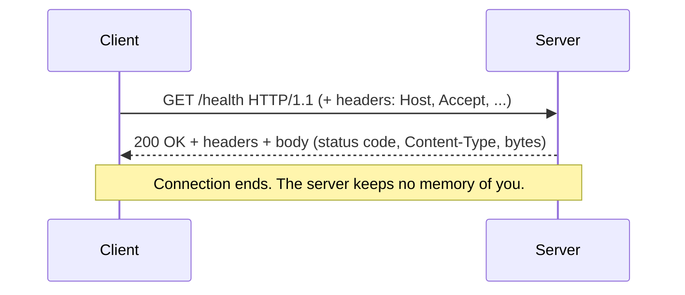
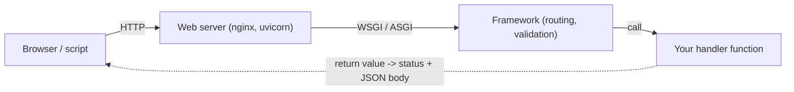
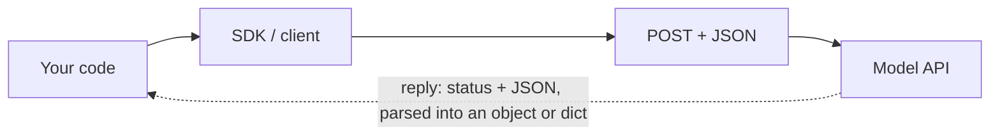
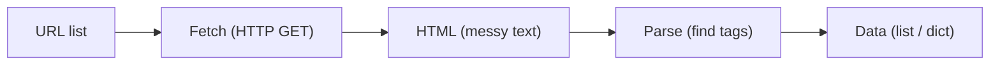
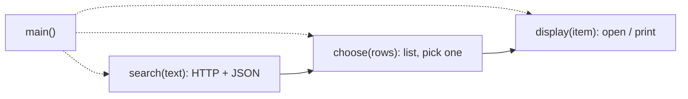

# The Web

**What this chapter gives you.** Almost every AI product you will build talks over HTTP:
your code calls a model API, and other code calls your service. This chapter shows how HTTP
works, how to write clients and small servers in Python, and how to pull data out of web pages.

## Web Basics

The web is a **client–server** system. A client opens a TCP connection, sends a request in
text form (HTTP), and the server sends back a response. TCP/IP only moves bytes; HTTP gives those
bytes meaning. The three original ideas were HTTP (the protocol), HTML (a page format) and the URL
(an address for a resource).



> [!info] Key idea: HTTP is stateless
> Every request stands alone. The server does not remember the last one. Caching, shopping carts and
> logins all need extra tricks, such as **cookies**: a small value the server sends once and
> the client sends back with each later request.

### URL anatomy

```text
https://   api.example.com   :8443   /v1/answer   ?q=hi&n=2
scheme     host              port    path         query
```

```python
from urllib.parse import urlparse, parse_qs

u = urlparse("https://api.example.com:8443/v1/answer?q=hi&n=2#top")
print(u.scheme, u.hostname, u.port, u.path)
print(u.query, parse_qs(u.query))
```

```text
https api.example.com 8443 /v1/answer
q=hi&n=2 {'q': ['hi'], 'n': ['2']}
```

Note that `parse_qs` gives *lists* of strings, because a key may repeat.

### Status codes

| **Range** | **Meaning** | **Examples you will meet** |
|---|---|---|
| 1xx | information | rarely seen by your code |
| 2xx | success | 200 OK, 201 Created |
| 3xx | redirect | 301/302: the resource lives at another URL |
| 4xx | **your** mistake | 400 bad input, 401/403 auth, 404 not found, 429 too many requests |
| 5xx | **their** mistake | 500 crash, 502/503 upstream down or overloaded |

> [!tip] Rule
> Treat 429 and 5xx as “try again later” (with a delay) and 4xx as “fix the request”. Retrying a
> 400 forever never helps. Model APIs behave this way too.

### Cookies in one example

```python
from http.cookies import SimpleCookie

jar = SimpleCookie()
jar["session"] = "abc123"
jar["session"]["path"] = "/"
print(jar.output())
parsed = SimpleCookie("session=abc123; theme=dark")
print({k: m.value for k, m in parsed.items()})
```

```text
Set-Cookie: session=abc123; Path=/
{'session': 'abc123', 'theme': 'dark'}
```

## HTTP Testing

HTTP is plain text, so you can poke a server by hand before writing any Python.

| **Tool** | **What it is** | **Use it for** |
|---|---|---|
| Telnet | old raw TCP terminal; you type the HTTP yourself | seeing the protocol; mostly replaced (and not installed by default on Windows) |
| curl | the standard command-line web client | quick GET/POST, headers, scripts |
| HTTPie (`http`) | friendlier curl with JSON by default; `pip install httpie` | readable manual testing |
| httpbin | a test site that echoes requests back; can run in Docker | safe target for experiments |

Here is what Telnet would show you, done with a plain socket against a tiny local service
(listed in the next section). The text you send is the whole request:

```python
import socket

request = (
    "GET /health HTTP/1.1\r\n"
    "Host: localhost\r\n"
    "Connection: close\r\n"
    "\r\n"                      # blank line = end of headers
)
with socket.create_connection(("127.0.0.1", 8765)) as s:
    s.sendall(request.encode("ascii"))
    chunks = []
    while data := s.recv(4096):
        chunks.append(data)
print(b"".join(chunks).decode("ascii"))
```

```text
HTTP/1.0 200 OK
Server: BaseHTTP/0.6 Python/3.12.10
Date: Mon, 02 Nov 2026 17:46:15 GMT
Content-Type: application/json
Content-Length: 16

{"status": "ok"}
```

The first line is the status line. Then come headers, one blank line, then the body. The
`Date` line changes on each run.

```text
HTTP/1.0 200 OK                      <- status line
Content-Type: application/json       <- headers
Content-Length: 16                   <- headers
                                     <- blank line (separator)
{"status": "ok"}                     <- body (bytes)
```

The same thing with curl, run against that local service (real output):

```text
$ curl -s -X POST -H "Content-Type: application/json" \
       -d '{"name":"run-7"}' http://127.0.0.1:8765/runs
{"stored": "run-7"}
$ curl -s -o /dev/null -w "%{http_code}\n" http://127.0.0.1:8765/missing
404
```

> [!warning] Trap
> JSON needs **double quotes**. A body like `{'a': 1}` is a Python dict literal, not JSON,
> and a server will reject it. Also, quoting rules differ in PowerShell and cmd; on Windows the
> simplest fix is to test from Python.

HTTPie sends JSON by default (`http POST url a=1 b=2`) and form data with `-f`. Not run
here (needs `pip install httpie`).

## Web Clients

### The standard library

The `http` package covers protocol details (`client`, `server`, `cookies`).
`urllib` sits on top (`request`, `response`, `parse`, `error`). First,
the stub service the next examples call. It plays the role of a tiny model API: it has a health
check, an `/answer` endpoint, and a POST route.

```python
# web_server.py - a stub service on localhost (stdlib only)
import json
import threading
from http.server import BaseHTTPRequestHandler, ThreadingHTTPServer
from urllib.parse import urlparse, parse_qs

class Handler(BaseHTTPRequestHandler):
    def _send(self, status, payload):
        body = json.dumps(payload).encode("utf-8")
        self.send_response(status)
        self.send_header("Content-Type", "application/json")
        self.send_header("Content-Length", str(len(body)))
        self.end_headers()
        self.wfile.write(body)

    def do_GET(self):
        url = urlparse(self.path)
        if url.path == "/health":
            self._send(200, {"status": "ok"})
        elif url.path == "/answer":
            q = parse_qs(url.query).get("q", [""])[0]
            self._send(200, {"question": q, "answer": q.upper(),
                             "tokens": len(q.split())})
        else:
            self._send(404, {"error": "no such route"})

    def do_POST(self):
        size = int(self.headers.get("Content-Length", 0))
        data = json.loads(self.rfile.read(size))
        self._send(201, {"stored": data["name"]})

    def log_message(self, *args):    # silence the access log
        pass

server = ThreadingHTTPServer(("127.0.0.1", 8765), Handler)
threading.Thread(target=server.serve_forever, daemon=True).start()
BASE = "http://127.0.0.1:8765"
```

Now a GET, looking at every type along the way:

```python
import json
import urllib.request
from web_server import BASE

with urllib.request.urlopen(f"{BASE}/health") as resp:
    print(type(resp).__name__, resp.status)
    print(resp.headers["Content-Type"])
    raw = resp.read()

print(type(raw), raw)
text = raw.decode("utf-8")
print(type(text), text)
data = json.loads(text)
print(type(data), data["status"])
```

```text
HTTPResponse 200
application/json
<class 'bytes'> b'{"status": "ok"}'
<class 'str'> {"status": "ok"}
<class 'dict'> ok
```

> [!example] Type check
> The body travels as **bytes**. Turning it into something usable takes three steps, and each
> has its own type:
>
>
> ```mermaid
> flowchart LR
>     R["HTTPResponse (connection object)"] -->|".read()"| B["bytes"]
>     B -->|".decode()"| T["str"]
>     T -->|"json.loads()"| D["dict / list"]
> ```
> `json.load(resp)` (no `s`) reads and parses a file-like object in one go. Calling
> `resp.read()` twice returns empty bytes the second time: the stream is used up.

Query strings, POST bodies, errors and timeouts:

```python
import json
import urllib.request
import urllib.error
from urllib.parse import urlencode
from web_server import BASE

query = urlencode({"q": "what is a token?"})
print(query)
with urllib.request.urlopen(f"{BASE}/answer?{query}", timeout=5) as resp:
    reply = json.load(resp)
print(reply)

body = json.dumps({"name": "run-42"}).encode("utf-8")
req = urllib.request.Request(
    f"{BASE}/runs",
    data=body,
    headers={"Content-Type": "application/json"},
    method="POST",
)
with urllib.request.urlopen(req, timeout=5) as resp:
    print(resp.status, json.load(resp))

try:
    urllib.request.urlopen(f"{BASE}/nope", timeout=5)
except urllib.error.HTTPError as err:
    print(err.code, err.reason, json.load(err))
```

```text
q=what+is+a+token%3F
{'question': 'what is a token?', 'answer': 'WHAT IS A TOKEN?', 'tokens': 4}
201 {'stored': 'run-42'}
404 Not Found {'error': 'no such route'}
```

> [!warning] Trap
> `urllib` *raises* `HTTPError` on 4xx/5xx, and the error object is itself a readable
> response (you can parse its JSON body). Never build query strings by hand with f-strings: use
> `urlencode`, which escapes spaces and `?`. And always pass `timeout`; without one, a
> stalled server can hang your program forever.

### Requests

`requests` is the popular third-party client. It needs `pip install requests`; the
snippets below were syntax-checked only (not run, since no network calls are allowed here).

```python
import requests

resp = requests.get(
    "http://127.0.0.1:8765/answer",
    params={"q": "what is a token?"},    # encoded for you
    timeout=5,
)
resp.raise_for_status()      # raises on 4xx/5xx; requests does NOT by default
data = resp.json()           # parsed JSON: a dict here
```

> [!example] Type check
>
> | **Expression** | **Type** | **Note** |
> |---|---|---|
> | `resp` | `Response` | prints as `<Response [200]>`; truthy if status $<$ 400 |
> | `resp.status_code` | `int` | 200, 404, … |
> | `resp.content` | `bytes` | raw body |
> | `resp.text` | `str` | body decoded with the guessed encoding |
> | `resp.json()` | `dict` or `list` | raises if body is not JSON |
>

A `Session` reuses the TCP connection between calls, which is why it is faster when you call
the same host many times (the book measured about 3.5x faster than separate calls).

```python
import requests

with requests.Session() as s:
    s.headers.update({"Authorization": "Bearer <your-key>"})
    for q in ["a", "b", "c"]:
        r = s.get("http://127.0.0.1:8765/answer", params={"q": q}, timeout=5)
```

### Other clients: httpx and aiohttp

| **Library** | **Sync / async** | **Pick it when** |
|---|---|---|
| `urllib` | sync, stdlib | no installs allowed; tiny scripts |
| `requests` | sync only | simple blocking calls |
| `httpx` | both, `requests`-like API | you want sync now and async later; the Anthropic SDK is built on it |
| `aiohttp` | async only (also a server) | purely async programs |

Async pays off when you wait on many remote hosts: most of the time is waiting for I/O, not
computing. Here is the shape of an async fan-out (syntax-checked; needs `pip install httpx`):

```python
import asyncio
import httpx

async def ask_all(questions):
    async with httpx.AsyncClient(timeout=10) as client:
        tasks = [
            client.get("http://127.0.0.1:8765/answer", params={"q": q})
            for q in questions
        ]
        responses = await asyncio.gather(*tasks)
    return [r.json() for r in responses]

answers = asyncio.run(ask_all(["one", "two", "three"]))
```

```text
sequential: [wait 1][wait 2][wait 3][wait 4]        total = sum of waits
concurrent: [wait 1]
            [wait 2]                                total = the slowest wait
            [wait 3]
            [wait 4]
            ---------------------------------------> time
```

> [!note] Lab result
> Ten stand-in “API calls” that each wait 0.1 s (a `sleep`), run three ways on this machine:
> sequential 1.0 s, thread pool 0.1 s, `asyncio.gather` 0.1 s. Waiting overlaps; computing
> does not (see [[21 - Data in Time - Concurrency|Chapter 21]]).

## Web Servers

### The simplest Python web server

```text
$ python -m http.server 9999
Serving HTTP on 0.0.0.0 port 9999 ...
```

It serves files from the current folder and logs each hit as
`127.0.0.1 - - [date] "GET / HTTP/1.1" 200 -` (client IP, two unused fields, time, request line,
status). Stop with Ctrl+C. `0.0.0.0` means “listen on every network interface”; for tests
prefer `--bind 127.0.0.1` so only your machine can reach it. Use it for quick demos only:
it is slow and cannot run dynamic code.

### From CGI to WSGI to ASGI

| **Era** | **How server and Python code connect** | **Problem / benefit** |
|---|---|---|
| CGI | start a new program per request | slow: startup cost every time |
| Embedded (`mod_php`, `mod_python`) | interpreter lives inside the web server | fast, but tied to that server |
| WSGI | standard sync interface between server and Python app | portable; one request at a time per worker |
| ASGI | the async counterpart of WSGI | many waiting requests per worker (`async`/`await`) |



### Apache, nginx and other servers

- **Apache** runs WSGI apps through `mod_wsgi` (embedded or daemon mode). Most of the
  work is editing Apache's config.
- **nginx** has no embedded Python. It sits in front and forwards requests to a separate
  WSGI server such as uWSGI or Gunicorn.
- **Other Python servers** fall in two groups: multi-process/multi-thread (CherryPy,
  Waitress) and event-based (Tornado, gevent, Gunicorn workers). For ASGI apps, `uvicorn` is
  the usual choice.

## Web Server Frameworks

A web server speaks HTTP; a **framework** is what you write against. The main jobs:

| **Job** | **Meaning** |
|---|---|
| Routing | map a URL and verb to a Python function |
| Parameters | read path, query and body values; validate type/range |
| Auth | authentication (who are you?) and authorization (what may you do?) |
| Sessions | keep state across requests |
| Responses | return data plus the right status code |
| Static files, templates | serve files; fill HTML with values |

### Bottle

One file, no dependencies (`pip install bottle`). The decorator binds a URL to a function;
`<thing>` captures part of the path.

```python
from bottle import route, run

@route("/")
def home():
    return "model service is up"

@route("/greet/<name>")
def greet(name):
    return f"Hello, {name}!"

run(host="localhost", port=9999)
```

### Flask

Flask is Bottle's bigger cousin: more extensions, Jinja2 templates. Needs `pip install flask`.
Path values and query values arrive differently:

```python
from flask import Flask, request, render_template_string

app = Flask(__name__)

@app.route("/greet/<name>")            # path parameter
def greet(name):
    return f"Hello, {name}!"

@app.route("/search")                  # /search?q=cats&top=3
def search():
    q = request.args.get("q", "")      # query parameters: strings!
    top = int(request.args.get("top", 5))
    page = "<p>{{ q }} (top {{ top }})</p>"      # Jinja2 template
    return render_template_string(page, q=q, top=top)

if __name__ == "__main__":
    app.run(port=9999, debug=True)
```

> [!warning] Trap
> `debug=True` shows an interactive debugger page. Never use it on a server reachable from the
> internet. And query values are always *strings*; convert them yourself (`int(...)`), or
> use a framework that validates (below).

### Django, FastAPI, Litestar

| **Framework** | **Style** | **Best for** |
|---|---|---|
| Bottle | one file, minimal | learning, tiny tools |
| Flask | small core + extensions, sync (WSGI) | simple sites and APIs |
| Django | “batteries included”: ORM, admin pages, auth | large database-backed sites; common in job ads |
| FastAPI | ASGI, type hints, auto docs, Pydantic validation | JSON APIs, **model-serving services** |
| Litestar | similar to FastAPI, more built-ins | alternative to FastAPI |

FastAPI is the one an AI engineer will use most. You describe the request and response with
Pydantic models; FastAPI validates input and builds interactive docs at `/docs`. Needs
`pip install fastapi uvicorn`; syntax-checked, not run. The model call is a stub.

```python
from fastapi import FastAPI
from pydantic import BaseModel

app = FastAPI()

class AskIn(BaseModel):
    question: str
    max_tokens: int = 256

class AskOut(BaseModel):
    answer: str

def ask_model(question: str, max_tokens: int) -> str:
    return f"stub answer to: {question}"     # swap in a real SDK call

@app.post("/ask", response_model=AskOut)
def ask(body: AskIn) -> AskOut:
    return AskOut(answer=ask_model(body.question, body.max_tokens))

# run:  uvicorn app:app --reload      then open http://127.0.0.1:8000/docs
```

What the validation does, shown with Pydantic alone (this part really ran):

```python
from pydantic import BaseModel, ValidationError

class AskIn(BaseModel):
    question: str
    max_tokens: int = 256

print(AskIn(question="hi"))
print(AskIn(question="hi", max_tokens="300"))     # str "300" -> int 300
try:
    AskIn(question="hi", max_tokens="lots")
except ValidationError as e:
    print(e.error_count(), e.errors()[0]["type"], e.errors()[0]["loc"])
```

```text
question='hi' max_tokens=256
question='hi' max_tokens=300
1 int_parsing ('max_tokens',)
```

In FastAPI, bad input like that returns a **422** response automatically; your function never
runs. Compare Flask, where you would write those checks by hand.

> [!warning] Trap
> Inside `async def` handlers, a blocking call (`requests.get`, `time.sleep`, a
> synchronous SDK call) freezes the whole event loop and every other request. Either use plain
> `def` (FastAPI runs it in a thread) or use the async client.

> [!danger] Boss fight: statelessness is why chat needs a history list
> HTTP forgets you between requests. A web service that answers questions is the same: if the second
> request does not carry the first question, the server has no idea what “it” refers to. The fix is
> always the same: either the **client sends the context each time** (as model APIs do with the
> message history), or the server **stores state** and finds it again using an ID the client
> sends back (a cookie, session ID or conversation ID).
>
>
> ```mermaid
> sequenceDiagram
>     participant C as Client
>     participant S as Server
>     C->>S: Q1: who wrote Dune?
>     S-->>C: A1: Frank Herbert
>     C->>S: Q2 alone: what else did he write?
>     Note over S: Who is "he"? The server has no memory.
>     C-->>S: Fix: send Q1 + A1 + Q2 together, or a session ID
> ```

## Database Frameworks

Web and databases go together. Options, from most work to least:

| **Approach** | **What you do** |
|---|---|
| Build it yourself | a framework (Bottle/Flask) + a DB package (DB-API, SQLAlchemy) + a driver (PyMySQL) |
| Web/DB combo tools | Connexion, Datasette, sandman2, Flask-Restless expose a database as an API |
| Framework with a built-in ORM | Django (also gives automatic admin pages for internal use) |
| Schemaless store | a NoSQL database ([[23 - Data in a Box - Persistent Storage\|Chapter 23]]) when row shapes differ a lot |

## Web Services and Automation

### webbrowser and webview

`webbrowser.open(url)` asks your own browser to show a page; it returns `True` if it
could try. (`import antigravity` is a joke that calls it.) `webview` (third party,
`pywebview`) instead shows the page in its own native window.

```python
import webbrowser
webbrowser.open("http://127.0.0.1:8000/docs")    # opens your default browser
```

### Web APIs and REST

Instead of HTML for people, a web API returns data (usually JSON) for programs. A
**RESTful** service uses HTTP verbs in set ways, so the *verb* says what you do and the
*URL* says to what.

| **Verb** | **Meaning** | **Changes data?** | **Example** |
|---|---|---|---|
| GET | read a resource | no | `GET /runs/42` |
| HEAD | headers only, no body | no | `HEAD /runs/42` |
| POST | create a resource | yes | `POST /runs` |
| PUT | replace (or create) | yes | `PUT /runs/42` |
| PATCH | change part of it | yes | `PATCH /runs/42` |
| DELETE | remove it | yes | `DELETE /runs/42` |

> [!tip] Rule
> GET must never change data. Caches, browsers and crawlers assume GET is safe to repeat.

Model APIs are exactly this: a POST with a JSON body (model name, messages) returns a JSON body
(the reply, usage counts). The SDK wraps it, but the traffic is plain HTTP.



### WebSockets

HTTP is request-then-response, and the server cannot start talking. A **WebSocket** keeps one
two-way connection open: good for chat, live notifications, collaboration and games. The book's
example uses the third-party `websockets` package (`pip install websockets`); the
version below is my own, syntax-checked but not run.

```python
import asyncio
from websockets.asyncio.server import serve

async def shout(ws):
    async for message in ws:               # one connection, many messages
        await ws.send(message.upper())

async def main():
    async with serve(shout, "localhost", 8765):
        await asyncio.get_running_loop().create_future()   # run forever

asyncio.run(main())
```

FastAPI can host WebSocket routes beside normal ones. Note that LLM APIs usually stream tokens with
**server-sent events** over normal HTTP (one-way, server to client), which is simpler than a
WebSocket.

### Webhooks

A webhook flips the direction: you give a service a URL, and *it* calls you (as an HTTP
client) when something happens, such as a finished batch job. Your service just needs a POST
route that returns 2xx quickly. FastAPI documents this well.

## Web Frontends

A frontend faces the user; it is normally HTML, CSS and JavaScript talking to a backend by API.
Two Python-friendly ways to avoid writing much JavaScript:

| **Tool** | **Idea** |
|---|---|
| htmx | a small JavaScript library driven by HTML attributes: any element can send a request on any event and put the returned HTML into any part of the page |
| FastHTML | Python functions such as `Div()` and `P()` build the HTML, so the whole app is Python (`pip install python-fasthtml`) |

```python
from fasthtml.common import FastHTML, serve

app = FastHTML()

@app.get("/")
def home():
    return "<p>Yes, it works.</p>"

serve()          # dev server, default http://localhost:5001
```

Syntax-checked only. For data dashboards, [[25 - Data Science|Chapter 25]] lists Python-only tools such as Streamlit.

## Crawl and Scrape

A **crawler** (spider) fetches pages automatically; a **scraper** pulls out the data you
want. Use an API if one exists; scrape only when data is on the page and nowhere else.



| **Tool** | **Role** |
|---|---|
| Scrapy | full crawl-and-scrape framework; powerful but more setup |
| Beautiful Soup (`beautifulsoup4`) | parses HTML you already have, even broken HTML |
| requests-html | fetch + parse in one package |
| `html.parser` (stdlib) | enough for simple jobs |

Do not parse HTML with regular expressions; real pages are messy. A runnable stdlib version that
collects links:

```python
from html.parser import HTMLParser

class LinkFinder(HTMLParser):
    def __init__(self):
        super().__init__()
        self.links = []

    def handle_starttag(self, tag, attrs):
        if tag == "a":
            self.links.append(dict(attrs).get("href"))

page = """<html><body>
<a href="/docs">Docs</a> <p>text <a href="https://x.test/a">A</a>
<a name="anchor-only">no href</a>
</body></html>"""
finder = LinkFinder()
finder.feed(page)
print(finder.links)
```

```text
['/docs', 'https://x.test/a', None]
```

Note the `None`: an `<a>` tag without `href`. Filter it out before using the list.
With Beautiful Soup the same job is shorter (needs `pip install beautifulsoup4`; syntax-checked):

```python
from bs4 import BeautifulSoup

def get_links(html: str) -> list[str]:
    doc = BeautifulSoup(html, features="html.parser")
    return [a["href"] for a in doc.find_all("a", href=True)]
```

> [!warning] Trap
> Be a polite scraper: read `robots.txt`, slow down, and check the site's terms. The stdlib
> can parse the rules:

```python
from urllib.robotparser import RobotFileParser

rules = ["User-agent: *", "Disallow: /private/", "Crawl-delay: 5"]
rp = RobotFileParser()
rp.parse(rules)
print(rp.can_fetch("my-bot", "https://site.test/docs/a"))
print(rp.can_fetch("my-bot", "https://site.test/private/x"))
print(rp.crawl_delay("my-bot"))
```

```text
True
False
5
```

For AI work, scraped text often becomes the input for chunking and embeddings, so clean HTML to
plain text early and keep the source URL with every piece.

## Let's Watch a Movie: a client in four small functions

The book ends with a full program: search an API, list results, let the user pick one, open it in
the browser. The lesson is its *shape*: one small function per job. Here is the same shape
against our local stub (it ran).



```python
import json
import urllib.request
from urllib.parse import urlencode
from web_server import BASE

def search(text):
    url = f"{BASE}/answer?{urlencode({'q': text})}"
    with urllib.request.urlopen(url, timeout=5) as resp:
        return json.load(resp)

def choose(rows):
    for num, row in enumerate(rows):
        print(f"{num}: {row['answer']} ({row['tokens']} words)")
    return rows[0]            # a real program would call input()

def main():
    rows = [search(t) for t in ("hello world", "what is rag")]
    picked = choose(rows)
    print("picked:", picked["question"])

main()
```

```text
0: HELLO WORLD (2 words)
1: WHAT IS RAG (3 words)
picked: hello world
```

Most real APIs require a key, sent in a header and never hard-coded. Anonymous APIs are rare
because free open resources get abused. Keep keys in environment variables.

## Practice and wrap-up

The web is clients, servers and the services between them. As an AI engineer you will mostly write
JSON clients and small FastAPI-style services.

> [!question-] Practice
>
> 1. Using only `urllib`, write a function that GETs a JSON URL with a query dict and a
>   timeout, and returns a dict. What type does each step return?
> 1. A request returns status 429, another 404, another 503. Which would you retry, and why?
> 1. Write a Flask or FastAPI route `/echo` that takes `thing`, `height` and
>   `color` as query parameters and returns them as JSON. Which of them must you convert?
> 1. Why can a server not answer “and what about the second one?” by itself? Name two fixes.
> 1. When is `httpx` with `asyncio.gather` faster than a plain loop of `requests`,
>   and when is it not?
> 1. Extract all `href` values from an HTML string with `html.parser`, skipping tags
>   that have none.
>

> [!success] Achievement unlocked: Web client and server
> You can now:
>
> - read a raw HTTP request and response and name each part;
> - call a JSON API from Python and handle errors, timeouts and the bytes/str/dict steps;
> - choose between WSGI and ASGI frameworks and sketch a validated FastAPI endpoint;
> - explain why HTTP is stateless and how chat history works around it;
> - pull links out of HTML and respect `robots.txt`.
>

---
Related: [[22 - Data in Space - Networks]] · [[21 - Data in Time - Concurrency]] · [[17 - Text Data]] · [[23 - Data in a Box - Persistent Storage]] · [[26 - AI]]
