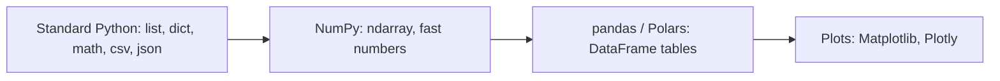
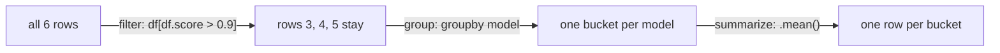

# Data Science

**What this chapter gives you.** Model work is mostly data work: reading files, cleaning
rows, comparing numbers, and turning text into vectors. Here you meet the standard-library tools
for numbers, then NumPy (fast arrays) and pandas (tables), which almost every AI library builds on.


Each layer is built on the one before it; ML libraries (PyTorch, scikit-learn) speak NumPy.

## Standard Python

### Sorting with itemgetter and attrgetter

`sorted(items, key=...)` wants a function that picks the sort value. `itemgetter` builds
one for indexes and dict keys; `attrgetter` does it for object attributes. Several names
break ties in order.

```python
from operator import itemgetter, attrgetter
from dataclasses import dataclass

runs = [
    {"model": "haiku", "score": 0.81, "cost": 0.4},
    {"model": "opus", "score": 0.93, "cost": 3.1},
    {"model": "sonnet", "score": 0.90, "cost": 1.2},
]
by_score = sorted(runs, key=itemgetter("score"), reverse=True)
print([r["model"] for r in by_score])
get_two = itemgetter("model", "cost")      # several keys -> a tuple
print(get_two(runs[0]))

@dataclass
class Run:
    model: str
    score: float

objs = [Run("b", 0.5), Run("a", 0.9)]
print(sorted(objs, key=attrgetter("score")))
```

```text
['opus', 'sonnet', 'haiku']
('haiku', 0.4)
[Run(model='b', score=0.5), Run(model='a', score=0.9)]
```

### Format conversions

[[17 - Text Data|Chapter 17]], 18 and 23 covered text, binary and database formats. The standard library reads CSV
and JSON; pandas (below) handles many more. One trap to remember: CSV values come back as
*strings*.

```python
import csv, io, json

text = "model,score\nhaiku,0.81\nopus,0.93\n"
rows = list(csv.DictReader(io.StringIO(text)))
print(rows)
print(type(rows[0]["score"]))
for r in rows:
    r["score"] = float(r["score"])       # convert yourself
print(json.dumps(rows))
print(json.loads(json.dumps(rows)) == rows)
```

```text
[{'model': 'haiku', 'score': '0.81'}, {'model': 'opus', 'score': '0.93'}]
<class 'str'>
[{"model": "haiku", "score": 0.81}, {"model": "opus", "score": 0.93}]
True
```

### Math

`import math` gives constants (`pi`, `e`, `inf`, `nan`) and functions.
Behaviours worth knowing:

```python
import math
print(math.pi, math.e)
print(math.floor(-2.5), math.ceil(-2.5), round(2.5), round(3.5))
print(math.log(8, 2), math.log2(8), math.log10(1000))
print(2**3, 2.0**3, math.pow(2, 3))
print(math.hypot(3, 4), math.sqrt(16))
try:
    math.sqrt(-1)
except ValueError as e:
    print("ValueError:", e)
print(math.isclose(0.1 + 0.2, 0.3), 0.1 + 0.2 == 0.3, 0.1 + 0.2)
print(math.gcd(24, 16), math.factorial(5))
print(math.inf > 10**100, math.isnan(math.nan), math.nan == math.nan)
```

```text
3.141592653589793 2.718281828459045
-3 -2 2 4
3.0 3.0 3.0
8 8.0 8.0
5.0 4.0
ValueError: math domain error
True False 0.30000000000000004
8 120
True True False
```

> [!warning] Trap
> Never compare floats with `==`. Use `math.isclose`. Also: `round(2.5)` is 2 and
> `round(3.5)` is 4 (round-half-to-even), `nan == nan` is `False`, and `**` with two
> ints stays an int while `math.pow` always returns a float. The trig functions (`sin`,
> `cos`, `atan2`, …) and `radians`/`degrees` are there when you need them.

### Complex numbers, Decimal and Fraction

```python
print(3 + 2j, (3 + 2j) * 1j, 1j * 1j)
z = 3 + 4j
print(z.real, z.imag, abs(z))

from decimal import Decimal
price, tax = Decimal("19.99"), Decimal("0.06")      # build from STRINGS
total = price + price * tax
print(total, total.quantize(Decimal("0.01")))
print(Decimal(0.1))                  # building from a float keeps its error
print(0.1 + 0.2, Decimal("0.1") + Decimal("0.2"))

from fractions import Fraction
print(Fraction(1, 3) * Fraction(2, 3), Fraction(3, 6), Fraction("0.25"))
```

```text
(3+2j) (-2+3j) (-1+0j)
3.0 4.0 5.0
21.1894 21.19
0.1000000000000000055511151231257827021181583404541015625
0.30000000000000004 0.3
2/9 1/2 1/4
```

| **Type** | **Good for** | **Watch out** |
|---|---|---|
| `float` | almost all science and ML math | tiny binary rounding errors |
| `Decimal` | money, exact decimal rules | slower; make it from `str`, not float |
| `Fraction` | exact ratios (`2/9`) | grows big; rarely needed in ML |
| `complex` | signal processing, `cmath` functions | not used in everyday AI code |

> [!warning] Trap
> The book calls `fractions.gcd`. That function was removed in Python 3.9; importing it raises
> `ImportError`. Use `math.gcd`. Also the book shows `np.float` for NumPy dtypes: that
> alias was removed from NumPy; use `float` or `np.float64`.

### array, statistics and the @ operator

`array.array` packs one numeric type tightly (less memory than a list of Python objects), but
it has no math on whole arrays. For real numeric work use NumPy.

```python
import sys
from array import array
import statistics as st

nums = list(range(1000))
packed = array("i", nums)
print(sys.getsizeof(nums), sys.getsizeof(packed))   # list = pointers only
print(packed.itemsize, packed.typecode, packed[:3])
try:
    packed.append(1.5)
except TypeError as e:
    print("TypeError:", e)

lat = [120, 135, 128, 410, 131, 125]      # latencies in ms, one outlier
print(st.mean(lat), st.median(lat), round(st.stdev(lat), 1))
print(st.mode(["a", "b", "a"]))
print(st.quantiles(lat, n=4))
```

```text
8056 4080
4 i array('i', [0, 1, 2])
TypeError: 'float' object cannot be interpreted as an integer
174.83333333333334 129.5 115.3
a
[123.75, 129.5, 203.75]
```

The outlier (410 ms) drags the mean far above the median. When latency or cost has outliers,
report the median or a percentile.

The `@` operator means matrix multiply, but only for types that define it. Plain lists do not;
NumPy arrays do.

```python
a = [[1, 2], [3, 4]]
try:
    a @ a
except TypeError as e:
    print("TypeError:", e)
```

```text
TypeError: unsupported operand type(s) for @: 'list' and 'list'
```

## NumPy

NumPy's `ndarray` is a block of memory holding values of **one type** next to each other.
That makes math over whole arrays fast, and it is the data format under embeddings, images and
tensors. (Needs `pip install numpy`. NumPy is not installed in this notes environment, so the
outputs below are labeled *example output*; I checked the numbers by hand or with plain Python.)

|  | **Python `list`** | **NumPy `ndarray`** |
|---|---|---|
| Element types | anything, mixed | one `dtype` (float64, int64, …) |
| Memory | pointers to separate objects | one contiguous block |
| `x * 3` | repeats the list 3 times | multiplies every element by 3 |
| `x + y` | joins two lists | adds element by element |
| 2D indexing | `m[1][2]` | `m[1, 2]` (and `m[1][2]` also works) |
| Math functions | write a loop or comprehension | whole-array operations |

### Making arrays and reading their shape

Three attributes describe every array: `ndim` (number of dimensions; the book calls it the
rank), `shape` (length along each dimension, a tuple) and `size` (total elements).

```python
import numpy as np

b = np.array([2, 4, 6, 8])          # from a list
print(b, b.ndim, b.shape, b.size)
a = np.arange(7, 11)                # like range(), but an array
f = np.arange(2.0, 3.0, 0.25)       # floats are fine
z = np.zeros((2, 4))                # shape is ONE tuple argument
o = np.ones((3, 5))
rng = np.random.default_rng(0)      # modern random generator
r = rng.random((3, 5))              # values in [0.0, 1.0)
print(z.shape, o.size, r.shape)
```

```text
[2 4 6 8] 1 (4,) 4
(2, 4) 15 (3, 5)
```

 *Example output.*

> [!warning] Trap
> `np.zeros(2, 4)` is an error: the shape goes in one tuple, `np.zeros((2, 4))`. And
> `arange` with a float step can produce an unexpected number of items because of rounding;
> prefer `np.linspace(start, stop, num)` when you care about the count.

### Reshape and indexing

```text
arange(10)  shape (10,)
  [ 0  1  2  3  4  5  6  7  8  9 ]
            |  reshape(2, 5)
            v
shape (2, 5)       col: 0  1  2  3  4
              row 0  [  0  1 (2  3  4)]   a[0, 2:] -> [2 3 4]
              row 1  [  5  6 [7] 8  9 ]   a[1, 2]  -> 7
```

```python
a = np.arange(10).reshape(2, 5)     # same 10 values, new shape
print(a[1, 2], a[-1, :3], a[0, 2:])
a[:, 2:4] = 1000                    # assign to a slice of every row
print(a)
b = a.reshape(5, 2)                 # sizes must multiply to 10
# a.reshape(3, 4) -> ValueError: cannot reshape array of size 10 ...
```

```text
7 [5 6 7] [2 3 4]
[[   0    1 1000 1000    4]
 [   5    6 1000 1000    9]]
```

 *Example output.*

> [!warning] Trap
> Slices and `reshape` return **views**, not copies: they share memory with the original.
> Changing the view changes the source. Call `.copy()` when you need independence. With plain
> lists, a slice is a new list, so the habit does not carry over.

### Array math: no loops

```python
arr = np.arange(4)
arr = arr * 3                   # every element at once
print(arr)                      # [0 3 6 9]
print([1, 2] * 3)               # a LIST repeats instead
print(np.zeros((2, 5)) + 17.0)  # one number added to all ten
scores = np.array([0.2, 0.9, 0.4, 0.95])
print(scores[scores > 0.5])     # boolean mask: keep matching items
```

```text
[0 3 6 9]
[1, 2, 1, 2, 1, 2]
[[17. 17. 17. 17. 17.]
 [17. 17. 17. 17. 17.]]
[0.9  0.95]
```

 *Example output (the list line was run in plain Python).*

> [!example] Type check
> Same-looking values, different behaviour:
>
> - `[1, 2] * 3` is a `list` of six items; `np.array([1, 2]) * 3` is an
>   `ndarray` `[3 6]`.
> - `type(x)` tells you which you have. `x.shape` exists only on arrays, not lists.
> - `np.array(my_list)` converts a list; `arr.tolist()` converts back (needed for
>   `json.dumps`, which cannot encode an `ndarray`).
>

### Shapes and broadcasting

> [!danger] Boss fight: broadcasting
> When two arrays have different shapes, NumPy *stretches* the smaller one to fit, as long as
> each dimension matches or is 1 (compared from the right). It does not copy the data; it
> behaves as if it had. Most shape errors in ML code come from not knowing the shape. Print
> `.shape` early and often.
>
>
> ```text
>    A (2, 3)          B (3,)               C (2, 3)
>   [ 1  2  3 ]   +   [10 20 30]    =     [ 11  22  33 ]
>   [ 4  5  6 ]       [10 20 30]  <- stretched copy (not stored)
>                                         [ 14  25  36 ]
> ```
>
> ```python
> A = np.array([[1, 2, 3], [4, 5, 6]])    # shape (2, 3)
> B = np.array([10, 20, 30])              # shape (3,)
> print(A + B)                            # B is applied to every row
> # np.ones((2, 3)) + np.ones((2,))  -> ValueError: shapes (2,3) (2,) ...
> ```
>
> ```text
> [[11 22 33]
>  [14 25 36]]
> ```
>
>  *Example output.*

### Linear algebra, and an embedding example

The book solves the system $4x+5y=20,  x+2y=13$. Here is the same method on my own system:
$2x + y = 5$ and $x - y = 1$ (solution $x=2, y=1$).

```python
coef = np.array([[2, 1], [1, -1]])
rhs = np.array([5, 1])
sol = np.linalg.solve(coef, rhs)
print(sol)
print(np.allclose(coef @ sol, rhs))     # check; @ is matrix multiply
```

```text
[2. 1.]
True
```

 *Example output.*

Use `np.allclose` for float comparison, as with `math.isclose`. A far more common job in
AI work is comparing two embedding vectors by the angle between them (**cosine similarity**):

```text
          ^ y
          |   d2 (different)
          |  /
          | /      q (query)
          |/     .-'
          +-------------------> x
           `--.__  d1 (similar: small angle to q)
```
Cosine similarity compares the angle between vectors: a small angle gives a value near 1.

$$
\text{cos}(q,d) \;=\; \frac{q\cdot d}{\lVert q\rVert\,\lVert d\rVert}

$$

A value near 1 means the vectors point the same way. I checked this calculation in plain
Python: for $q=(1,2,2)$ and $d=(2,0,1)$ the dot product is 4, the norms are 3 and $\sqrt5$, and the
result is $0.5963$.

```python
import numpy as np

def cosine(q: np.ndarray, d: np.ndarray) -> float:
    return float(q @ d / (np.linalg.norm(q) * np.linalg.norm(d)))

q = np.array([1.0, 2.0, 2.0])
d = np.array([2.0, 0.0, 1.0])
print(round(cosine(q, d), 4))
```

```text
0.5963
```

 *Example output (matches the plain-Python check).*

NumPy also has modules for polynomials, Fourier transforms, statistics and random distributions.

## SciPy

SciPy sits on NumPy and adds ready-made scientific algorithms. You will rarely import it for
LLM work, but it is behind many ML tools.

| **Area** | **What you get** |
|---|---|
| Optimization | minimize a function; curve fitting |
| Statistics | distributions, hypothesis tests |
| Linear regression, interpolation | fit and fill in values |
| Integration | numerical integrals |
| Signal and image processing | filters, transforms |

Python plus NumPy plus SciPy covers much of what MATLAB or R do. (`pip install scipy`.)

## pandas

pandas handles messy real-world tables: many column types, missing values, dates, and many file
formats (CSV, TSV, fixed-width text, Excel, JSON, HTML tables, SQL, HDF5). Its core type is the
**DataFrame**, a table with labelled rows (the *index*) and typed columns. One column is a
**Series**.

```text
index | model  | task      | score | latency_ms
------+--------+-----------+-------+-----------
  0   | haiku  | summarize | 0.81  | 420
  1   | haiku  | extract   | 0.88  | 380
  2   | sonnet | summarize | 0.90  | 910
  3   | sonnet | extract   | 0.94  | 870
whole grid = DataFrame df;  the score column = one Series: df["score"]
```

### Reading a CSV and looking around

I use a small, made-up table of evaluation results. `read_csv` accepts a path, a URL, or any
file-like object (here an in-memory string). Install with `pip install pandas`. Not run here;
the outputs follow pandas' standard display and I computed the numbers with plain Python.

```python
import io
import pandas as pd

csv_text = """model,task,score,latency_ms
haiku,summarize,0.81,420
haiku,extract,0.88,380
sonnet,summarize,0.90,910
sonnet,extract,0.94,870
opus,summarize,0.93,2100
opus,extract,0.97,1980
"""
df = pd.read_csv(io.StringIO(csv_text))     # a DataFrame
print(df)
```

```text
    model       task  score  latency_ms
0   haiku  summarize   0.81         420
1   haiku    extract   0.88         380
2  sonnet  summarize   0.90         910
3  sonnet    extract   0.94         870
4    opus  summarize   0.93        2100
5    opus    extract   0.97        1980
```

 *Example output.*

> [!example] Type check
>
> | **Expression** | **Type** | **Meaning** |
> |---|---|---|
> | `df` | `DataFrame` | the whole table |
> | `df["score"]` | `Series` | one column (1-D, with an index) |
> | `df[["score"]]` | `DataFrame` | double brackets: a one-column table |
> | `df.loc[0]` | `Series` | one row, by index label |
> | `df["score"].to_numpy()` | `ndarray` | the raw values, for NumPy or a model |
> | `df.shape` | `tuple` | `(6, 4)`: rows, columns |
>

### Filter, group, summarize



```python
good = df[df["score"] > 0.9]                    # boolean mask on rows
print(list(good.index))                         # [3, 4, 5]
means = df.groupby("model")[["score", "latency_ms"]].mean()
print(means)
print(round(df["score"].mean(), 3))             # Series method -> float
```

```text
[3, 4, 5]
        score  latency_ms
model
haiku   0.845       400.0
opus    0.950      2040.0
sonnet  0.920       890.0
0.905
```

 *Example output.*

```text
Mean score by model (illustrative data: the sample table above)
haiku   | ##########################################  0.845
sonnet  | ##############################################  0.92
opus    | ###############################################  0.95
        +-------------------------------------------------- 0 ... 1
```

> [!tip] Rule
> Compute on whole columns (`df["score"] > 0.9`, `groupby`, `mean`) instead of looping
> over rows with `for`. It is shorter and far faster, for the same reason NumPy beats a list loop.

> [!warning] Trap
> A boolean filter is an expression, not a statement: `df["score"] > 0.9` gives a Series of
> `True`/`False`; you must pass it back into `df[...]` to get rows. Also,
> `df["new"] = ...` on a *filtered* frame can trigger the `SettingWithCopyWarning` or
> silently fail; take `.copy()` first. And a column holding numbers read as text (e.g.
> `"0.81"`) will sort and compare wrongly: check `df.dtypes`.

### Dates

`pd.date_range("2025-01-01", periods=3, freq="MS")` returns a `DatetimeIndex` of the
first day of three months. It handles calendar details (month ends, business days) that are
painful to write by hand. Note that pandas calls frequency codes by letters such as `MS`
(month start); check the docs if one is deprecated in your version.

## Polars

Polars is a newer DataFrame library written in Rust. It can use all CPU cores and handle data
bigger than memory (lazy mode). Its API differs from pandas: you build *expressions* with
`pl.col(...)`. (`pip install polars`; syntax-checked only.)

```python
import polars as pl

df = pl.read_csv("results.csv")
best = (
    df.filter(pl.col("score") > 0.9)
      .group_by("model")
      .agg(pl.col("score").max())
)
```

## DuckDB

DuckDB is an in-process SQL database (like SQLite, no server) built for analysis. It can run SQL
straight over a pandas DataFrame, CSV or JSON file, and it connects to NumPy and Polars too.
(`pip install duckdb`; syntax-checked only.)

```python
import duckdb
import pandas as pd

df = pd.DataFrame({"model": ["haiku", "opus"], "score": [0.81, 0.93]})
out = duckdb.sql("SELECT model, score FROM df WHERE score > 0.9").df()
```

DuckDB finds the variable named `df` by name. The result converts back to a pandas DataFrame
with `.df()`.

| **Tool** | **You write** | **Reach for it when** |
|---|---|---|
| pandas | Python methods on DataFrames | the default; small to medium data |
| Polars | expressions, lazy plans | bigger data, speed, multi-core |
| DuckDB | SQL | you already think in SQL; query files in place |

## Data Visualization

A chart is for insight, not decoration. Pick a tool by how interactive and how shareable the
result must be.

| **Package** | **Notes** | **Typical use** |
|---|---|---|
| Matplotlib | oldest, most control, 2D/3D | static charts, papers, notebooks |
| seaborn | statistical plots on top of Matplotlib | quick plots straight from DataFrames |
| Plotly | interactive charts | dashboards, hover details |
| Bokeh | interactive, browser-based | web plots |
| Streamlit | turn a script into a web app | share a demo or eval dashboard |

```python
import matplotlib.pyplot as plt

means = df.groupby("model")["score"].mean()      # a Series
ax = means.plot(kind="bar", ylim=(0, 1), title="Mean score by model")
ax.set_ylabel("score")
plt.tight_layout()
plt.savefig("scores.png")
```

Syntax-checked only. Plotting a Series draws one bar per index label, which is why the
`groupby` result above plots with no extra work.

## Practice and wrap-up

Data science is a ladder: plain Python for small jobs, NumPy for numeric speed, pandas for tables,
SQL or Polars when the data grows.

> [!question-] Practice
>
> 1. Sort a list of dicts of eval runs by score (high first), breaking ties by cost (low first),
>   using `itemgetter`. Which argument handles the direction?
> 1. Show why `0.1 + 0.2 == 0.3` is false, and give two correct ways to compare or compute it.
> 1. What are the shapes of `np.arange(12).reshape(3, 4)` and its transpose? What happens if you
>   add a shape `(4,)` array to it? A shape `(3,)` array?
> 1. Change a slice of a NumPy array and then print the original. Explain the result and fix it
>   with `.copy()`.
> 1. In pandas, what is the difference between `df["a"]` and `df[["a"]]`? When would
>   each be the right one?
> 1. Write a pandas or SQL query that returns the best score per model from a table of eval runs.
>

> [!success] Achievement unlocked: Data wrangler
> You can now:
>
> - pick the right number type (`float`, `Decimal`, `Fraction`) and avoid float comparison bugs;
> - read an array's `shape`, reshape it, slice it, and predict broadcasting;
> - tell a list, an `ndarray`, a `Series` and a `DataFrame` apart by type and behaviour;
> - filter, group and summarize a table of results;
> - choose between pandas, Polars and DuckDB, and a plotting tool, for a job.
>

---
Related: [[03 - Numbers]] · [[08 - Tuples and Lists]] · [[17 - Text Data]] · [[23 - Data in a Box - Persistent Storage]] · [[26 - AI]] · [[27 - Performance]]
