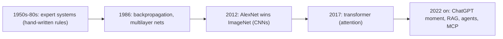
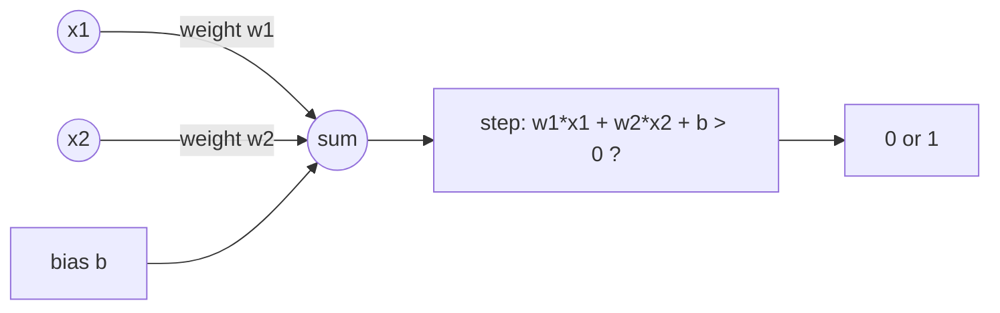
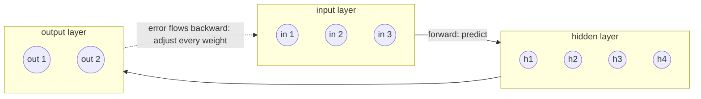
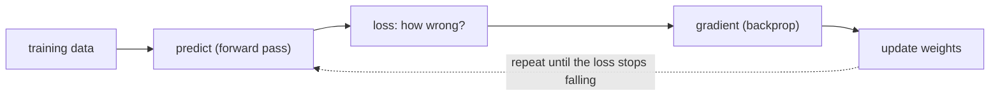
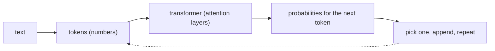
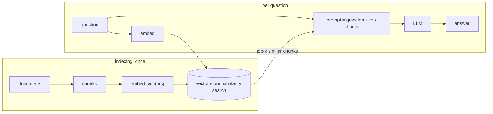
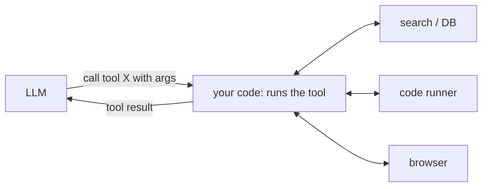
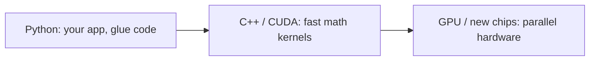
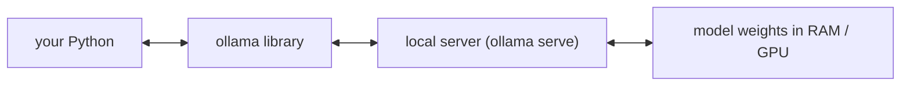

# AI

**What this chapter gives you.** This chapter is the map of the field you are entering: where
modern AI came from, which ideas matter (training, loss, attention, retrieval, agents), and how
Python fits in. The book's model examples date quickly; **model names change, concept**
last}. For hands-on work in this series you use the Anthropic SDK with
`claude-haiku-5-5`, `claude-sonnet-5-5` and `claude-opus-5-5`.

## Terms that get mixed up

```text
+-- Artificial intelligence (AI) -----------------------------+
|   (rule-based expert systems live in this outer ring)       |
|  +-- Machine learning (ML) ---------------------------+     |
|  |  +-- Deep learning (DL): many-layer neural nets --+ |     |
|  |  |      [ LLMs, e.g. the Claude models ]          | |     |
|  |  +------------------------------------------------+ |     |
|  +-----------------------------------------------------+     |
+--------------------------------------------------------------+
```

| **Term** | **Meaning** |
|---|---|
| AI | the broad, old goal: machines that do things people do |
| ML | learn patterns from data instead of being given rules |
| DL | ML with multi-layer neural networks |
| LLM | a large deep-learning model trained on text to predict the next token |

> [!info] Key idea: programs versus models
> Classic code: *you* write the rules, the computer applies them. Machine learning: you supply
> examples (inputs and the right outputs), and the computer finds the rules (called
> **weights**). You cannot read the weights like source code, which is why you must test a
> model's outputs rather than trust them.

## It Turns Out… (a short history)



### Expert systems

From roughly the 1950s to the 1980s, AI meant symbolic, top-down programs: experts wrote the
rules. Chess shows the arc: a custom machine reached master level in 1983, and IBM's Deep Blue beat
a grandmaster in 1997. Later, AlphaGo (2016) beat a Go champion, and a successor learned the game
from self-play with no rules taught.

### Perceptrons

A **perceptron** is one artificial neuron: multiply each input by a weight, add a bias, and
apply a threshold. It worked for simple classification and was proven unable to learn some
patterns, which stalled the field for years.



A tiny trainer in pure Python (my own example; it ran). It learns AND, which one neuron can
represent, but not XOR, which it cannot:

```python
def step(x):
    return 1 if x > 0 else 0

def train(samples, epochs=20, lr=0.1):
    w1 = w2 = b = 0.0
    for _ in range(epochs):
        for (x1, x2), target in samples:
            pred = step(w1 * x1 + w2 * x2 + b)
            err = target - pred
            w1 += lr * err * x1      # nudge weights toward the target
            w2 += lr * err * x2
            b += lr * err
    return w1, w2, b

def accuracy(samples, w1, w2, b):
    hits = sum(step(w1 * x1 + w2 * x2 + b) == t for (x1, x2), t in samples)
    return hits / len(samples)

AND = [((0, 0), 0), ((0, 1), 0), ((1, 0), 0), ((1, 1), 1)]
XOR = [((0, 0), 0), ((0, 1), 1), ((1, 0), 1), ((1, 1), 0)]
print("AND", accuracy(AND, *train(AND)))
print("XOR", accuracy(XOR, *train(XOR)))
```

```text
AND 1.0
XOR 0.5
```

### The breakthrough: hidden layers and backpropagation

In 1986, Rumelhart, Hinton and Williams showed that a **multilayer perceptron** can learn the
hard cases, thanks to two additions: **hidden layers** (more weights between input and output)
and **backpropagation** (adjusting the weights backward from the error). Hinton and Hopfield
shared the 2024 Nobel Prize in Physics for related work.



**Training** means: start with random weights; predict; measure how wrong you are with a
**loss function**; use calculus (the slope, or *gradient*) to learn which way to move each
weight; repeat. **Gradient descent** takes bigger steps where the slope is steep. After
training, using the model on new data is **inference**.



> [!danger] Boss fight: learning is minimizing a loss
> No one writes the model's rules. A loop nudges the weights downhill on the loss curve. The smallest
> possible example: fit $y = w x$ to data that follows $y=3x$. The loss is the mean squared error.
> Each step moves $w$ by $-\text{learning rate}\times\text{gradient}$.
>
> ```python
> xs = [1.0, 2.0, 3.0, 4.0]
> ys = [3.0, 6.0, 9.0, 12.0]
> w, lr = 0.0, 0.01
>
> def loss(w):
>     return sum((w * x - y) ** 2 for x, y in zip(xs, ys)) / len(xs)
>
> for step in range(6):
>     grad = sum(2 * (w * x - y) * x for x, y in zip(xs, ys)) / len(xs)
>     print(f"step {step}: w={w:.4f} loss={loss(w):.4f} grad={grad:.4f}")
>     w -= lr * grad
> ```
>
> ```text
> step 0: w=0.0000 loss=67.5000 grad=-45.0000
> step 1: w=0.4500 loss=48.7687 grad=-38.2500
> step 2: w=0.8325 loss=35.2354 grad=-32.5125
> step 3: w=1.1576 loss=25.4576 grad=-27.6356
> step 4: w=1.4340 loss=18.3931 grad=-23.4903
> step 5: w=1.6689 loss=13.2890 grad=-19.9667
> ```
>
>
>
> ```text
> Loss curve: loss = 7.5 * (w - 3)^2   (dots = the six steps in the output above)
> loss
>  67.5 *
>  48.8    *
>  35.2       *
>  25.5          *
>  18.4            *
>  13.3              *
>   0   -----------------------V-------   minimum at w = 3
>       0   0.45 0.83 1.16 1.43 1.67 ...  w
> ```
>
> The gradient shrinks as $w$ nears the minimum, so the steps shrink too. Running 200 more steps (my
> run) ends at $w=3.0000$. A learning rate that is too big overshoots and the loss grows. Real models
> do the same thing with billions of weights, and PyTorch computes the gradients for you.

### Image recognition: ImageNet and AlexNet

ImageNet is a huge labeled image set. From 2010 a yearly contest asked programs to label images.
In 2012 the entry AlexNet won by a wide margin using a **convolutional neural network**
(CNN), and interest in deep learning exploded. CNNs scan small patches of an image for patterns.

### Large language models

In 2017, the paper “Attention Is All You Need” introduced the **transformer**. Earlier
sequence models (RNNs) processed text one step at a time. *Attention* lets the model relate
every token to every other token, and it can be computed in parallel on GPUs, so very large models
became practical. LLMs look like fancy autocomplete, yet they show surprising abilities at scale.



> [!warning] Trap
> The model sees **tokens**, not letters. A word like *strawberry* may arrive as a couple of
> chunks (the real split depends on the tokenizer). That is why small models famously miscount
> letters. When you need an exact answer, do not ask a model to count: write `"strawberry".count("r")`
> (it returns 3).

### The ChatGPT moment

In 2022 OpenAI released ChatGPT. A chat interface turned a research model into something anyone
could use: write code, converse, summarize. Since then every major lab has shipped chat models and
APIs.

### Retrieval augmented generation (RAG)

A model answers from what it learned in training, and it may **hallucinate**: state a wrong
answer confidently. **RAG** gives the model fresh, relevant text at question time, and tends to
reduce (not remove) hallucinations.



### Agents, tools and protocols

Plain models take text in and give text out. Many are **multimodal** too (images, audio,
video). Applications now connect a model to outside **tools and data**: a vector store for
similarity search, a browser to control, a code runner. In an **agent loop** the model decides
which tool to call, your code runs it, and the result goes back to the model, until it can answer.


Repeat until the model returns a final answer.

| **Name** | **What it is** |
|---|---|
| LangChain | a Python framework to wire a model to tools and steps |
| MCP (Model Context Protocol) | Anthropic's open protocol for plugging tools and data sources into models |
| A2A (Agent2Agent) | Google's protocol for agents to find and talk to each other |

### Efficiency

Better algorithms, cheaper and more scalable hardware and the cloud made all this affordable.
**GPUs** beat CPUs at the repeated multiply-and-add at the heart of neural networks, because
they do many of them in parallel.

## Create Models: Python Frameworks

Python won AI partly because it is free, open and good with data, and because NumPy and SciPy let a
slow-looking language drive fast numeric code. The book names the main training frameworks.

| **Library** | **What it is** | **Use it for** |
|---|---|---|
| scikit-learn | classic ML: classification, clustering, regression | small/tabular problems, baselines |
| TensorFlow | Google's deep-learning framework (2015), mostly C++ underneath | existing TF codebases |
| PyTorch | Meta's framework (2016), more “Pythonic” | most current deep-learning research and models |
| fastai | high-level layer on PyTorch | quick training experiments |
| Keras | simple API on top of TensorFlow and others | beginner-friendly model building |

The book chooses not to teach model building here, and instead shows how to *use* models. That
matches a junior AI engineer's day-to-day job: call models, evaluate them, wire them to data.


The usual AI sandwich: easy on top, fast underneath.

## Current Models

The book lists (as of early 2025) models from OpenAI, Anthropic, Google, Perplexity, DeepSeek,
xAI and Meta, plus special-purpose models such as AlphaFold (protein structure). That list is
already dated; treat it as an example of the *kinds* of providers, not a recommendation.

| **Kind of model** | **How you reach it** | **Trade-off** |
|---|---|---|
| Hosted frontier model (Claude, GPT, Gemini) | HTTPS API with a key, via an SDK | best quality; costs per token; your data leaves your machine |
| Open-weights model (Llama and others) | download and run it yourself (Ollama, Hugging Face) | free to run, private; needs RAM/GPU; usually weaker |
| Special-purpose model | its own API or library | excellent at one job, useless at others |

> [!tip] Rule
> Do not hard-code a model name deep in your program. Put it in one constant or config value, so you
> can swap `claude-haiku-5-5` for `claude-sonnet-5-5` or `claude-opus-5-5` (cheaper and
> faster versus stronger) without touching the logic.

Illustrative call with the Anthropic SDK. It needs `pip install anthropic` and an API key
in your environment (variable `ANTHROPIC_API_KEY`). Syntax-checked only:

```python
import anthropic

MODEL = "claude-haiku-5-5"          # one place to change the model

client = anthropic.Anthropic()      # reads the key from the environment
response = client.messages.create(
    model=MODEL,
    max_tokens=1000,
    messages=[{"role": "user", "content": "Define a limerick in one line."}],
)
for block in response.content:      # content is a LIST of blocks
    if block.type == "text":
        print(block.text)
```

> [!example] Type check
> The SDK returns a **typed object**, not a dict. I built one offline (no API call) to show
> the types:
>
> ```python
> from anthropic.types import Message, TextBlock, Usage
>
> msg = Message(
>     id="msg_demo", type="message", role="assistant",
>     model="claude-haiku-5-5",
>     content=[TextBlock(type="text", text="A token is a chunk of text.")],
>     stop_reason="end_turn", stop_sequence=None,
>     usage=Usage(input_tokens=12, output_tokens=9),
> )
> print(type(msg).__name__)
> print(type(msg.content).__name__, type(msg.content[0]).__name__)
> print(msg.usage.input_tokens + msg.usage.output_tokens)
> d = msg.model_dump()                    # plain dict, e.g. for json.dumps
> print(type(d).__name__, d["content"][0]["text"])
> ```
>
> ```text
> Message
> list TextBlock
> 21
> dict A token is a chunk of text.
> ```
>
>
>
> | **Expression** | **Type** | **Use** |
> |---|---|---|
> | `response` | `Message` (object) | attribute access: `.content`, `.usage` |
> | `response.content` | `list` of blocks | loop; do not assume `[0]` is text |
> | `block.text` | `str` | only on blocks whose `type == "text"` |
> | `response.model_dump()` | `dict` | save to JSON, log, compare |
>

## A Million Models: Hugging Face

Hugging Face is a hub with over a million open models and many datasets (the book's count). Its
`transformers` library downloads and runs them, on top of PyTorch or TensorFlow
(`pip install transformers torch`). The `pipeline` helper is the quickest start.
Illustrative sketch (not run; the model id is a placeholder you pick from the hub):

```python
from transformers import pipeline

classify = pipeline("text-classification", model="<model-id-from-the-hub>")
result = classify("The new release fixed my bug.")
# result is a LIST of dicts, e.g. [{"label": "...", "score": 0.97}]
print(result[0]["label"], result[0]["score"])
```

| **Hub item** | **Why you care** |
|---|---|
| Models | ready-made weights for text, vision, audio and more; check each model's license |
| Datasets | data for training and evaluation |
| Libraries | `transformers` to run models, others to train them |

## Working Examples With Ollama

Ollama runs open models on your own computer, free and open source, with a command-line tool and a
Python library (`pip install ollama`). The book uses it to try small local models. Typical flow:

```text
$ ollama serve                   # start the local server
$ ollama run tinyllama           # downloads the model on first use, then chats
>>> Send a message (/? for help)
```

Illustrative Python use (not run; check the library docs for current response fields):

```python
import ollama

reply = ollama.chat(
    model="tinyllama",
    messages=[{"role": "user", "content": "What is a limerick?"}],
)
print(reply["message"]["content"])
```


Everything stays on your machine: no API key, no per-token bill.

|  | **Local small model** | **Hosted frontier model** |
|---|---|---|
| Cost | free after download; uses your RAM/CPU/GPU | pay per token |
| Privacy | data stays on your machine | data is sent to the provider |
| Quality | often weak at counting, poetry, code | much stronger overall |
| Setup | install, download gigabytes | API key and an SDK |

### What the book's experiments teach

The author tried two small local models. TinyLlama gave a wrong answer to a letter-counting
question, did not write a real villanelle or limerick, did not define a limerick correctly, and wrote
Python that did not work. Code Llama (Python version) did better on short functions but wrote test
cases that were duplicated and sometimes wrong. The lessons matter more than the models:

- **Small models are uneven.** Match the model to the task; test before you trust.
- **Model output is untrusted input.** Run generated code and check it yourself.
- **Models can be out of date.** One generated snippet used `datetime.utcnow()`, which
  Python now warns is deprecated.

Checks I ran for these ideas:

```python
import warnings
from datetime import datetime, timezone

def utc_now_str():
    return datetime.now(timezone.utc).strftime("%Y-%m-%d %H:%M:%S")

s = utc_now_str()
print(len(s), s[4], s[10] == " ")
with warnings.catch_warnings(record=True) as w:
    warnings.simplefilter("always")
    datetime.utcnow()                       # the old, deprecated way
    print(w[0].category.__name__)
print("strawberry".count("r"))
gen = (x for x in range(1, 6))              # generator expression
lst = [x for x in range(1, 6)]              # list comprehension
print(type(gen).__name__, type(lst).__name__, list(gen))
```

```text
19 - True
DeprecationWarning
3
generator list [1, 2, 3, 4, 5]
```

Note the last line: “a generator comprehension” (round brackets) is not the same type as a list
comprehension (square brackets). A model that returns a list when you asked for a generator has
changed the type.

> [!tip] Rule
> Never accept model-written tests as proof. Write your own cases (include edge cases such as an empty
> string) and run them against the generated function:

```python
def count_letter(word, letter):          # pretend a model wrote this
    return word.count(letter)

cases = [("strawberry", "r", 3), ("banana", "a", 3), ("", "x", 0)]
failures = [(w, l, want, count_letter(w, l))
            for w, l, want in cases if count_letter(w, l) != want]
print("failures:", failures)
```

```text
failures: []
```

### References and next steps

The book points to material on Ollama and its Python library, a general AI tutorial, Chip Huyen's
*AI Engineering* and *Designing Machine Learning Systems*, and 3Blue1Brown's visual
videos on backpropagation and gradient descent. For a visual learner, the last is the one to
watch first.

## Practice and wrap-up

Python became the main language of data science and AI because it glues easy code to fast
libraries. The field moved from hand-written rules to learned weights, and from single models to
tools and agents.

> [!question-] Practice
>
> 1. Put these in order of nesting: deep learning, AI, machine learning, LLM. Which one does a
>   rule-based chess program belong to?
> 1. In your own words: what are the *loss*, the *gradient* and a *learning rate*?
>   What goes wrong with a learning rate that is too large?
> 1. Why does a language model often fail at “how many r's are in strawberry”, and what is the
>   reliable way to get the answer?
> 1. Draw the steps of a RAG system for a question about your own notes. Which step uses
>   embeddings and which uses the LLM?
> 1. Ask any model of your choice to write `utc_now_str()`. Run it, check for deprecation
>   warnings, and write three tests of your own.
> 1. List two reasons to run a small model locally and two reasons to call a hosted one.
>

> [!success] Achievement unlocked: AI map
> You can now:
>
> - explain AI, ML, DL and LLM, and the key ideas of training: weights, loss, gradient descent;
> - describe how transformers, RAG and agents with tools fit together;
> - read the types in an SDK response (object, list of blocks, dict) and parse them safely;
> - choose between a local and a hosted model, and verify model-written code instead of trusting it;
> - write a loop that fits a one-parameter model by gradient descent.
>

---
Related: [[25 - Data Science]] · [[24 - The Web]] · [[15 - Testing]] · [[27 - Performance]]
