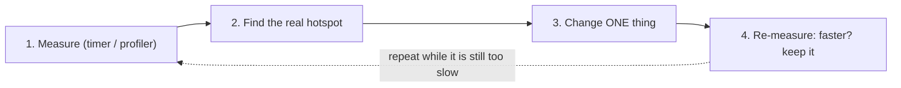
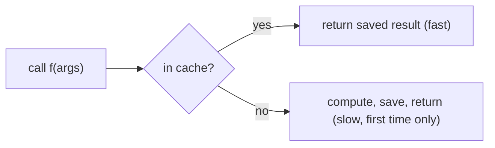
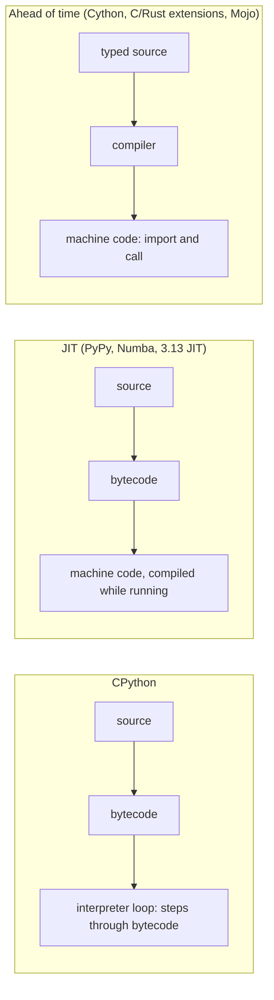

# Performance

**What this chapter gives you.** Python is fast enough until it is not, and people guess wrong
about where the time goes. This chapter teaches you to *measure* first (timers and a
profiler), then fix the real hotspot with a better algorithm, a cache, concurrency, or a faster
tool. In AI work the slow parts are usually waiting on model APIs, big loops over data, and
memory use.



## Computer Hardware

A CPU core has registers (hold the numbers in use), an arithmetic-logic unit (does the
operations), a control unit (fetches instructions and data) and a clock. Around it sit caches, RAM,
an SSD and maybe a hard drive. Going down the list, storage gets bigger, cheaper and **muc**
slower}. The first two kinds lose their data when power is lost; the last two keep it.

```text
Time for one access (rough orders of magnitude, illustrative, log scale)
Register          | #                    under 1 ns
L1 cache          | #                    about 1 ns
L2 cache          | ##                   few ns
L3 cache          | ###                  about 10 ns
RAM               | #####                about 100 ns
SSD               | ################     about 0.1 ms
Hard disk         | ###################  several ms
Network API call  | #####################  100 ms and up
                    1 ns     1 us      1 ms      1 s
```

The point of the chart: each step down costs 10 to 1000 times more. Waiting on a network call is
millions of times slower than adding two numbers. The operating system moves data between rows for
you (for example virtual memory pages to disk, which is why a computer that runs out of RAM
suddenly crawls). At the software level you can help in three ways:

| **Lever** | **Idea** | **Python example** |
|---|---|---|
| Data layout | contiguous data fits caches; scattered objects do not | `array`, NumPy arrays instead of lists of floats |
| Parallelism | the CPU applies one instruction to many values (SIMD), or many cores work at once | NumPy and pandas operations; multiprocessing |
| Concurrency | do other work while waiting for disk or network | threads, `asyncio` ([[21 - Data in Time - Concurrency\|Chapter 21]]) |

## Measure Timing

| **Tool** | **Good for** | **Note** |
|---|---|---|
| `time.time()` | wall-clock epoch seconds | can jump if the system clock changes; the book uses it |
| `time.perf_counter()` | timing a block of code | best clock for intervals |
| `timeit` | tiny snippets, many repeats | runs the code for you |
| `cProfile` | which function is slow | per-function table |
| `tracemalloc` | which code uses memory | peak and current bytes |

### A stopwatch with perf_counter

```python
import time

t0 = time.perf_counter()
time.sleep(0.2)                          # the work being timed
elapsed = time.perf_counter() - t0
print(f"{elapsed:.2f} s")
```

```text
0.20 s
```

Run it several times: tiny jobs vary a lot (other programs, caches, power saving). One measurement
proves little.

### timeit

`timeit.timeit(code, number=n)` runs the code `n` times and returns the *total*
seconds for all runs (a `float`). The default `number` is one million, so set it
yourself for anything slow. `repeat` gives several totals; take the **minimum**, which has
the least noise. You can pass a string, or any callable.

```python
from timeit import timeit, repeat

total = timeit("sum(range(100))", number=1000)       # float, seconds
runs = repeat("sum(range(100))", number=1000, repeat=5)
best = min(runs) / 1000                             # seconds per call
print(type(total).__name__, len(runs))
print(f"best per call: {best * 1e6:.1f} us")        # varies per machine

data = list(range(1000))
t = timeit(lambda: sorted(data), number=100)        # pass a callable
print(f"{t:.4f} s for 100 sorts")
```

```text
float 5
best per call: 0.4 us
0.0003 s for 100 sorts
```

 *Your numbers will differ.*

### A decorator and a context manager

For your own programs, wrap timing in a reusable tool. `functools.wraps` keeps the
function's name; `try/finally` prints even if the function raises.

```python
import time
from contextlib import contextmanager
from functools import wraps

def timed(func):
    @wraps(func)
    def inner(*args, **kwargs):
        t0 = time.perf_counter()
        try:
            return func(*args, **kwargs)
        finally:
            print(f"{func.__name__}: {time.perf_counter() - t0:.3f} s")
    return inner

@contextmanager
def stopwatch(label):
    t0 = time.perf_counter()
    yield
    print(f"{label}: {time.perf_counter() - t0:.3f} s")

@timed
def embed_batch(n):                 # stand-in for an embedding call
    time.sleep(0.05 * n)
    return [0.0] * n

vecs = embed_batch(2)
with stopwatch("parse"):
    time.sleep(0.1)
```

```text
embed_batch: 0.100 s
parse: 0.100 s
```

> [!warning] Trap
> Do not time code with `print` in the middle, with the first run only (caches and imports make it
> slower), or with a stdout redirect that does I/O. And never compare timings from two different
> machines or from your laptop on battery. Compare two versions on the same machine in the same run.

## Profile

Timers tell you *how long*. A profiler tells you *where*. `cProfile` (written in C,
low overhead) counts calls and times every function. Below, a pipeline hides a slow
de-duplication step; the profile exposes it. I ran this; file paths are shortened.

```python
import cProfile
import pstats

def tokenize(text):
    return text.split()

def slow_unique(words):
    seen = []
    for w in words:
        if w not in seen:           # linear search in a list
            seen.append(w)
    return seen

def pipeline():
    text = " ".join(f"w{i % 700}" for i in range(20000))
    return slow_unique(tokenize(text))

prof = cProfile.Profile()
prof.runcall(pipeline)
pstats.Stats(prof).sort_stats("cumulative").print_stats(5)
```

```text
         20707 function calls in 0.037 seconds

   Ordered by: cumulative time

   ncalls  tottime  percall  cumtime  percall filename:lineno(function)
        1    0.000    0.000    0.037    0.037 pipeline.py:14(pipeline)
        1    0.033    0.033    0.033    0.033 pipeline.py:7(slow_unique)
        1    0.002    0.002    0.004    0.004 {method 'join' of 'str' objects}
    20001    0.003    0.000    0.003    0.000 pipeline.py:15(<genexpr>)
        1    0.000    0.000    0.000    0.000 pipeline.py:4(tokenize)
```

| **Column** | **Meaning** | **When to look** |
|---|---|---|
| `ncalls` | number of calls | huge numbers: called too often |
| `tottime` | time inside the function itself | the real hotspot |
| `cumtime` | time including everything it calls | which top-level step is slow |

> [!danger] Boss fight: measure before you optimize
> Everyone guesses. In the run above you might blame `tokenize` or the string building. The
> profiler shows that one function, `slow_unique`, owns about 90% of the time.
>
>
> ```mermaid
> flowchart LR
>     P["pipeline: 0.037 s total"] --> S["slow_unique: 0.033 s (89%)"]
>     P --> J["join + generator: 0.004 s (11%)"]
>     P --> T["tokenize: under 0.001 s"]
> ```
>
> The fix is a data-structure change, not clever code: membership in a list scans every item, in a set
> it is a hash lookup. One line, found only by measuring:
>
> ```python
> def fast_unique(words):
>     return list(dict.fromkeys(words))     # keeps first-seen order, O(n)
> ```
>

For memory, `tracemalloc` reports the peak bytes allocated while your code ran (measured
here, one million numbers):

```python
import tracemalloc
from array import array

def peak_mb(build):
    tracemalloc.start()
    keep = build()
    _, peak = tracemalloc.get_traced_memory()
    tracemalloc.stop()
    return peak / 1_000_000

N = 1_000_000
print("list of ints :", round(peak_mb(lambda: list(range(N))), 1), "MB")
print("array('i')   :", round(peak_mb(lambda: array("i", range(N))), 1), "MB")
gen_mb = peak_mb(lambda: sum(x for x in range(N)))
print("sum(generator):", round(gen_mb, 3), "MB")
```

```text
list of ints : 40.0 MB
array('i')   : 4.1 MB
sum(generator): 0.0 MB
```

A generator never holds the whole sequence, which matters when you stream a huge file of
documents.

## Algorithms and Data Structures

“Better” can mean faster, shorter, clearer or lighter on memory. Compare with data. All numbers
below are measured on this machine (Python 3.12); yours will differ, but the *ratios* are the
lesson.

```python
from timeit import timeit

def with_append():
    out = []
    for v in range(1000):
        out.append(v * 2)
    return out

def with_comp():
    return [v * 2 for v in range(1000)]

print("loop :", round(timeit(with_append, number=2000), 3))
print("comp :", round(timeit(with_comp, number=2000), 3))

ids_list = list(range(5000))
ids_set = set(ids_list)
print("list in:", round(timeit(lambda: 4999 in ids_list, number=2000), 4))
print("set in :", round(timeit(lambda: 4999 in ids_set, number=2000), 6))

parts = [str(i) for i in range(2000)]
def plus():
    s = ""
    for p in parts:
        s += p
    return s
print("join :", round(timeit(lambda: "".join(parts), number=500), 4))
print("plus :", round(timeit(plus, number=500), 4))
```

```text
loop : 0.052
comp : 0.043
list in: 0.0342
set in : 6e-05
join : 0.0024
plus : 0.0488
```

```text
Time for the whole run (measured, log scale)
append loop    | ###################################  0.052 s
comprehension  | ##################################   0.043 s
in list        | #################################    0.0342 s
in set         | ########                             0.00006 s
join           | ###########################          0.0024 s
plus-equals    | ###################################  0.0488 s
```

| **Choice** | **Measured gap** | **Why** |
|---|---|---|
| comprehension vs append loop | about 1.2$\times$ here | fewer bytecode steps; the book saw about 2$\times$ on its machine, so gaps change between Python versions |
| `in` on a set vs a list | about 500$\times$ | hash lookup vs scanning every item |
| `"".join(parts)` vs repeated `+=` | about 20$\times$ | join measures once and copies once |

> [!tip] Rule
> The big wins come from changing the **algorithm or data structure** (list to set, repeated work
> to cached work), not from micro-tweaks. Choose the readable form first; optimize only the measured
> hotspot.

### Arrays versus lists and tuples

Contiguous, same-type data is friendlier to the CPU cache. The standard `array` module
packs numbers tightly (measured above: 4.1 MB against 40.0 MB for a million ints). NumPy goes
further and runs the loop in compiled code ([[25 - Data Science|Chapter 25]]). NumPy is not installed here, so this is a
syntax-checked sketch:

```python
import numpy as np

values = list(range(1_000_000))
doubled_slow = [v * 2 for v in values]       # Python loop

arr = np.arange(1_000_000)
doubled_fast = arr * 2                       # compiled loop, no Python per item
```

> [!example] Type check
> The speed of NumPy and pandas comes from keeping work *out of Python's per-item loop*. If you
> call `.apply` or loop over `df.iterrows()`, you lose the benefit. Prefer whole-column
> operations.

## Cache

If the same call keeps producing the same answer, compute it once. `functools.cache` (unbounded)
and `lru_cache(maxsize=N)` (keeps the N most recently used) store results keyed by the
arguments. This is ideal for expensive, repeatable work, such as embedding the same text twice.



```python
import time
from functools import lru_cache, cache

calls = 0

@cache
def embed(text):                 # pretend this calls an embedding API
    global calls
    calls += 1
    time.sleep(0.05)
    return len(text)

t0 = time.perf_counter()
for t in ["a", "bb", "a", "bb", "a"]:
    embed(t)
print(calls, f"{time.perf_counter() - t0:.2f}")
print(embed.cache_info())

@lru_cache(maxsize=2)            # small limit: evicts the oldest
def f(x): return x
for x in (1, 2, 3, 1):
    f(x)
print(f.cache_info())

try:
    @cache
    def g(xs): return len(xs)
    g([1, 2])
except TypeError as e:
    print("TypeError:", e)
```

```text
2 0.10
CacheInfo(hits=3, misses=2, maxsize=None, currsize=2)
CacheInfo(hits=0, misses=4, maxsize=2, currsize=2)
TypeError: unhashable type: 'list'
```

Five calls, only two real computations. In the second cache, the last call to `f(1)` missed
because `1` had already been evicted.

> [!warning] Trap
> Arguments must be **hashable**: pass a tuple or string, not a list. Caching ties up memory
> (use `lru_cache(maxsize=...)` for unbounded inputs). Never cache a function with side effects
> or one whose answer changes over time (the current time, a live API result).

## Concurrency for waiting

[[21 - Data in Time - Concurrency|Chapter 21]]'s lesson applies directly to AI apps: most of your time is spent waiting for model and
network calls. Overlap the waits. Measured here with a fake call that sleeps 0.1 s, ten of them:

```python
import asyncio
import time
from concurrent.futures import ThreadPoolExecutor

def fake_call(i):
    time.sleep(0.1)                  # stands in for a network wait
    return i

async def fake_acall(i):
    await asyncio.sleep(0.1)
    return i

t0 = time.perf_counter()
seq = [fake_call(i) for i in range(10)]
print(f"sequential: {time.perf_counter() - t0:.1f} s")

t0 = time.perf_counter()
with ThreadPoolExecutor(max_workers=10) as pool:
    res = list(pool.map(fake_call, range(10)))
print(f"threads   : {time.perf_counter() - t0:.1f} s")

async def main():
    return await asyncio.gather(*(fake_acall(i) for i in range(10)))
t0 = time.perf_counter()
res2 = asyncio.run(main())
print(f"asyncio   : {time.perf_counter() - t0:.1f} s", res2 == seq)
```

```text
sequential: 1.0 s
threads   : 0.1 s
asyncio   : 0.1 s True
```

```text
Ten 0.1 s waits (measured)
sequential | ################################  1.0 s
threads    | ###                               0.1 s
asyncio    | ###                               0.1 s
```

> [!example] Type check
> Threads and `asyncio` help with *waiting* (I/O). They do not speed up pure number
> crunching in CPython, because of the global interpreter lock. For CPU-bound work use NumPy, a
> compiled tool below, or multiple processes.

## Going faster than CPython

When the algorithm is right and the hotspot is still CPU-bound Python, you can compile it. First,
how Python normally runs, and where each tool plugs in:



You can see CPython's bytecode with the `dis` module (output from Python 3.12):

```python
import dis
dis.dis("a + b")
```

```text
  0           0 RESUME                   0

  1           2 LOAD_NAME                0 (a)
              4 LOAD_NAME                1 (b)
              6 BINARY_OP                0 (+)
             10 RETURN_VALUE
```

| **Tool** | **How it works** | **You change** | **Good for** |
|---|---|---|---|
| Cython | Python with optional C types, compiled to C | add `cdef` types, build step | numeric loops (large speedups when typed) |
| C or Rust extension | write the hot function in C/Rust, call from Python | write in another language | libraries; Rust is memory-safe. Pydantic's core and `uv` are Rust |
| Taichi | JIT-compiles Python-like kernels | decorate kernels | numeric and graphics code |
| PyPy | alternative interpreter with a JIT | run your program with `pypy` | long-running pure-Python code; check C-extension support |
| Numba | JIT for numeric functions | add `@njit` | loops over numbers and NumPy arrays |
| CPython 3.13 JIT | experimental built-in JIT | rebuild CPython with the option | experiments only |
| Mojo | new Python-like language with types, compiled | rewrite hot code in Mojo | ML kernels; still young |

### Cython

Cython translates Python plus type declarations to C. Not run here (needs a C compiler and a build
step); illustrative `.pyx` file:

```text
# sumsq.pyx
def sum_sq(int n):
    cdef long total = 0
    cdef int i
    for i in range(n):
        total += i * i
    return total
```

### NumPy and SciPy

The cheapest “compiler” is a library that already has compiled loops. NumPy and SciPy do the heavy
numeric work in C and Fortran (see [[25 - Data Science|Chapter 25]]), which is a big reason Python is used for data
science.

### C or Rust extensions

Much of Python itself and its standard library is C wrapped for convenience. You can write your own
extension for a hotspot. A recent trend is Rust instead of C because it is fast and safer with
memory. Two well-known Python tools built this way: Pydantic's validation core, and the package
manager `uv`.

### Taichi, PyPy and Numba

**CPython** is the standard interpreter (written in C; do not confuse it with Cython). It
translates your code to bytecode and steps through it. **PyPy** is another interpreter that
adds just-in-time compilation and is often much faster on CPU-bound pure Python. **Numba**
compiles chosen functions with a decorator. The first call includes compile time, so time later
calls:

```python
from numba import njit          # pip install numba

@njit                           # = jit(nopython=True)
def sum_sq(n):
    total = 0
    for i in range(n):
        total += i * i
    return total

sum_sq(10)                      # first call compiles; ignore its time
result = sum_sq(10_000_000)     # later calls run machine code
```

Syntax-checked only. A JIT helps with long loops over numbers. It will not help a tiny function
called once, or code that is mostly I/O or dictionaries of strings (the book's own tiny
`hypot` example showed little gain).

### The standard-library JIT

Python 3.13 added an *experimental* JIT, available only if you rebuild CPython with the right
flag. That version also has an experimental free-threaded build (no GIL). Neither is something to
rely on yet.

### Mojo

Mojo is a newer language from Modular (announced in 2023), designed as a faster “Python++” for AI
work. Key points from the book:

- **Why:** modern AI stacks are a sandwich: Python on top, C/C++/CUDA in the middle, new
  hardware underneath. Mojo aims to cover all layers in one language.
- **Who:** Chris Lattner, who earlier created LLVM, Clang, Swift and MLIR.
- **Design:** compiles to machine code; type hints are mandatory (CPython ignores them);
  `struct` groups data; `fn` replaces `def` for strictly typed functions; it can run
  existing Python.
- **Claims:** one demo was 35{,}000$\times$ faster than naive Python; another about 60$\times$
  and twice NumPy. Treat such vendor and demo figures with caution and measure your own workload.
- **Limits:** young; Python compatibility is still incomplete.

> [!tip] Rule
> Climb the ladder in order and stop when it is fast enough: (1) measure, (2) better algorithm or data
> structure, (3) cache or avoid repeated work, (4) use built-in or C-backed libraries (`sum`,
> `sorted`, NumPy, pandas), (5) overlap waiting with threads or `asyncio`, (6) compile the
> hotspot (Numba, Cython, Rust), (7) different interpreter or language. Each step costs more effort
> and flexibility than the previous one.

## Practice and wrap-up

Performance work is detective work: measure, find the cause, change one thing, measure again.

> [!question-] Practice
>
> 1. Why is `time.perf_counter()` a better stopwatch than `time.time()`? What does
>   `timeit.repeat` return, and which value of it should you report?
> 1. Profile a function of your own. Which column tells you the hotspot, `tottime` or
>   `cumtime`? Why?
> 1. Change a list used for membership tests to a set and measure. Predict the ratio first.
> 1. Why does `@cache` fail for a function that takes a list? How would you fix the call?
> 1. Embedding 200 documents takes 0.1 s of waiting per call. Roughly how long does a sequential
>   loop take, and a pool of 20 threads? What changes if the work were CPU-bound instead?
> 1. Compare three ways to compute the sum of the first $n$ squares: a `for` loop, a generator
>   passed to `sum`, and the closed formula $n(n+1)(2n+1)/6$. Time them for $n=10^6$ and explain the
>   result.
>

> [!success] Achievement unlocked: Performance detective
> You can now:
>
> - time code correctly with `perf_counter` and `timeit`, and report a stable number;
> - read a `cProfile` table to find the real hotspot, and check memory with `tracemalloc`;
> - replace a slow data structure or algorithm (list to set, `+=` to `join`, loop to comprehension);
> - add caching and concurrency, and know when each one helps;
> - explain where Numba, Cython, PyPy, Rust extensions and Mojo fit, and when to leave them alone.
>

---
Related: [[21 - Data in Time - Concurrency]] · [[25 - Data Science]] · [[16 - Debugging]] · [[26 - AI]]
